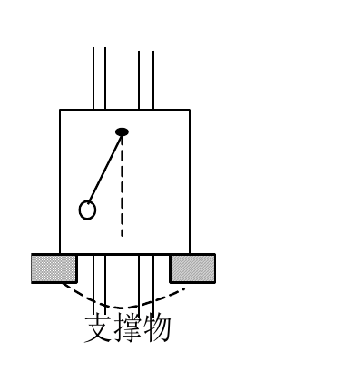
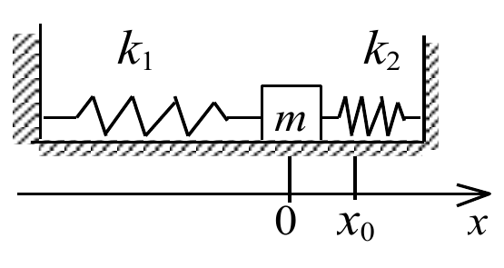
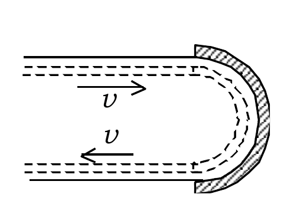
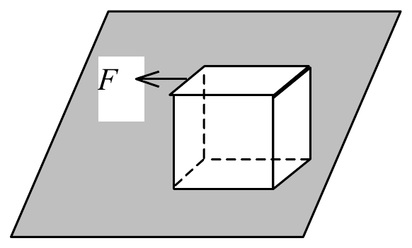
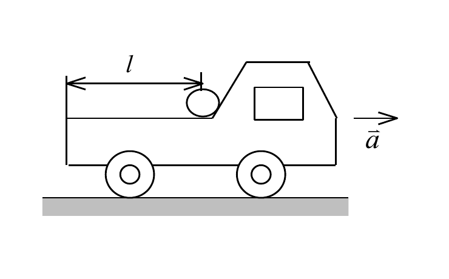
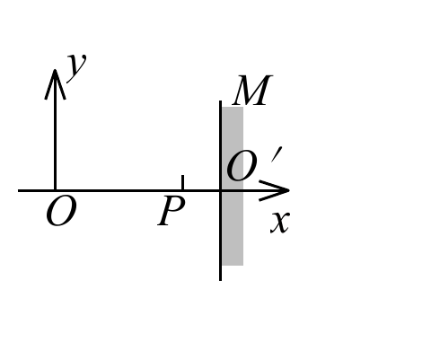

# 基础物理学A(1) 一套力学试题

## 一、选择正确答案：（每题 4 分）

1. 质量为 $m$ 的物体自空中落下，它除受重力外，还受到一个与速度平方成正比的阻力的作用，比例系数为 $k$， $k$ 为正值常量．该下落物体的收尾速度（即最后物体作匀速运动时的速度）将是（　　）。

   (A) $\sqrt{\dfrac{mg}{k}}$．　　(B) $\dfrac{g}{2k}$．　　(C) $gk$．　　(D) $\sqrt{gk}$．

2. 一单摆挂在木板的小钉上（摆球的质量 $\ll$ 木板的质量），木板可沿两根竖直且无摩擦的轨道下滑，如图．开始时木板被支撑物托住，且使单摆摆动．当摆球尚未摆到最高点时，移开支撑物，木板自由下落，则在下落过程中，摆球相对于板（　　）。

   

   (A) 作匀速率圆周运动．　　(B) 静止．

   (C) 仍作周期性摆动．　　(D) 作上述情况之外的运动．

3. 一竖直向上发射之火箭，原来静止时的初质量为 $m_0$，经时间 $t$ 燃料耗尽时的末质量为 $m$，喷气相对火箭的速率恒定为 $u$，不计空气阻力，重力加速度 $g$ 恒定．则燃料耗尽时火箭速率为（　　）。

   (A) $v=u\ln\dfrac{m_0}{m}-gt/2$．　　(B) $v=u\ln\dfrac{m}{m_0}-gt$．

   (C) $v=u\ln\dfrac{m_0}{m}+gt$．　　(D) $v=u\ln\dfrac{m_0}{m}-gt$．

4. 质量为 0.10 kg 的质点，由静止开始沿曲线 $\vec r=(5/3)t^3\,\vec i+2\,\vec j$（SI）运动，则在 $t=0$ 到 $t=2$ s 时间内，作用在该质点上的合外力所做的功为（　　）。

   (A) $5/4$ J．　　(B) $20$ J．　　(C) $75/4$ J．　　(D) $40$ J．

5. 一均匀细杆原来静止放在光滑的水平面上，现在其一端给予一垂直于杆身的水平方向的打击，此后杆的运动情况是（　　）。

   (A) 杆沿力的方向平动．

   (B) 杆绕其未受打击的端点转动．

   (C) 杆的质心沿打击力的方向运动，杆又绕质心转动．

   (D) 杆的质心不动，而杆绕质心转动．

6. 有一质量为 $M$、半径为 $R$、高为 $H$ 的匀质圆柱体，通过与其侧面上的一条母线相重合的轴的转动惯量为（　　）。

   (A) $(1/4)MR^2$．　　(B) $(1/2)MR^2$．　　(C) $(2/3)MR^2$．　　(D) $(3/2)MR^2$．

7. 如图所示，一质量为 $m$ 的滑块，两边分别与劲度系数为 $k_1$ 和 $k_2$ 的轻弹簧联接，两弹簧的另外两端分别固定在墙上．滑块 $m$ 可在光滑的水平面上滑动， $0$ 点为系统平衡位置．将滑块 $m$ 向右移动到 $x_0$，自静止释放，并从释放时开始计时．取坐标如图所示，则其振动方程为（　　）。

   

   (A) $x=x_0\cos\left[\sqrt{\dfrac{k_1+k_2}{m}}\,t\right]$．　　(B) $x=x_0\cos\left[\sqrt{\dfrac{k_1k_2}{m(k_1+k_2)}}\,t\right]$．

   (C) $x=x_0\cos\left[\sqrt{\dfrac{k_1+k_2}{m}}\,t+\pi\right]$．　　(D) $x=x_0\cos\left[\sqrt{\dfrac{k_1k_2}{m(k_1+k_2)}}\,t+\pi\right]$．

   (E) $x=x_0\cos\left[\sqrt{\dfrac{m}{k_1+k_2}}\,t\right]$．

8. 轻弹簧上端固定，下系一质量为 $m_1$ 的物体，稳定后在 $m_1$ 下边又系一质量为 $m_2$ 的物体，于是弹簧又伸长了 $\Delta x$．若将 $m_2$ 移去，并令其振动，则振动周期为（　　）。

   (A) $T=2\pi\sqrt{\dfrac{m_2\Delta x}{m_1g}}$．　　(B) $T=2\pi\sqrt{\dfrac{m_1\Delta x}{m_2g}}$．

   (C) $T=\dfrac{1}{2\pi}\sqrt{\dfrac{m_1\Delta x}{m_2g}}$．　　(D) $T=2\pi\sqrt{\dfrac{m_2\Delta x}{(m_1+m_2)g}}$．

9. 一沿 $x$ 轴传播的平面简谐波，频率为 $\nu$．其微分方程为
   $$
   \frac{\partial^2y}{\partial x^2}=\frac{1}{16}\frac{\partial^2y}{\partial t^2}\quad(\mathrm{SI}).
   $$
   则（　　）。

   (A) 波速为 16 m/s．　　(B) 波速为 1/16 m/s．

   (C) 波长为 4 m．　　(D) 波长等于 $\dfrac{4}{\nu}$（SI）．

## 二、填空题：（每题 4 分）

1. 设质点的运动学方程为 $\vec r=R\cos\omega t\,\vec i+R\sin\omega t\,\vec j$（式中 $R$、 $\omega$ 皆为常量），则质点的 $\vec v=$ \_\_\_\_\_\_\_\_， $\mathrm{d}v/\mathrm{d}t=$ \_\_\_\_\_\_\_\_．

2. 半径为 30 cm 的飞轮，从静止开始以 $0.50\ \mathrm{rad\cdot s^{-2}}$ 的匀角加速度转动，则飞轮边缘上一点在飞轮转过 $240^\circ$ 时的切向加速度 $a_t=$ \_\_\_\_\_\_\_\_，法向加速度 $a_n=$ \_\_\_\_\_\_\_\_．

3. 一质量为 $M$ 的质点沿 $x$ 轴正向运动，假设该质点通过坐标为 $x$ 的位置时速度的大小可以表示为 $kx$（ $k$ 为正值常量），那么作用于该质点上的力 $F=$ \_\_\_\_\_\_\_\_，该质点从 $x=x_0$ 点出发运动到 $x=x_1$ 处所经历的时间 $\Delta t=$ \_\_\_\_\_\_\_\_．

4. 水流流过一个固定的涡轮叶片，如图所示．水流流过叶片曲面前后的速率都等于 $v$，每单位时间流向叶片的水的质量保持不变且等于 $Q$，则水作用于叶片的力大小为 \_\_\_\_\_\_\_\_，方向为 \_\_\_\_\_\_\_\_．

   

5. 两个滑冰运动员的质量各为 70 kg，均以 6.5 m/s 的速率沿相反的方向滑行，滑行路线间的垂直距离为 10 m，当彼此交错时，各抓住一 10 m 长的绳索的一端，然后相对旋转，则抓住绳索之后各自对绳中心的角动量 $L=$ \_\_\_\_\_\_\_\_；它们各自收拢绳索，到绳长为 5 m 时，各自的速率 $v=$ \_\_\_\_\_\_\_\_．

6. 质量为 20 kg、边长为 1.0 m 的均匀立方物体，放在水平地面上．有一拉力 $F$ 作用在该物体一顶边的中点，且与包含该顶边的物体侧面垂直，如图所示．地面极粗糙，物体不可能滑动．若要使该立方体翻转 $90^\circ$，则拉力 $F$ 不能小于 \_\_\_\_\_\_\_\_．

   

7. 一根质量为 $m$、长为 $l$ 的均匀细杆，可在水平桌面上绕通过其一端的竖直固定轴转动．已知细杆与桌面的滑动摩擦系数为 $\mu$，则杆转动时受的摩擦力矩的大小为 \_\_\_\_\_\_\_\_．

8. 两个同方向同频率的简谐振动，其合振动的振幅为 20 cm，与第一个简谐振动的相位差为 $\phi-\phi_1=\pi/6$．若第一个简谐振动的振幅为 $10\sqrt{3}$ cm $=17.3$ cm，则第二个简谐振动的振幅为 \_\_\_\_\_\_\_\_ cm，第一、二两个简谐振动的相位差 $\phi_1-\phi_2$ 为 \_\_\_\_\_\_\_\_．

9. 两列振动方向互相垂直的平面简谐机械波相遇，在相遇区域内，媒质质点的运动轨迹为圆，则这两列波应满足的条件是：频率 \_\_\_\_\_\_\_\_；在各相遇点振动相位差 \_\_\_\_\_\_\_\_；振幅 \_\_\_\_\_\_\_\_．

## 三、计算题：（第一题 6 分，其它题 7 分）

1. 一个具有单位质量的质点在随时间 $t$ 变化的力 $\vec F=(3t^2-4t)\vec i+(12t-6)\vec j$（SI）作用下运动．设该质点在 $t=0$ 时位于原点，且速度为零．求 $t=2$ 秒时，该质点受到对原点的力矩和该质点对原点的角动量．

2. 将一个均匀的圆柱体放在平板卡车上，圆柱体的轴到卡车后沿的距离为 $l$，如图所示．如卡车突然以匀加速度 $\vec a$ 向前开动，圆柱体在车上只滚不滑，试以卡车为参照系进行计算，求当圆柱体刚滚下车时，卡车相对地面行驶的距离．

   

3. 如图，一角频率为 $\omega$、振幅为 $A$ 的平面简谐波沿 $x$ 轴正方向传播，设在 $t=0$ 时该波在原点 $O$ 处引起的振动使媒质元由平衡位置向 $y$ 轴的负方向运动． $M$ 是垂直于 $x$ 轴的波密媒质反射面．已知 $OO'=7\lambda/4$， $PO'=\lambda/4$（ $\lambda$ 为该波波长）；设反射波不衰减，求：

   

   (1) 入射波与反射波的表达式；

   (2) $P$ 点的振动方程．
