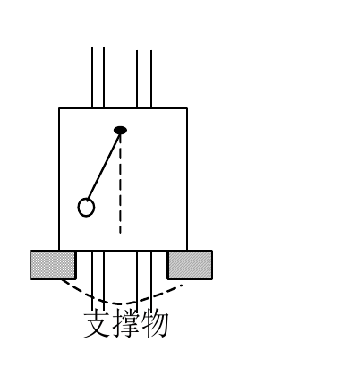
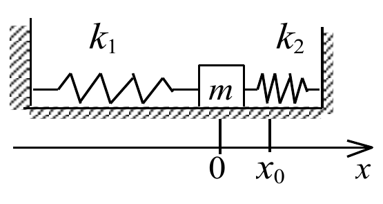
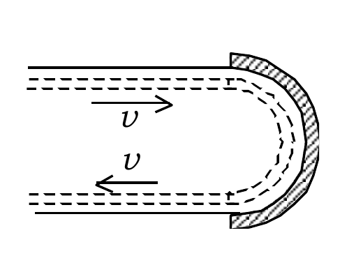
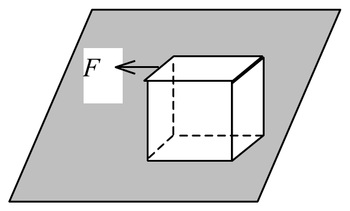
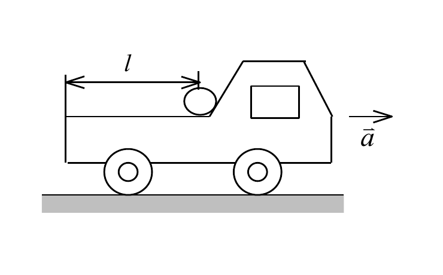
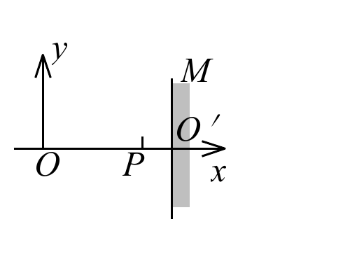

# 基础物理学A(1) 一套力学试题参考答案

## 一、选择正确答案

**答案：** 1.[A]　2.[A]　3.[D]　4.[B]　5.[C]　6.[D]　7.[A]　8.[B]　9.[D]

### 1. 收尾速度

#### 题目

质量为 $m$ 的物体自空中落下，它除受重力外，还受到一个与速度平方成正比的阻力的作用，比例系数为 $k$， $k$ 为正值常量．该下落物体的收尾速度（即最后物体作匀速运动时的速度）将是（　　）。

(A) $\sqrt{\dfrac{mg}{k}}$．　　(B) $\dfrac{g}{2k}$．　　(C) $gk$．　　(D) $\sqrt{gk}$．

#### 答案

**答案：** (A)。

匀速时 $mg=kv^2$，故 $v=\sqrt{\dfrac{mg}{k}}$。

### 2. 木板自由下落时摆球相对于板的运动

#### 题目

一单摆挂在木板的小钉上（摆球的质量 $\ll$ 木板的质量），木板可沿两根竖直且无摩擦的轨道下滑，如图．开始时木板被支撑物托住，且使单摆摆动．当摆球尚未摆到最高点时，移开支撑物，木板自由下落，则在下落过程中，摆球相对于板（　　）。

(A) 作匀速率圆周运动．　　(B) 静止．

(C) 仍作周期性摆动．　　(D) 作上述情况之外的运动．

#### 答案

**答案：** (A)。

木板自由下落，在木板参考系中重力与惯性力抵消，摆球不受回复力；摆球已有切向速度，又被摆线约束在距小钉 $l$ 处，故相对木板作匀速率圆周运动。

### 3. 火箭燃料耗尽时的速率

#### 题目

一竖直向上发射之火箭，原来静止时的初质量为 $m_0$，经时间 $t$ 燃料耗尽时的末质量为 $m$，喷气相对火箭的速率恒定为 $u$，不计空气阻力，重力加速度 $g$ 恒定．则燃料耗尽时火箭速率为（　　）。

(A) $v=u\ln\dfrac{m_0}{m}-gt/2$．　　(B) $v=u\ln\dfrac{m}{m_0}-gt$．

(C) $v=u\ln\dfrac{m_0}{m}+gt$．　　(D) $v=u\ln\dfrac{m_0}{m}-gt$．

#### 答案

**答案：** (D)。计入重力的齐奥尔科夫斯基公式 $v=u\ln\dfrac{m_0}{m}-gt$。

### 4. 合外力所做的功

#### 题目

质量为 0.10 kg 的质点，由静止开始沿曲线 $\vec r=(5/3)t^3\,\vec i+2\,\vec j$（SI）运动，则在 $t=0$ 到 $t=2$ s 时间内，作用在该质点上的合外力所做的功为（　　）。

(A) $5/4$ J．　　(B) $20$ J．　　(C) $75/4$ J．　　(D) $40$ J．

#### 答案

**答案：** (B)。

$\vec v=\dfrac{\mathrm{d}\vec r}{\mathrm{d}t}=5t^2\,\vec i$， $t=2$ s 时 $v=20\ \mathrm{m/s}$（ $y$ 方向速度恒为零）。由动能定理
$$
W=\frac{1}{2}mv^2-0=\frac{1}{2}\times0.10\times20^2=20\ \mathrm{J}.
$$

### 5. 细杆一端受打击后的运动

#### 题目

一均匀细杆原来静止放在光滑的水平面上，现在其一端给予一垂直于杆身的水平方向的打击，此后杆的运动情况是（　　）。

(A) 杆沿力的方向平动．

(B) 杆绕其未受打击的端点转动．

(C) 杆的质心沿打击力的方向运动，杆又绕质心转动．

(D) 杆的质心不动，而杆绕质心转动．

#### 答案

**答案：** (C)。

打击力的冲量使质心获得沿力方向的速度，冲量对质心的力矩又使杆绕质心转动，二者同时存在。

### 6. 匀质圆柱体对侧面母线的转动惯量

#### 题目

有一质量为 $M$、半径为 $R$、高为 $H$ 的匀质圆柱体，通过与其侧面上的一条母线相重合的轴的转动惯量为（　　）。

(A) $(1/4)MR^2$．　　(B) $(1/2)MR^2$．　　(C) $(2/3)MR^2$．　　(D) $(3/2)MR^2$．

#### 答案

**答案：** (D)。

对中心轴 $I_c=\dfrac{1}{2}MR^2$，由平行轴定理（母线与中心轴相距 $R$）
$$
I=I_c+MR^2=\frac{3}{2}MR^2 .
$$

### 7. 双弹簧滑块的振动方程

#### 题目

如图所示，一质量为 $m$ 的滑块，两边分别与劲度系数为 $k_1$ 和 $k_2$ 的轻弹簧联接，两弹簧的另外两端分别固定在墙上．滑块 $m$ 可在光滑的水平面上滑动， $0$ 点为系统平衡位置．将滑块 $m$ 向右移动到 $x_0$，自静止释放，并从释放时开始计时．取坐标如图所示，则其振动方程为（　　）。

(A) $x=x_0\cos\left[\sqrt{\dfrac{k_1+k_2}{m}}\,t\right]$．　　(B) $x=x_0\cos\left[\sqrt{\dfrac{k_1k_2}{m(k_1+k_2)}}\,t\right]$．

(C) $x=x_0\cos\left[\sqrt{\dfrac{k_1+k_2}{m}}\,t+\pi\right]$．　　(D) $x=x_0\cos\left[\sqrt{\dfrac{k_1k_2}{m(k_1+k_2)}}\,t+\pi\right]$．

(E) $x=x_0\cos\left[\sqrt{\dfrac{m}{k_1+k_2}}\,t\right]$．

#### 答案

**答案：** (A)。

滑块偏离平衡位置 $x$ 时，两弹簧的合回复力为 $-(k_1+k_2)x$，故 $\omega=\sqrt{\dfrac{k_1+k_2}{m}}$；又 $t=0$ 时 $x=x_0$、 $v=0$，初相为零，得 $x=x_0\cos\left[\sqrt{\dfrac{k_1+k_2}{m}}\,t\right]$。

### 8. 移去 $m_2$ 后的振动周期

#### 题目

轻弹簧上端固定，下系一质量为 $m_1$ 的物体，稳定后在 $m_1$ 下边又系一质量为 $m_2$ 的物体，于是弹簧又伸长了 $\Delta x$．若将 $m_2$ 移去，并令其振动，则振动周期为（　　）。

(A) $T=2\pi\sqrt{\dfrac{m_2\Delta x}{m_1g}}$．　　(B) $T=2\pi\sqrt{\dfrac{m_1\Delta x}{m_2g}}$．

(C) $T=\dfrac{1}{2\pi}\sqrt{\dfrac{m_1\Delta x}{m_2g}}$．　　(D) $T=2\pi\sqrt{\dfrac{m_2\Delta x}{(m_1+m_2)g}}$．

#### 答案

**答案：** (B)。

加 $m_2$ 后弹簧又伸长 $\Delta x$，故 $k\Delta x=m_2g$，即 $k=\dfrac{m_2g}{\Delta x}$。移去 $m_2$ 后振子质量为 $m_1$：
$$
T=2\pi\sqrt{\frac{m_1}{k}}=2\pi\sqrt{\frac{m_1\Delta x}{m_2g}} .
$$

### 9. 平面简谐波的波速与波长

#### 题目

一沿 $x$ 轴传播的平面简谐波，频率为 $\nu$．其微分方程为
$$
\frac{\partial^2y}{\partial x^2}=\frac{1}{16}\frac{\partial^2y}{\partial t^2}\quad(\mathrm{SI}).
$$
则（　　）。

(A) 波速为 16 m/s．　　(B) 波速为 1/16 m/s．

(C) 波长为 4 m．　　(D) 波长等于 $\dfrac{4}{\nu}$（SI）．

#### 答案

**答案：** (D)。

与标准形式 $\dfrac{\partial^2y}{\partial x^2}=\dfrac{1}{u^2}\dfrac{\partial^2y}{\partial t^2}$ 比较得 $u^2=16$， $u=4\ \mathrm{m/s}$，故 $\lambda=\dfrac{u}{\nu}=\dfrac{4}{\nu}$。

## 二、填空题

### 1. $\vec r=R\cos\omega t\,\vec i+R\sin\omega t\,\vec j$，求 $\vec v$ 与 $\mathrm{d}v/\mathrm{d}t$

#### 题目

设质点的运动学方程为 $\vec r=R\cos\omega t\,\vec i+R\sin\omega t\,\vec j$（式中 $R$、 $\omega$ 皆为常量），则质点的 $\vec v=$ \_\_\_\_\_\_\_\_， $\mathrm{d}v/\mathrm{d}t=$ \_\_\_\_\_\_\_\_．

#### 答案

**答案：** $\vec v=-\omega R\sin\omega t\,\vec i+\omega R\cos\omega t\,\vec j$（2 分）； $\dfrac{\mathrm{d}v}{\mathrm{d}t}=0$（2 分）。

质点作匀速率圆周运动，速率 $v=\omega R$ 为常量，故速率的变化率为零（题中第二空为 $\mathrm{d}v/\mathrm{d}t$，求的是速率的变化率而非加速度矢量）。

### 2. 飞轮边缘一点的切向、法向加速度

#### 题目

半径为 30 cm 的飞轮，从静止开始以 $0.50\ \mathrm{rad\cdot s^{-2}}$ 的匀角加速度转动，则飞轮边缘上一点在飞轮转过 $240^\circ$ 时的切向加速度 $a_t=$ \_\_\_\_\_\_\_\_，法向加速度 $a_n=$ \_\_\_\_\_\_\_\_．

#### 答案

**答案：** $a_t=0.15\ \mathrm{m\cdot s^{-2}}$（2 分）； $a_n=1.26\ \mathrm{m\cdot s^{-2}}$（2 分）。

参考解：
$$
a_t=R\beta=0.15\ \mathrm{m/s^2},\qquad
a_n=R\omega^2=R\cdot 2\beta\theta=1.26\ \mathrm{m/s^2}.
$$

### 3. $v=kx$ 的质点所受力与运动时间

#### 题目

一质量为 $M$ 的质点沿 $x$ 轴正向运动，假设该质点通过坐标为 $x$ 的位置时速度的大小可以表示为 $kx$（ $k$ 为正值常量），那么作用于该质点上的力 $F=$ \_\_\_\_\_\_\_\_，该质点从 $x=x_0$ 点出发运动到 $x=x_1$ 处所经历的时间 $\Delta t=$ \_\_\_\_\_\_\_\_．

#### 答案

**答案：** $F=Mk^2x$（2 分）； $\Delta t=\dfrac{1}{k}\ln\dfrac{x_1}{x_0}$（2 分）。

$$
a=\frac{\mathrm{d}v}{\mathrm{d}t}=\frac{\mathrm{d}v}{\mathrm{d}x}\cdot\frac{\mathrm{d}x}{\mathrm{d}t}=k\cdot kx=k^2x,
$$
故 $F=Mk^2x$；又 $\dfrac{\mathrm{d}x}{\mathrm{d}t}=kx$ 积分得 $\Delta t=\dfrac{1}{k}\ln\dfrac{x_1}{x_0}$。

### 4. 水流对涡轮叶片的作用力

#### 题目

水流流过一个固定的涡轮叶片，如图所示．水流流过叶片曲面前后的速率都等于 $v$，每单位时间流向叶片的水的质量保持不变且等于 $Q$，则水作用于叶片的力大小为 \_\_\_\_\_\_\_\_，方向为 \_\_\_\_\_\_\_\_．

#### 答案

**答案：** $2Qv$（2 分）；方向为水流入方向（2 分）。

水流经叶片后方向反向、速率不变，动量变化率为 $Qv-(-Qv)=2Qv$，故水作用于叶片的力大小为 $2Qv$，方向沿水流入方向。

### 5. 两滑冰运动员抓住绳索后的角动量与收绳后的速率

#### 题目

两个滑冰运动员的质量各为 70 kg，均以 6.5 m/s 的速率沿相反的方向滑行，滑行路线间的垂直距离为 10 m，当彼此交错时，各抓住一 10 m 长的绳索的一端，然后相对旋转，则抓住绳索之后各自对绳中心的角动量 $L=$ \_\_\_\_\_\_\_\_；它们各自收拢绳索，到绳长为 5 m 时，各自的速率 $v=$ \_\_\_\_\_\_\_\_．

#### 答案

**答案：** $L=2275\ \mathrm{kg\cdot m^2\cdot s^{-1}}$（2 分）； $v=13\ \mathrm{m\cdot s^{-1}}$（2 分）。

抓住 10 m 绳索后每人距绳中心 5 m：
$$
L=mvr=70\times6.5\times5=2275\ \mathrm{kg\cdot m^2\cdot s^{-1}} .
$$
收绳到绳长 5 m 时每人距中心 2.5 m，由角动量守恒 $2275=70\times v\times2.5$，得 $v=13\ \mathrm{m/s}$。

### 6. 使立方体翻转所需的最小拉力

#### 题目

质量为 20 kg、边长为 1.0 m 的均匀立方物体，放在水平地面上．有一拉力 $F$ 作用在该物体一顶边的中点，且与包含该顶边的物体侧面垂直，如图所示．地面极粗糙，物体不可能滑动．若要使该立方体翻转 $90^\circ$，则拉力 $F$ 不能小于 \_\_\_\_\_\_\_\_．

#### 答案

**答案：** $F=98$ N（4 分）。

以立方体底面远离拉力一侧的棱为转轴，拉力力臂为边长 1.0 m，重力力臂为半边长 0.5 m：
$$
F\times1.0=mg\times0.5=20\times9.8\times0.5\ \Rightarrow\ F=98\ \mathrm{N}.
$$

### 7. 细杆转动时的摩擦力矩

#### 题目

一根质量为 $m$、长为 $l$ 的均匀细杆，可在水平桌面上绕通过其一端的竖直固定轴转动．已知细杆与桌面的滑动摩擦系数为 $\mu$，则杆转动时受的摩擦力矩的大小为 \_\_\_\_\_\_\_\_．

#### 答案

**答案：** $\dfrac{1}{2}\mu mgl$（4 分）。

参考解：
$$
M=\int\mathrm{d}M=\int_0^l\left(\frac{\mu gm}{l}\right)r\,\mathrm{d}r=\frac{1}{2}\mu mgl .
$$

### 8. 两个同方向同频率简谐振动的合成

#### 题目

两个同方向同频率的简谐振动，其合振动的振幅为 20 cm，与第一个简谐振动的相位差为 $\phi-\phi_1=\pi/6$．若第一个简谐振动的振幅为 $10\sqrt{3}$ cm $=17.3$ cm，则第二个简谐振动的振幅为 \_\_\_\_\_\_\_\_ cm，第一、二两个简谐振动的相位差 $\phi_1-\phi_2$ 为 \_\_\_\_\_\_\_\_．

#### 答案

**答案：** 第二个振幅为 $10$ cm（2 分）； $\phi_1-\phi_2=-\dfrac{\pi}{2}$（2 分）。

由旋转矢量法， $A_1=10\sqrt3$、 $A=20$、 $\phi-\phi_1=\pi/6$，可得 $A_2=10$ cm 且 $\phi_2-\phi_1=\pi/2$，即 $\phi_1-\phi_2=-\dfrac{\pi}{2}$。

### 9. 两列互相垂直的平面简谐波使质点轨迹为圆的条件

#### 题目

两列振动方向互相垂直的平面简谐机械波相遇，在相遇区域内，媒质质点的运动轨迹为圆，则这两列波应满足的条件是：频率 \_\_\_\_\_\_\_\_；在各相遇点振动相位差 \_\_\_\_\_\_\_\_；振幅 \_\_\_\_\_\_\_\_．

#### 答案

**答案：** 频率相同（1 分）；在各相遇点振动相位差为 $\dfrac{\pi}{2}$ 或 $\dfrac{3\pi}{2}$（2 分）；振幅相同（1 分）。

## 三、计算题

### 1. 求 $t=2$ s 时质点对原点的力矩与角动量

#### 题目

一个具有单位质量的质点在随时间 $t$ 变化的力 $\vec F=(3t^2-4t)\vec i+(12t-6)\vec j$（SI）作用下运动．设该质点在 $t=0$ 时位于原点，且速度为零．求 $t=2$ 秒时，该质点受到对原点的力矩和该质点对原点的角动量．

#### 答案

**答案：** $\vec M_0=-40\vec k$（SI）； $\vec L_0=-16\vec k$（SI）。

解： $m=1$， $\vec F=m\vec a$，
$$
\vec a=(3t^2-4t)\vec i+(12t-6)\vec j .
$$
由 $\vec a=\mathrm{d}\vec v/\mathrm{d}t$ 及 $t=0$ 时 $\vec v_0=0$：（2 分）
$$
\vec v=(t^3-2t^2)\vec i+(6t^2-6t)\vec j .
$$
由 $\vec v=\mathrm{d}\vec r/\mathrm{d}t$ 及 $t=0$ 时 $\vec r_0=0$：（1 分）
$$
\vec r=\left(\frac{1}{4}t^4-\frac{2}{3}t^3\right)\vec i+(2t^3-3t^2)\vec j .
$$
当 $t=2$ s 时（2 分）
$$
\vec r=-\frac{4}{3}\vec i+4\vec j,\qquad \vec v=12\vec j,\qquad \vec F=4\vec i+18\vec j .
$$
力矩（2 分）
$$
\vec M_0=\vec r\times\vec F=\left(-\frac{4}{3}\vec i+4\vec j\right)\times(4\vec i+18\vec j)=-40\vec k .
$$
角动量（2 分）
$$
\vec L_0=\vec r\times m\vec v=\left(-\frac{4}{3}\vec i+4\vec j\right)\times12\vec j=-16\vec k .
$$

### 2. 卡车上的圆柱体只滚不滑，求卡车行驶的距离

#### 题目

将一个均匀的圆柱体放在平板卡车上，圆柱体的轴到卡车后沿的距离为 $l$，如图所示．如卡车突然以匀加速度 $\vec a$ 向前开动，圆柱体在车上只滚不滑，试以卡车为参照系进行计算，求当圆柱体刚滚下车时，卡车相对地面行驶的距离．

#### 答案

**答案：** $S=\dfrac{3}{2}l$。

解：以卡车为参考系，设圆柱体的质心加速度为 $a_c$，角加速度为 $\beta$。在水平方向上有（2 分）
$$
F^*-f=ma_c \qquad ①
$$
式中 $f$ 为摩擦力， $F^*=ma$ 为惯性力的大小。设圆柱体半径为 $R$，由转动定律得（2 分）
$$
f\cdot R=J\beta=\frac{1}{2}mR^2\beta \qquad ②
$$
$$
a_c=R\beta \qquad ③
$$
联立 ①②③ 得（1 分）
$$
a_c=\frac{2}{3}a .
$$
因 $l=\dfrac{1}{2}a_ct^2$，得 $t^2=\dfrac{3l}{a}$（1 分）。由此求出卡车在地面上运动的距离（2 分）
$$
S=\frac{1}{2}at^2=\frac{3}{2}l .
$$

### 3. 入射波、反射波表达式与 P 点振动方程

#### 题目

如图，一角频率为 $\omega$、振幅为 $A$ 的平面简谐波沿 $x$ 轴正方向传播，设在 $t=0$ 时该波在原点 $O$ 处引起的振动使媒质元由平衡位置向 $y$ 轴的负方向运动． $M$ 是垂直于 $x$ 轴的波密媒质反射面．已知 $OO'=7\lambda/4$， $PO'=\lambda/4$（ $\lambda$ 为该波波长）；设反射波不衰减，求：

(1) 入射波与反射波的表达式；

(2) $P$ 点的振动方程．

#### 答案

**答案：** 入射波 $y=A\cos\left(\omega t+\dfrac{\pi}{2}-\dfrac{2\pi}{\lambda}x\right)$；反射波 $y'=A\cos\left(\omega t+\dfrac{2\pi}{\lambda}x+\dfrac{\pi}{2}\right)$；P 点 $y_P=-2A\cos\left(\omega t+\dfrac{\pi}{2}\right)$。

解：设 $O$ 处振动方程为 $y_0=A\cos(\omega t+\phi)$。当 $t=0$ 时 $y_0=0$、 $v_0<0$，故 $\phi=\dfrac{1}{2}\pi$，
$$
y_0=A\cos\left(\omega t+\frac{\pi}{2}\right) \qquad（2\ 分）
$$
故入射波表达式为（1 分）
$$
y=A\cos\left(\omega t+\frac{\pi}{2}-\frac{2\pi}{\lambda}x\right).
$$
在 $O'$ 处入射波引起的振动方程为
$$
y_1=A\cos\left(\omega t+\frac{\pi}{2}-\frac{2\pi}{\lambda}\times\frac{7\lambda}{4}\right)=A\cos(\omega t-\pi).
$$
由于 $M$ 是波密媒质反射面， $O'$ 处反射波振动有 $\pi$ 的相位突变：（2 分）
$$
y_1'=A\cos(\omega t-\pi+\pi)=A\cos\omega t .
$$
反射波表达式（2 分）
$$
y'=A\cos\left[\omega t-\frac{2\pi}{\lambda}(OO'-x)\right]
=A\cos\left[\omega t-\frac{2\pi}{\lambda}\left(\frac{7\lambda}{4}-x\right)\right]
=A\cos\left(\omega t+\frac{2\pi}{\lambda}x+\frac{\pi}{2}\right).
$$
合成波为（2 分）
$$
y=y+y'=A\cos\left(\omega t-\frac{2\pi}{\lambda}x+\frac{\pi}{2}\right)+A\cos\left(\omega t+\frac{2\pi}{\lambda}x+\frac{\pi}{2}\right)
=2A\cos\frac{2\pi}{\lambda}x\cos\left(\omega t+\frac{\pi}{2}\right).
$$
将 P 点坐标 $x=\dfrac{7}{4}\lambda-\dfrac{1}{4}\lambda=\dfrac{3}{2}\lambda$ 代入，得 P 点的振动方程（1 分）
$$
y_P=-2A\cos\left(\omega t+\frac{\pi}{2}\right).
$$
