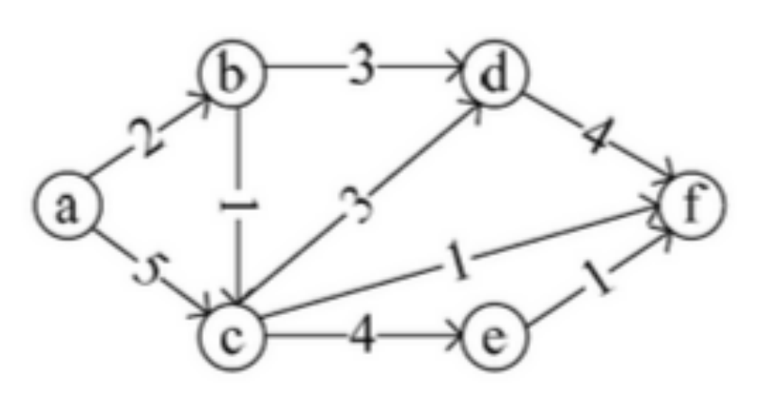
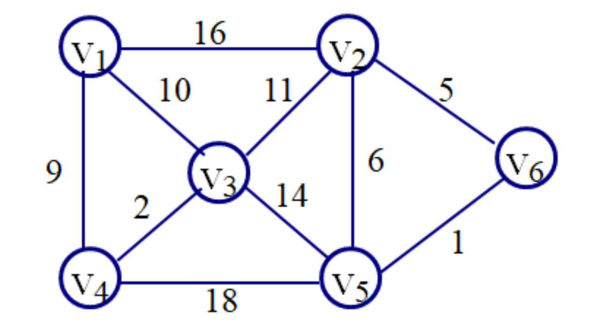
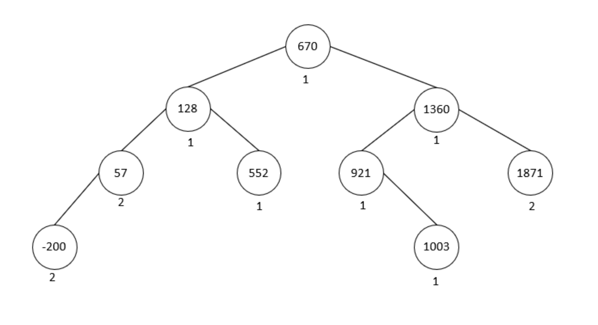

# 数据结构 2021–2022 学年第二学期期末试卷参考答案

## 一、选择题

### 1. 已知二叉树的前序序列为：ABDFGCEHJIK，中序序列为：BFDGAJHEIKC，则其后序序列为

#### 题目

已知二叉树的前序序列为：ABDFGCEHJIK，中序序列为：BFDGAJHEIKC，则其后序序列为：

(A) KIJHECGFDBA　(B) GDFBCKIEHJA　(C) FGDBJHKIECA　(D) JHIKEFFGDBA

#### 答案

**答案：** (C)。按前序与中序还原，后序序列为左子树 FGDB + 右子树 JHKIEC + 根 A，即 FGDBJHKIECA，共 11 个结点，与选项 (C) 一致。

### 2. 一有向带权图如下图所示，若采用迪杰斯特拉（Dijkstra）算法求源点 a 到其他各顶点的最短路径，得到的第一条最短路径的目标顶点是 b，后续得到的其余各最短路径的目标顶点依次是（　　）

#### 题目

一有向带权图如下图所示，若采用迪杰斯特拉（Dijkstra）算法求源点 a 到其他各顶点的最短路径，得到的第一条最短路径的目标顶点是 b，后续得到的其余各最短路径的目标顶点依次是（　　）。



(A) c,d,e,f　(B) c,e,d,f　(C) c,f,e,d　(D) c,f,d,e

#### 答案

**答案：** (D)。各顶点最短距离依次为 b=2、c=3、f=4、d=5、e=7，故 b 之后依次为 c、f、d、e。

### 3. 若有以下说明和语句，则以下对结构变量 std 中成员 no 的引用方式正确的是（　　）

#### 题目

若有以下说明和语句：

```c
struct student{
    int age;
    int no;
};

struct student std, *p;
p = &std;
```

则以下对结构变量 `std` 中成员 `no` 的引用方式正确的是（　　）。

(A) `std->no`　(B) `p->no`　(C) `(*std).no`　(D) `*p.no`

#### 答案

**答案：** (B)。std 是结构变量，用 `.` 取成员；p 是指向结构的指针，用 `->` 取成员。

### 4. 下列说法中，错误的是（　　）

#### 题目

下列说法中，错误的是（　　）。

(A) 无向图的邻接矩阵一定是一个对称矩阵。

(B) 若有向图采用邻接表的存储方式，则其第 i 个链表中边结点个数是第 i 个顶点的出度。

(C) 对于给定的带权连通无向图，从某源点到图中各顶点的最短路径构成的生成树一定是该图的最小生成树。

(D) 包含具有 n 个顶点的连通图 G 的全部 n 个顶点，仅包含其 n-1 条边的极小连通子图称为 G 的一个生成树。

#### 答案

**答案：** (C)。单源最短路径树只保证根到各顶点路径最短，其边权总和不一定最小，不等于最小生成树。

### 5. 有一无向图 G=(V,E)，其中：V={a,b,c,d,e,f}，E={(a,b),(a,e),(a,c),(b,d),(c,f),(f,d),(e,c)}，则下面的顶点序列中，是该图深度优先遍历的一个正确的输出序列是（　　）

#### 题目

有一无向图 G=(V,E)，其中：V={a,b,c,d,e,f}，E={(a,b),(a,e),(a,c),(b,d),(c,f),(f,d),(e,c)}，则下面的顶点序列中，是该图深度优先遍历的一个正确的输出序列是（　　）。

(A) a,b,e,c,d,f　　(B) a,c,f,e,b,d

(C) a,e,b,f,c,b　　(D) a,e,c,f,d,b

#### 答案

**答案：** (D)。a→e、e→c、c→f、f→d、d→b 相邻接且恰好访问 6 个顶点各一次；(A) 中 b→e、(B) 中 f→e、(C) 中 e→b 都不是该图的边。

### 6. 下列排序方法中，稳定的排序方法是（　　）

#### 题目

下列排序方法中，稳定的排序方法是（　　）。

(A) 选择排序　(B) 快速排序　(C) 冒泡排序　(D) 堆排序

#### 答案

**答案：** (C)。选择排序、快速排序、堆排序都不稳定，冒泡排序稳定。

### 7. 若用一个大小为 20 的数组（下标从 0 开始）来实现循环队列，且当前 rear 和 front 的值分别为 18 和 10，当从队列中出队两个元素，再入队五个元素后，rear 和 front 的值分别为（　　）

#### 题目

若用一个大小为 20 的数组（下标从 0 开始）来实现循环队列，且当前 rear 和 front 的值分别为 18 和 10，当从队列中出队两个元素，再入队五个元素后，rear 和 front 的值分别为（　　）。

(A) 3 和 12　(B) 12 和 3　(C) 0 和 15　(D) 15 和 0

#### 答案

**答案：** (A)。出队两个元素后 front=(10+2)%20=12，入队五个元素后 rear=(18+5)%20=3。

### 8. 设 p 指针指向单链表（单链表长度为 n）中的某个结点（p≠NULL），若只知道指向该单链表第一个结点的指针和 p 指针，则在 p 指针所指结点之前和 p 指针所指结点之后插入一个结点的时间复杂度分别是（　　）

#### 题目

设 p 指针指向单链表（单链表长度为 n）中的某个结点（p≠NULL），若只知道指向该单链表第一个结点的指针和 p 指针，则在 p 指针所指结点之前和 p 指针所指结点之后插入一个结点的时间复杂度分别是（　　）。

(A) O(1) 和 O(n)　(B) O(n) 和 O(1)　(C) O(n) 和 O(n)　(D) O(1) 和 O(1)

#### 答案

**答案：** (B)。在 p 之前插入需从头遍历找 p 的前驱，为 O(n)；在 p 之后插入只需改指针，为 O(1)。

### 9. 若在有序序列中采用折半查找方法进行查找，用来描述该查找过程的“判定树”的形状与（　　）有关

#### 题目

若在有序序列中采用折半查找方法进行查找，用来描述该查找过程的“判定树”的形状与（　　）有关。

(A) 序列中元素的值　(B) 序列中元素的排列次序　(C) 序列中元素的类型　(D) 序列中元素的个数

#### 答案

**答案：** (D)。折半查找判定树由序列长度唯一确定，与元素的具体取值、类型无关。

### 10. 在建立散列表时，若散列函数为 H(k)，a 与 b 分别为关键字值，则当（　　）时，称此现象为散列冲突

#### 题目

在建立散列表时，若散列函数为 H(k)，a 与 b 分别为关键字值，则当（　　）时，称此现象为散列冲突。

(A) a==b　(B) a!=b　(C) a==b 且 H(a)==H(b)　(D) a!=b 且 H(a)==H(b)

#### 答案

**答案：** (D)。不同关键字映射到同一散列地址才叫冲突。

## 二、填空题

### 1. 若一棵深度为 7 的完全二叉树的第 7 层有 15 个叶结点（根结点在第 1 层），则该二叉树所有叶结点的个数为 \_\_\_

#### 题目

若一棵深度为 7 的完全二叉树的第 7 层有 15 个叶结点（根结点在第 1 层），则该二叉树所有叶结点的个数为 \_\_\_。

#### 答案

**答案：** 39。第 1–6 层为满二叉树共 63 个结点，第 7 层 15 个结点；第 6 层 32 个结点中有 8 个有孩子，故第 6 层叶结点 24 个，叶结点总数 24+15=39。

### 2. 对于上图所示的无向连通图，若采用普里姆（Prim）算法求其最小生成树，假设第一个选择加入最小生成树的顶点为 V2，则最后一条加入最小生成树的边的权值为 \_\_\_

#### 题目

对于上图所示的无向连通图，若采用普里姆（Prim）算法求其最小生成树，假设第一个选择加入最小生成树的顶点为 V2，则最后一条加入最小生成树的边的权值为 \_\_\_。



#### 答案

**答案：** 9。Prim 依次加入 V2–V6(5)、V6–V5(1)、V2–V3(11)、V3–V4(2)、V4–V1(9)。

### 3. 若一二叉树中有 20 个叶子结点，则其度为 2 的结点 \_\_\_ 个

#### 题目

若一二叉树中有 20 个叶子结点，则其度为 2 的结点 \_\_\_ 个。

#### 答案

**答案：** 19。二叉树中叶结点数 n0 与度为 2 的结点数 n2 满足 n0=n2+1。

### 4. 倘若输入的序列是 e8,e4,e2,e5,e3,e9,e1,e6,e7，如果使用多个队列，使其出队的序列为 e1,e2,e3,e4,e5,e6,e7,e8,e9，则至少需要 \_\_\_ 个这样的队列

#### 题目

倘若输入的序列是 e8,e4,e2,e5,e3,e9,e1,e6,e7，如果使用多个队列，使其出队的序列为 e1,e2,e3,e4,e5,e6,e7,e8,e9，则至少需要 \_\_\_ 个这样的队列。（要求：输入的元素可以选择进入任何一个队列，但是每个队列都需要遵循先入先出的原则。）

#### 答案

**答案：** 4。

### 5. 表达式 (a+b)/c-(d-e)*f 的后缀表达式是 \_\_\_

#### 题目

表达式 (a+b)/c-(d-e)*f 的后缀表达式是 \_\_\_。

#### 答案

**答案：** ab+c/de-f*-。

### 6. 如果用 push 表示进栈操作，用 pop 表示出栈操作，已知元素的进栈顺序为 e1,e2,e3,e4,e5，为了得到 e2,e4,e5,e3,e1 的出栈顺序，相应的入栈和出栈操作应为 \_\_\_

#### 题目

如果用 push 表示进栈操作，用 pop 表示出栈操作，已知元素的进栈顺序为 e1,e2,e3,e4,e5，为了得到 e2,e4,e5,e3,e1 的出栈顺序，相应的入栈和出栈操作应为 \_\_\_。（用 push 和 pop 表示，用英文逗号分割，例如：push,push,pop,pop）

#### 答案

**答案：** push,push,pop,push,push,pop,push,pop,pop,pop。

### 7. 若有一单链表，定义其结点的结构类型名为 struct node，其中指向下一结点的指针为 link；下面定义一递归函数实现该链表的删除操作（即：删除整个链表的所有结点），形参为链表头指针，请将语句补充完整

#### 题目

若有一单链表，定义其结点的结构类型名为 `struct node`，其中指向下一结点的指针为 link；下面定义一递归函数实现该链表的删除操作（即：删除整个链表的所有结点），形参为链表头指针，请将语句补充完整：

```c
void delete(struct node *head){
    if(head!=NULL) {
        delete(_____________);
        free(head);
    }
}
```

#### 答案

**答案：** `head->link`。

### 8. 具有 30 个顶点的无向图采用邻接矩阵表示（两顶点间有边用 1 表示，无边用 0 表示），若该图为连通图，则其邻接矩阵中至少有 \_\_\_ 个非零元素

#### 题目

具有 30 个顶点的无向图采用邻接矩阵表示（两顶点间有边用 1 表示，无边用 0 表示），若该图为连通图，则其邻接矩阵中至少有 \_\_\_ 个非零元素。

#### 答案

**答案：** 58。连通图至少有 29 条边，邻接矩阵中每条边对应 2 个非零元素。

### 9. 给定一组权值：{1,2,3,4,4,5,6}，以这些权值作为叶结点构造哈夫曼树，其带权路径长度为 \_\_\_

#### 题目

给定一组权值：{1,2,3,4,4,5,6}，以这些权值作为叶结点构造哈夫曼树，其带权路径长度为 \_\_\_。

#### 答案

**答案：** 67。依次合并 1+2=3、3+3=6、4+4=8、5+6=11、6+8=14、11+14=25，带权路径长度为各非叶结点权值之和 3+6+8+11+14+25=67。

### 10. 有如下定义，若要将三角形 tr 的顶点 b 的 x 坐标设置为 1.5，请将该赋值语句补充完整

#### 题目

有如下定义：

```c
struct point{
    float x,y;
};
struct triangle{
    struct point a,b,c;
}tr;
```

若要将三角形 tr 的顶点 b 的 x 坐标设置为 1.5，请将该赋值语句补充完整：\_\_\_=1.5；

#### 答案

**答案：** `tr.b.x`，即 `tr.b.x=1.5;`。

## 三、编程题

### 编程题 1. 汉明距离（hamming.c）

#### 题目

##### 【问题描述】

在信息论中，两个等长字符串之间的汉明距离（Harmming Distance）是指两个字符串中对应位置的不同字符的个数（区分大小写）。换句话说，它就是将一个字符串变换成另外一个字符串所需要替换的字符个数。例如：10110101 与 11011101 的汉明距离为 3，roses 与 cotes 的汉明距离为 2。从标准输入中输入一组等长字符串，以第一个字符串为基准，统计其与其它字符串的汉明距离，并按汉明距离由小至大输出字符串对及其汉明距离。

##### 【输入形式】

首先从标准输入读入字符串的个数 n（2<=n<=16），然后分行读入 n 个等长的字符串（长度小于等于 16）。

##### 【输出形式】

将结果输出到标准输出，具体要求如下：

1、以第一个字符串为基准，按汉明距离由小至大的顺序分行输出字符串对及其汉明距离；字符串及其汉明距离间都以一个空格分隔。

2、若汉明距离相同，则按照字符串对中第二个字符串的字典序（由小到大）输出；由于要区分大小写，故字典序是指字符的 ASCII 码序。

##### 【样例输入】

```text
5
roses
cotes
Roses
coset
rotes
```

##### 【样例输出】

```text
roses Roses 1
roses rotes 1
roses coset 2
roses cotes 2
```

##### 【样例说明】

输入了 5 个长度为 5 的字符串；第一个字符串 roses 与其它字符串的汉明距离为 1 或 2；先输出汉明距离为 1 的字符串对，而且按字典序 Roses 小于 rotes，故先输出 roses 和 Roses 的汉明距离。

##### 【评分标准】

题目要求计算输出第一个字符串与其它字符串之间的汉明距离，提交程序名为 hamming.c。

#### 答案

**答案：** 以第一个字符串为基准，统计它与第 2–n 个字符串的汉明距离，再按「距离升序、距离相同按第二个字符串 ASCII 序升序」排序输出。

##### 实现一：结构体数组加 qsort

用结构体数组记录第 2–n 个字符串及其与第一个字符串的汉明距离，再用 `qsort` 按「距离升序、距离相同按第二个字符串 ASCII 序升序」排序输出。

```c
# include <stdio.h>
# include <string.h>
# include <stdlib.h>

struct result {
    int distance;
    char word[20];
};
struct result result[20];   // 存储结果

int calculate(char *s1, char *s2);
int cmp(const void *e1, const void *e2);

int main()
{
    int n;
    scanf("%d", &n);

    char standard_string[20];   // 第一个字符串
    char tmp_string[20];   // 后面的字符串的缓冲区
    scanf("%s", standard_string);   // 先把第一个字符串读进来

    for (int i = 0; i < n - 1; i++) {    // 注意i不是从0开始了（第一个字符串已经被读进来了）
        scanf("%s", tmp_string);    // 把字符串读到缓冲区
        result[i].distance = calculate(standard_string, tmp_string);   // 计算该字符串和第一个字符串之间的汉明距离
        strcpy(result[i].word, tmp_string);
    }

    qsort(result, n - 1, sizeof(result[0]), cmp);   // 排序
    for (int i = 0; i < n - 1; i++) {     // 打印输出
        printf("%s %s %d\n", standard_string, result[i].word, result[i].distance);
    }
    return 0;
}

int calculate(char *s1, char *s2)   // 计算两等长字符串的汉明距离
{
    int res = 0;
    for (int i = 0; s1[i]; i++) {
        if ((s1[i] != s2[i])) {
            res++;
        }
    }
    return res;
}

int cmp(const void *e1, const void *e2)
{
    struct result *a = (struct result*) e1;
    struct result *b = (struct result*) e2;
    if (a -> distance != b -> distance) {
        return a -> distance - b -> distance;
    }
    return strcmp(a -> word, b -> word);
}
```

##### 实现二：二维字符数组加下标冒泡排序

用二维字符数组存全部字符串，另开距离数组与下标数组，对下标做冒泡排序；相邻比较时先比距离，距离相同再比第二个字符串的 ASCII 序。

```c
#include <stdio.h>
#include <string.h>

#define MAXN 16
#define MAXL 17

int main(void)
{
    int n, i, j, t;
    char s[MAXN][MAXL];
    int d[MAXN], idx[MAXN];

    scanf("%d", &n);
    for (i = 0; i < n; i++)
        scanf("%s", s[i]);

    /* 以第一个字符串为基准，统计与第 2..n 个字符串的汉明距离 */
    for (i = 1; i < n; i++) {
        d[i] = 0;
        for (j = 0; s[0][j] != '\0'; j++)
            if (s[0][j] != s[i][j])
                d[i]++;
        idx[i] = i;
    }

    /* 按汉明距离升序、距离相同按第二个字符串 ASCII 序升序排序 */
    for (i = 1; i < n - 1; i++) {
        for (j = 1; j < n - i; j++) {
            if (d[idx[j]] > d[idx[j + 1]] ||
                (d[idx[j]] == d[idx[j + 1]] &&
                 strcmp(s[idx[j]], s[idx[j + 1]]) > 0)) {
                t = idx[j];
                idx[j] = idx[j + 1];
                idx[j + 1] = t;
            }
        }
    }

    for (i = 1; i < n; i++)
        printf("%s %s %d\n", s[0], s[idx[i]], d[idx[i]]);

    return 0;
}
```

### 编程题 2. 二叉搜索树（bst.c）

#### 题目

##### 【问题描述】

编写程序读入一组整数，按输入顺序构造一棵二叉查找树（BST 树）来查找并统计相应整数的出现次数，BST 树的构造规则如下：

1、在输入整数过程中按照左子结点值小于根结点值、右子结点值大于根结点值的方式构造一棵 BST 树；

2、输入的整数等于 BST 树中某结点值时，该结点的出现次数加 1。

示例详见下面的样例。

对于最终构建的 BST 树，要求统计如下数据：

1、在 BST 树的创建及查找整数过程中总的比较次数，仅统计输入的整数与结点值进行比较的次数，不统计指针的判断次数；

2、出现次数最多的整数的比较路径；比较路径是指 BST 树中从根结点到该节点的路径；若出现次数最多的整数有多个，则只输出按照前序遍历次序访问的第一个出现次数最多的整数的比较路径。

##### 【输入形式】

先从控制台输入整数的个数 n（大于等于 1），然后在下一行输入 n 个整数，以一个空格分隔各个整数。

##### 【输出形式】

先向控制台输出在 BST 树的创建及查找整数过程中总的比较次数，然后在下一行输出按照前序遍历次序访问的第一个出现次数最多的整数的比较路径，用该路径上各结点对应的整数表示，各整数间以一个空格分隔，最后一个整数后有无空格均可。

##### 【样例输入】

```text
12
670 1360 1871 921 128 1871 57 -200 1003 552 -200 57
```

##### 【样例输出】

```text
26
670 128 57
```

##### 【样例说明】

输入了 12 个整数，根据上述构造规则，建立的 BST 树如下图所示：



其中结点中的值为输入的整数值，结点下方的数值为该整数出现的次数。

开始 BST 树为空，第一个整数 670 作为根结点，没有与结点值进行比较，比较次数为 0；第二个整数 1360 与结点 670 比较了 1 次；第三个整数 1871 与结点 670 和结点 1360 各比较了 1 次；第六个整数 1871 与结点 670、1360 和 1871 各比较了 1 次；其它整数与上述整数类同；在该 BST 树的创建及查找整数过程中总的比较次数为 26 次。

在该 BST 树中，出现次数最多的整数有三个，分别为 1871、57 和 -200，其中按照前序遍历次序访问到的第一个为 57，所以要输出结点 57 的比较路径，即从根结点 670 到结点 57 的路径。

##### 【评分标准】

该题要求根据输入的整数构建 BST 树，并统计总的比较次数和出现次数最多的整数的比较路径，提交程序名为 bst.c。

#### 答案

**答案：** 三种实现都分两步：先按输入顺序建 BST 树，累计输入整数与结点值的比较次数；再前序遍历，找到第一个出现次数最多的结点，输出从根结点到它的路径。

##### 实现一：三叉链表，沿双亲指针回溯

用三叉链表（结点含双亲指针）建树，找到目标结点后沿双亲指针回溯打印路径：

```c
# include <stdio.h>
# include <string.h>
# include <stdlib.h>

typedef struct node{
    int data_num;     // 数据域
    int occurence_number;      // 出现次数
    struct node *lchild;
    struct node *rchild;
    struct node *parent;       // 双亲结点的地址
} node;

int cmp_time;   // 总比较次数
int max_time;   // 最多次数
int flag;

node* insert(node *root, node *par, int index);
void preorder(node *root, node **target);
void print_path(node *target);

int main()
{
    max_time = 1;
    node *root = NULL;
    int n;
    int tmp;
    scanf("%d", &n);
    for (int i = 0; i < n; i++) {
        scanf("%d", &tmp);
        root = insert(root, NULL, tmp);   // 插入树
    }
    printf("%d\n", cmp_time);
    node *target;
    preorder(root, &target);     // 找到目标结点
    print_path(target);     // 打印该结点路径

    return 0;
}

node* insert(node *root, node *par, int index)
{
    if (root == NULL) {
        root = (node*) malloc(sizeof(node));
        root -> data_num = index;
        root -> occurence_number = 1;
        root -> lchild = root -> rchild = NULL;
        root -> parent = par;
        return root;
    }
    // 接下来的每一种情况都要把cmp_num加一
    if (index < root -> data_num) {
        cmp_time++;
        root -> lchild = insert(root -> lchild, root, index);
    } else if (index > root -> data_num) {
        cmp_time++;
        root -> rchild = insert(root -> rchild, root, index);
    } else {
        cmp_time++;
        root -> occurence_number++;
        if (root -> occurence_number > max_time) {
            max_time = root -> occurence_number;
        }
    }
    return root;
}

void preorder(node *root, node **target)
{
    if (!flag) {
        if (root -> occurence_number == max_time) {
            flag = 1;
            *target = root;
        }
        if (root -> lchild != NULL) {
            preorder(root -> lchild, target);
        }
        if (root -> rchild != NULL) {
            preorder(root -> rchild, target);
        }
    }
}

void print_path(node *target)
{
    if (target == NULL) return;
    print_path(target -> parent);
    printf("%d ", target -> data_num);
}
```

##### 实现二：二叉链表，前序遍历时用数组记录路径

用普通二叉链表，在前序遍历过程中用数组动态记录到当前结点为止的路径，找到目标结点时记下路径长度：

```c
# include <stdio.h>
# include <string.h>
# include <stdlib.h>

typedef struct node{
    int data_num;       // 数据域
    int occurence_number;        // 出现次数
    struct node *lchild;
    struct node *rchild;
} node;

int cmp_time;   // 总比较次数
int max_time;   // 最多次数
int flag;
int path[20];    // 路径
int path_len;   // 路径长度

node* insert(node *root, int index);
void preorder(node *root, int height);
void print_path(node *target);

int main()
{
    max_time = 1;
    node *root = NULL;
    int n;
    int tmp;
    scanf("%d", &n);
    for (int i = 0; i < n; i++) {
        scanf("%d", &tmp);
        root = insert(root, tmp);   // 插入树
    }
    printf("%d\n", cmp_time);
    preorder(root, 0);     // 找到目标结点

    for (int i = 0; i < path_len; i++) {     // 输出路径前path_len位
        printf("%d ", path[i]);
    }
    return 0;
}

node* insert(node *root, int index)
{
    if (root == NULL) {
        root = (node*) malloc(sizeof(node));
        root -> data_num = index;
        root -> occurence_number = 1;
        root -> lchild = root -> rchild = NULL;
        return root;
    }
    // 接下来的每一种情况都要把cmp_num加一
    if (index < root -> data_num) {
        cmp_time++;
        root -> lchild = insert(root -> lchild, index);
    } else if (index > root -> data_num) {
        cmp_time++;
        root -> rchild = insert(root -> rchild, index);
    } else {
        cmp_time++;
        root -> occurence_number++;
        if (root -> occurence_number > max_time) {
            max_time = root -> occurence_number;
        }
    }
    return root;
}

void preorder(node *root, int height)
{
    if (!flag) {
        if (root == NULL) return;     // 遍历到头了

        path[height] = root -> data_num;
        if (root -> occurence_number == max_time) {   // 找到目标结点了
            flag = 1;
            path_len = height + 1;
            return;
        }

        preorder(root -> lchild, height + 1);
        preorder(root -> rchild, height + 1);
    }
}
```

##### 实现三：二叉链表，插入用循环实现

插入时用循环而非递归，前序遍历时同样用数组记录当前路径，命中出现次数最多的结点时把路径整体复制保存。

```c
#include <stdio.h>
#include <stdlib.h>

#define MAXN 1000

struct node {
    int val;
    int cnt;
    struct node *left, *right;
};

struct node *root = NULL;
long total = 0;          /* 总比较次数 */

void insert(int v)
{
    struct node *p, *q;

    if (root == NULL) {                 /* 第一个整数作根结点，不比较 */
        root = (struct node *)malloc(sizeof(struct node));
        root->val = v;
        root->cnt = 1;
        root->left = root->right = NULL;
        return;
    }

    p = root;
    while (p != NULL) {
        total++;                        /* 与当前结点值比较一次 */
        if (v == p->val) {
            p->cnt++;
            return;
        }
        q = p;
        p = (v < p->val) ? p->left : p->right;
    }

    p = (struct node *)malloc(sizeof(struct node));
    p->val = v;
    p->cnt = 1;
    p->left = p->right = NULL;
    if (v < q->val)
        q->left = p;
    else
        q->right = p;
}

int maxcnt = 0;
int path[MAXN], plen = 0;
int best[MAXN], blen = 0;

void preorder(struct node *p)
{
    int i;

    if (p == NULL)
        return;

    path[plen++] = p->val;
    if (p->cnt > maxcnt) {              /* 前序遍历中第一个出现次数最多的结点 */
        maxcnt = p->cnt;
        blen = plen;
        for (i = 0; i < plen; i++)
            best[i] = path[i];
    }
    preorder(p->left);
    preorder(p->right);
    plen--;
}

int main(void)
{
    int n, i, v;

    scanf("%d", &n);
    for (i = 0; i < n; i++) {
        scanf("%d", &v);
        insert(v);
    }

    printf("%ld\n", total);

    preorder(root);
    for (i = 0; i < blen; i++)
        printf("%d%c", best[i], (i == blen - 1) ? '\n' : ' ');

    return 0;
}
```

### 编程题 3. 解释系统（inter.c）

#### 题目

##### 【问题描述】

有一 min 解释语言，其只有整型常量、变量、赋值语句、算术表达式语句及打印语句组成。编写一程序，实现该系统。

规则：

1. 变量仅由单个小写字母组成。

2. 只有三种语句：print、exit 和赋值语句。一行只有一个语句，语句中的字符个数不会超过 200，每条语句的末尾都有换行符。语句格式为：

   a) 赋值语句：`<变量> = <算术表达式>`。`<算术表达式>` 是由十进制整型常量（末尾不带后缀）、变量、算术运算符（+, -, *, /）及小括号组成；赋值语句中没有空白符。

   b) print 语句：`print <变量列表>`。`<变量列表>` 为由空格分隔的变量序列，print 和变量间由空格分隔。功能是输出变量列表中各变量的值。

   c) exit 语句：`exit`。退出解释系统。

3. 在进行赋值运算、算术运算、打印输出时，相应变量都会有具体值，不会出现语法错误。在计算过程中结果数据类型为浮点型，输出时保留小数点后 2 位。

##### 【输入形式】

从标准输入读入解释系统的待执行语句，每条语句独占一行；最后一条语句为 exit。注意：所有输入中出现的常量都是不带后缀的十进制整数常量。

##### 【输出形式】

在解释系统执行过程中，每条 print 语句执行后，print 后各变量的值将会输出到标准输出，输出时保留小数点后 2 位，各数据间以一个空格分隔，最后一个数据后没有空格，有换行符。

##### 【样例输入和输出】

```text
a=10
b=20
c=(a+b)/4
print a b c
10.00 20.00 7.50
d=a*(b-c)
print d
125.00
exit
```

##### 【样例说明】

第一条语句将 10 赋值给变量 a；第二条语句将 20 赋值给变量 b；第三条语句需要先计算表达式 (a+b)/4 的值，然后将结果赋值给变量 c，这时 c 的值为 7.50；第四条语句要打印变量 a、b 和 c 的值，于是下一行便会输出当前 a、b 和 c 的值，分别为 10.00、20.00 和 7.50；第五条语句需要先计算表达式 a*(b-c) 的值，然后将结果赋值给变量 d，这时 d 的值为 125.00；第六条语句要打印变量 d 的值，于是在下一行输出 125.00；第七条语句为 exit，执行后退出解释系统。

##### 【评分标准】

该题要求实现解释系统的语句读入和执行，提交程序名为 inter.c。

#### 答案

**答案：** 变量只有单个小写字母，用 `double variable[26]` 存值；三类语句靠第二个字符是否为 `'='`、是否等于 `exit` 区分；表达式求值仍是计算器问题，先转后缀表达式再求值，只是遇到小写字母时取变量当前值当作浮点数。

##### 实现一：中缀转后缀表达式后求值

先把中缀表达式转成后缀表达式，再对后缀表达式求值。

```c
# include <stdio.h>
# include <string.h>

typedef struct {
    int type;     // 记录是数还是操作符的标识。0为数，1为操作符
    union {
        double num;
        char op;
    } data;
} node;

node representation[100];      // 记录后缀表达式
char opera[100];       // 操作符缓冲区
double variable[26];      // 记录变量的值

int ishigh(char c1,char c2);
int change(char *str);
double calculate(char *str, int rep_num);

int main()
{
    char buf[100];      // 每一行语句的缓冲区
    while (gets(buf) != NULL) {
        if (buf[1] == '=') {      // 是赋值语句
            // 计算表达式的值，并赋值给变量
            int rep_num = change(buf + 2);
            variable[buf[0] - 'a'] = calculate(buf + 2, rep_num);
        } else if (strcmp(buf, "exit") == 0) {     // 退出
            break;
        } else {     // print语句
            for (int i = 6; buf[i]; i++) {
                if (buf[i] >= 'a' && buf[i] <= 'z') {
                    printf("%.2lf ", variable[buf[i] - 'a']);
                }
            }
            printf("\n");
        }
    }
    return 0;
}

int ishigh(char c1,char c2)      //判断加减乘除运算符的优先级
{
    int a1,a2;
    if(c1=='+'||c1=='-')a1=0;
    else a1 = 1;
    if(c2=='+'||c2=='-')a2=0;
    else a2 = 1;
    if(a1>=a2)return 1;
    return 0;
}

int change(char *str)      // 转化为后缀表达式
{
    int rep_num = 0;      // 记录表达式有多少位
    int op_num = 0;
    int tmp = 0;       // 暂存数字
    int flag = 0;      // 当前是否是数字的标识

    for (int i = 0; str[i]; i++) {
        if (str[i] >= '0' && str[i] <= '9') {       // 当前这位是数字
            if (flag) {        // 前面已经有数字了
                tmp = tmp * 10 + str[i] - '0';
            } else {
                flag = 1;
                tmp = str[i] - '0';
            }
        } else if (str[i] >= 'a' && str[i] <= 'z') {        // 当前这位是变量
            representation[rep_num].type = 0;
            representation[rep_num++].data.num = variable[str[i] - 'a'];
        } else {       // 当前这位是操作符
            if (flag) {        // 如果前面是数字
                representation[rep_num].type = 0;
                representation[rep_num++].data.num = tmp;
                flag = 0;
                tmp = 0;
            }

            //左右括号特判
            if(str[i]=='('){
                opera[op_num++] = str[i];
                continue;
            }
            if(str[i] == ')'){
                while(opera[op_num - 1] != '(') {
                    representation[rep_num].type = 1;
                    representation[rep_num++].data.op = opera[op_num - 1];
                    op_num--;
                }
                op_num--;
                continue;
            }

            // 当前位是加减整除运算符，先将opera中优先级高于自己的操作符出栈
            while(op_num != 0 && ishigh(opera[op_num - 1], str[i]) && opera[op_num-1] != '(') {
                // ishigh函数判断加减乘除四个运算符的优先级
                representation[rep_num].type = 1;
                representation[rep_num++].data.op = opera[op_num - 1];
                op_num--;
            }
            opera[op_num++] = str[i];//该操作符入栈
        }
    }

    if (flag) {       // 如果前面是数字，输出出来
        representation[rep_num].type = 0;
        representation[rep_num++].data.num = tmp;
        flag = 0;
        tmp = 0;
    }
    // 最后将栈清空输出到逆波兰表达式中
    for(int i = op_num - 1; i >= 0; i--) {
        representation[rep_num].type = 1;
        representation[rep_num++].data.op = opera[i];
    }
    return rep_num;
}

double calculate(char *str, int rep_num)    // 计算表达式的值
{
    //求解逆波兰表达式
    double stack[1024] = {0};    //栈
    int stack_num = 0;
    for(int j = 0; j < rep_num; j++) {
        if(representation[j].type == 0) {    //该位是数字，直接入栈
            stack[stack_num++] = representation[j].data.num;
        }else {    //该位是操作符
            switch (representation[j].data.op){
                case '+':
                    stack[stack_num-2] = stack[stack_num-2] + stack[stack_num-1];
                    stack_num--;
                    break;
                case '-':
                    stack[stack_num-2] = stack[stack_num-2] - stack[stack_num-1];
                    stack_num--;
                    break;
                case '*':
                    stack[stack_num-2] = stack[stack_num-2] * stack[stack_num-1];
                    stack_num--;
                    break;
                case '/':
                    stack[stack_num-2] = stack[stack_num-2] / stack[stack_num-1];
                    stack_num--;
                    break;
            }
        }
    }
    return stack[0];
}
```

##### 实现二：递归下降直接求值

按表达式文法用递归下降直接求值，不显式构造后缀表达式；读入用 fgets，print 语句逐个变量输出并自行控制分隔空格。

```c
#include <stdio.h>
#include <string.h>
#include <ctype.h>

double var[26];
char line[256];
int pos;

double expr(void);
double term(void);

double factor(void)
{
    double v = 0.0;

    if (line[pos] == '-') {             /* 一元负号 */
        pos++;
        return -factor();
    }
    if (line[pos] == '+') {
        pos++;
        return factor();
    }
    if (line[pos] == '(') {
        pos++;
        v = expr();
        if (line[pos] == ')')
            pos++;
        return v;
    }
    if (islower((unsigned char)line[pos])) {
        v = var[line[pos] - 'a'];
        pos++;
        return v;
    }
    while (isdigit((unsigned char)line[pos])) {
        v = v * 10 + (line[pos] - '0');
        pos++;
    }
    return v;
}

double term(void)
{
    double v, r;
    char op;

    v = factor();
    while (line[pos] == '*' || line[pos] == '/') {
        op = line[pos++];
        r = factor();
        if (op == '*')
            v *= r;
        else
            v /= r;
    }
    return v;
}

double expr(void)
{
    double v, r;
    char op;

    v = term();
    while (line[pos] == '+' || line[pos] == '-') {
        op = line[pos++];
        r = term();
        if (op == '+')
            v += r;
        else
            v -= r;
    }
    return v;
}

int main(void)
{
    int n, i, first;
    char name;

    while (fgets(line, sizeof(line), stdin) != NULL) {
        n = (int)strlen(line);
        while (n > 0 && (line[n - 1] == '\n' || line[n - 1] == '\r'))
            line[--n] = '\0';

        if (strcmp(line, "exit") == 0)
            break;

        if (strncmp(line, "print", 5) == 0) {
            first = 1;
            for (i = 5; line[i] != '\0'; i++) {
                if (line[i] == ' ')
                    continue;
                if (!first)
                    putchar(' ');
                printf("%.2f", var[line[i] - 'a']);
                first = 0;
            }
            putchar('\n');
            continue;
        }

        name = line[0];                 /* 赋值语句：变量 = 算术表达式 */
        pos = 2;                        /* 跳过 "x=" */
        var[name - 'a'] = expr();
    }

    return 0;
}
```
