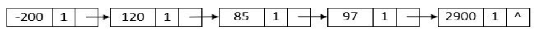
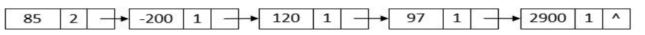
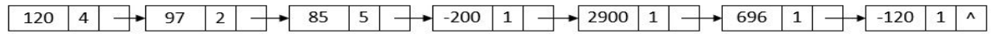

# 数据结构 2022–2023 学年第二学期期中试卷

> 卷首说明：选择填空题共 10 道，每道 0.5 分；第一道编程题 15 分，第二道编程题 10 分；共 30 分。注意：填空题答案中不得有空格，选择题答案只填大写或小写字母，不得有括号等其它字符。

## 一、选择题（共 7 题，每题 0.5 分）

1. 若有语句 `int *point, a=4;` 和 `point=&a;`，下面均代表地址的一组选项是（　　）。

   (A) `a`，`point`，`*&a`　(B) `&(*a)`，`&a`，`*point`　(C) `*(&point)`，`*point`，`&a`　(D) `&a`，`&(*point)`，`point`

2. 若有以下说明和语句：

   ```c
   struct student
   {
       int age;
       int num;
   }std, *p;
   p = &std;
   ```

   则以下对结构变量 `std` 中成员 `age` 的引用方式不正确的是（　　）。

   (A) `std.age`　(B) `p->age`　(C) `(*p).age`　(D) `*p.age`

3. 设 p 指针指向单链表（单链表长度为 n）中的某个结点（p≠NULL），若只知道指向该单链表第一个结点的指针和 p 指针，则在 p 指针所指结点之前和 p 指针所指结点之后插入一个结点的时间复杂度分别是（　　）。

   (A) O(1) 和 O(n)　(B) O(1) 和 O(1)　(C) O(n) 和 O(n)　(D) O(n) 和 O(1)

4. 【单选题】设某一非空的单循环链表的头指针（指向第一个结点的指针）为 Head，尾指针（指向最后一个结点的指针）为 Rear，则下列条件判断结果一定为真的是（　　）。

   (A) `Head==Rear->link`　(B) `Head==Rear->link->link`

   (C) `Rear==Head->link`　(D) `Rear==Head->link->link`

5. 若要删除非空线性链表中由 p 所指的链结点的直接后继链结点（由 `p->link` 指向），则需依次执行（　　）。

   (A) `r=p->link; p->link=r; free(r);`

   (B) `r=p->link; p->link=r->link; free(r);`

   (C) `r=p->link; p->link=r->link; free(p);`

   (D) `p->link=p->link->link; free(p);`

6. 【单选题】下列语句中，能正确进行字符串赋值的是（　　）。

   (A) `char s[10]; s="BUAA";`　(B) `char* sp; *sp="BUAA";`

   (C) `char *sp="BUAA";`　(D) `char s[10]; *s="BUAA";`

7. 若线性表最常用的运算是存取第 i 个元素及其前驱的值，则采用（　　）存储方式节省时间。

   (A) 单链表　(B) 双链表　(C) 顺序表　(D) 循环单链表

## 二、填空题（共 3 题，每题 0.5 分）

1. 若有函数定义为：

   ```c
   int func(int n)
   {
       if(n<=1)
           return 1;
       else
           return (2+n*func(n-1));
   }
   ```

   假设 m 为 int 类型，则执行语句 `m=func(5);` 后，m 的值为：\_\_\_。

2. 若有如下定义：

   ```c
   char *pls[1000], buf[512];
   int i=0;
   ```

   下面的语句是按行从标准输入读入一篇文章（每行字符数少于 511，行数少于 1000）保存到 pls 中，并且要求**尽可能节省空间**，请将语句补充完整：

   ```c
   while(fgets(buf,512,stdin)!=NULL){
       pls[i]=(char*)malloc( _______________________ );
       strcpy(pls[i],buf);
       i++;
   }
   ```

3. 有如下定义：

   ```c
   struct point{
       float x,y;
   };
   struct triangle{
       struct point a,b,c;
   }tr;
   ```

   若要将三角形 tr 的顶点 b 的 x 坐标设置为 1.5，请将该赋值语句补充完整：\_\_\_=1.5；

## 三、编程题

### 编程题 1. 密码对应表（15 分）

#### 【问题描述】

有一种加密方法为：其使用一个字符串（可以含重复字母，字符个数不超过 50）作为密钥。例如：若密钥字符串为 Fea25Ther，则需要先将大写字母转换成小写字母，并去掉密钥单词中的非字母及重复字母得到单词串 feathr，然后将其反序，最后将字母表中的其它字母以反序追加到后面：

```text
r h t a e f z y x w v u s q p o n m l k j i g d c b
```

加密字母的对应关系如下：

```text
a b c d e f g h i j k l m n o p q r s t u v w x y z
r h t a e f z y x w v u s q p o n m l k j i g d c b
```

编写程序根据输入的密钥，生成相应的密码对应表串。

#### 【输入形式】

从标准输入读入密钥字符串（字符个数不超过 50，其中可包含空白符或其它非字母字符），末尾有换行符（不属于密钥字符串）。

#### 【输出形式】

先向控制台输出原字母表，然后在下一行输出生成的对应密码表。

#### 【样例输入】

```text
Fea25Ther
```

#### 【样例输出】

```text
abcdefghijklmnopqrstuvwxyz
rhtaefzyxwvusqponmlkjigdcb
```

#### 【样例说明】

输入的密钥字符串为 Fea25Ther，先将大写字母转换成小写字母，并去掉密钥单词中的非字母及重复字母得到单词串 feathr，然后将其反序，最后将字母表中的其它字母以反序追加到后面，便得到密码表。

#### 【评分标准】

该题要求生成密码对应表，提交程序名为：key.c。

### 编程题 2. 基于前移法的链表查找（10 分）

#### 【问题描述】

链表结构存在一个严重不足，就是需要顺序查找才能找到所需要的元素，查找性能低，下面为一个改进链表查找效率的方法。链表构造规则如下：

1、初始时链表为空；

2、若元素不在链表中，将其加到链表尾；

3、若元素在链表中，则将该元素移到链表头（若元素已在链表头则不移动）。

编写程序，对输入的一组整数，依次在上述规则构建的链表中查找每个整数。假如依次输入了 15 个整数，分别为：-200 120 85 97 2900 85 696 -120 85 120 85 120 85 97 120，前五个数据输入后，构建的链表如下所示：



结点中前面的数据表示输入的整数，后面的数据是该整数的出现次数。输入第六个数据后，构建的链表如下所示：



所有整数输入完毕后，构建的链表如下所示：



#### 【输入形式】

先从控制台读取整数的个数 n（n>0），然后在下一行输入 n 个整数，各整数间以一个空格分隔，输入的整数不会超过 int 的表示范围。

#### 【输出形式】

先输出创建链表时总的整数比较次数，然后依次分行输出链表中前五个整数及其出现次数（整数和出现次数间以一个空格分隔）；若链表中结点的个数少于五个，则按照实际结点个数输出。

#### 【样例输入】

```text
15
-200 120 85 97 2900 85 696 -120 85 120 85 120 85 97 120
```

#### 【样例输出】

```text
41
120 4
97 2
85 5
-200 1
2900 1
```

#### 【样例说明】

输入了 15 个整数；按照上述链表创建规则，输入第一个整数后，没有比较整数，这时总的比较次数为 0；输入第五个整数后，整数比较次数为 14；输入第六个整数后，整数比较次数为 17；所有整数输入完毕后，总的比较次数为 41，这时整数 120 位于链表头，出现了 4 次。

#### 【评分标准】

该题要求按照改进的链表查找整数，提交程序名为 link.c。
