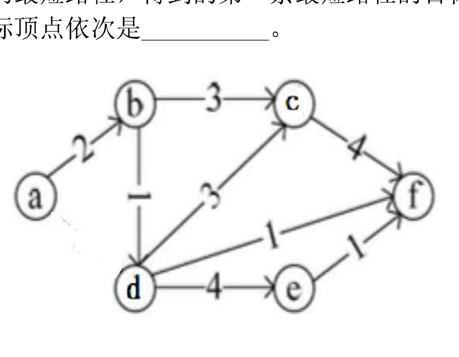
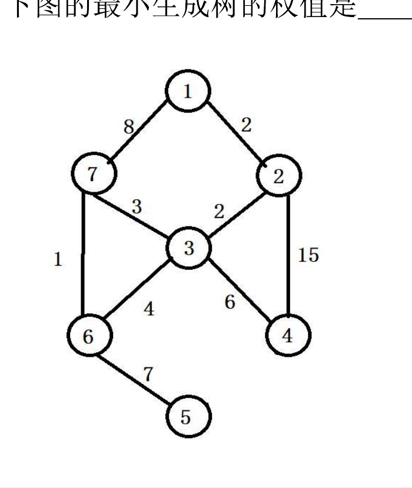
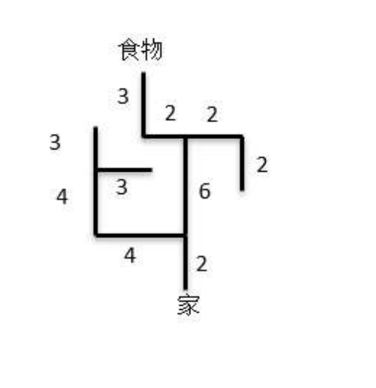
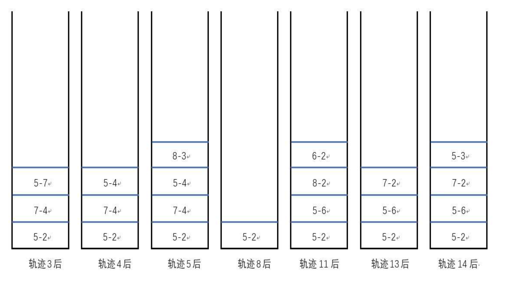

# 数据结构 2022–2023 学年第二学期期末试卷

> 注意：填空题答案中不得有空格，选择题答案只填大写或小写字母，不得有括号等其它字符！

## 一、单选题（总分 5.00）

1. 一棵满二叉树有 m 个树枝，n 个结点，其深度为 h，则\_\_\_\_\_\_。

   (A) $n=h+m$　(B) $h+m=2n$　(C) $m=h-1$　(D) $n=2^{h}-1$

2. 栈和队列的共同点是\_\_\_\_\_\_。

   (A) 都是先进先出　(B) 都是先进后出　(C) 只允许在端点处插入和删除元素　(D) 没有共同点

3. 某栈的输入序列为 25, 30, 7, 10，下面的四个序列中，\_\_\_\_\_\_不可能是它的输出序列。

   (A) 10, 7, 25, 30　(B) 30, 7, 10, 25　(C) 25, 7, 30, 10　(D) 7, 10, 30, 25

4. 若对序列 (2, 12, 16, 70, 5, 10) 按值从小到大进行排序，前三趟排序的结果分别为：

   第 1 趟排序的结果：(2, 12, 16, 70, 5, 10)，

   第 2 趟排序的结果：(2, 5, 16, 70, 12, 10)，

   第 3 趟排序的结果：(2, 5, 10, 70, 12, 16)

   则由此可以断定，该排序过程采用的排序方法是\_\_\_\_\_\_。

   (A) 快速排序　(B) 选择排序　(C) 插入排序　(D) 冒泡排序

5. 若在有序序列中采用折半查找方法进行查找，用来描述该查找过程的“判定树”的形状与\_\_\_\_\_\_有关。

   (A) 序列中元素的排列次序　(B) 序列中元素的值　(C) 序列中元素的个数　(D) 序列中元素的类型

6. 下列排序方法中，不稳定的排序方法是\_\_\_\_\_\_。

   (A) 冒泡排序　(B) 归并排序　(C) 快速排序　(D) 插入排序

7. 具有 n 个顶点的无向图用邻接矩阵表示，若该图为连通图，则其邻接矩阵中至少有\_\_\_\_\_\_个非零元素。

   (A) 2*(n-1)　(B) n-1　(C) n*n　(D) n*(n-1)

8. 有一无向图 G=(V,E)，其中：V={a,b,c,d,e,f}，E={(a,b), (a,e), (a,c), (b,d), (c,f), (f,d), (e,c)}，则下面的顶点序列中，\_\_\_\_\_\_是该图深度优先遍历的一个正确的输出序列。

   (A) a,b,e,c,d,f　(B) a,c,f,e,b,d　(C) a,e,b,f,c,b　(D) a,e,c,f,d,b

9. 在堆排序中，基于关键字序列 6,9,1,5,8,4,7 建立初始大顶堆 H，得到的 H 是\_\_\_\_\_\_。

   (A) 9,8,7,6,5,4,1　(B) 9,8,7,5,4,1,6　(C) 9,8,7,5,6,4,1　(D) 9,6,7,5,8,4,1

10. 一有向带权图如下图所示，若采用迪杰斯特拉（Dijkstra）算法求源点 a 到其他各顶点的最短路径，得到的第一条最短路径的目标顶点是 b，后续得到的其余各最短路径的目标顶点依次是\_\_\_\_\_\_。

    

    (A) d,c,e,f　(B) d,e,c,f　(C) d,f,e,c　(D) d,f,c,e

## 二、填空题（总分 10.00）

1. 一棵完全二叉树，第 6 层的叶子结点个数为 20，该数最多有\_\_\_\_\_\_个结点。

2. 若用一个大小为 10 的数组（下标从 0 开始）来实现循环队列，且当前 rear 和 front 的值分别为 1 和 4，当从队列中出队一个元素，再入队两个元素后，rear 和 front 的值分别为\_\_\_\_\_\_和\_\_\_\_\_\_。

3. 设栈 S 和队列 Q 的初始状态为空，元素 e1、e2、e3、e4、e5 和 e6 依次进栈 S，一个元素出栈后即进队列 Q，若 6 个元素出队的序列是 e2、e4、e3、e6、e5、e1，则栈 S 的容量至少应该是\_\_\_\_\_\_。

4. 设有一组记录的关键字为（19, 16, 23, 1, 68, 20, 84, 27, 55, 11, 10, 81），利用散列存储，地址空间范围为 [0...12]，散列函数为 H(key)=key MOD 13，利用链地址法解决散列冲突，则散列地址为 3 的链表中有\_\_\_\_\_\_个链结点。

5. 对序列进行从小到大排序，若序列的原始状态为 1,2,3,4,5,10,6,7,8,9，要想使得排序过程中元素的比较次数最少，应该采用\_\_\_\_\_\_方法。

6. 若以 {3, 7, 2, 9, 18, 4} 作为叶子结点的权值构造哈夫曼树，则其带权路径长度是\_\_\_\_\_\_。

7. 已知二叉树的中序序列为：BADCE，后序序列为：BDECA，则其前序序列为：\_\_\_\_\_\_。

8. 已知一个有向图，其共有 10 个顶点，则其最多有\_\_\_\_\_\_条边。

9. 下图的最小生成树的权值是\_\_\_\_\_\_。

   

10. 一棵 5 阶 B-树，除根结点以外的其它分支结点中最少有\_\_\_\_\_\_个关键字。

## 三、编程题（总分 35.00）

### 1. 查找同时空人员（分值 15.00）

#### 【问题描述】

假设一共 6 个手机基站，都具有记录手机连接基站状态的能力，当手机进入和离开基站固定范围后，基站将及时记录手机的连接信息：

1、约定基站覆盖范围不存在重合，也就是同一个手机在同一时间内只会处于一个基站覆盖范围内；

2、同一个手机在同一个基站上多次连续登录，属于正常情况，说明该手机不断出入该基站的覆盖范围。

编写程序，读入某一天多个基站的手机登录日志信息（服务商提供的日志信息是按手机进入基站的时间排好序，详见样例输入）和一个要查找的人员手机号，查找与该人员同时空人员的手机号（即与该手机号基站相同且进入与离开时间有重叠的手机号；若一手机号的进入时间与另一手机号的离开时间完全相同，两手机号也算有重叠。）。输出与指定手机号有时空重叠的手机号及所在基站。

基站的手机登录日志信息包括：手机号（11 位的数字，按字符串处理）、基站编号（一共 6 个基站，分别用大写字母 A、B、C、D、E、F 表示）、登录时间和登出时间（用长度为 6 的数字串表示，例如：093756，表示 9 时 37 分 56 秒）。

#### 【输入形式】

先输入手机登录日志信息的条数（小于 1000 条），然后按上述格式分行输入手机登录日志信息，手机号、基站编号、登录时间和登出时间之间以一个空格分隔。

#### 【输出形式】

按照手机号由大至小进行排序，分行输出与指定手机号有时空重叠的手机号及所在基站编号，手机号与基站编号之间以一个空格分隔。手机号相同时按基站字母序排序输出。

#### 【样例输入】

```text
28
18222336979 F 060201 063539
18222336979 B 063601 063802
18222336979 C 063806 064607
18222336979 D 064615 065816
18222336979 A 065827 160003
18222336979 D 160013 161605
18222336979 C 161617 162633
18222336979 B 162702 172333
13810013509 C 080005 092537
13810013509 A 100356 124732
13810013509 C 125021 161619
13810013509 F 162315 163857
13810013509 B 163901 205602
13810013509 C 210509 230108
13810013509 D 230901 232556
13557912211 B 060615 080239
13557912211 E 120507 150309
13557912211 C 162633 163621
13557912211 B 163855 172209
13557912211 D 200609 230901
13985992766 A 070000 120203
13985992766 F 130506 160000
13985992766 B 160102 161503
13985992766 C 161617 163058
13985992766 E 163302 180709
13985992766 D 190005 200729
15857596331 D 000201 235051
13877882206 C 003123 220806
13557912211
```

#### 【样例输出】

```text
18222336979 B
18222336979 C
15857596331 D
13985992766 C
13985992766 D
13877882206 C
13810013509 B
13810013509 D
```

#### 【样例说明】

先输入 28 条手机登录基站的日志信息，然后输入手机号 13557912211，表示要查找与该手机号同时空的手机号。该手机号首先在 6 点 6 分 15 秒登录 B 基站，在 8 点 2 分 39 秒登出 B 基站，在这个时间段内只有手机号 18222336979 存在重叠；指定手机号登录登出过 E 基站，但没有存在重叠的手机号；指定手机号在 C 基站与 3 个手机号发生重叠，其余重叠情况类似。按照这些手机号由大至小进行排序，分行输出与指定手机号有时空重叠的手机号及所在基站编号，手机号相同时按基站字母序排序输出。

#### 【评分标准】

该题要求查找与指定手机号同时空的手机号，提交程序名为 same.c。

### 2. 老鼠回家-无回路（分值 12.00）

#### 【问题描述】

老鼠离家去找食物，要经过不断探索才能找到食物。某老鼠非常聪明，在原路返回时能够避免找食物时多走的冤枉路，找到直接回家的路。

编写程序，读入该老鼠找食物过程中的轨迹记录，然后分析出其原路回家的最佳路径（即：走过的路，但不包括冤枉路）。在此冤枉路指的是原路返回的路；而且假设老鼠走过的路不会形成环。

算法提示：使用栈保存老鼠走过的轨迹：每当读入老鼠新的轨迹时，检查栈顶元素，判断新轨迹能否与栈顶轨迹抵消（全部或部分），然后进行入栈或出栈操作，示例见样例说明。

#### 【输入形式】

输入为一系列老鼠轨迹。老鼠轨迹以行进方向和步数对来表示。行进方向包括：5-上、6-下、7-左、8-右，步数为一个整数值，行进方向和步数为 0 时表示输入结束。例如：5-4，表示向上行进 4 步，5 和 4 之间为英文减号“-”。各行进步数间以一个空格分隔。最后的 0-0 后为换行符。老鼠行走的总步数不超过 1000 步。



以上图为例（图中数字为路的长度，以老鼠的步数为单位），老鼠从家开始找食物的轨迹输入如下：

```text
5-2 7-4 5-7 6-3 8-3 7-3 6-4 8-4 5-6 8-2 6-2 5-2 7-4 5-3 0-0
```

#### 【输出形式】

按照上述要求输出老鼠从食物回家的最佳路径，输出格式同输入，最后一步后有无空格均可。

#### 【样例输入】

```text
5-2 7-4 5-7 6-3 8-3 7-3 6-4 8-4 5-6 8-2 6-2 5-2 7-4 5-3 0-0
```

#### 【样例输出】

```text
6-3 8-2 6-8
```

#### 【样例说明】

老鼠从家出发，开始向上走，前 3 次轨迹后栈的状态如下图所示；轨迹 4 因为是往下走 3 步，与栈顶的往上走 7 步（5-7）相比较，属于原路返回的路，可以从栈顶轨迹中核减掉，结果如下图所示；轨迹 6、7、8 都是往回走，结果如下图所示；其它轨迹类似，轨迹 14 后找到食物，最后输出原路回家的最佳路径，既将栈中的轨迹反向输出（部分轨迹要合并）。



#### 【评分标准】

该题要求找到回家的最佳路径，提交程序名为 path.c。

### 3. 文件拷贝（分值 8.00）

#### 【问题描述】

假设已有一个文件目录和一组带有全目录路径的文件，请将该组文件按下面规则拷贝到已有文件目录中，并按要求输出拷贝后的文件目录：

1. 若相应目录下无给定文件，则将该文件直接拷贝到相应目录下；
2. 若相应目录下有给定同名文件且拷贝入文件比原有文件日期较新，则用新文件覆盖已有同名文件，否则不执行任何操作；
3. 若相应目录中无给定文件目录路径上的某个子目录，则在当前目录相应目录下创建相应子目录及文件。

假设要拷贝的文件根目录与已有文件根目录是相同的。

例如：若已有下图所示目录（文件名下方数字是其日期时间）：

```text
D:
├── data
├── doc
│   ├── temp
│   └── work
│       ├── data.xls    202206211925
│       ├── report.ppt  202203260918
│       └── temp
│           └── plan.doc  202206051202
└── temp
    ├── plan.doc  202206051202
    └── test.c    202206120912
```

要拷贝的一组文件（文件名后为相应文件日期时间）如下所示：

```text
D:\doc\test\test.c 202205181107
D:\doc\work\data.xls 202206230907
D:\doc\work\temp\plans.doc 202206171705
D:\temp\plan.doc 202206171502
D:\doc\work\report.ppt 202203250830
D:\doc\work\math.doc 202207021506
```

按上面规则文件拷贝后目录如下图所示：

```text
D:
├── data
├── doc
│   ├── temp
│   ├── test
│   │   └── test.c     202205181107
│   └── work
│       ├── data.xls   202206230907
│       ├── math.doc   202207021506
│       ├── report.ppt 202203260918
│       └── temp
│           ├── plan.doc  202206051202
│           └── plans.doc 202206171705
└── temp
    ├── plan.doc  202206171502
    └── test.c    202206120912
```

#### 【输入形式】

目录以下面形式给出：a₁(a₁₁,a₁₂,a₁₃,……,a₁ₙ)，表中 a₁ 是根目录编号，括号中每个元素，可以是一个具体文件编号，也可以是以同样方式定义的一个子目录编号。例如，下面方式：1(2(4),3(5(7,8,9),6)) 则表示了如下目录树：

```text
        1
       / \
      2   3
     /   / \
    4   5   6
       /|\
      7 8 9
```

其中 1 为根结点目录编号，其有 2 个编号为 2 和 3 的子目录，而编号为 2 的子目录有一个编号为 4 的子目录或文件，以此类推。任一结点的子结点个数不超过 100 个。所有编号大于等于 1 且小于等于 1000，编号在一个目录树中是惟一的。

以上面形式定义的一个已有目录树保存在当前目录下的文件 in.txt 中，目录树中的字符都是英文字符，字符数不超过 5000，只包含数字、小括号和逗号；在目录树后，in.txt 分行保存目录树中每个结点编号所对应的文件名（不超过 20 个字符）、文件属性（1 表示目录，0 表示普通文件）和日期时间（文件用 12 位数字串表示，目录没有时间，用英文减号字符“-”表示），各数据间以 1 个空格分隔。

从标准输入读入要拷贝的文件数目，然后分行读入每个文件的全路径信息和日期时间（两者之间以一个空格分隔），最后一个文件信息后也有换行符。

#### 【输出形式】

按层次遍历序分行输出拷贝后目录树中的文件及相应日期时间，同一层的按文件名的字典序输出，若同一层的文件名也相同，则按照时间序输出。注意只输出普通文件信息，不输出目录信息。

#### 【样例输入】

in.txt 文件内容如下：

```text
100(25,32(18,1(26,37,66(17))),101(2,3))
100 D: 1 -
101 temp 1 -
2 plan.doc 0 202206051202
3 test.c 0 202206120912
25 data 1 -
32 doc 1 -
18 temp 1 -
1 work 1 -
26 data.xls 0 202206211925
37 report.ppt 0 202203260918
66 temp 1 -
17 plan.doc 0 202206051202
```

标准输入如下：

```text
6
D:\doc\test\test.c 202205181107
D:\doc\work\data.xls 202206230907
D:\doc\work\temp\plans.doc 202206171705
D:\temp\plan.doc 202206171502
D:\doc\work\report.ppt 202203250830
D:\doc\work\math.doc 202207021506
```

#### 【样例输出】

```text
plan.doc 202206171502
test.c 202206120912
data.xls 202206230907
math.doc 202207021506
report.ppt 202203260918
test.c 202205181107
plan.doc 202206051202
plans.doc 202206171705
```

#### 【样例说明】

根据 in.txt 文件中输入的目录树和文件目录信息，可以生成如上面第一张图所示的文件目录；将标准输入中读入的 6 个文件拷贝到该文件目录后，状态如上面第二张图所示，最后将其中的文件信息按层次输出到标准输出。

#### 【评分标准】

该题要求将指定的文件拷贝到文件目录中，提交程序名为 copy.c。
