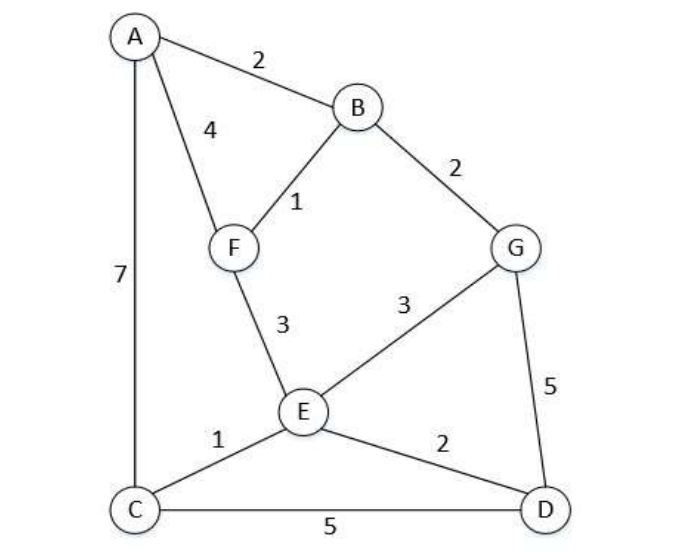
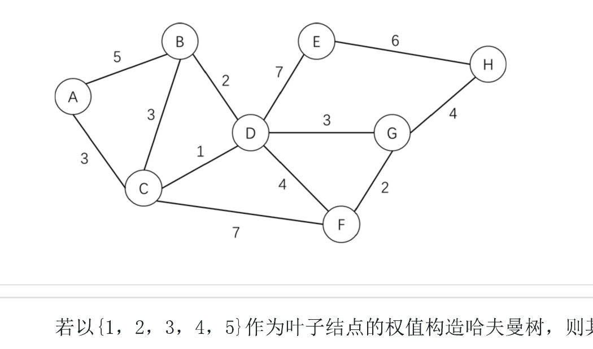

# 数据结构 2023–2024 学年第二学期期末试卷参考答案

## 一、单选题

### 1. 对非空二叉查找树进行\_\_\_\_\_\_，将一定得到一个有序序列

#### 题目

对非空二叉查找树进行\_\_\_\_\_\_，将一定得到一个有序序列。

(A) 前序遍历　(B) 中序遍历　(C) 后序遍历　(D) 层次遍历

#### 答案

**答案：** (B)。

### 2. 在建立散列表时，若散列函数为 H(k)，a 与 b 分别为关键字值，则当\_\_\_\_\_\_时，称此现象为散列冲突

#### 题目

在建立散列表时，若散列函数为 H(k)，a 与 b 分别为关键字值，则当\_\_\_\_\_\_时，称此现象为散列冲突。

(A) a=b　(B) a≠b　(C) a=b 且 H(a)=H(b)　(D) a≠b 且 H(a)=H(b)

#### 答案

**答案：** (D)。

### 3. 若采用 Dijkstra 算法求下图中顶点 A 到其他顶点的最短路径，最短路径数组为 Path，Path[v] 表示顶点 v 在最短路径上的直接前驱顶点，那么最终求得的 Path[E] 为\_\_\_\_\_\_

#### 题目

若采用 Dijkstra 算法求下图中顶点 A 到其他顶点的最短路径，最短路径数组为 Path，Path[v] 表示顶点 v 在最短路径上的直接前驱顶点，那么最终求得的 Path[E] 为\_\_\_\_\_\_。



(A) C　(B) D　(C) F　(D) G

#### 答案

**答案：** (C)。各顶点最短距离为 B=2、F=3、G=4、E=6、C=7、D=8，E 的最短路径为 A→B→F→E，故 Path[E]=F。

### 4. 栈和队列的共同点是\_\_\_\_\_\_

#### 题目

栈和队列的共同点是\_\_\_\_\_\_。

(A) 都是先进先出　(B) 都是先进后出　(C) 只允许在端点处插入和删除元素　(D) 没有共同点

#### 答案

**答案：** (C)。

### 5. 下面关于 m 阶 B-树说法正确的是\_\_\_\_\_\_

#### 题目

下面关于 m 阶 B-树说法正确的是\_\_\_\_\_\_。

①每个结点至少有两棵非空子树；　②树中每个结点至多有 m-1 个关键字；

③所有叶子在同一层上；　④当插入一个数据项引起结点分裂后，树长高一层。

(A) ①②③　(B) ②③　(C) ②③④　(D) ③

#### 答案

**答案：** (B)。①错误（非根结点至少有 ⌈m/2⌉ 棵子树）；④错误（只有根结点分裂才会使树长高）。

### 6. 利用堆排序算法进行从小到大排序，建立的初始大顶堆为 (15, 12, 7, 10, 5, 1, 3, 9)，进行第一趟堆排序并将前面七个元素调整成大顶堆后得到的结果为\_\_\_\_\_\_

#### 题目

利用堆排序算法进行从小到大排序，建立的初始大顶堆为 (15, 12, 7, 10, 5, 1, 3, 9)，进行第一趟堆排序（即：第一个元素和最后一个元素交换）并将前面七个元素调整成大顶堆后得到的结果为\_\_\_\_\_\_。

(A) 12, 9, 7, 10, 5, 1, 3, 15　(B) 9, 12, 7, 10, 5, 1, 3, 15

(C) 12, 10, 7, 9, 5, 1, 3, 15　(D) 12, 7, 9, 10, 5, 1, 3, 15

#### 答案

**答案：** (C)。首尾交换后为 9,12,7,10,5,1,3,15；9 与较大孩子 12 交换得 12,9,7,10,5,1,3,15；9 再与较大孩子 10 交换得 12,10,7,9,5,1,3,15。

### 7. 下列关于树的叙述中，正确的是\_\_\_\_\_\_

#### 题目

下列关于树的叙述中，正确的是\_\_\_\_\_\_。

(A) 树的度是树中结点的度数之和

(B) 哈夫曼树中不存在度为 1 的结点

(C) 一棵二叉树必须有至少一个度为 0 的结点

(D) 一棵完全二叉树不存在度为 1 的结点

#### 答案

**答案：** (B)。(A) 错（树的度是各结点度数的最大值）；(D) 错（完全二叉树可以有一个度为 1 的结点）。

### 8. 一个无向带权连通图的最小生成树\_\_\_\_\_\_

#### 题目

一个无向带权连通图的最小生成树\_\_\_\_\_\_。

(A) 只有一棵　(B) 有一棵或多棵　(C) 一定有多棵　(D) 可能不存在

#### 答案

**答案：** (B)。

### 9. 若利用快速排序算法进行从小到大排序，下列选项中，不可能是经过两次选择分界元素并确定其最终位置后的排序结果的是\_\_\_\_\_\_

#### 题目

若利用快速排序算法进行从小到大排序，下列选项中，不可能是经过两次选择分界元素并确定其最终位置后的排序结果的是\_\_\_\_\_\_。

(A) -100, 25, 10, 56, 78, 95, 127　(B) -100, 78, 25, 10, 56, 95, 127

(C) -100, 25, 10, 56, 127, 78, 95　(D) -100, 127, 25, 10, 56, 78, 95

#### 答案

**答案：** (D)。排序后序列为 -100, 10, 25, 56, 78, 95, 127。选项 (D) 为 -100, 127, 25, 10, 56, 78, 95，其中处于最终位置的只有 -100（下标 0）和 25（下标 2）；而 25 左侧的 127 大于 25，违反划分性质，25 不可能是某趟划分后落定的分界元素，故 (D) 不可能是两次划分后的结果。

### 10. 将数据元素 1,3,5,7,11,23,29,31,37,41 依次存放于一个一维数组 [0...9] 中，采用折半查找算法查找元素 23，则被比较过的数据元素的下标依次为\_\_\_\_\_\_

#### 题目

将数据元素 1,3,5,7,11,23,29,31,37,41 依次存放于一个一维数组 [0...9] 中，采用折半查找算法查找元素 23，则被比较过的数据元素的下标依次为\_\_\_\_\_\_。

(A) 11, 23, 31　(B) 11, 31, 23　(C) 4, 7, 5　(D) 4, 5, 7

#### 答案

**答案：** (C)。mid 依次取 4、7、5，对应元素 11、31、23。

## 二、填空题

### 1. 在一个具有 n 个顶点的无向连通图中至少有\_\_\_\_\_\_条边

#### 题目

在一个具有 n 个顶点的无向连通图中至少有\_\_\_\_\_\_条边。

#### 答案

**答案：** n-1。

### 2. 若一棵满二叉树有 511 个结点，则叶子结点有\_\_\_\_\_\_个

#### 题目

若一棵满二叉树有 511 个结点，则叶子结点有\_\_\_\_\_\_个。

#### 答案

**答案：** 256。 $511=2^{9}-1$，深度为 9，叶子结点 $2^{8}=256$ 个。

### 3. 有一长度为 n（n≥1）的双向链表，在其结点 p 之前插入一个新结点 s 的时间复杂度为 O(\_\_\_\_\_\_)

#### 题目

有一长度为 n（n≥1）的双向链表，在其结点 p 之前插入一个新结点 s 的时间复杂度为 O(\_\_\_\_\_\_)。

#### 答案

**答案：** 1。双向链表可直接由 p 得到其前驱，为 O(1)。

### 4. 关键字为 {17, 14, 24, 1, 68, 20, 84, 27, 55, 11, 10, 79}，散列函数 H(key)=key MOD 7，散列地址为 3 的链中有\_\_\_\_\_\_个元素

#### 题目

有一组记录的关键字为 {17, 14, 24, 1, 68, 20, 84, 27, 55, 11, 10, 79}，设散列函数为 H(key)=key MOD 7，散列表为 [0...6]，利用链地址法解决散列冲突，散列地址为 3 的链中有\_\_\_\_\_\_个元素。

#### 答案

**答案：** 3。17、24、10 除以 7 的余数均为 3。

### 5. 中缀表达式 A*(B-C/D)/E 的后缀形式是\_\_\_\_\_\_

#### 题目

中缀表达式 A*(B-C/D)/E 的后缀形式是\_\_\_\_\_\_。

#### 答案

**答案：** ABCD/-*E/。

### 6. 对于给定的 8 个元素：34、76、45、18、26、54、92、65，按逐点插入法生成一棵二叉查找树，该树的深度为\_\_\_\_\_\_

#### 题目

对于给定的 8 个元素：34、76、45、18、26、54、92、65，按逐点插入法生成一棵二叉查找树，该树的深度为\_\_\_\_\_\_。

#### 答案

**答案：** 5。最长路径为 34→76→45→54→65。

### 7. 已知无向带权图的结构如下图所示。其最小生成树中，各边的权重之和为\_\_\_\_\_\_

#### 题目

已知无向带权图的结构如下图所示。其最小生成树中，各边的权重之和为\_\_\_\_\_\_。



#### 答案

**答案：** 21。Kruskal 依次选取 C–D(1)、B–D(2)、G–F(2)、A–C(3)、D–G(3)、G–H(4)、E–H(6)。

### 8. 若以 {1, 2, 3, 4, 5} 作为叶子结点的权值构造哈夫曼树，则其带权路径长度为\_\_\_\_\_\_

#### 题目

若以 {1, 2, 3, 4, 5} 作为叶子结点的权值构造哈夫曼树，则其带权路径长度为\_\_\_\_\_\_。

#### 答案

**答案：** 33。合并过程 1+2=3，3+3=6，4+5=9，6+9=15，带权路径长度 3+6+9+15=33。

### 9. 一棵完全二叉树，根结点在第 1 层，第 6 层的叶子结点个数为 20，该二叉树最多有\_\_\_\_\_\_个结点

#### 题目

一棵完全二叉树，根结点在第 1 层，第 6 层的叶子结点个数为 20，该二叉树最多有\_\_\_\_\_\_个结点。

#### 答案

**答案：** 87。第 1–6 层共 63 个结点，第 6 层 32 个结点中有 12 个有孩子，第 7 层最多 24 个结点，合计 87。

### 10. 在容量为 5 的循环队列中，先入队 1，2，3，再出队两个元素，再入队 4，5，6，7，此时队首元素是\_\_\_\_\_\_

#### 题目

在容量为 5 的循环队列中，先入队 1，2，3，再出队两个元素，再入队 4，5，6，7，此时队首元素是\_\_\_\_\_\_。

#### 答案

**答案：** 3。

## 三、编程题

### 1. 运动打卡统计

#### 题目

##### 【问题描述】

某学校要求学生每天课后锻炼一小时以上，每个锻炼地点都有打卡记录。请根据输入的运动打卡记录，统计并输出每位学生的锻炼时长和打卡次数。

##### 【输入形式】

先输入打卡记录数（不超过 1000），然后按照时间序分行输入每位学生的打卡记录，每行的信息格式如下：

```text
<学号> <开始时间> <结束时间>
```

- `<学号>`：以字母 B（表示本科生）、M（表示硕士研究生）和 D（表示博士研究生）开头，其它六位均为数字的符号串，如 B230011、M236123、D220456。
- `<开始时间>` 和 `<结束时间>`：HH MM SS。分别表示时、分、秒，采用 24 小时制，时间不存在跨天的情况，时、分和秒间以一个空格分隔。

上述信息间以一个空格分隔。

##### 【输出形式】

按学号（本科、硕研、博研先后序）分类输出每位学生的锻炼时长及打卡次数，同一学生分类中按锻炼时长由小到大输出（同一学生分类中不存在锻炼时长相同的学生），输出的每行学生信息格式如下：

```text
<学号> <时长> <打卡次数>
```

- `<时长>`：如 1.11（单位为小时，小数点后保留二位）

上述信息间以一个空格分隔。

##### 【样例输入】

```text
28
B230330 06 00 08 07 02 56
B230326 06 00 10 06 31 09
M220160 06 30 02 07 02 56
B230312 06 50 03 07 12 56
D230126 07 00 02 07 25 01
M220126 07 00 03 07 30 08
B230101 09 30 00 10 31 05
B230330 10 00 07 11 00 10
B230326 10 00 10 11 30 00
M220126 14 05 06 15 06 25
B230330 15 00 07 16 00 10
B230326 15 00 10 16 00 15
D220028 16 00 05 18 30 09
M230507 16 30 06 17 38 56
D210037 17 00 00 17 47 39
D220012 17 00 01 17 47 40
D230126 17 03 56 18 15 55
B230108 17 59 58 19 02 10
B230312 18 00 00 19 02 07
B230101 18 00 01 19 02 06
B230102 18 00 02 19 02 08
D210037 18 02 00 18 40 22
D220012 18 02 05 18 35 56
M230507 19 00 35 20 30 23
B230326 20 00 10 21 33 01
M220126 20 05 03 22 04 01
M220156 20 05 06 22 04 05
M220160 20 05 08 22 04 03
```

##### 【样例输出】

```text
B230102 1.03 1
B230108 1.04 1
B230312 1.42 2
B230101 2.05 2
B230330 3.05 3
B230326 4.56 4
M220156 1.98 1
M220160 2.53 2
M230507 2.64 2
M220126 3.51 3
D220012 1.36 2
D210037 1.43 2
D230126 1.62 2
D220028 2.50 1
```

##### 【样例说明】

输入了 28 个打卡记录，其中学号为 B230101 的学生打卡了 2 次，两次运动分别耗时 3665 秒、3725 秒，共 7390 秒，约为 2.05 小时；其它学生类似。

#### 答案

**答案：**

```c
#include <stdio.h>
#include <string.h>

#define MAXR 1000
#define MAXS 1000

typedef struct {
    char id[16];
    long sec;
    int cnt;
} Stu;

static Stu s[MAXS];
static int ns = 0;

int main(void)
{
    int n, i, j;
    char id[16];
    int h1, m1, s1, h2, m2, s2;
    long d;

    scanf("%d", &n);
    for (i = 0; i < n; i++) {
        scanf("%s %d %d %d %d %d %d", id, &h1, &m1, &s1, &h2, &m2, &s2);
        d = (long)(h2 * 3600 + m2 * 60 + s2) - (long)(h1 * 3600 + m1 * 60 + s1);

        for (j = 0; j < ns; j++)
            if (strcmp(s[j].id, id) == 0)
                break;
        if (j == ns) {
            strcpy(s[j].id, id);
            s[j].sec = 0;
            s[j].cnt = 0;
            ns++;
        }
        s[j].sec += d;
        s[j].cnt++;
    }

    /* 按 B、M、D 分类，类内按锻炼时长升序 */
    for (i = 0; i < ns - 1; i++)
        for (j = 0; j < ns - 1 - i; j++) {
            int o1 = (s[j].id[0] == 'B') ? 0 : (s[j].id[0] == 'M') ? 1 : 2;
            int o2 = (s[j + 1].id[0] == 'B') ? 0 : (s[j + 1].id[0] == 'M') ? 1 : 2;
            if (o1 > o2 || (o1 == o2 && s[j].sec > s[j + 1].sec)) {
                Stu t = s[j];
                s[j] = s[j + 1];
                s[j + 1] = t;
            }
        }

    for (i = 0; i < ns; i++)
        printf("%s %.2f %d\n", s[i].id, s[i].sec / 3600.0, s[i].cnt);

    return 0;
}
```

### 2. 浏览器历史记录与浏览爱好统计

#### 题目

##### 【问题描述】

一般的浏览器都可以通过“后退”或“前进”查看历史访问记录，编写程序模拟实现该功能，并统计浏览爱好（即：访问次数最多的网站）。

假设浏览器缺省打开的网页为：`https://www.baidu.com/`（即：打开浏览器第一个访问的网页都是 `https://www.baidu.com/`）。

输入的网页地址格式只有两种：

1. `https://....../` 表示某网站地址，网站名为位于 https:// 和 / 之间的字符串，例如：`www.buaa.edu.cn`。
2. `https://....../.../.../......` 表示某网站下的网页地址，例如：`https://www.buaa.edu.cn/bhgk/jrbh.htm`。

上述两种格式都是以 https:// 开始，且网页地址中没有空白符，最多不超过 80 个字符。

为了实现该功能，假设有两个栈存放网页访问历史记录：“后退栈”和“前进栈”，这两个栈初始都为空，其作用见输入形式中描述。

##### 【输入形式】

从控制台输入如下命令和网页地址：

- `VISIT <网页地址>` 表示访问某网页，该命令与后面网页地址间以一个空格分隔；其功能是：先将当前网页压入“后退栈”，然后将 VISIT 后的网页地址指定为新的当前网页，同时清空“前进栈”。所输入的网页地址格式只有上述两种，且输入的网页地址与当前网页地址是不同的。该命令个数少于 100。
- `<-` 由英文小于字符和减号字符组成，中间无空格；表示后退命令，其功能是：先将当前网页压入“前进栈”，然后从“后退栈”弹出网页，使其成为新的当前网页。如果执行该命令前“后退栈”为空，则忽略该命令（即当前网页、“前进栈”、“后退栈”都不变）。“后退栈”最多能存入 100 个网页，且不会满。
- `->` 由英文减号字符和大于字符组成，中间无空格；表示前进命令，其功能是：先将当前网页压入“后退栈”，然后从“前进栈”弹出页面，使其成为新的当前页面。如果执行该命令前“前进栈”为空，则忽略该命令（即当前网页、“前进栈”、“后退栈”都不变）。“前进栈”最多能存入 100 个网页，且不会满。
- `QUIT <参数>` 表示退出浏览器，后跟参数 0 或 1，QUIT 和参数间以一个空格分隔。其后参数若为 0：表示只输出所浏览过的网页；其后参数若为 1：表示除输出所浏览过的网页外，还要输出浏览次数最多的网站和浏览次数。

##### 【输出形式】

1. 按行输出所浏览过的网页；
2. 若 QUIT 后参数为 1，还要输出浏览次数最多的网站名和浏览次数，网站名定义见上述“问题描述”中网页地址格式（1），网站名和浏览次数之间以一个空格分隔。浏览次数最多的网站不会出现多个。

##### 【样例输入】

```text
VISIT https://www.buaa.edu.cn/
VISIT https://www.taobao.com/
<-
<-
<-
->
VISIT https://www.buaa.edu.cn/jgsz/jxkyjg.htm
<-
<-
->
->
->
QUIT 1
```

##### 【样例输出】

```text
https://www.baidu.com/
https://www.buaa.edu.cn/
https://www.taobao.com/
https://www.buaa.edu.cn/
https://www.baidu.com/
https://www.buaa.edu.cn/
https://www.buaa.edu.cn/jgsz/jxkyjg.htm
https://www.buaa.edu.cn/
https://www.baidu.com/
https://www.buaa.edu.cn/
https://www.buaa.edu.cn/jgsz/jxkyjg.htm
www.buaa.edu.cn 7
```

##### 【样例说明】

初始浏览器打开的当前网页为 `https://www.baidu.com/`，“前进栈”和“后退栈”都为空，然后依次执行输入的命令：

1. 前两个为访问命令，先将 `https://www.baidu.com/` 和 `https://www.buaa.edu.cn/` 分别压入“后退栈”，同时分别访问网页 `https://www.buaa.edu.cn/` 和 `https://www.taobao.com/`；
2. 执行两个“后退”命令：先将 `https://www.taobao.com/` 和 `https://www.buaa.edu.cn/` 分别压入“前进栈”，同时分别访问“后退栈”弹出的网页 `https://www.buaa.edu.cn/` 和 `https://www.baidu.com/`；
3. 第五个命令为“后退”命令，此时“后退栈”为空，忽略该命令；
4. 第六个命令为“前进”命令，先将 `https://www.baidu.com/` 压入“后退栈”，同时访问“前进栈”弹出的网页 `https://www.buaa.edu.cn/`；
5. 第七个命令为访问命令，先将网页 `https://www.buaa.edu.cn/` 压入“后退栈”，同时访问网页 `https://www.buaa.edu.cn/jgsz/jxkyjg.htm`，并清空“前进栈”；
6. 后面的“后退”和“前进”命令同上。

最后输入退出命令，后跟参数 1，表示先按时间序依次输出浏览器访问过的网页，并且要统计输出访问次数最多的网站，网站 `www.buaa.edu.cn` 访问次数最多，为 7 次。若后跟参数为 0，则只输出访问过的网页。

#### 答案

**答案：**

```c
#include <stdio.h>
#include <string.h>

#define MAXP 200
#define MAXL 100
#define MAXS 200

static char bk[MAXP][MAXL], fw[MAXP][MAXL];
static int bn = 0, fn = 0;
static char cur[MAXL] = "https://www.baidu.com/";

static char site[MAXS][MAXL];
static int scnt[MAXS];
static int ns = 0;

static void siteOf(const char *url, char *out)
{
    const char *p = strstr(url, "https://");
    int i = 0, j = 0;

    p = (p == NULL) ? url : p + 8;
    while (p[i] != '\0' && p[i] != '/')
        out[j++] = p[i++];
    out[j] = '\0';
}

static void visit(void)
{
    char s[MAXL];
    int i;

    siteOf(cur, s);
    for (i = 0; i < ns; i++)
        if (strcmp(site[i], s) == 0)
            break;
    if (i == ns) {
        strcpy(site[i], s);
        scnt[i] = 0;
        ns++;
    }
    scnt[i]++;
    printf("%s\n", cur);
}

int main(void)
{
    char cmd[MAXL], arg[MAXL];
    int i, best, p;

    visit();

    while (scanf("%s", cmd) == 1) {
        if (strcmp(cmd, "VISIT") == 0) {
            scanf("%s", arg);
            strcpy(bk[bn++], cur);          /* 当前页压入后退栈 */
            strcpy(cur, arg);
            fn = 0;                         /* 清空前进栈 */
            visit();
        } else if (strcmp(cmd, "<-") == 0) {
            if (bn > 0) {
                strcpy(fw[fn++], cur);
                strcpy(cur, bk[--bn]);
                visit();
            }
        } else if (strcmp(cmd, "->") == 0) {
            if (fn > 0) {
                strcpy(bk[bn++], cur);
                strcpy(cur, fw[--fn]);
                visit();
            }
        } else if (strcmp(cmd, "QUIT") == 0) {
            scanf("%d", &p);
            if (p == 1) {
                best = 0;
                for (i = 1; i < ns; i++)
                    if (scnt[i] > scnt[best])
                        best = i;
                printf("%s %d\n", site[best], scnt[best]);
            }
            break;
        }
    }

    return 0;
}
```

### 3. 服务器集群故障诊断

#### 题目

##### 【问题描述】

某单位服务器集群网络结构呈树型结构，网络中节点可为交换机和服务器二种设备，服务器只能位于树的叶节点上。在该网络结构中正常工作的服务器每天定时向外广播心跳信息（即是否正在工作）（心跳技术，Heartbeat）。

编写一程序根据设备心跳记录日志分析是否存在运行故障设备，并报告可能存在的故障设备。心跳记录日志文件存储在根交换机，且根交换机不会出现故障，其中的每条记录只由服务器设备号（只要收到信息就表示状态正常）组成。诊断规则如下：

1. 服务器故障判定：根交换机若没有收到某个服务器的心跳信息，但收到该服务器同属交换机下（不仅包括同层，也包括下面层）的服务器心跳信息，则诊断该服务器可能出错；例如下图中：若没有收到 3 号服务器的心跳信息，但收到 6 号服务器的心跳信息，则诊断 3 号服务器可能出错。
2. 交换机故障判定：根交换机若没有收到某个交换机下（不仅包括同层，也包括下面层）的所有服务器心跳信息，则诊断该交换机可能出错（如果多个交换机满足条件，则只报最上层交换机故障）。例如下图中：若收到了 15 号服务器的心跳信息，但没有收到 21 号、22 号和 23 号服务器的心跳信息，则只报 13 号交换机故障。

##### 【输入形式】

1. 首先输入设备配置表中设备的数目；
2. 然后按如下格式分行输入设备配置表中每个设备的信息：

   ```text
   <设备号> <父设备（交换机）号> <端口号> <设备类型>
   ```

   - `<设备号>`：取值范围 0-2000；
   - `<父设备号>`：父交换机的编号，根设备的父设备号为 -1；
   - `<端口号>`：取值范围 1-32；
   - `<设备类型>`：0 表示交换机，1 表示服务器。

   上述设备信息数据间以一个空格分隔，输入的设备编号是无序的（但保证输入一个设备信息时，其父设备信息已经输入）；

3. 最后输入发出心跳的服务器号，以 -1 结束：

   ```text
   <服务器号1> <服务器号2> … -1
   ```

   （以一个空格分隔的服务器号序列，收到的心跳记录是无序的）。

注意：根设备肯定为交换机，没有父设备，其位于配置表的第一行，因此设备配置表的第一行一定为 `0 -1 -1 0`。

##### 【输出形式】

按前序遍历序输出可能出现故障的设备号，各数据间以一个空格分隔。前序遍历的原则为：

1. 先访问根结点；
2. 然后根据端口号（从 1 至 32）依次按照前序遍历的原则访问子树中的结点。

##### 【样例输入】

```text
37
0 -1 -1 0
4 0 5 0
5 4 2 1
7 4 8 0
29 4 10 1
13 7 16 0
15 7 26 1
14 13 1 0
23 13 2 1
21 14 2 1
22 14 5 1
27 14 8 0
8 0 32 0
16 8 27 0
17 16 2 0
28 16 5 0
30 16 7 0
18 17 5 1
31 28 3 0
33 30 3 1
32 31 2 1
34 31 8 1
35 31 12 0
36 35 15 1
1 0 1 0
2 1 2 0
3 1 3 1
9 2 1 0
6 2 9 1
10 9 2 0
12 9 3 0
19 9 5 1
11 10 3 1
20 12 2 0
24 12 5 1
25 20 2 0
26 20 5 1
18 32 36 21 22 5 23 6 3 -1
```

##### 【样例输出】

```text
9 27 15 29 34 30
```

##### 【样例说明】

1. 输入了 37 个设备的信息，构成了树型结构；
2. 根交换机收到了 9 个服务器发出的心跳记录；
3. 故障判定逻辑：由于收到了 6 号服务器的心跳记录，但没有收到 9 号交换机下所有服务器的心跳信息，所以判定 9 号交换机可能故障，其下的所有设备不再报故障；由于收到了 23 号服务器的心跳记录，说明 7 号交换机没有故障，但没收到其下的 15 号服务器的心跳信息，所以可判定 15 号服务器可能故障；其他判定类似……

#### 答案

**答案：**

```c
#include <stdio.h>

#define MAXD 2100
#define MAXP 33

static int type[MAXD];          /* -1 不存在，0 交换机，1 服务器 */
static int port[MAXD][MAXP];    /* 按端口号存放孩子设备号 */
static int hb[MAXD];            /* 服务器是否收到心跳 */
static int out[MAXD], nout = 0;
static int root = -1;

/* 子树中是否有服务器收到心跳 */
static int anyHb(int id)
{
    int p;

    if (type[id] == 1)
        return hb[id];
    for (p = 1; p <= 32; p++)
        if (port[id][p] >= 0 && anyHb(port[id][p]))
            return 1;
    return 0;
}

static void dfs(int id, int isRoot)
{
    int p, c;

    if (type[id] != 0)
        return;

    if (!anyHb(id)) {                    /* 其下所有服务器均无心跳 */
        if (!isRoot)                     /* 根交换机不会出现故障 */
            out[nout++] = id;
        return;
    }

    for (p = 1; p <= 32; p++) {          /* 按端口号前序遍历 */
        c = port[id][p];
        if (c < 0)
            continue;
        if (type[c] == 1) {
            if (!hb[c])
                out[nout++] = c;
        } else {
            dfs(c, 0);
        }
    }
}

int main(void)
{
    int n, i, j, id, par, pt, tp, x;

    for (i = 0; i < MAXD; i++) {
        type[i] = -1;
        hb[i] = 0;
        for (j = 0; j < MAXP; j++)
            port[i][j] = -1;
    }

    scanf("%d", &n);
    for (i = 0; i < n; i++) {
        scanf("%d %d %d %d", &id, &par, &pt, &tp);
        type[id] = tp;
        if (par == -1)
            root = id;
        else
            port[par][pt] = id;
    }

    while (scanf("%d", &x) == 1 && x != -1)
        hb[x] = 1;

    dfs(root, 1);

    for (i = 0; i < nout; i++)
        printf("%d%c", out[i], (i == nout - 1) ? '\n' : ' ');

    return 0;
}
```
