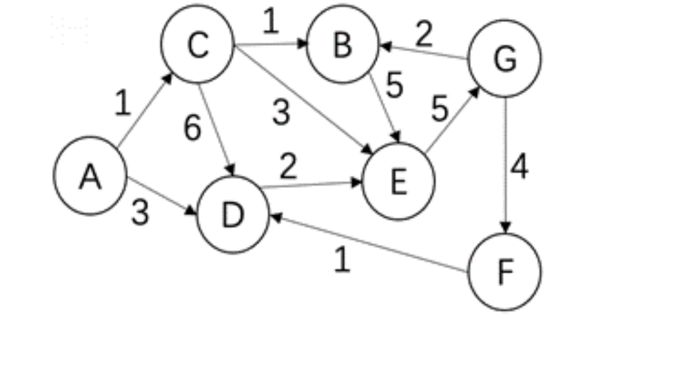
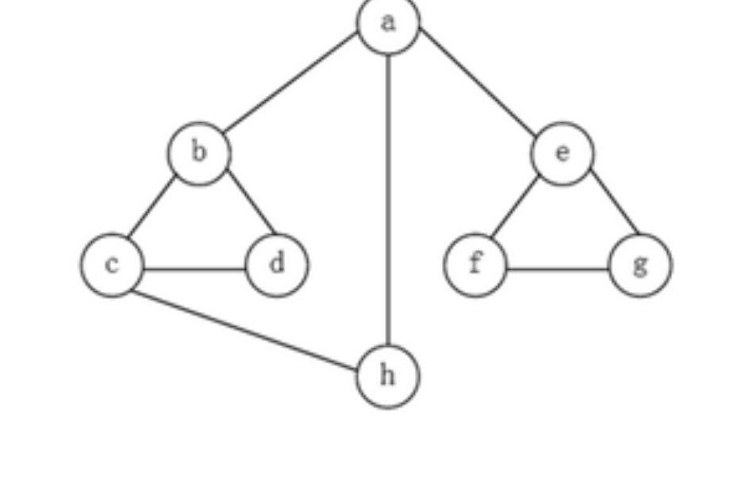
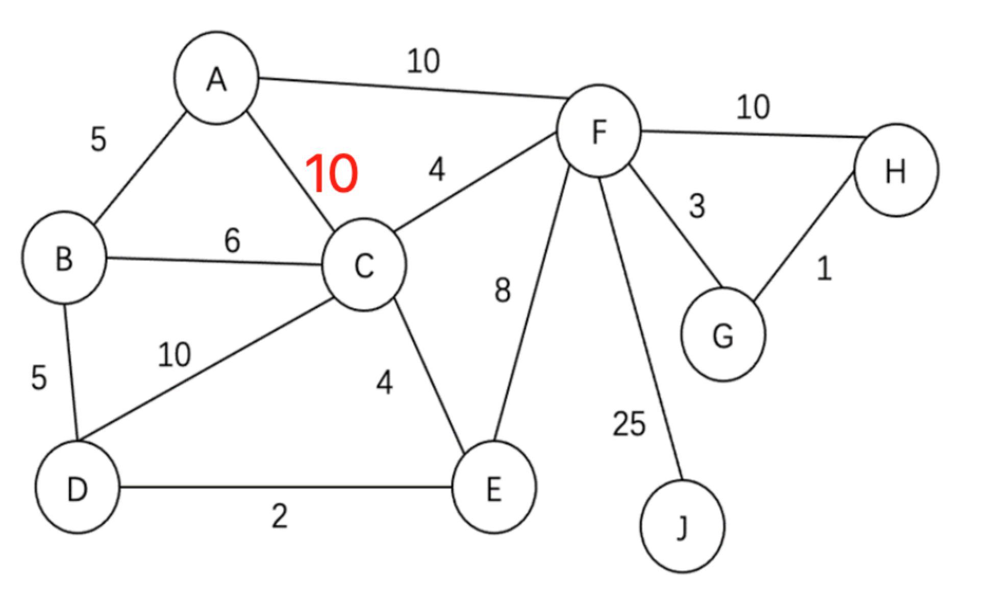
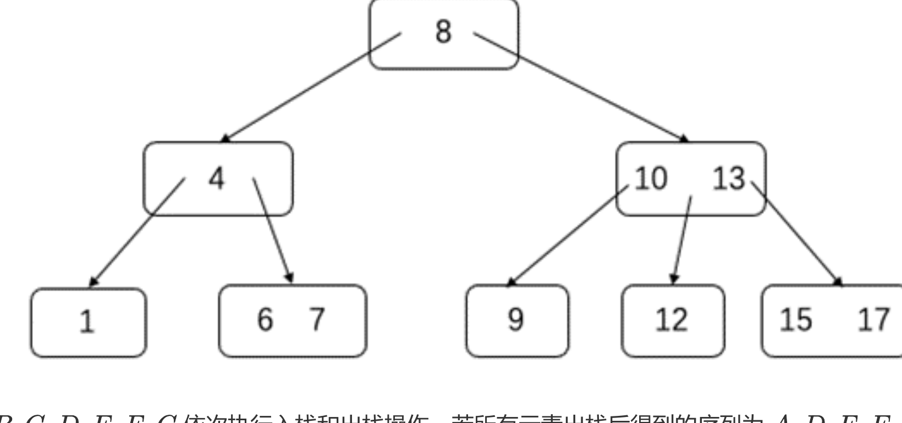

# 数据结构 2024–2025 学年第二学期期末试卷参考答案

## 一、选择题

### 1. 下列排序方法中，稳定的排序方法是（　　）

#### 题目

下列排序方法中，稳定的排序方法是（　　）。

(A) 选择排序　(B) 谢尔排序　(C) 快速排序　(D) 插入排序

#### 答案

**答案：** (D)。

### 2. 对非空二叉查找树进行（　　），将一定得到一个有序序列

#### 题目

对非空二叉查找树进行（　　），将一定得到一个有序序列。

(A) 前序遍历　(B) 中序遍历　(C) 后序遍历　(D) 层次遍历

#### 答案

**答案：** (B)。

### 3. 将数据元素 1, 2, 3, 5, 7, 8, 10, 11, 23, 29, 31, 37, 41, 50 依次存放于一个一维数组 [0..13] 中，采用折半查找算法查找元素 23，则被比较过的数组元素的下标依次为（　　）

#### 题目

将数据元素 1, 2, 3, 5, 7, 8, 10, 11, 23, 29, 31, 37, 41, 50 依次存放于一个一维数组 [0..13] 中，采用折半查找算法查找元素 23，则被比较过的数组元素的下标依次为（　　）。

(A) 6, 12, 10, 8　(B) 10, 31, 23　(C) 7, 11, 9　(D) 6, 10, 8

#### 答案

**答案：** (D)。mid 依次取 6、10、8，对应元素 10、31、23。

### 4. 关键字为（18, 32, 22, 5, 66, 23, 82, 27, 58, 11, 10, 78），散列函数 H(key)=key%13，散列地址为 6 的链中有（　　）个链结点

#### 题目

设有一组记录的关键字为（18, 32, 22, 5, 66, 23, 82, 27, 58, 11, 10, 78），利用散列存储，地址空间范围为 [0...12]，散列函数为 $H(key)=key\%13$，利用链地址法解决散列冲突，则散列地址为 6 的链中有（　　）个链结点。

(A) 1　(B) 2　(C) 3　(D) 4

#### 答案

**答案：** (B)。32 与 58 除以 13 的余数均为 6。

### 5. 循环队列存储在数组 A[0..n] 中，front 是队头元素下标，则出队时对 front 的操作为（　　）

#### 题目

循环队列存储在数组 $A[0..n]$ 中，front 是队头元素下标，则出队时对 front 的操作为（　　）。

(A) $front = front + 1$　(B) $front = (front+1)\%(n-1)$

(C) $front = (front+1)\%n$　(D) $front = (front+1)\%(n+1)$

#### 答案

**答案：** (D)。数组 $A[0..n]$ 共 $n+1$ 个单元。

### 6. 一有向带权图如下图所示，若采用 Dijkstra 算法求源点 A 到其他各顶点的最短路径，得到的第一条最短路径的目标顶点是 C，后续得到的其余各最短路径的目标顶点依次是（　　）

#### 题目

一有向带权图如下图所示，若采用 Dijkstra 算法求源点 A 到其他各顶点的最短路径，得到的第一条最短路径的目标顶点是 C，后续得到的其余各最短路径的目标顶点依次是（　　）。



(A) D, B, F, G, E　(B) B, D, E, F, G　(C) B, D, G, E, F　(D) B, D, E, G, F

#### 答案

**答案：** (D)。各顶点最短距离依次为 C=1、B=2、D=3、E=4、G=9、F=13。

### 7. 若对序列 (2, 12, 16, 70, 5, 10) 排序，前三趟结果为 (2,12,16,70,5,10)、(2,5,16,70,12,10)、(2,5,10,70,12,16)，则该排序方法为（　　）

#### 题目

若对序列 (2, 12, 16, 70, 5, 10) 按值从小到大进行排序，前三趟排序的结果分别为：

第 1 趟排序的结果：(2, 12, 16, 70, 5, 10)，

第 2 趟排序的结果：(2, 5, 16, 70, 12, 10)，

第 3 趟排序的结果：(2, 5, 10, 70, 12, 16)

则由此可以断定，该排序过程采用的排序方法是（　　）。

(A) 快速排序　(B) 选择排序　(C) 插入排序　(D) 冒泡排序

#### 答案

**答案：** (B)。

### 8. 若具有 n 个顶点的无向图采用邻接矩阵存储方法，该邻接矩阵一定为一个（　　）

#### 题目

若具有 $n$ 个顶点的无向图采用邻接矩阵存储方法，该邻接矩阵一定为一个（　　）。

(A) 稠密矩阵　(B) 对称矩阵　(C) 对角矩阵　(D) 稀疏矩阵

#### 答案

**答案：** (B)。

### 9. 对于初态为空的栈，下面给出的操作序列中，（　　）序列不能使栈的终态为空

#### 题目

若符号 PUSH 和 POP 分别表示 1 次进栈与 1 次出栈操作，则进栈和出栈的操作序列可以表示为仅由 PUSH 和 POP 组成的序列。对于初态为空的栈，下面给出的操作序列中，（　　）序列不能使栈的终态为空：

(A) PUSH, PUSH, PUSH, PUSH, POP, POP, POP, POP

(B) PUSH, POP, PUSH, PUSH, PUSH, POP, PUSH, POP

(C) PUSH, PUSH, PUSH, POP, PUSH, POP, POP, POP

(D) PUSH, PUSH, PUSH, POP, POP, PUSH, POP, POP

#### 答案

**答案：** (B)。该序列执行后栈中剩 2 个元素。

### 10. 若采用二叉链表的存储结构，在具有 n 个结点的二叉树中，其空指针域的个数为（　　）

#### 题目

若采用二叉链表的存储结构，在具有 $n$ 个结点的二叉树中，其空指针域的个数为（　　）。

(A) $2n+1$　(B) $n+1$　(C) $n-1$　(D) 不确定

#### 答案

**答案：** (B)。

### 11. 对如下无向图进行遍历，则下列选项中，不可能是广度优先遍历序列的是（　　）

#### 题目

对如下无向图进行遍历，则下列选项中，不可能是广度优先遍历序列的是（　　）。



(A) a, b, h, e, c, d, f, g　(B) e, g, f, a, h, b, c, d

(C) c, b, a, e, f, g, h, d　(D) g, e, f, a, b, h, c, d

#### 答案

**答案：** (C)。从 c 出发，与 c 距离为 1 的顶点只有 b、d、h，a 与 c 距离为 2，不可能排在 d、h 之前。

### 12. 若长度为 n 的线性表采用顺序存储结构，在其第 i 个位置插入一个新元素的算法的时间复杂度为（　　）

#### 题目

若长度为 $n$ 的线性表采用顺序存储结构，在其第 $i\ (1 \le i \le n+1)$ 个位置插入一个新元素的算法的时间复杂度为（　　）。

(A) $O(\log n)$　(B) $O(1)$　(C) $O(n)$　(D) $O(n^2)$

#### 答案

**答案：** (C)。

## 二、填空题

### 1. 已知无向带权图的结构如下图所示。其最小生成树中，各边的权重之和为\_\_\_\_\_\_

#### 题目

已知无向带权图的结构如下图所示。其最小生成树中，各边的权重之和为\_\_\_\_\_\_。



#### 答案

**答案：** 49。Kruskal 依次选取 G–H(1)、D–E(2)、F–G(3)、C–E(4)、C–F(4)、A–B(5)、B–D(5)、F–J(25)。

### 2. 一颗二叉查找树的后序遍历序列为 23, 30, 38, 60, 58, 73, 70, 50，则该二叉查找树的前序遍历序列为\_\_\_\_\_\_

#### 题目

一颗二叉查找树的后序遍历序列为 23, 30, 38, 60, 58, 73, 70, 50，则该二叉查找树的前序遍历序列为\_\_\_\_\_\_。（以英文逗号分隔数字，中间无空格）

#### 答案

**答案：** 50,38,30,23,70,58,60,73。

### 3. 若以 {3, 4, 5, 6, 8} 作为叶子结点的权值构造哈夫曼树，则其带权路径长度是\_\_\_\_\_\_

#### 题目

若以 {3, 4, 5, 6, 8} 作为叶子结点的权值构造哈夫曼树，则其带权路径长度是\_\_\_\_\_\_。

#### 答案

**答案：** 59。合并过程 3+4=7，5+6=11，7+8=15，11+15=26，带权路径长度 7+11+15+26=59。

### 4. 一棵完全二叉树，根结点为第 1 层，第 5 层的叶子结点个数为 6，该二叉树最多有\_\_\_\_\_\_个结点

#### 题目

一棵完全二叉树，根结点为第 1 层，第 5 层的叶子结点个数为 6，该二叉树最多有\_\_\_\_\_\_个结点。

#### 答案

**答案：** 51。第 1–5 层共 31 个结点，第 5 层 16 个结点中有 10 个有孩子，第 6 层最多 20 个结点，合计 51。

### 5. 用 S 表示入栈操作，X 表示出栈操作，若元素入栈的顺序为 1, 2, 3, 4, 5，为了得到 1, 3, 4, 5, 2 出栈顺序，相应的 S 和 X 的操作串为\_\_\_\_\_\_

#### 题目

用 S 表示入栈操作，X 表示出栈操作，若元素入栈的顺序为 1, 2, 3, 4, 5，为了得到 1, 3, 4, 5, 2 出栈顺序，相应的 S 和 X 的操作串为\_\_\_\_\_\_（除了 S 和 X 字符，中间不要有任何其它字符）。

#### 答案

**答案：** SXSSXSXSXX。

### 6. 已知一棵 3 阶 B-树如图所示，若在此 B-树上插入关键字 5，则根节点序列为\_\_\_\_\_\_

#### 题目

已知一棵 3 阶 B-树如图所示，若在此 B-树上插入关键字 5，则根节点序列为\_\_\_\_\_\_。（以英文逗号分隔数字，中间无空格）



#### 答案

**答案：** 8。5 插入叶结点 [6,7] 后分裂并把 6 上提到父结点 [4]，根结点仍为 [8]。

### 7. 元素 A, B, C, D, E, F, G 依次执行入栈和出栈操作，若所有元素出栈后得到的序列为 A, D, F, E, C, G, B，则栈的容量至少为\_\_\_\_\_\_

#### 题目

元素 $A, B, C, D, E, F, G$ 依次执行入栈和出栈操作，若所有元素出栈后得到的序列为 $A, D, F, E, C, G, B$，则栈的容量至少为\_\_\_\_\_\_。

#### 答案

**答案：** 4。

### 8. 该数据区的逻辑结构应该是\_\_\_\_\_\_

#### 题目

为解决程序执行过程中函数调用与返回的上下文管理问题，通常需要维护一个特殊的数据区，当调用子函数时，系统会将当前函数的返回地址、局部变量及参数等依次存入该数据区，而子函数执行完毕后则按相反顺序从数据区中读取内容恢复调用环境。该数据区的逻辑结构应该是\_\_\_\_\_\_。

#### 答案

**答案：** 栈。

## 三、编程题

### 题目一 电子收银系统（ecr.c）

#### 题目

##### 【问题描述】

一餐馆需要开发一套电子收银系统，提供点菜和统计分析功能。请编程实现电子收银模拟系统：点菜时，需要输入桌台号（小于等于 100 的正整数表示）、菜品编码、数量（正整数表示）和单价（正整数表示，单位：元），菜品编码由一个大写的英文字母（A 表示热菜或凉菜，B 表示饮品，C 表示主食）和三位 0–9 的数字组成。每天打烊时，老板希望得到当天的总销售额，并需要按照菜品的销售额由低到高排序输出菜品的销售信息，销售额相同的按照菜品的销售数量由小到大输出（不存在销售数量和销售额都相同的情况）。

##### 【输入形式】

先从控制台输入当天点菜信息条数（大于 0 且小于 100），然后分行输入点菜信息：桌台号、菜品编码、数量和单价之间以一个空格分隔。

##### 【输出形式】

先按照销售额由低到高分行输出各菜品销售信息：菜品编码、该菜品总销售数量和该菜品总销售额之间以一个空格分隔，销售额相同的按照菜品的销售数量由小到大输出；最后输出总销售额。

##### 【样例输入】

```text
30
5 A003 1 38
5 A005 1 26
5 A012 1 69
5 B002 2 10
5 C001 2 1
3 A006 1 15
3 A008 1 33
3 C003 1 10
6 A012 1 69
6 A008 1 33
6 A037 1 55
6 A020 1 56
6 A002 1 99
6 A051 1 165
6 B005 12 6
6 C001 6 1
6 C010 1 36
2 A008 1 33
2 A037 1 55
2 C001 2 1
8 A008 1 33
8 A012 1 69
8 A006 1 15
8 B005 2 6
8 C001 2 1
1 A008 1 33
1 A037 1 55
1 A003 1 38
1 B002 3 10
1 C001 3 1
```

##### 【样例输出】

```text
C003 1 10
C001 15 15
A005 1 26
A006 2 30
C010 1 36
B002 5 50
A020 1 56
A003 2 76
B005 14 84
A002 1 99
A051 1 165
A037 3 165
A008 5 165
A012 3 207
1184
```

##### 【样例说明】

输入了 30 条点菜信息，汇总统计总销售额为 1184 元；编码为 C003 的菜品销售额最低，共 10 元；编码为 A012 的菜品销售额最高，销售了 3 份，共 207 元；编码为 A051、A037 和 A008 的菜品销售额相同，都为 165 元，这时需要按照销售数量由小到大的顺序输出。

##### 【评分标准】

该题要求实现电子收银模拟系统，提交程序名为 ecr.c。

1. 只完成总销售额和菜品销售额统计功能，可得 20% 分数。
2. 完成统计功能，并实现按照销售额排序可得 60% 的分数。
3. 完成统计功能，并实现销售额和销售数量排序（例如上面样例），可得 100% 分数。

#### 答案

**答案：**

```c
#include <stdio.h>
#include <string.h>

#define MAXD 200

typedef struct {
    char code[8];
    int qty;
    long amount;
} Dish;

static Dish d[MAXD];
static int nd = 0;

int main(void)
{
    int n, i, j, table, qty, price;
    char code[8];
    long total = 0;

    scanf("%d", &n);
    for (i = 0; i < n; i++) {
        scanf("%d %s %d %d", &table, code, &qty, &price);
        for (j = 0; j < nd; j++)
            if (strcmp(d[j].code, code) == 0)
                break;
        if (j == nd) {
            strcpy(d[j].code, code);
            d[j].qty = 0;
            d[j].amount = 0;
            nd++;
        }
        d[j].qty += qty;
        d[j].amount += (long)qty * price;
        total += (long)qty * price;
    }

    /* 销售额升序；销售额相同按销售数量升序 */
    for (i = 0; i < nd - 1; i++)
        for (j = 0; j < nd - 1 - i; j++)
            if (d[j].amount > d[j + 1].amount ||
                (d[j].amount == d[j + 1].amount && d[j].qty > d[j + 1].qty)) {
                Dish t = d[j];
                d[j] = d[j + 1];
                d[j + 1] = t;
            }

    for (i = 0; i < nd; i++)
        printf("%s %d %ld\n", d[i].code, d[i].qty, d[i].amount);
    printf("%ld\n", total);

    return 0;
}
```

### 题目二 新闻事件锁定与汇总（report.c）

#### 题目

##### 【问题描述】

一家新闻社正在跟踪最近的一系列新闻，每条新闻都可以用一个事件表示，其中包含以下信息：事件类型（三种类型，以一个大写字母表示：A 表示“突发新闻”、B 表示“深度报道”、C 表示“评论”）、事件发生时间（以 8 位数字表示，例如：20240305）和事件标题（不超过 100 字符的字符串表示，不包含空白符）。所有事件的个数不超过 100。

新闻社希望按以下顺序处理这些事件：

1. 突发新闻事件（A）应立即处理（优先级最高）。
2. 深度报道事件（B）应排在突发事件之后处理。
3. 评论事件（C）应在所有其他事件处理完成后处理。
4. 相同等级事件按时间倒序整理（即：时间近的先处理），若时间相同，则按照输入的倒序处理（即：先输入的后处理）。

主编可以发出两种指令：

1. 锁定指令：用大写字母 R 表示，后跟需要锁定的新闻事件数量 $N$（大于 0 且小于等于输入的未被锁定的新闻事件数量）；遇到该指令时，需按照上面的处理顺序锁定已经输入的、且未被锁定的 $N$ 个新闻事件。该指令可能没有，也可能有多个。
2. 汇总命令：用大写字母 E 表示；遇到该指令时，表示按照上面处理的顺序汇总剩余所有未被锁定的新闻事件，并且代表输入结束。

算法提示：

1. 可利用三个栈分别存储处理三类新闻事件。
2. 读入事件信息或锁定命令后要注意处理行末的换行符！

##### 【输入形式】

按照时间正序从控制台分行输入新闻事件信息，事件类型、事件标题和事件发生时间之间以一个空格分隔；中间可输入多条锁定指令（R 与 $N$ 之间以一个空格分隔）；最后输入汇总命令（E）表示输入结束。

##### 【输出形式】

先按照锁定指令输入的先后顺序，分行输出锁定的新闻事件信息（事件类型、事件标题和事件发生时间之间以一个空格分隔）；最后输出遇到汇总命令时，汇总的所有未被锁定的新闻事件信息。

##### 【样例输入】

```text
C 20240317 Analysis_of_recent_traffic_congestion_situation
A 20240317 Stock_market_crash
B 20240317 The_Future_of_Artificial_Intelligence
B 20240318 The_impact_of_climate_change_on_global_food_supply
A 20240319 Sudden_earthquake_in_the_Pacific_Plate
R 3
C 20240319 Analyze_the_causes_of_extreme_weather_conditions
R 1
A 20240319 New_York_City_Suddenly_Falls_Lizzard
B 20240320 Chip_Industry_Chain_Tracking
E
```

##### 【样例输出】

```text
A 20240319 Sudden_earthquake_in_the_Pacific_Plate
A 20240317 Stock_market_crash
B 20240318 The_impact_of_climate_change_on_global_food_supply
B 20240317 The_Future_of_Artificial_Intelligence
A 20240319 New_York_City_Suddenly_Falls_Lizzard
B 20240320 Chip_Industry_Chain_Tracking
C 20240319 Analyze_the_causes_of_extreme_weather_conditions
C 20240317 Analysis_of_recent_traffic_congestion_situation
```

##### 【样例说明】

先输入了 5 条新闻事件，然后遇到锁定 3 条新闻事件的指令，于是按照规定的处理顺序，锁定了两条突发事件和一条 20240318 日期的深度报道事件；之后输入 1 条新闻事件后又遇到锁定 1 条新闻事件的指令，这次锁定的是 20240317 日期的深度报道事件；最后输入 2 条新闻事件后遇到汇总指令，输入结束。输出时：先输出之前锁定的事件，然后按照规定的处理顺序汇总输出所有未被锁定的新闻事件。

注意：由于浏览器显示的差异，从题目中拷贝出的输入样例信息每行后会多出空行，所以测试时请先将输入样例信息拷贝到文本编辑器（例如：记事本）中，删除掉其中的空行后再拷贝到控制台窗口中进行测试！

##### 【评分标准】

该题要求实现新闻的事件的锁定汇总功能，提交程序名为 report.c。

仅实现汇总指令可得 30% 的分数。

#### 答案

**答案：**

```c
#include <stdio.h>
#include <string.h>

#define MAXE 100
#define MAXT 101

typedef struct {
    char type;
    char time[16];
    char title[MAXT];
} Ev;

static Ev st[3][MAXE];          /* 0:A 1:B 2:C 三个栈 */
static int top[3] = {0, 0, 0};

static int nextIdx(void)
{
    int i;
    for (i = 0; i < 3; i++)
        if (top[i] > 0)
            return i;
    return -1;
}

static void popPrint(void)
{
    int k = nextIdx();
    top[k]--;
    printf("%c %s %s\n", st[k][top[k]].type,
           st[k][top[k]].time, st[k][top[k]].title);
}

int main(void)
{
    char line[256];
    int i, n;

    while (fgets(line, sizeof(line), stdin) != NULL) {
        if (line[0] == 'E') {                 /* 汇总剩余所有未锁定事件 */
            while (nextIdx() >= 0)
                popPrint();
            break;
        }

        if (line[0] == 'R') {                 /* 锁定 N 条事件 */
            sscanf(line + 1, "%d", &n);
            for (i = 0; i < n && nextIdx() >= 0; i++)
                popPrint();
            continue;
        }

        if (line[0] == 'A' || line[0] == 'B' || line[0] == 'C') {
            int t = (line[0] == 'A') ? 0 : (line[0] == 'B') ? 1 : 2;
            Ev *e = &st[t][top[t]];
            e->type = line[0];
            sscanf(line + 2, "%s %s", e->time, e->title);
            top[t]++;
        }
    }

    return 0;
}
```

### 题目三 兴趣点查找（search.c）

#### 题目

##### 【问题描述】

目前手机地图均提供根据当前位置查找兴趣点（如餐馆、电影院、品牌专卖店、酒店、药店、加油站……）并根据距离远近给出相应路线，如在手机地图（高德、百度……）上查找加油站，将会按距离远近给出加油站及相应路线。编程实现兴趣点查找。

##### 【输入形式】

首先从标准输入读入图顶点的个数 $N$（大于 0 且小于 200），图顶点表示地图中的各个位置。

然后从下一行开始分行输入每个顶点的编号（大于等于 10）及该顶点包含的兴趣点（用整数 1～9 来表示不同类型的兴趣点），每行以 -1 结束，如输入行：

```text
10 1 3 5 -1
```

表示编号为 10 的顶点包含有 1, 3, 5 三种兴趣点；

之后输入边的个数 $M$（大于 0），然后分行输入 $M$ 个以 $(u, v, d)$ 表示的边的信息，其中 $u, v$ 为边的 2 个顶点编号， $d$ 表示边的长度（以正整数表示）， $u$、 $v$ 和 $d$ 之间以一个空格分隔。

最后一行输入要查找的兴趣点编号及当前位置（即：顶点编号），之间以一个空格分隔。

##### 【输出形式】

按照距离由近至远的顺序分行输出找到的包含给定兴趣点的顶点编号、距离及路径（顶点编号、距离及路径之间以一个空格分隔），路径用从当前位置的顶点编号开始，到目标顶点编号所经过的所有顶点编号来表示，路径中的各顶点编号之间以英文减号字符 - 分隔。

注意：

1. 假设没有 2 个距离完全相同的兴趣点！
2. 如果当前位置就有要查找的兴趣点，则其距离为 0（最近），只需输出当前位置顶点编号和距离 0，不用输出路径。

##### 【样例输入】

```text
12
22 2 5 6 -1
15 1 3 4 9 -1
56 4 7 8 -1
25 1 2 3 -1
30 6 7 -1
18 2 4 5 -1
90 1 2 9 -1
67 1 7 8 -1
39 1 3 5 9 -1
89 1 4 -1
20 2 3 5 6 -1
102 2 8 9 -1
14
56 22 10
22 15 14
56 25 6
15 30 16
30 90 12
18 30 20
18 25 70
67 18 18
20 18 20
67 90 30
67 39 15
67 89 14
89 20 17
20 102 8
2 18
```

##### 【样例输出】

```text
18 0
20 20 18-20
102 28 18-20-102
90 32 18-30-90
22 50 18-30-15-22
25 66 18-30-15-22-56-25
```

##### 【样例说明】

该样例输入了 12 个位置顶点和 14 条边，形成了如下所示的地图：

图中的圆表示顶点，顶点中上方的数字表示顶点编号，下方的数字表示该顶点包含的兴趣点，顶点之间连线上的数字是其边的长度。

要求从当前位置顶点 18 开始查找包含兴趣点为 2 的所有位置顶点。

首先，当前位置顶点就包含兴趣点 2，其距离最近，所以输出 18 0；

其次距离最近的为与 18 直接相连的顶点 20，距离为 20，路径为 18-20。其它 4 个包含给定兴趣点的顶点类似。

##### 【评分标准】

该题要求从输入的地图中查找所以包含兴趣点的顶点，提交程序名为 search.c。

#### 答案

**答案：**

```c
#include <stdio.h>

#define MAXV 200
#define MAXE 400
#define INF 1000000000

static int vid[MAXV], npoi[MAXV], poi[MAXV][10], nv = 0;
static int eu[MAXE], ev[MAXE], ew[MAXE];
static int head_[MAXV], nxt[MAXE * 2], to[MAXE * 2], wt[MAXE * 2], ec = 0;
static int dist[MAXV], pre[MAXV], done[MAXV];

static int findV(int id)
{
    int i;
    for (i = 0; i < nv; i++)
        if (vid[i] == id)
            return i;
    return -1;
}

int main(void)
{
    int n, m, i, j, x, u, v, d, target, cur, p, t;
    int order[MAXV], no = 0;
    int path[MAXV], np;

    scanf("%d", &n);
    for (i = 0; i < n; i++) {
        scanf("%d", &vid[i]);
        npoi[i] = 0;
        while (scanf("%d", &x) == 1 && x != -1)
            poi[i][npoi[i]++] = x;
        nv++;
    }

    scanf("%d", &m);
    for (i = 0; i < m; i++)
        scanf("%d %d %d", &eu[i], &ev[i], &ew[i]);

    scanf("%d %d", &target, &cur);

    for (i = 0; i < nv; i++)
        head_[i] = -1;
    for (i = 0; i < m; i++) {
        int a = findV(eu[i]), b = findV(ev[i]);
        to[ec] = b; wt[ec] = ew[i]; nxt[ec] = head_[a]; head_[a] = ec++;
        to[ec] = a; wt[ec] = ew[i]; nxt[ec] = head_[b]; head_[b] = ec++;
    }

    for (i = 0; i < nv; i++) {
        dist[i] = INF;
        pre[i] = -1;
        done[i] = 0;
    }
    p = findV(cur);
    dist[p] = 0;

    for (i = 0; i < nv; i++) {                 /* Dijkstra */
        int best = -1;
        for (j = 0; j < nv; j++)
            if (!done[j] && dist[j] < INF && (best < 0 || dist[j] < dist[best]))
                best = j;
        if (best < 0)
            break;
        done[best] = 1;
        for (j = head_[best]; j != -1; j = nxt[j])
            if (dist[best] + wt[j] < dist[to[j]]) {
                dist[to[j]] = dist[best] + wt[j];
                pre[to[j]] = best;
            }
    }

    for (i = 0; i < nv; i++) {                 /* 收集含目标兴趣点且可达的顶点 */
        if (dist[i] >= INF)
            continue;
        for (j = 0; j < npoi[i]; j++)
            if (poi[i][j] == target)
                break;
        if (j < npoi[i])
            order[no++] = i;
    }

    for (i = 0; i < no - 1; i++)               /* 按距离升序 */
        for (j = 0; j < no - 1 - i; j++)
            if (dist[order[j]] > dist[order[j + 1]]) {
                t = order[j];
                order[j] = order[j + 1];
                order[j + 1] = t;
            }

    for (i = 0; i < no; i++) {
        int k = order[i];

        if (dist[k] == 0) {                    /* 当前位置即含该兴趣点 */
            printf("%d 0\n", vid[k]);
            continue;
        }

        np = 0;
        t = k;
        while (t != -1) {
            path[np++] = t;
            t = pre[t];
        }

        printf("%d %d ", vid[k], dist[k]);
        for (j = np - 1; j >= 0; j--)
            printf("%d%c", vid[path[j]], (j == 0) ? '\n' : '-');
    }

    return 0;
}
```
