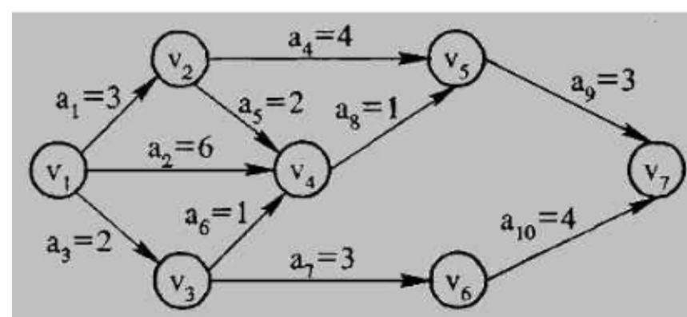
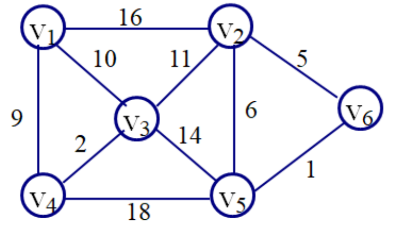
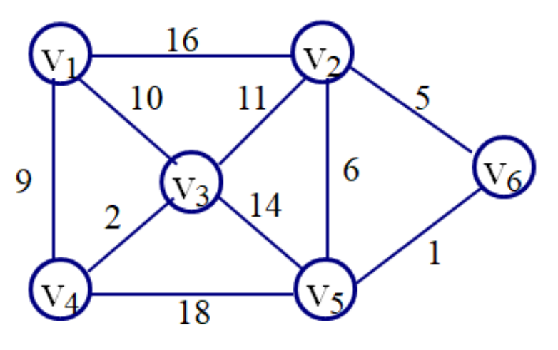
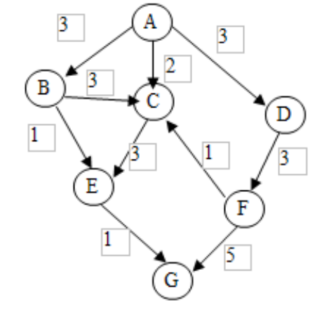
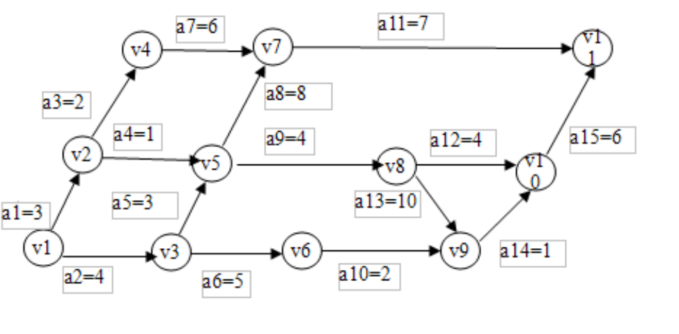

# 数据结构 七次作业选填题目（2024 春）

## 第一次作业

### 选择题

**1.** 下面程序段的运行结果是

```c
char a[7]="abcdef",b[4]="ABC";
strcpy(a,b);
printf("%c",a[1]);
```

- (A) a
- (B) A
- (C) b
- (D) B

**2.** 以下给字符数组 `str` 定义和赋值正确的是

- (A) `char str[10]; str = "China";`
- (B) `char str[] = "China";`
- (C) `char str[10]; strcpy (str, "abcdefghijklmn");`
- (D) `char str[10] = "abcdefghijklmn";`

**3.** 下面程序段的运行结果是

```c
char c[]="\t\v\\\0will\n";
printf("%d",strlen(c));
```

- (A) 14
- (B) 3
- (C) 9
- (D) 字符串有非法字符，输出值不确定

**4.** 下述对 C 语言字符数组的描述中错误的是

- (A) 字符数组可以存放字符串
- (B) 字符数组的字符串可以整体输入,输出
- (C) 可以在赋值语句中通过赋值运算符"="对字符数组整体赋值
- (D) 不可以用关系运算符对字符数组中的字符串进行比较

**5.** 下面能正确进行字符串赋值，并且能确保字符串以 `\0` 结尾的操作是

- (A) `char s[5] = {"ABCDE"};`
- (B) `char s[5] = {'A', 'B', 'C', 'D', 'E'};`
- (C) `char *s; s = "ABCDE";`
- (D) `char *s; scanf("%s", s);`

**6.** 有下面的程序段：

```c
char a[3], b[] = "China";
a = b;
printf("%s", a);
```

则

- (A) 运行后将输出 China
- (B) 运行后将输出 Ch
- (C) 运行后将输出 Chi
- (D) 编译出错

**7.** 阅读程序，选择程序的运行结果

```c
#include <stdio.h>
int try(int );
int main()
{
    int x;
    x = try(5);
    printf("%d\n",x);
    return 0;
}
int try(int n)
{
    if(n>0)
        return ( n*try(n-2));
    else
        return (1);
}
```

- A. 15
- B. 120
- C. 1
- D. 前面的答案均不正确

**8.** 下面程序的功能是将字符串 s 中所有的字符"c"删除。请选择填空。

```c
#include<stdio.h>
int main()
{
    char s[80];
    int i,j;
    gets(s);
    for(i=j=0;s[i]!='\0';i++)
        if(s[i]!='c') ______;
    s[j]='\0';
    puts(s);

    return 0;
}
```

- (A) `s[j++]=s[i]`
- (B) `s[++j]=s[i]`
- (C) `s[j]=s[i];j++`
- (D) `s[j]=s[i]`

**9.** 若有说明 `char *language[] = {"FORTRAN", "BASIC", "PASCAL", "JAVA", "C"};` 则以下不正确的叙述是

- (A) `*(language+2)` 表示字符串"PASCAL"的首地址
- (B) `*language[2]` 的值是字母 P
- (C) language 是一个字符型指针数组，它包含 5 个元素，每个元素都是一个指向字符串的指针
- (D) language 包含 5 个相同长度的数组

**10.** 设 n 是描述问题规模的非负整数，下列程序片段的时间复杂度是

```c
x=2;
while(x<n/2)
        x=2*x;
```

- A. $O(\log_2 n)$
- B. $O(n)$
- C. $O(n\log_2 n)$
- D. $O(n^2)$

### 填空题

**1.** 下面程序段的运行结果是 \_\_\_\_\_\_

```c
char ch[ ] = "600";
int a, s = 0;
for (a = 0; ch[a] >= '0' && ch[a] <= '9'; a++)
    s = 10 * s + ch[a] - '0';
printf("%d", s);
```

**2.** 写出下述程序的输出结果 \_\_\_\_\_\_

```c
#include <stdio.h>
int func(int n)
{
    if(n<=1)
        return 1;
    else
        return (2+n*func(n-1));
}

int main()
{
    int x = 4;
    printf("%d\n",func(x));

    return 0;
}
```

**3.** 给出下述程序的执行结果 \_\_\_\_\_\_

```c
#include <stdio.h>
long fib(int x)
{
    switch(x)
    {
        case 0: return 0;
        case 1:
        case 2:   return 1;
    }
    return (fib(x-1)+fib(x-2));
}
int main()
{
    int x=6;
    printf("%d\n",fib(x));

    return 0;
}
```

**4.** 下面的函数 invert 的功能是将一个字符串的内容颠倒过来。请将函数补充完整。\_\_\_\_\_\_（所有答案填写在此空内，答案间以空格隔开）

```c
void invert (char str [] )
{
    int i,j,填空1______;
    for(i=0,j=strlen(str)填空2______;i<j;i++,j--)
    {
        k=str[i];
        str[i]=str[j];
        str[j]=k;
    }
}
```

**5.** 下列程序是否正确，如果正确给出输出结果，如果不正确，答案处填写"不正确"。\_\_\_\_\_\_

```c
#include <stdio.h>
void func(char *q)
{
    char a[]="hello";
    q=a;
}
main()
{
    char *p;
    func(p);
    printf("%s\n",p);
}
```

**6.** 函数 `index(char s[],char t[])` 检查字符串 s 中是否包含字符串 t，若包含，则返回 t 在 s 中的开始位置（下标值），否则返回 -1。请将函数补充完整。

```c
int index(char s[],char t[])
{
    int i,j,k;
    for(i=0;s[i]!='\0';i++)
    {
        for(j=i,k=0;填空1______&&s[j]==t[k];j++,k++)
            ;
        if(填空2______)
            return i;
    }
    return -1;
}
```

（所有答案填写在此空内，答案间以空格隔开）

**7.** 函数 `squeez(char s[],char c)` 的功能是删除字符串 s 中所出现的与变量 c 相同的字符。

```c
void squeez(char s[],char c)
{
    int i,j;
    for(i=j=0;填空1______;i++)
        if(s[i]!=c)
            填空2______;
    s[j]='\0';
}
```

（所有答案填写在此空内，答案间以空格隔开）

**8.** 下面的函数 `itoh(n,s)` 完成将无符号十进制整数转换成十六进制表示，并存入字符串数组 s 中。程序中用到的函数 `reverse(char s[])` 是一个将字符串置逆的函数。

```c
void reverse(char s[])
{
    int temp,i,j;
    for(i=0,j=strlen(s)-1;i<j;i++,j--)
    {
        temp=s[i];
        s[i]=s[j];
        s[j]=temp;
    }
}

void itoh(unsigned n,char s[])
{
    int h,i=0;
    do{
        h=n%16;
        s[i++]=(h<=9)?h+'0':h+'A'______;
    }while((n/=16)!=0);
    ______;
    reverse(s);
}
```

（所有答案填写在此空内，答案间以空格隔开）

**9.** 下面程序的功能是将字符串 s 中的内容按逆序输出，但不改变串中的内容，请选择填空（答案请填写所选择的两个字母，中间用空格格开，如 A A 的形式）：\_\_\_\_\_\_

```c
#include <stdio.h>
void inverp(char *a)
{
    if ( __________ )
        return;
    inverp(a+1);
    printf("%c", ___________ );
}
int main()
{
    char s[10] = "hello!";
    inverp(s);

    return 0;
}
```

选项：

```text
Selection 1 :
(A)   *a != '\0'
(B)   *a != NULL
(C)   *a == '\0'
(D)   ! a * == 0

Selection 2 :
(A)   * (a-1)
(B)   *a
(C)   * (a+1)
(D)   * (--a)
```

**10.** 下面程序的功能是将已按升序排好的两个字符串 a 和 b 中的字符按升序并归到字符串 c 中。请选择填空将程序补充完整：\_\_\_\_\_\_（所有答案填写在此空内，答案间以空格隔开）

```c
#include<stdio.h>
#include<string.h>
int main()
{
    char a[]="acegikm";
    char b[]="bdfhjlnpq";
    char c[80],*p;
    int i=0,j=0,k=0;
    while(a[i]!='\0'&&b[j]!='\0')
    {
        if(a[i]<b[j]){_______}
        else{_______}
    }
    c[k]='\0';
    if(_______)p=b+j;
    else p=a+i;
    strcat(c,p);
    puts(c);

    return 0;
}
```

选项：

```text
填空1：
(A)c[k++]=a[i++];
(B)c[k++]=a[j++];
(C)c[k++]=b[i++];
(D)c[k++]=b[j++];
填空2：
(A)c[k++]=a[i++];
(B)c[k++]=a[j++];
(C)c[k++]=b[i++];
(D)c[k++]=b[j++];
填空3：
(A)a[i]=='\0'
(B)a[j]=='\0'
(C)b[i]=='\0'
(D)b[j]=='\0'
```

## 第二次作业

### 选择题

**1.** 以下与 `int *q[5];` 等价的定义语句是

- (A) `int q[5] ;`
- (B) `int *q;`
- (C) `int *(q[5]) ;`
- (D) `int (*q)[5] ;`

**2.** 设有说明 `int (* ptr) [M];` 其中 ptr 是

- (A) M 个指向整型变量的指针
- (B) 指向 M 个整型变量的函数指针
- (C) 一个指向具有 M 个整型元素的一维数组的指针
- (D) 具有 M 个指针元素的一维指针数组，每个元素都只能指向整型量

**3.** 若有以下定义，则数值不为 3 的表达式是

```c
int x[10] = {0, 1, 2, 3, 4, 5, 6, 7, 8, 9}, *p1;
```

- (A) `x[3]`
- (B) `p1 = x + 3, *p1++`
- (C) `p1 = x + 2, *(p1++)`
- (D) `p1 = x + 2, *++p1`

**4.** 以下正确的说明语句是

- (A) `int *b[] = {1, 3, 5, 7, 9};`
- (B) `int a[5], *num[5] = {&a[0], &a[1], &a[2], &a[3], &a[4]};`
- (C) `int a[] = {1, 3, 5, 7, 9}; int *num[5] = {a[0], a[1], a[2], a[3], a[4]};`
- (D) `int a[3][4], (*num)[4]; num[1] = &a[1][3];`

**5.** 已知 `int a, *p=&a;` 则下列函数调用中错误的是

- (A) `scanf("%d", &a);`
- (B) `scanf("%d", p);`
- (C) `printf("%d", a);`
- (D) `printf("%d", p);`

**6.** fscanf 函数的正确调用形式是

- (A) `fscanf(fp, 格式字符串, 输出表列);`
- (B) `fscanf(格式字符串, 输出表列, fp);`
- (C) `fscanf(格式字符串, 文件指针, 输出表列);`
- (D) `fscanf(文件指针, 格式字符串, 输入表列);`

**7.** 有以下程序：

```c
#include<stdio.h>

struct stu{
    int num;
    float TotalScore;
};

void f(struct stu p)
{
    struct stu s[2]={{20044,550},{20045,537}};
    p.num=s[1].num;
    p.TotalScore=s[1].TotalScore;
}

int main()
{
    struct stu s[2]={{20041,703},{20042,580}};
    f(s[0]);
    printf("%d %3.0f\n",s[0].num,s[0].TotalScore);
    return 0;
}
```

程序运行后的输出结果是：

- (A) 20045 537
- (B) 20044 550
- (C) 20042 580
- (D) 20041 703

**8.** 有以下程序段：

```c
struct st{
    int x;
    int *y;
} *pt;
int a[ ]={1,2}, b[ ]={3,4};
struct st c[2]={10,a,20,b};
pt=c;
```

以下选项中表达式的值为 11 的是：

- (A) `*pt->y`
- (B) `pt->x`
- (C) `++pt->x`
- (D) `(pt++)->x`

**9.** 有以下程序段：

```c
typedef struct node{
    int num;
    struct node *next;
} OLD;
```

以下叙述中正确的是：

- (A) 以上的说明形式非法
- (B) node 是一个结构类型
- (C) OLD 是一个结构类型
- (D) OLD 是一个结构变量

**10.** 若有以下程序段

```c
struct dent
{
    int n;
    int *m;
};
int a=1, b=2, c=3;
struct dent s[3]={{101,&a},{102,&b},{103,&c}};
struct dent *p =s;
```

则以下表达式值为 2 的是

- A. `(p++ )->m`
- B. `*(p++ )->m`
- C. `(*p).m`
- D. `*( ++p)->m`

**11.** 已知学生记录的定义为：

```c
struct student
{
    int no;
    char name[20];
    char sex;
    struct
    {
        int year;
        int month;
        int day;
    }birth;
};
struct student s;
```

假设变量 s 中的"生日"应是"1988 年 5 月 10 日"，对"生日"的正确赋值语句是

- (A) `year=1988; month=5; day=10;`
- (B) `brith.year=1988; birth.month=5; birth.day=10;`
- (C) `s.year=1988; s.month=5; s.day=10;`
- (D) `s.birth.year=1988; s.birth.month=5; s.birth.day=10;`

**12.** 若有以下说明和语句，则下面表达式中值为 1002 的是

```c
struct student
{
    int age;
    int num;
};
struct student stu[3] = {{1001, 20}, {1002, 19}, {1003, 21}};
struct student *p;
p = stu;
```

- (A) `(p++)->num`
- (B) `(p++)->age`
- (C) `(*p).num`
- (D) `(*++p).age`

**13.** 以下对结构类型变量 std1 的定义中错误的是

(A)

```c
#define STUDENT struct student
STUDENT
  { int num;
    float age;
  } std1;
```

(B)

```c
struct student
  { int num;
    float age;
  };
struct student std1;
```

(C)

```c
struct
  { int num;
    float age;
  } std1;
```

(D)

```c
struct
  { int num;
    float age;
  } student;
struct student std1;
```

**14.** 设有以下说明语句：

```c
struct strutype
{
    int a;
    float b;
}var;
```

则下面叙述中错误的是

- (A) struct 是结构类型的关键字
- (B) struct strutype 是用户定义的结构类型
- (C) var 是用户定义的结构类型名
- (D) a 和 b 都是结构成员名

**15.** 若有以下说明和语句：

```c
struct student
{
    int age;
    int num;;
}std, *p;
p = &std;
```

则以下对结构变量 std 中成员 age 的引用方式不正确的是

- (A) `std.age`
- (B) `p->age`
- (C) `(*p).age`
- (D) `*p.age`

### 填空题

**1.** 给出下述程序的执行结果 \_\_\_\_\_\_

```c
#include<stdio.h>
void sub(int x,int y,int *z)
{
    *z=y-x;
}
main()
{
    int a,b,c;
    sub(10,5,&a);
    sub(7,a,&b);
    sub(a,b,&c);
    printf("%d,%d,%d\n",a,b,c);
}
```

**2.** 给出下述程序的执行结果 \_\_\_\_\_\_

```c
#include <stdio.h>
void swap(int *p, int *q)
{
    int *t;
    t=p;
    p=q;
    q=t;
}
main()
{
    int a=10,b=20;

    swap(&a,&b);
    printf("a=%d,b=%d\n",a,b);
}
```

**3.** 给出下述程序的执行结果 \_\_\_\_\_\_

```c
#include <stdio.h>
main()
{
    int a[4] = {1,2,3,4};
    int *p;
    p=&a[2];
    printf("%d ",++*p);
    printf("%d\n",*--p);
}
```

**4.** 以下函数 sstrcat 的功能是实现字符串的连接，即将 t 所指的字符串复制到 s 所指字符串的尾部。例如：s 所指字符串为 abcd，t 所指字符串为 efgh，函数调用后 s 所指字符串为 abcdefgh。请填空：

```c
#include <string.h>
void sstrcat(char *s, char *t)
{
    int n;
    n=strlen(s);
    while( *(s+n)= ______ )
    {
        s++; t++;
    }
}
```

**5.** 有如下定义：

```c
struct {
    int x;
    char *y;
} tab[2] = {{1, "ab"}, {2, "cd"}}, *p = tab;
```

语句 `printf("%c", *(++p)->y );` 的输出结果是 \_\_\_\_\_\_

## 第三次作业

### 选择题

**1.** 在一个单向循环链表中，若要在 p 所指向的结点之后插入一个新结点，则需要相继修改 \_\_\_\_\_\_ 个指针域的值

- A. 1
- B. 2
- C. 3
- D. 4

**2.** 在一个以 h 为头节点的单循环链表中，p 指针指向链尾节点的条件是 \_\_\_\_\_\_。

- A. `p->next == h`
- B. `p->next == NULL`
- C. `p->next->next == h`
- D. `p->data == -1`

**3.** 下面说法错误的是（\_\_\_\_\_\_）

- A. 线性关系是指：除了第一个元素与最后一个元素外，元素序列中任何一个元素有且仅有一个直接前驱元素，并且有且仅有一个直接后继元素。
- B. 数据元素之间具有的逻辑关系为线性关系的数据元素集合称为线性表。
- C. 线性表的有序性是指其中的数据元素是按照由小到大或由大到小的顺序排列的。
- D. 线性表采用顺序存储结构时，读取其中某个位置的元素的时间复杂度为 $O(1)$。

**4.** 下列程序片段的时间复杂度是 \_\_\_\_\_\_

```c
count=0;
for(k=1;k<=n;k*=2)
        for(j=1;j<=n;j++)
                count++;
```

- A. $O(\log_2 n)$
- B. $O(n)$
- C. $O(n\log_2 n)$
- D. $O(n^2)$

**5.** 将下列复杂度由小到大重新排序：\_\_\_\_\_\_

排序对象：1. $n*\log_2(n)$，2. $n+n^2+n^3$，3. $2^4$，4. $n^{0.5}$

- A. 3,4,2,1
- B. 3,4,1,2
- C. 4,3,2,1
- D. 4,3,1,2

**6.** 在一个具有 n 个链结点的线性链表中查找某一个链结点，若查找成功，需要平均比较 \_\_\_\_\_\_ 个链结点。

- A. n
- B. n/2
- C. $(n+1)/2$
- D. $(n-1)/2$

**7.** 数据的存储结构通常有 \_\_\_\_\_\_。

- A. 顺序存储结构和链式存储结构
- B. 顺序存储结构、链式存储结构和索引结构
- C. 顺序存储结构、链式存储结构和散列结构
- D. 顺序存储结构、链式存储结构、索引结构和散列结构

**8.** 若长度为 n 的线性表采用顺序存储结构，在其第 i 个位置插入一个新元素的算法的时间复杂度为（\_\_\_\_\_\_）（1<=i<=n+1）。

- A. $O(0)$
- B. $O(1)$
- C. $O(n)$
- D. $O(n^2)$

**9.** 下面关于线性表的叙述中，错误的是哪一个？（\_\_\_\_\_\_）

- A. 线性表采用顺序存储，必须占用一片连续的存储单元。
- B. 线性表采用顺序存储，便于进行插入和删除操作。
- C. 线性表采用链接存储，不必占用一片连续的存储单元。
- D. 线性表采用链接存储，便于插入和删除操作。

**10.** 某线性表中最常用的操作是在最后一个元素之后插入一个元素和删除第一个元素，则采用 \_\_\_\_\_\_ 存储方式最节省运算时间。

- A. 单链表
- B. 仅有头指针的单循环链表
- C. 双链表
- D. 仅有尾指针的单循环链表

### 填空题

**1.** 20 人从 1 到 20 编号围成一圈，从 1 开始，进行 1、2 报数，报到 2 的人出列，剩余的人继续从出列人的下一个人报数，则最后剩下的人的编号为 \_\_\_\_\_\_

**2.** 假设 n 为 2 的乘幂，并且 n>2，试求下列算法的时间复杂度（以 n 的函数形式表示，在本课程作业和考试范围内，除非特别声明，都采用大 O 表示法来表示时间复杂度，并且对数都是以 2 为底，即 $\log_2 n$ 可表示为：log n 或者 log(n)；m*n 的形式可表示为 mn）。

```c
int time (int n) {
    int count=0, x=2;
    while (x < n/2 ) {
        x=2*x;
        count++;
    }
    return (count);
}
```

时间复杂度：\_\_\_\_\_\_

**3.** 下面程序段的时间复杂度为 \_\_\_\_\_\_（采用大 O 表示法）

```c
for ( i = 0; i < n; i++ )
    for ( j = 0; j < m; j++ )
        a[i][j] = ( i > j ) ? ( i*i*i ) : ( j*j*j );
```

**4.** 设 n 为大于 1 的正整数，计算机执行下面的语句时，带 # 语句的执行次数为 \_\_\_\_\_\_

```c
i=1;
j=0;
while(i+j<=n){
# if(i>j)
    j++;
  else
    i++;
}
```

**5.** 设 lista，listb 分别为两个有序链表（升序）的第 1 个链结点的指针，将这两个有序链表合并为一个有序链表，并设合并后的链表的第一个链结点的指针为 listc。

```c
LinkList MERGELIST(LinkList lista,LinkList listb)
{
    LinkList listc,p=lista,q=listb,r;
    if(lista->data<=listb->data){
        listc=lista;
        r=lista;
        p=lista->link;
    }
    else{
        listc=listb;
        r=listb;
        q=listb->link;
    }
    while(p!=NULL&&q!=NULL){
        if(p->data<=q->data){
            ______;
            r=p;
            ______;
        }
        else{
            ______;
            r=q;
            ______;
        }
    }
    r->link=______?p:q;
    return listc;
}
```

**6.** 在一个长度为 n 的顺序表中第 i 个元素（1≤i≤n）之前插入一个元素时，需向后移动 \_\_\_\_\_\_ 个元素。

**7.** 线性表中的插入、删除操作，在顺序存储方式下平均移动近一半的元素，时间复杂度为 \_\_\_\_\_\_；而在链式存储方式下，若要在某个结点后插入和删除一个结点，其时间复杂度都是 \_\_\_\_\_\_。

**8.** 若某线性表采用顺序存储结构，每个元素占 4 个存储单元，首地址为 100，则第 10 个元素的存储地址为 \_\_\_\_\_\_。

**9.** 非空线性链表中，若要在由 p 所指的链结点后面插入新结点 q，则应执行语句 \_\_\_\_\_\_ 和 \_\_\_\_\_\_。

结点结构为

```c
typedef struct Node{

int value;

struct Node* link;

}node;
```

**10.** 线性表 L=（a1,a2,…,an）用数组表示，假定删除表中任一元素的概率相同，则删除一个元素平均需要移动元素的个数是 \_\_\_\_\_\_

## 第四次作业

### 选择题

**1.** 栈和队都是 \_\_\_\_\_\_

- A. 顺序存储的线性结构
- B. 链式存储的非线性结构
- C. 限制存取点的线性结构
- D. 限制存取点的非线性结构

**2.** 递归过程或函数调用时，处理参数及返回地址，要用一种称为 \_\_\_\_\_\_ 的数据结构。

- A. 队列
- B. 多维数组
- C. 栈
- D. 线性表

**3.** 设栈 S 和队列 Q 的初始状态为空，元素 e1，e2，e3，e4，e5 和 e6 依次通过栈 S，一个元素出栈后即进队列 Q，若 6 个元素出队的序列是 e2，e4，e3，e6，e5，e1 则栈 S 的容量至少应该是 \_\_\_\_\_\_

- A. 6
- B. 4
- C. 3
- D. 2

**4.** 设一个栈的输入序列是 1，2，3，4，5，则下列序列中，是栈的合法输出序列的是 \_\_\_\_\_\_

- A. 5 1 2 3 4
- B. 4 5 1 3 2
- C. 4 3 1 2 5
- D. 3 2 1 5 4

**5.** 一个栈的进栈序列是 a，b，c，d，e，则栈的不可能的输出序列是 \_\_\_\_\_\_。

- A. edcba
- B. decba
- C. dceab
- D. abcde

**6.** 中缀表达式 A-(B+C/D)×E 的后缀形式是 \_\_\_\_\_\_。

- A. ABC+D/ ×E-
- B. ABCD/+E×-
- C. AB-C+D/E×
- D. ABC-+D/E×

**7.** 在非空双向循环链表中由 q 所指的那个链结点前面插入一个由 p 所指的链结点的动作所对应的语句依次为：```p一>rlink=q; p一>llink=q一>llink; q一>llink=p;``` \_\_\_\_\_\_。（空白处为一条赋值语句）

- A. ```q一>rlink= p;```
- B. ```q一>llink一>rlink=p;```
- C. ```p一>rlink一>rlink= p;```
- D. ```p一>llink一>rlink=p;```

**8.** 若栈和队都采用顺序存储结构，则下述说法正确的是 \_\_\_\_\_\_。

- A. 任何情况下都可以进行出栈操作。
- B. 任何情况下都可以进行进栈操作。
- C. 队不为空时可以进行出队操作。
- D. 任何情况下都可以进行入队操作。

**9.** 为解决计算机主机与打印机之间速度不匹配问题，通常设置一个打印数据缓冲区，主机将要输出的数据依次写入该缓冲区，而打印机则依次从该缓冲区中取出数据。该缓冲区的逻辑结构应该是 \_\_\_\_\_\_。

- A. 栈
- B. 队列
- C. 树
- D. 图

**10.** 己知循环队列存储在一维数组 A[0-n-1] 中，且队列非空时 front 和 rear 分别指向队头元素和队尾元素。若初始时队列为空，且要求第 1 个进入队列的元素存储在 A[0] 处，则初始时 front 和 rear 的值分别是 \_\_\_\_\_\_。

- A. 0,0
- B. 0,n-1
- C. n-1,0
- D. n-1,n-1

**11.** 允许对队列进行的操作有 \_\_\_\_\_\_。

- A. 对队列中的元素排序
- B. 取出最近进队的元素
- C. 在队头元素之前插入元素
- D. 删除队头元素

**12.** 设有一顺序栈 S，元素 a, b, c, d, e, f, g, h 依次进栈，如果 8 个元素出栈的顺序是 d, f, e, c, h, g, b, a，则栈的容量至少应该是 \_\_\_\_\_\_

- A. 3
- B. 4
- C. 5
- D. 6

**13.** 若用一个大小为 6 的数组来实现循环队列，且当前 rear 和 front 的值分别为 0 和 3，当从队列中删除一个元素，再加入两个元素后，rear 和 front 的值分别为多少？\_\_\_\_\_\_

- A. 1 和 5
- B. 2 和 4
- C. 4 和 2
- D. 5 和 1

### 填空题

**1.** 下列程序判断字符串 s 是否对称，对称则返回 1，否则返回 0；如 f("abba") 返回 1，f("abab") 返回 0；

```c
int f(______)
{
    int  i=0,j=0;
    while (s[j])______;
    for(j--; i<j  && s[i]==s[j]; i++,j--);
    return(______);
}
```

**2.** 用 S 表示入栈操作，X 表示出栈操作，若元素入栈的顺序为 1234，为了得到 1342 出栈顺序，相应的 S 和 X 的操作串为 \_\_\_\_\_\_

**3.** 若已知一个栈的入栈序列是 1,2,3…，30，其输出序列是 p1,p2,p3,…pn，若 p1=30，则 p10 为 \_\_\_\_\_\_。

**4.** 若某栈初始为空，PUSH 与 POP 分别表示对栈进行一次进栈与出栈操作，那么对于进栈序列 a,b,c,d,e，经过 PUSH,PUSH,POP,PUSH,POP,PUSH,PUSH 以后，得到的出栈序列是 \_\_\_\_\_\_。（答案用 "," 隔开，如：a,b,c）。

**5.** 中缀表达式 3+x*(2.4/5-6) 所对应的后缀表达式为 \_\_\_\_\_\_。（中间有无空格均可）

**6.** 栈 R，从顶到底:{2,4,6,8,10}，逐个取出放入队列 Q 中，再从 Q 中逐个取出放入 R 中，问现在栈 R 中从顶到底的顺序为 \_\_\_\_\_\_。

输出格式：{1,2,3,4,5}

**7.** 有一后缀表达式为：abcde+*/，对应的中缀表达式为：\_\_\_\_\_\_。

## 第五次作业

### 选择题

**1.** 在一棵度为 4 的树 T 中，若有 20 个度为 4 的结点，10 个度为 3 的结点，1 个度为 2 的结点，10 个度为 1 的结点，则树 T 的叶节点个数是 \_\_\_\_\_\_。

- A. 41
- B. 82
- C. 113
- D. 122

**2.** 一个满二叉树有 m 个树枝，n 个结点，其深度为 h，则 \_\_\_\_\_\_。

- A. n = h + m
- B. h + m = 2n
- C. m = h - 1
- D. $n = 2^h - 1$

**3.** 若二叉树的前序序列与后序序列的次序正好相反，则该二叉树一定是 \_\_\_\_\_\_ 的二叉树。

- A. 空或仅有一个结点
- B. 其分支结点无左子树
- C. 其分支结点无右子树
- D. 其分支结点的度都为 1

**4.** 在二叉查找树中进行查找的效率与 \_\_\_\_\_\_ 有关。

- A. 二叉查找树的深度
- B. 二叉查找树的结点个数
- C. 被查找结点的度
- D. 二叉查找树的存储结构

**5.** 将森林 F 转换为对应的二叉树 T，F 中叶结点的个数等于 \_\_\_\_\_\_：

- A. T 中叶结点的个数
- B. T 中度为 1 的结点个数
- C. T 中左孩子指针为空的结点个数
- D. T 中右孩子指针为空的结点个数

**6.** 当一棵有 n 个结点的二叉树按层次从上到下，同层次从左到右将数据存放在一维数组 A[1..n] 中时，数组中第 i 个结点的左孩子为 \_\_\_\_\_\_。

- A. A[2i] (2i<=n)
- B. A[2i+1] (2i+1<= n)
- C. A[i/2]
- D. 无法确定

**7.** 已知一算术表达式的中缀形式为 A+B*C-D/E，后缀形式为 ABC*+DE/-，其前缀形式为 (\_\_\_\_\_\_)。

- A. -A+B*C/DE
- B. -A+B*CD/E
- C. - +*ABC/DE
- D. - +A*BC/DE

**8.** 5 个字符有如下 4 种编码方案。其中，不是前缀编码的是 \_\_\_\_\_\_：

- A. 0，10，110，1111
- B. 11，10，001，101，0001
- C. 00，010，0110，1000
- D. b, c, aa, ac, aba, abb, abc

**9.** 由带权为 3，9，6，2，5 的五个叶子结点构成一颗哈夫曼树，则带权路径长度为 \_\_\_\_\_\_

- A. 54
- B. 55
- C. 65
- D. 25

**10.** 有 11 个叶结点的哈夫曼树共有 \_\_\_\_\_\_ 个结点。

- A. 22
- B. 21
- C. 20
- D. 19

### 填空题

**1.** 对具有 n 个结点的完全二叉树按照层次从上到下，每一层从左到右的次序对所有结点进行编号，编号为 i 的结点的双亲结点的编号为 \_\_\_\_\_\_，左孩子的编号为 \_\_\_\_\_\_，右孩子的编号为 \_\_\_\_\_\_。（从 1 开始编号，用 [x] 表示对 x 向下取整）

**2.**

…… 度为 k 的树中，第 i 层最多有 \_\_\_\_\_\_ 个结点（i≥1）（2 的幂指数可表示为形如 2^(n+1) 形式）

**3.** 若一棵满二叉树有 2047 个结点，则该二叉树中叶结点的个数为 \_\_\_\_\_\_。

**4.** 已知某完全二叉树采用顺序存储结构，结点的存放次序为 A，B，C，D，E，F，G，H，I，J，则该二叉树的后序序列为 \_\_\_\_\_\_。（答案中不要加入空格及其他符号，格式如 ABCDE）

**5.** 若具有 n 个结点的二叉树采用二叉链表存储结构，则该链表中有 \_\_\_\_\_\_ 个指针域，其中 \_\_\_\_\_\_ 个指针域用于链接孩子结点，\_\_\_\_\_\_ 个指针域空闲存放着 NULL。

**6.** 已知二叉树的前序遍历序列为 ABDCEFG，中序遍历序列是 DBCAFEG，则其后序遍历序列为 \_\_\_\_\_\_。（答案中不要加空格及其他符号）

**7.** 在顺序存储的二叉树中，编号为 i 和 j 的两个结点处在同一层的条件是 \_\_\_\_\_\_。（利用 [] 表示向下取整， $\log_2 x$ 可表示为：logx）

**8.** 如果 A,B,C,D 的值分别为 2，3，4，5，试计算下列前缀表达式的值。

(1) + - × A B C D　答：\_\_\_\_\_\_

(2) - × A + B C D　答：\_\_\_\_\_\_

**9.** 采用逐点插入法建立序列（54,28,16,34,73,62,95,60,26,43）的二叉查找树后，查找数据元素 62 共进行 \_\_\_\_\_\_ 次元素间的比较。

**10.** 若以{4，5，6，7，8} 作为叶子结点的权值构造哈夫曼树，则其带权路径长度是 \_\_\_\_\_\_。

## 第六次作业

### 选择题

**1.** 对 N 个元素的表做顺序查找时，若查找每个元素的概率相同，则平均查找长度为 \_\_\_\_\_\_

- A. N/2
- B. (N+1) /2
- C. N
- D. [（1+N）*N ]/2

**2.** 已知一个长度为 16 的顺序表 L，其元素按关键字有序排列。若采用折半查找法查找一个 L 中不存在的元素，则关键字比较次数最多为 \_\_\_\_\_\_

- A. 7
- B. 6
- C. 5
- D. 4

**3.** 对于长度为 9 的有序顺序表，若采用折半搜索，在等概率情况下搜索成功的平均搜索长度为 \_\_\_\_\_\_ 的值除以 9。

- A. 20
- B. 18
- C. 25
- D. 22

**4.** 将数据元素 2,4,6,8,10,12,14,16,18,20 依次存放于一个一维数组中，然后采用折半查找方法查找元素 12，被比较过的数组元素的**下标**依次为 \_\_\_\_\_\_。

- A. 10,16,12
- B. 10,12,16
- C. 4,7,5
- D. 4,5,7

**5.** 下面关于 m 阶 B- 树说法正确的是 (\_\_\_\_\_\_)

①每个结点至少有两棵非空子树；②树中每个结点至多有 m-1 个关键字；
③所有叶子在同一层上；④当插入一个数据项引起 B 树结点分裂后，树长高一层。

- A. ①②③
- B. ②③
- C. ②③④
- D. ③

**6.** 设有一组记录的关键字为{19，14，23，1，68，20，84，27，55，11，10，79}，用链地址法构造散列表，散列函数为 H（key）=key MOD 13，散列地址为 1 的链中有 \_\_\_\_\_\_ 个记录

- A. 1
- B. 2
- C. 3
- D. 4

**7.** 已知序列 25,13,10,12,9 是大顶堆，在序列尾部插入新元素 18，将其再调整为大顶堆。调整过程中元素之间进行的比较次数是 \_\_\_\_\_\_

- A. 1
- B. 2
- C. 4
- D. 5

**8.** 下列排序算法中 (\_\_\_\_\_\_) 排序在一趟结束后不一定能选出一个元素放在其最终位置上。

- A. 选择
- B. 冒泡
- C. 归并
- D. 堆

**9.** 对一组数据（84，47，25，15，21）排序，数据的排列次序在排序的过程中的变化为

(1) 84 47 25 15 21

(2) 15 47 25 84 21

(3) 15 21 25 84 47

(4) 15 21 25 47 84

则采用的排序是 \_\_\_\_\_\_。

- A. 选择
- B. 冒泡
- C. 快速
- D. 插入

**10.** 若要进行从小到大排序，数据元素序列 11,12,13,7,8,9,23,4,5 是采用下列排序方法之一得到的第二趟排序后的结果，则该排序算法只能是 \_\_\_\_\_\_

- A. 冒泡排序
- B. 插入排序
- C. 选择排序
- D. 二路归并排序

**11.** 选择：对有 8 个元素的序列（49，38，65，97，76，13，27，50）按从小到大顺序进行排序，\_\_\_\_\_\_ 是选择排序法的第一趟的结果

- A. 13,38,65,97,76,49,27,50
- B. 13,27,38,49,50,65,76,97
- C. 97,76,65,50,49,38,27,13
- D. 13,38,50,76,49,27,97

**12.** 为实现快速排序算法，待排序序列宜采用的存储方式是 \_\_\_\_\_\_

- A. 顺序存储
- B. 散列存储
- C. 链式存储
- D. 索引存储

**13.** 快速排序在平均情况下的时间复杂度为 \_\_\_\_\_\_，在最坏情况下的时间复杂度为 \_\_\_\_\_\_

- A. $O(n \log n)$
- B. $O(n^2)$
- C. $O(n^2 \log n)$
- D. $O(n)$

**14.** 给出一组关键字序列{12,2,16,30,8,28,4,10,20,6,18}，当用快速排序（选第一个记录为基准点进行划分，采用教材中"快速排序"描述的算法）从小到大进行排序第一趟结束时的序列为 \_\_\_\_\_\_

- A. 6，2，8，10，4，12，28，30，16，20，18
- B. 6，4，8，10，2，12，28，30，16，20，18
- C. 4，2，6，10，8，12，28，30，20，16，18
- D. 4，2，8，10，6，12，16，20，28，30，18

**15.** 若利用快速排序算法进行从小到大排序，下列选项中，不可能是经过两次选择分界元素并确定其最终位置后的排序结果的是 \_\_\_\_\_\_：

- A. 2,3,5,4,6,7,9
- B. 2,7,5,6,4,3,9
- C. 3,2,5,4,7,6,9
- D. 4,2,3,5,7,6,9

### 填空题

**1.** 对序列 (49,38,65,97,76,13,47,50) 采用折半插入排序法进行排序，若把第 7 个元素 47 插入到已排序序列中，为寻找插入的合适位置需要进行 \_\_\_\_\_\_ 次元素间的比较。

**2.** 在有序表 (k1,k2,...,k99) 中采用折半查找方法查找 99 次，其中至少有一个元素被比较了 99 次，该元素是 \_\_\_\_\_\_。（答案格式如：k99）

**3.** 折半查找过程可以利用一棵称之为"判定树"的二叉树来描述。在长度为 12 的序列中进行折半查找对应判定树的根结点右孩子的值（某元素在序列中的位置）是 \_\_\_\_\_\_。

**4.** 若一个待散列存储的线性表为 K=(18,25,63,50,42,32,9,45)，散列函数为 H(k) = k MOD 9，则与元素 18 发生冲突的元素有 \_\_\_\_\_\_ 个。

**5.** 插入排序法的时间花费主要取决于元素间的比较次数，若具有 n 个元素的序列初始时已经是一个**递增**序列，则排序过程中一共要进行 \_\_\_\_\_\_ 次比较。

## 第七次作业

### 选择题

**1.** 对含有 n 条边的无向图而言，其邻接表中边数为 \_\_\_\_\_\_。

- A. n
- B. 2n
- C. n/2
- D. n×n

**2.** 若具有 n 个顶点的无向图采用邻接矩阵存储方法，该邻接矩阵一定为一个 \_\_\_\_\_\_。

- A. 一般矩阵
- B. 对称矩阵
- C. 对角矩阵
- D. 稀疏矩阵

**3.** 有 8 个顶点的无向图最多有 \_\_\_\_\_\_ 条边。

- A. 14
- B. 28
- C. 56
- D. 112

**4.** 在一个图中，所有顶点的度数之和等于图的边数的 \_\_\_\_\_\_ 倍。

- A. 1/2
- B. 1
- C. 2
- D. 4

**5.** 图的深度优先遍历类似于二叉树的 \_\_\_\_\_\_

- A. 先序遍历
- B. 中序遍历
- C. 后序遍历
- D. 层次遍历

**6.** 任何一个无向连通图的最小生成树 \_\_\_\_\_\_。

- A. 只有一棵
- B. 一棵或多棵
- C. 一定有多棵
- D. 可能不存在

**7.** 用邻接表表示图进行广度优先遍历时，通常是采用 \_\_\_\_\_\_ 来实现算法的。

- A. 栈
- B. 队列
- C. 树
- D. 图

**8.** 已知 AOE 网中顶点 $v_1 \sim v_7$ 分别表示 7 个事件，弧 $a_1 \sim a_{10}$ 分别表示 10 个活动，弧上的数值表示每个活动花费的时间，如下图所示。那么，该网关键路径的长度为 \_\_\_\_\_\_，活动 $a_6$ 的松弛时间（活动的最迟开始时间 - 活动的最早开始时间）为 \_\_\_\_\_\_。

- (1) A. 7　B. 9　C. 10　D. 11
- (2) A. 3　B. 2　C. 1　D. 0



**9.** 对于含有 n 个顶点 e 条边的无向连通图，利用 Kruskal 算法生成最小生成树，其时间复杂度为 \_\_\_\_\_\_。

- A. $O(e \log_2 e)$
- B. $O(e*n)$
- C. $O(e*e)$
- D. $O(n \log_2 n)$

**10.** 下面关于 AOE 网的叙述中，**不正确**的是 \_\_\_\_\_\_。

- A. 若所有关键活动都提前完成，则整个工程一定能够提前完成
- B. 即使所有非关键活动都未按时完成，整个工程仍有可能按时完成
- C. 任何一个关键活动的延期完成，都会导致整个工程的延期完成
- D. 任何一个关键活动的提前完成，都会导致整个工程的提前完成

### 填空题

**1.** 图中顶点的度是指依附于该顶点的边的数目，有向图中的顶点还有出度和入度之分。在图 G 的邻接表表示中，每个顶点邻接表中所含的结点数，对于无向图来说等于该顶点的 \_\_\_\_\_\_；对于有向图来说等于该顶点的 \_\_\_\_\_\_。

**2.** 有向图 G 用邻接矩阵存储，其第 i 行的所有非无穷大元素个数等于顶点 i 的 \_\_\_\_\_\_

**3.** 假设图 G 可选择的存储方案有邻接矩阵和邻接表两种，若图 G 为稀疏图，则 G 采用 \_\_\_\_\_\_ 存储较省空间

**4.** 如果 n 个顶点的图是一个环，则它有 \_\_\_\_\_\_ 棵生成树。

**5.** 对于上图所示的无向连通图，若采用普里姆（Prim）算法求其最小生成树，假设第一个选择加入最小生成树的顶点为 V1，则最后一条加入最小生成树的边的权值为 \_\_\_\_\_\_。



**6.** 对于上图所示的无向连通图，若采用克鲁斯卡尔（Kruskal）算法求其最小生成树，则最后选择加入最小生成树的边的权值为 \_\_\_\_\_\_。



**7.** 若一个非连通的无向图最多有 28 条边，则该无向图至少有 \_\_\_\_\_\_ 个顶点。

**8.** 已知某有向图 G=(V,E)，其中 V={v1,v2,v3,v4,v5,v6}，E={<v1,v2>, <v1,v4>, <v2,v6>, <v3,v1>, <v3,v4>, <v4,v5>, <v5,v2>, <v5,v6>}，G 的拓扑序列是 \_\_\_\_\_\_。（输出序列中不要有空格、标点符号等，保持小写，输出样例：v1v2v3v4v5v6）

**9.** 用迪杰斯特拉算法计算下图中 A 到 G 的最短路径为 \_\_\_\_\_\_。（输出序列中不要有空格、标点符号等，保持大写，输出样例：ABCDEFG）



**10.** 手工计算如下图所示的 AOE 网中的关键路径为 \_\_\_\_\_\_（输出序列中不要有空格、标点符号等，输出样例：a1a2a15a10）。


