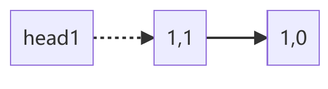
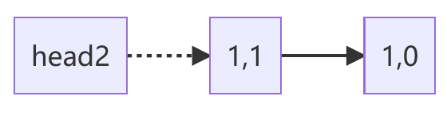
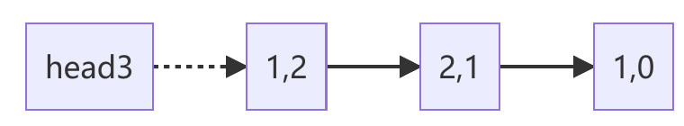

# 数据结构 第三次作业编程题第 2、5 题题解（2024 春）

## 第 2 题 多项式相乘

### 题目

本题主要考察链表的合并以及有序链表的维护。链表的优势就在于插入和删除，所以在插入的时候排序就 ok。

比如计算

$$(x + 1) \times (x + 1) = x^2 + 2x + 1$$

输入为两行，每行一个多项式，按「系数 指数」成对给出。上面这个例子对应的输入是：

```text
1 1 1 0
1 1 1 0
```

### 答案

#### 链表法

构建链表：

```c
typedef struct NODE {
    int an, n;
    struct NODE *next;
} Node;
```

读入后得到两条链表，每个结点记作「系数, 指数」：





遍历 head2 的元素和 head1 的元素依次相乘，把结果插入到 head3 即可得到：



这题我们先编写一个很方便的函数用来创建节点：

```c
Node *createNode(int an, int n) {
    Node *tempNode = (Node *) malloc(sizeof(Node));
    tempNode->an = an, tempNode->n = n, tempNode->next = NULL;
    return tempNode;
}
```

看主体代码：

```c
typedef struct NODE {
    int an, n;
    struct NODE *next;
} Node;

Node *head1, *head2, *head3;

...

int main() {
    read();//read函数用来读取输入并构建初始化两条链表
    Node *pointer1 = head1, *pointer2 = head2;
    while (pointer1) {
        pointer2 = head2;
        while (pointer2) {//遍历两条链表的元素相乘
            Node *tempNode = createNode(pointer1->an * pointer2->an, pointer1->n + pointer2->n); //得到乘积的节点
            head3 = insert(head3, tempNode);//把这个节点插入到结果链表中即可
            pointer2 = pointer2->next;
        }
        pointer1 = pointer1->next;
    }
    Node *pointer3 = head3;
    while (pointer3) {//遍历输出结果
        printf("%d %d ", pointer3->an, pointer3->n);
        pointer3 = pointer3->next;
    }
    return 0;
}
```

这道题的核心是插入函数 insert，它保证了能按顺序插入元素。一种实现方式如下：

```c
Node *insert(Node *head, Node *node) {
    //把node插入到head中，插入的过程中保持head中n的顺序是递减
    if (head == NULL) head = createNode(node->an, node->n);//head还没有初始化就创建一个节点
    else {
        Node *p = head;//使用p来遍历head链表
        while (1) {
            if (p->next == NULL || p->next->n < node->n) {
                //如果当前节点p的下一个节点为空或者下一个节点的n小于node的n，则插入node到p之后
                node->next = p->next;
                p->next = node;
                break;
            } else if (p->next->n > node->n) {//继续遍历
                p = p->next;
            } else if (p->next->n == node->n) {//如果下一个节点的n等于node的n，那么node的an合并入p
                p->next->an += node->an;
                break;
            }
        }
    }
    return head;
}
```

## 第 5 题 词频统计

### 题目

要求是读入单词、统计每个单词出现的次数，再按字典序输出。

### 答案

直接用数组然后 qsort 即可。

核心是添加单词的函数：

```c
struct WORD {
    int times;
    char word[30];
} words[10000];
int num;//单词种类数
void append(char *str) {
    //把读入的单词插入数组
    for (int i = 0; i < num; i++) {
        if (strcmp(words[i].word, str) == 0) {
            words[i].times++;
            return;
        }
    }
    words[num].times++;
    strcpy(words[num].word, str);
    num++;
}
```

最后注意快排 cmp 写法：

```c
int cmp(void const *a, void const *b) {
    int x;
    x = strcmp((*(struct WORD *) a).word, (*(struct WORD *) b).word);
    if (x < 0) {
        return -1;
    }
    return 1;
}
...
    qsort(words, num, sizeof(struct WORD), cmp);
...
```

## 链表小技巧

以下技巧旨在减小重复劳动，提高代码可读性。

### 善用宏定义申请空间

```c
#define opmm(X) (X *)malloc(sizeof(X))

typedef struct NODE {
    ...
    struct NODE *next;
} Node;
...
    Node *node = opmm(Node);//别忘了初始化node
...
```

### 使用创建节点函数

```c
typedef struct NODE {
    int an, n;
    struct NODE *next;
} Node;
Node *createNode(int an, int n) {
    Node *tempNode = (Node *) malloc(sizeof(Node));
    tempNode->an = an, tempNode->n = n, tempNode->next = NULL;
    return tempNode;
}
...
    Node *node = createNode(an, n);
...
```

### 链表遍历

```c
Node *pointer = head;
while (pointer) {//遍历,实际相当于while (pointer!=NULL)
    ...
    do sth.
    ...
    pointer = pointer->next;
}
```
