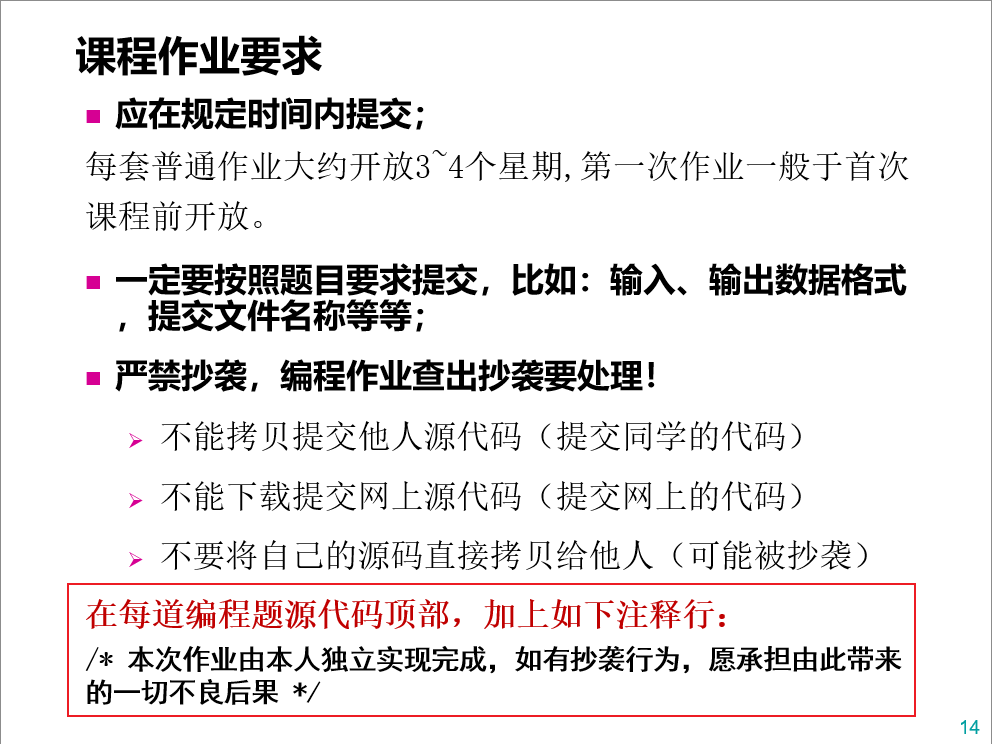

# 提问就得这么提

猪脚说 第0期

[TOC]

---

## 为什么要有这份文档?

1. **助教也是人**, 一般情况下没法瞬间回复, 更没办法瞬间完成解答;
2. 很多问题是大部分人都会遇到的, 所以希望同学们养成有问题**先搜索, 再提问**的习惯, 这样获得答案的效率更高;

## 提问前你要干什么?

1. 明确自己的问题到**代码行**;
2. 先到 **[百度](https://www.baidu.com)** 等搜索引擎搜寻自己的问题;
3. 若百度未能解决你的问题, 请到课程网站的**论坛**上搜寻相关问题;
4. 若课程网站的论坛未能解决你的问题, 请搜索课程微信群的**历史消息**, 看看有没有同学提到过相关问题;
5. 如果以上三步都没法解决你的问题, 那就提问吧!

## 如何提问更高效?

1. 尽可能**一语中的**地提问
    * [x] "执行**这句**代码时, Dev-C++ 报 SIGSEGV 错误, 截图如下/代码链接如下:" - **精确到行(或尽量精确)+错误信息+代码截图/链接**
    * [ ] "请问助教, 我这里哪错了?" - **请具体描述哪里不符合预期! 不精确到行的提问将相当耗费时间!**
2. 编写易读的代码:
    * **请不要用 `a, b, c, d, e, f` 这样没有意义的名字作为变量/函数的名字**, 建议用英文驼峰命名法, 英文单词不太懂的, 用拼音也问题不大;
    * 没记清楚运算符优先级时, 要么马上查一下, 要么**多用小括号**;
    * 就算 `if/while` 语句后面的执行语句只有一行, 也**请不要省去大括号**;
    * **勤加注释! 勤加注释! 勤加注释!**
    * 整理好你的代码, Dev-C++中使用 `Shift+Ctrl+A` 即可格式化代码, 更美观的代码会让答疑者更愿意帮你阅读代码;
3. 代码片段截图/代码片段链接, 告别微信群刷屏(**特别提出: 请不要抄袭盗用其他同学的代码, 我们有严格的代码查重!**):
    * 代码截图, 完全可以使用**微信自带的截图功能**;
    * 代码链接, 可以使用 **[Ubuntu Paste](https://paste.ubuntu.com/)**, 进入网站后使用方法如下:
       * Poster : 随意填写即可, 更推荐你填写学号姓名;
       * Syntax : 选择 `C` ;
       * Expiration : 过期时间, 选择 `A day` 意味着一天后系统将不再提供这段代码的链接;
       * Content : 粘贴**在Dev-C++中格式化后的**代码;
       * 点击 Paste , 随后生成一个网页, 把该网页的网址复制粘贴给别人, 别人就可以通过这个网址看到你的代码了.
4. 如果能够提供**复现错误**的方法, 就更好啦!

## 在哪里提问?

1. 课程论坛;
2. 微信群;
3. 私聊助教.

## 问题解决后?

十分鼓励同学们在解决自己的问题后, 把解决的思路写下来, 分享给大家. 可以是上传课程论坛, 可以是写成文档在微信群里分享!

## 其他

### Dev-C++ 小技巧 (未完待续)

1. 格式化代码: `Shift+Ctrl+A`
2. 查看函数原型: `Ctrl+鼠标左键点击函数名称`

### 提醒

