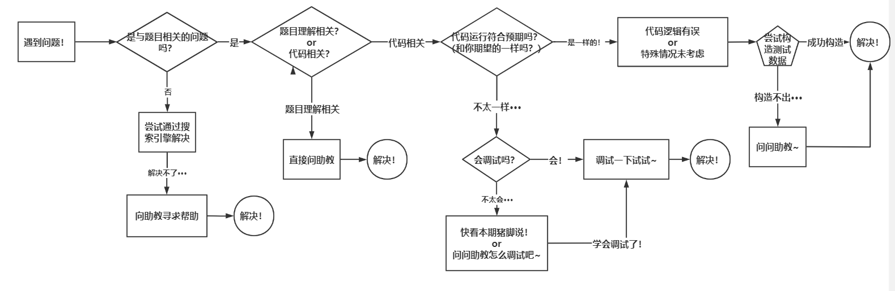
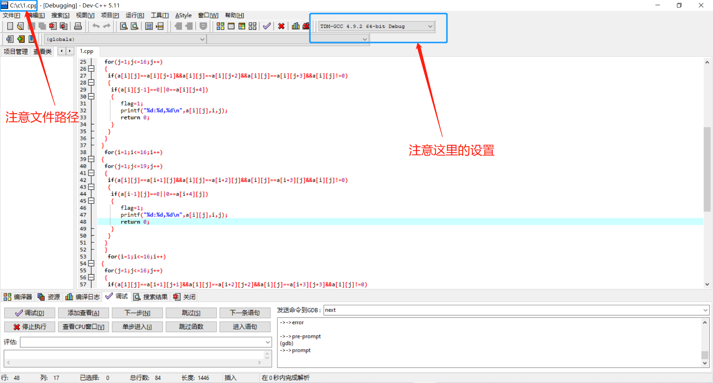
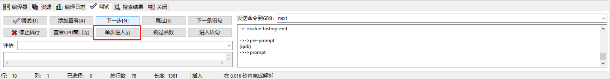

# 猪脚说第四期

* [关于提问](#id_1)
* [关于构造测试数据](#id_2)
* [关于调试](#id_3)

---

<h3 id='id_1'>关于提问</h3>

助教们非常欢迎同学们前来提问，并且乐于提供帮助。不过，在提问前，为了让助教们能更快速地理解同学们的意思并给出解答，我们建议同学们可以先通过以下流程先判断自己问题的类型，并先尝试自己解决~

---

<h3 id='id_2'>关于构造测试数据</h3>

在绝大多数题目中，**样例无法覆盖所有类型的测试数据**。

以**第二次作业第一题——五子棋危险**判断为例：样例中仅包含两种测试数据，即竖直方向存在危险的情况以及无危险的情况。但测试数据中可能会存在更多的情况，若是样例正确而提交后不通过，极有可能是在其他情况下出现问题。

因此，通过题目中的样例并非意味着可以结束本地测试的过程。我们往往需要**手动构造**更多类型的测试数据来完成测试过程——这其实并不复杂，往往只需要对样例稍加改动即可达到测试的目的。还是以五子棋为例：我们可能只需要修改样例中的几个数字，即可将样例改造为其他类型的测试数据。除此之外，**特殊情况、边界条件**等往往也是出现错误的常见区域。学会尝试自行构造基本的测试数据，能大幅度提升debug的速度。

当然，如果同学们再尝试构造后仍未查出程序的问题，助教们会为你们提供帮助~

---
<h3 id='id_3'>关于调试</h3>

根据几周的观察，同学们使用最多的IDE是**devcpp**。关于调试的基本方法，搜索引擎中可以搜到许多相关的教程，助教在此不再赘述。在此，我们仅对同学们调试过程中出现次数较多的**问题和误区**进行相关说明。

## 关于devcpp调试中可能出现的问题

* 文件路径中**不要出现中文字符**，并且文件**不可直接放置于盘符之下**（如C:/1.c 是不可行的）
* 注意将图中设置改为调试模式，即Debug（一般默认为Release，即发布模式）

## 有关调试的一些误区

* **“函数内调试不了”**——断点可以设置在函数内，从而直接在函数内进行调试；即使当前未进入函数内部，也可以通过**“单步进入”**进入函数并在函数内进行单步调试（直接点击**“下一步”**会跳过函数内部语句执行过程）

* **“查看数组变量很麻烦”**——查看变量时并非一定要查看完整的数组，可以有针对性地查看自己想看到的变量，如下图。事实上，甚至可以更具体地查看，如查看a[1]\[2]等。

![Dev-C++「新变量」对话框，输入变量名 a[][] 查看数组](image/助教说第四期-图2.png)

* **"对文件输出的语句没法调试"**——在进行文件输出后，若是没有执行fclose语句，我们是无法看到文件中有对应输出内容的，直到程序运行结束。建议在进行文件输出相关调试时，**通过printf语句在控制台输出同样的结果**，这样就能便于调试了~
