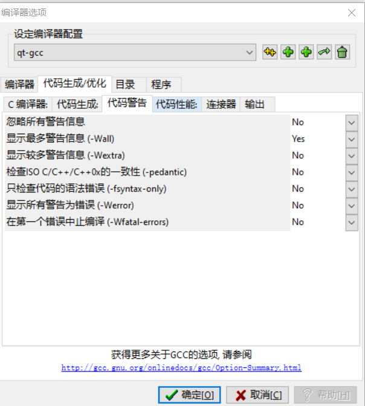

## 猪脚说第六期

### 第六周常见问题

* [标准输入读取问题](#1.1)
* [strcpy函数问题](#1.2)
* [链表建立问题](#1.3)
* [运行时错误的调试](#1.4)

### 补充内容

* [加入有用的编译选项](#1.5)
* [字符串操作综述](#1.6)

---
<h2 id="1.1">标准输入读取问题</h2>
在上次作业中，有部分同学通过在读入时对换行符(`\n`以及`\r`)进行判断来判断标准输入是否结束，或者在读入后硬性删除掉行尾的换行符，导致处理错误；

请注意，在评测机中，无论是标准输入还是文件输入，都可能不存在换行符。实际上，评测机上的标准输入很可能也是由文件实现的。因此，在之后的处理中，应该将标准输入与文件输入等同对待，不应过于依赖换行符进行判断。
<h2 id="1.2">字符串操作函数问题</h2>
strcpy函数，以及相似的strncpy函数，其复制源的内存与复制目标的内存不能出现重叠，否则会发生不可预知的错误。

出于同一种原因，strcat、strncat、memcpy这三个函数也同样不能出现这种情况。

简而言之，不应该使用该函数将一个字符串中的一部分拷贝到*同一字符串*的另一部分中。
<h2 id="1.3">链表建立问题</h2>
对于如下一个典型的链表结构

```c
struct Node{
  int num;
  struct Node* link;
};
```

要记得将链表尾部的元素的link指针置NULL，以防止之后的链表遍历操作无法找到尾部。
<h2 id="1.4">运行时错误的调试</h2>
在实际编程中，如果遇到运行时程序崩溃的情况，或者是提交后提示SIGSEGV的情况，首先应该检查自己程序的以下部分：

数组访问部分。如果数组访问时下标(即访问数组时中括号[]中的数字)超出了数组本身的大小，则会发生不可预知的错误。（不一定会崩溃）

指针使用部分。如果对空指针、未初始化的指针以及指向非法地址的指针（一般是通过将未初始化的指针赋值给已有指针产生）所指的内存进行访问，同样会发生不可预知的错误。

free部分。如果对上述指针进行free，同样会发生错误；此外，对同一个指针free两次也 *有可能* 会导致程序出错。

在调试运行时错误时，有两种方法相对比较有效；

一种是调试。调试功能可以对一些可疑的变量进行监视，并且在发生SIGSEGV时，调试会给出发生崩溃的那一行。请注意，如果正在进行监视的变量出错（如对指针指向的值进行监视，指针指向了不合法的地址），则gdb会报Trace/Breakpoint的错误而非SIGSEGV。

另一种是assert语句。assert语句可以在运行过程中监视一个表达式，在执行assert语句时，如果表达式的值为假（即0），则程序会退出并提示该assert语句的行号。这个语句可以用来检查运行中的空指针和数组下标越界问题。

例如，可以在程序中使用如下语句来检测问题；

```c
int a[50];
struct Node *p;
...
assert(i >= 0 && i < 50);
a[i] = some expression;
assert(p != NULL);
free(p);
```

此外，在使用assert语句时，需要包括头文件assert.h。

---

<h2 id="1.5">加入有用的编译选项</h2>
如果你使用Dev-C++（或者VS、CB、GUIDE等）作为编写C程序的IDE，那么你基本不用关心程序实际的编译与运行过程；IDE已经帮你做好了一切准备工作。

但实际上，编译器提供了很多实用的选项，但IDE实际上只会打开其中的一部分功能。

本章以Dev-C++为例，简单介绍gcc编译器的-Wall选项以及如何加入该选项。

-Wall选项，实际上是打开所有警告信息的简写。在不打开这个选项时，编译器一般不会对你”指手画脚“；但是在打开之后，编译器就会对程序中所有可能出问题的地方一一吐槽。

例如，在使用位运算的过程中未加括号，编译器会警告；

使用可能未初始化的变量或是定义了变量但不使用，编译器会警告；

对指针使用sizeof、代码缩进不正确、读入字符串时对字符串取址，等等常见小错误，编译器都会警告。

因此，这个选项可以辅助程序员快速养成较为良好的编程习惯并及时找出小错误。

如果想要加入这个选项，可以在Dev-C++的工具-编译器-代码生成/优化-代码警告下勾选"显示最多警告信息"。也可以自己试着打开其他的选项来尝试效果。


<br/><br/><br/><br/>
<h2 id="1.6">字符串操作综述</h2>

**常用操作**

---

*快速读入*：一种使用getchar读入的方法。也可以用于逐字符操作。

个人定制性很高，可以通过更改过滤掉的字符来实现各种读入方式。

```c
int read(char* str) {
  char c;
  int i = 0;
  do {
    c = getchar();
  }while (c < ' '  && c != EOF); //滤去不可见字符
  if (c == EOF) {
    return -1;
  }
  do {
    str[i++] = c;
    c = getchar();
  }while (c >= ' '); //读入，直至遇到不可见字符；
  str[i] = '\0';
  return i;
}
```

*字符串转数字*： 更改常数10可以将字符串转换为不同进制的数字。

```c
int parseInt(char* str) {
  int ret = 0;
  int i = 0;
  while (str[i] != '\0') {
    ret *= 10;
    ret += str[i++] - '0';
  }
  return ret;
}
```

*数字转字符串*： 与前一种操作过程基本相同。此外在十进制情况下，这两个函数也可以通过标准库实现。

```c
void valueOf(int num, char* str) {
  int i = 0;
  while(num) {
      str[i++] = num % 10;
      num /= 10;
  }
  str[i] = '\0';
  return;
}
```

*字符串分割*： 将字符串按照指定的分隔符delimiter进行分割。这个操作也可以使用strtok函数来完成，但并不推荐使用。

<br/><br/>
以下仅为操作示例，在实际应用中应根据自身情况调整。
<br/><br/>

```c
//用字符delimiter分割str，并将其结果保存到字符串数组result中
int split(char* str, char delimiter,  char** result) {
  int j = 0;
  int cnt = 0;
  for (int i = 0; str[i] != '\0'; ++i) {
    if (str[i] == delimiter) {
      result[cnt++][j] = '\0';
      j = 0;
    }
    else {
      result[cnt][j++] = str[i];
    }
  }
  return cnt;
}
```

**常用库函数**：

---

实际上，以下大部分函数都可以自己编写并实现。在对库函数不熟悉的情况下，推荐自行编写。

---

**必须熟练使用**：

`unsigned int strlen(char* str)`:

  返回一个字符串的长度。这里不得不进行第三次强调：不要在循环中的任何位置重复调用strlen函数！！！！

  具体原因见第五期猪脚说。

`int strcmp(char* str1, char* str2)`:
  逐字比较两个字符串的内容；这里不得不进行第三次强调：该函数的返回值不仅限于0,1和-1！

  具体原因同样见上一期猪脚说。

  此外，该函数也有一限制进行比较的字符个数的版本strncmp，但很少用到。

---

**值得一试**：

`char* strcpy(char* destination, char* source)`和`char* strncpy(char* dest, char* src, unsigned int num)`:

* 将source字符串中的内容拷贝到destination字符串中。
* 对于strncpy函数，可以用num来指定最大拷贝字符数。
* 返回destination字符串。
* 上文已经提及，不应将同一个字符串的不同部分分别作为dest和src。

`char* strcat(char* destination, char* source)`和`char* strncat(char* dest, char* src, unsigned int num)`:

* 将source字符串中的内容接到destination字符串的后面。
* 对于strncat函数，可以用num来指定仅将前num个字符接到destination的后面。
* 返回destination字符串。
* 上文已经提及，不应将同一个字符串的不同部分分别作为dest和src。
* cat是英文concatenate的缩写。

`char* strstr(char* str1, char* str2)`

* 在str1中查找str2。
* 如果查找到了，返回一个指向str1中的指针，这个指针指向str2第一次在str1中出现的位置。
* 如果没有查找到，返回NULL。
* 查找过程不会匹配空字符'\0'，并且会在该处停止查找。

`int atoi(char* str)` 和 `long int strtol(char* str, char** endptr, int base)`:

* 将str转换为整数。如果无法进行转换，则返回0.
* 如果转换后的数字超过整数可表示范围，则atoi可能会返回任意值；而strtol则会返回上限或者下限。
* strtol函数中中如果传入的endptr不为NULL，则该函数会将endptr指向str字符串中数字后面的第一个字符。
* 简单来说就是假如str是"123abc"，则strtol函数工作完后，endptr会指向a。  
* base参数可以指定strtol转化过程中使用的进制。
* 后面这个函数一般来说不常用，可以不用详细了解。
* 与其他函数不同，这两个函数定义在stdlib.h中。
* itoa函数不是标准库函数。

---

**较难掌握，但仍然有实用意义**:

`int sscanf(char* s, char* format, ...)`:

* 与fscanf相似。区别是scanf从文件中读入，而sscanf从s字符串中读入。
* 例如：

```c
  char str[] = "773 to 774";
  char s1[100], s2[100];
  int i;
  sscanf(str,"%d %s %s", &i, s1, s2);
```

运行后i的值为773，s1为"to", s2为"774"，与一般scanf的结果相同。

* 利用这个函数可以将字符串转化为各种类型的值。
* 返回值为读取变量的个数。若读取失败，返回EOF。

`int sprintf(char* s, char* format, ...)`:

* 与fprintf相似。区别是fprintf将内容输出到文件中，而sprintf将内容输入到s字符串中。
* 例如：

```c
  char buffer [50];
  int a=5, b=3;
  sprintf (buffer, "%d plus %d is %d", a, b, a+b);
```

* 这段程序会让buffer的内容变为"5 plus 3 is 8".
* 在需要获得指定格式的字符串时很有用。
* 该函数的返回值为格式化后的字符串的长度。
