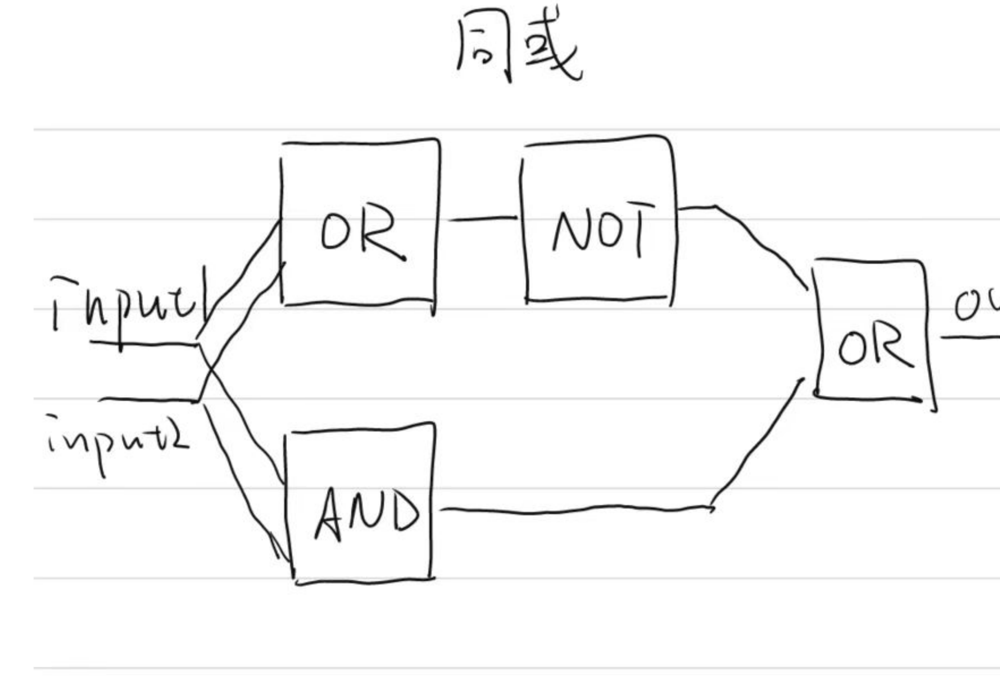
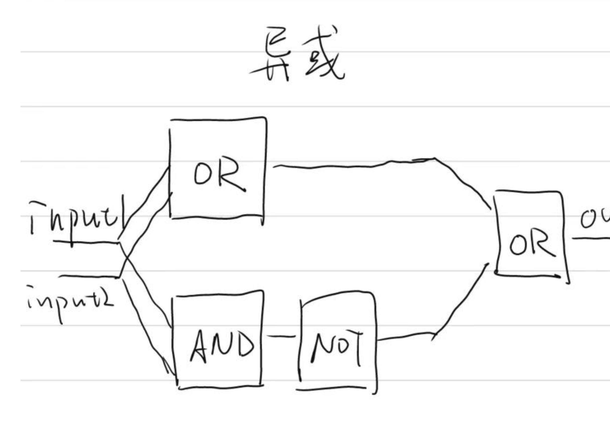

# 电子设计基础训练 逻辑电路实验作业答案（2024春）

## 1 同或逻辑门

### 题目

利用与、非、或三种逻辑门实现双控开关，即同或逻辑门。该实例模拟的是卧室中门口及床头两个开关都能控制卧室灯的场景，只要两个开关处于同一状态灯就亮起。

真值表：

| A | B | Y |
| --- | --- | --- |
| 0 | 0 | 1 |
| 0 | 1 | 0 |
| 1 | 0 | 0 |
| 1 | 1 | 1 |

### 答案

**答案：**

原件手绘电路的连接方式：

- 上支路：input1、input2 接入或门，或门输出再接入非门
- 下支路：input1、input2 接入与门
- 非门输出与与门输出一起接入末级或门，或门输出即 output

逻辑表达式：

$$Y=\overline{A+B}+AB$$

复算（与真值表一致）：

- $A=0,B=0$： $\overline{0}+0=1$
- $A=0,B=1$： $\overline{1}+0=0$
- $A=1,B=0$： $\overline{1}+0=0$
- $A=1,B=1$： $\overline{1}+1=1$

即同或（XNOR）。

## 2 异或逻辑门

### 题目

### 答案

**答案：**

原件手绘电路的连接方式：

- 上支路：input1、input2 接入或门，或门输出直接接入末级或门
- 下支路：input1、input2 接入与门，与门输出再接入非门，非门输出接入末级或门
- 末级或门输出即 output

按手绘电路连接写出的逻辑表达式为

$$Y=(A+B)+\overline{AB}$$

复算： $A,B$ 取 $00$、 $01$、 $10$、 $11$ 四组时， $A+B$ 与 $\overline{AB}$ 至少有一个为 1，故 $Y$ 恒为 1，不是异或。

异或的正确实现应为末级取与门：

$$Y=(A+B)\cdot\overline{AB}$$

复算：

- $A=0,B=0$： $0\cdot 1=0$
- $A=0,B=1$： $1\cdot 1=1$
- $A=1,B=0$： $1\cdot 1=1$
- $A=1,B=1$： $1\cdot 0=0$
