# 基础物理学A(2) 2022–2023 学年第一学期期末试卷参考答案

## 一、选择题（将正确答案的字母填在空格内，每小题 3 分，共 30 分）

### 1. 下列各式中哪一式表示气体分子的平均平动动能

#### 题目

1. 下列各式中哪一式表示气体分子的平均平动动能？（式中 $M$ 为气体的质量， $m$ 为气体分子质量， $N$ 为气体分子总数目， $n$ 为气体分子数密度， $N_\mathrm{A}$ 为阿伏加得罗常量）

   (A) $\dfrac{3m}{2M}pV$　　(B) $\dfrac{3M}{2M_\mathrm{mol}}pV$　　(C) $\dfrac{3}{2}npV$　　(D) $\dfrac{3M_\mathrm{mol}}{2M}N_\mathrm{A}pV$

#### 答案

**答案：** (A)。

由 $pV=NkT$ 得单个分子的平均平动动能 $\bar{\varepsilon}=\dfrac{3}{2}kT=\dfrac{3}{2}\cdot\dfrac{pV}{N}$，而 $\dfrac{m}{M}=\dfrac{1}{N}$（ $m$ 为分子质量， $M$ 为气体总质量），故 $\bar{\varepsilon}=\dfrac{3m}{2M}pV$。

### 2. 一定质量的理想气体在绝热过程中密度随压强的变化图象

#### 题目

2\. 在所给出的四个图象中，哪个图象能够描述一定质量的理想气体，在绝热过程中，密度随压强的变化？

   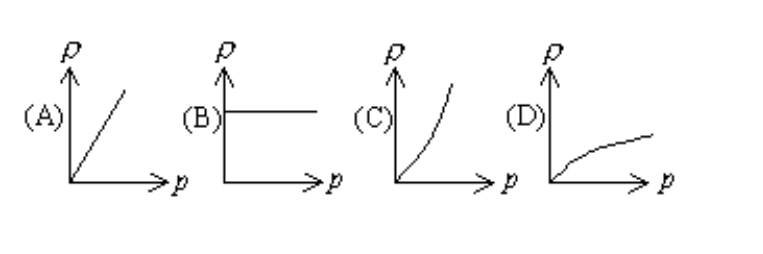

#### 答案

**答案：** (D)。

绝热过程 $pV^{\gamma}=C$，又 $\rho=M/V$，故 $p\propto\rho^{\gamma}$，即 $\rho\propto p^{1/\gamma}$。因 $\gamma>1$， $\rho$ 随 $p$ 单调增大且曲线向下凹（斜率递减），对应图 (D)。

### 3. 卡诺循环中传给低温热源的热量与从高温热源吸取热量之比

#### 题目

3\. 设高温热源的热力学温度是低温热源的热力学温度的 $n$ 倍，则理想气体在一次卡诺循环中，传给低温热源的热量是从高温热源吸取热量的

   (A) $n$ 倍　　(B) $n-1$ 倍　　(C) $\dfrac{1}{n}$ 倍　　(D) $\dfrac{n+1}{n}$ 倍

#### 答案

**答案：** (C)。

卡诺循环中 $\dfrac{Q_2}{Q_1}=\dfrac{T_2}{T_1}=\dfrac{1}{n}$。

### 4. $x=2a(1+\cos\omega_0 t)\cos\omega t$ 分解后另一个简谐振动的振幅

#### 题目

4\. 某一周期性振动的数学表达式为
$$x=2a(1+\cos\omega_0 t)\cos\omega t\qquad(\omega=m\omega_0,\ m\ \text{整数}).$$
该振动可以分解为三个简谐振动，它们的角频率分别为 $m\omega_0$、 $(m+1)\omega_0$ 和 $(m-1)\omega_0$；而其中两个简谐振动的振幅分别为 $a$ 和 $2a$，另一个简谐振动的振幅为

   (A) $a$　　(B) $2a$　　(C) $3a$　　(D) $4a$

#### 答案

**答案：** (A)。

$$x=2a\cos\omega t+2a\cos\omega_0t\cos\omega t=2a\cos m\omega_0t+a\cos(m+1)\omega_0t+a\cos(m-1)\omega_0t.$$

三个分量的振幅分别为 $2a$、 $a$、 $a$，故另一个振幅为 $a$。

### 5. $S_1$ 外侧各点两波引起的两谐振动的相位差

#### 题目

5\. 两相干波源 $S_1$ 和 $S_2$ 相距 $\lambda/4$（ $\lambda$ 为波长）， $S_1$ 的相位比 $S_2$ 的相位超前 $\dfrac{1}{2}\pi$，在 $S_1$、 $S_2$ 的连线上， $S_1$ 外侧各点（例如 $P$ 点）两波引起的两谐振动的相位差是

   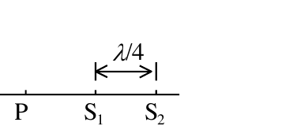

   (A) $0$　　(B) $\dfrac{1}{2}\pi$　　(C) $\pi$　　(D) $\dfrac{3}{2}\pi$

#### 答案

**答案：** (C)。

$$\Delta\varphi=(\varphi_1-\varphi_2)+\frac{2\pi}{\lambda}(r_2-r_1)=\frac{\pi}{2}+\frac{2\pi}{\lambda}\cdot\frac{\lambda}{4}=\pi .$$

### 6. 盖住 $S_2$ 并在垂直平分面加高折射率介质反射面后 $P$ 点的条纹

#### 题目

6\. 在双缝干涉实验中，屏幕 $E$ 上的 $P$ 点处是明条纹。若将缝 $S_2$ 盖住，并在 $S_1S_2$ 连线的垂直平分面处放一高折射率介质反射面 $M$，如图所示，则此时

   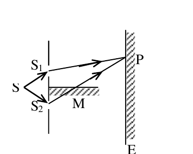

   (A) $P$ 点处仍为明条纹　　(B) $P$ 点处为暗条纹

   (C) 不能确定 $P$ 点处是明条纹还是暗条纹　　(D) 无干涉条纹

#### 答案

**答案：** (B)。

$M$ 位于 $S_1S_2$ 的垂直平分面上， $S_1$ 关于 $M$ 的像在 $S_2$ 处，故反射光 $S\to S_1\to M\to P$ 的几何路程等于原 $S\to S_2\to P$ 的路程，几何程差仍为 $r_1-r_2=k\lambda$；但反射时存在半波损失（相位突变 $\pi$），两束光相位差变为 $(2k+1)\pi$，故 $P$ 点变为暗条纹。

### 7. 单缝衍射第一个暗纹处 $BC$ 的长度

#### 题目

7\. 一束波长为 $\lambda$ 的平行单色光垂直入射到一单缝 $AB$ 上，装置如图。在屏幕 $D$ 上形成衍射图样，如果 $P$ 是中央亮纹一侧第一个暗纹所在的位置，则 $BC$ 的长度为

   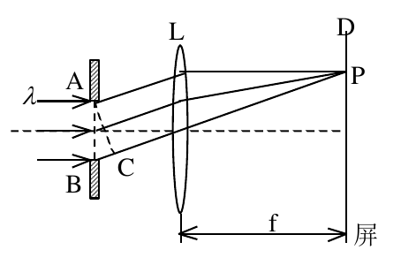

   (A) $\lambda/2$　　(B) $\lambda$　　(C) $3\lambda/2$　　(D) $2\lambda$

#### 答案

**答案：** (B)。

$BC$ 即单缝两端光线的光程差。第一个暗纹条件为 $a\sin\theta=\lambda$，故 $BC=\lambda$。

### 8. 入射角等于布儒斯特角时的反射光与透射光

#### 题目

8\. 一束偏振光（偏振方向如图）自空气射向一块平面玻璃，就一般情况而言，它在玻璃的两个界面上会产生如图所示的反射光和透射光。如果入射角恰好等于布儒斯特角 $i_0$，则

   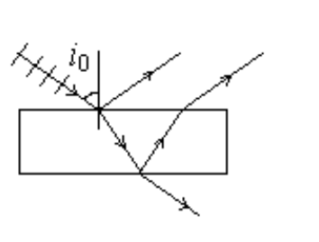

   (A) 反射光光强为零，透射光光强为最大

   (B) 反射光是完全偏振光，且振动方向垂直于入射面

   (C) 反射光是完全偏振光，且振动方向平行于入射面

   (D) 透射光光强为零，反射光光强为最大

#### 答案

**答案：** (B)。

入射角为布儒斯特角时，反射光为完全（线）偏振光，振动方向垂直于入射面；反射光强不为零，透射光为部分偏振光。

### 9. 赖曼系光谱波长的表达式

#### 题目

9\. 已知用光照的办法将氢原子基态的电子电离，可用的最长波长的光是 91.2 nm 的紫外光，那么氢原子从各受激态跃迁至基态的赖曼系光谱的波长可表示为：

   (A) $\lambda=91.2\dfrac{n-1}{n+1}$ nm　　(B) $\lambda=91.2\dfrac{n+1}{n-1}$ nm

   (C) $\lambda=91.2\dfrac{n^2}{n^2-1}$ nm　　(D) $\lambda=91.2\dfrac{n^2+1}{n^2-1}$ nm

#### 答案

**答案：** (C)。

基态电离的极限波长满足 $\dfrac{1}{\lambda_0}=R$， $\lambda_0=91.2$ nm；赖曼系 $\dfrac{1}{\lambda}=R\left(1-\dfrac{1}{n^2}\right)$，故 $\lambda=\lambda_0\dfrac{n^2}{n^2-1}=91.2\dfrac{n^2}{n^2-1}$ nm。

### 10. 电子单缝衍射中央最大的宽度

#### 题目

10\. 如图所示，一束动量为 $p$ 的电子，通过缝宽为 $a$ 的狭缝，在距离狭缝为 $R$ 处放置一荧光屏，屏上衍射图样中央最大的宽度 $d$ 等于

    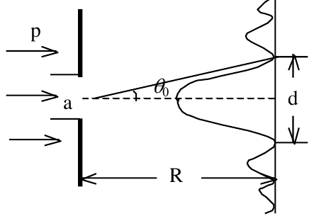

    (A) $2a^2/R$　　(B) $2ha/p$　　(C) $2ha/(Rp)$　　(D) $2Rh/(ap)$

#### 答案

**答案：** (D)。

德布罗意波长 $\lambda=h/p$，中央最大宽度 $d=2R\sin\theta=2R\dfrac{\lambda}{a}=\dfrac{2Rh}{ap}$。

## 二、填空题（将最简结果填在空格内；每题 3 分，共 30 分）

### 1. 由速率分布导出平均平动动能的分布及最概然值

#### 题目

1. 理想气体处于平衡态时，根据麦克斯韦速率分布函数
$$f(v)=4\pi\left(\frac{m}{2\pi kT}\right)^{\frac{3}{2}}e^{-\frac{mv^2}{2kT}}v^2,$$
可导出分子的平均平动动能在 $\varepsilon$ 到 $\varepsilon+\mathrm{d}\varepsilon$ 区间的概率为 $f(\varepsilon)\mathrm{d}\varepsilon=$ ________，其中 $\varepsilon=\dfrac{1}{2}mv^2$。

   再根据这一分布式，可导出分子平均平动能的最概然值 $\varepsilon_P=$ ________。

#### 答案

**答案：**

$$f(\varepsilon)\mathrm{d}\varepsilon=\frac{2}{\sqrt{\pi}}\left(\frac{1}{kT}\right)^{3/2}\sqrt{\varepsilon}\,e^{-\frac{\varepsilon}{kT}}\mathrm{d}\varepsilon .$$

由 $\dfrac{\mathrm{d}}{\mathrm{d}\varepsilon}\left(\sqrt{\varepsilon}e^{-\varepsilon/kT}\right)=0$ 得最概然值

$$\varepsilon_P=\frac{1}{2}kT .$$

### 2. 循环 acba 中净吸热量 $Q$ 与 $Q_{ab}$ 的比较

#### 题目

2\. 有 $\nu$ 摩尔理想气体，作如图所示的循环过程 acba，其中 acb 为半圆弧，b-a 为等压线， $p_c=2p_a$，令气体进行 a-b 的等压过程时吸热 $Q_{ab}$，则在此循环过程中气体净吸热量 $Q$ ________ $Q_{ab}$。（填入：>，< 或 =）

   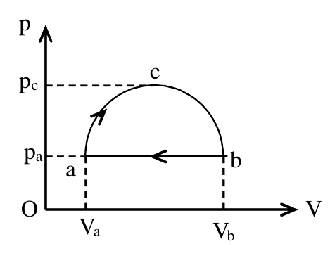

#### 答案

**答案：** $Q<Q_{ab}$，即填 $<$。

循环沿 $a\to c\to b\to a$ 为顺时针，净功等于半圆面积。半圆的半径 $R_0=\dfrac{V_b-V_a}{2}=p_c-p_a=p_a$，故

$$W=\frac{1}{2}\pi R_0^{2}=\frac{\pi}{2}p_a^{2}=\frac{\pi}{8}(V_b-V_a)^{2}.$$

等压过程 $a\to b$ 的吸热

$$Q_{ab}=\nu C_p\Delta T=\frac{C_p}{R}p_a(V_b-V_a)=\frac{C_p}{2R}(V_b-V_a)^{2}.$$

于是 $\dfrac{Q}{Q_{ab}}=\dfrac{W}{Q_{ab}}=\dfrac{\pi R}{4C_p}$。对理想气体 $C_p\ge\dfrac{5}{2}R$，故 $\dfrac{Q}{Q_{ab}}\le\dfrac{\pi}{10}<1$，即 $Q<Q_{ab}$。

### 3. 速度具有正最大值时为 $t=0$ 的简谐振动表达式

#### 题目

3\. 一质点作简谐振动，速度最大值 $v_m=5$ cm/s，振幅 $A=2$ cm。若令其速度具有正最大值的那一时刻为 $t=0$，则振动表达式为 ________。

#### 答案

**答案：** $x=2\sin(2.5t)$ cm，即 $x=0.02\sin(2.5t)$ m。

$\omega=\dfrac{v_m}{A}=\dfrac{5}{2}=2.5$ rad/s。取 $x=A\cos(\omega t+\varphi)$，则 $v=-A\omega\sin(\omega t+\varphi)$，由 $v(0)=v_m>0$ 得 $\sin\varphi=-1$， $\varphi=-\dfrac{\pi}{2}$，故 $x=2\cos\left(2.5t-\dfrac{\pi}{2}\right)=2\sin(2.5t)$ cm。

### 4. 管中波的平均能量密度与一个波长段内的能量

#### 题目

4\. 一简谐空气波，沿半径为 $R$ 的圆柱形管传播，波的强度为 $I$，频率为 $\nu$，波速为 $u$，则管中波的平均能量密度为 ________，管中每两个相邻同相面间的波段中含有的波的能量为 ________。

#### 答案

**答案：** 平均能量密度 $\bar{w}=\dfrac{I}{u}$；相邻两个同相面之间（一个波长）波段内的能量

$$W=\bar{w}\cdot\pi R^{2}\lambda=\frac{I}{u}\cdot\pi R^{2}\cdot\frac{u}{\nu}=\frac{\pi R^{2}I}{\nu}.$$

### 5. 沿 $x$ 轴负方向传播的平面简谐波表达式

#### 题目

5\. 一平面简谐波沿 $x$ 轴负方向传播。已知 $x=-1$ m 处质点的振动方程为 $y=A\cos(\omega t+\phi)$，若波速为 $u$，则此波的表达式为 ________。

#### 答案

**答案：**

$$y=A\cos\left[\omega\left(t+\frac{x+1}{u}\right)+\phi\right].$$

沿 $-x$ 方向传播的波可写为 $y=A\cos\left[\omega\left(t+\dfrac{x}{u}\right)+\varphi_0\right]$，代入 $x=-1$ m 处 $y=A\cos(\omega t+\phi)$，得 $\varphi_0=\phi+\dfrac{\omega}{u}$。

### 6. 牛顿环第 4 个暗环对应的空气膜厚度

#### 题目

6\. 用 $\lambda=600$ nm 的单色光垂直照射牛顿环装置时，从中央向外数第 4 个（不计中央暗斑）暗环对应的空气膜厚度为 ________ μm。（1 nm= $10^{-9}$ m）

#### 答案

**答案：** $d=2\lambda=1200$ nm $=1.2$ μm。

反射光中只有空气膜下表面（空气→玻璃）的反射有半波损失，光程差 $\delta=2d+\dfrac{\lambda}{2}$。暗环条件 $\delta=(2k+1)\dfrac{\lambda}{2}$，即 $2d=k\lambda$， $k=0,1,2,\dots$。中央暗斑对应 $k=0$，由中央向外数第 4 个暗环（不计中央暗斑）对应 $k=4$，故

$$d=\frac{4\lambda}{2}=2\lambda=2\times600\ \text{nm}=1200\ \text{nm}=1.2\ \mu\text{m}.$$

### 7. $k=2$ 方向上第一条缝与第六条缝的光程差

#### 题目

7\. 衍射光栅主极大公式 $(a+b)\sin\varphi=\pm k\lambda$， $k=0,1,2\cdots$。在 $k=2$ 的方向上第一条缝与第六条缝对应点发出的两条衍射光的光程差 $\delta=$ ________。

#### 答案

**答案：** $\delta=10\lambda$。

相邻缝的光程差 $d\sin\varphi=2\lambda$，第一条缝与第六条缝相隔 5 个缝距，故 $\delta=5\times2\lambda=10\lambda$。

### 8. 方解石晶体中 o 光与 e 光的振动方向

#### 题目

8\. 解石晶体（方解石晶体）内有一点光源 $S$，请在通过光轴的平面（见图）上画出晶体中的惠更斯波面图，并分别用点子（表示垂直于图面）和短线（表示平行于图面）标明该平面上 o 光线和 e 光线的振动（电矢量）方向。

   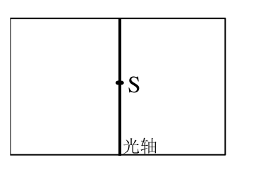

#### 答案

**答案：** 惠更斯波面图如下（图面即通过光轴的平面）：

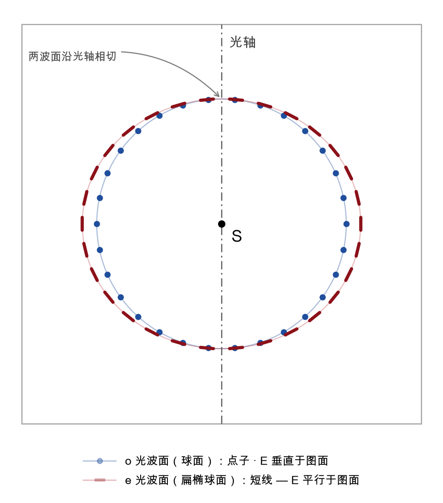

o 光的子波为球面（图中为圆），其振动（电矢量）方向垂直于主截面，即垂直于图面，故在 o 光波面上用点子（·）标出；e 光的子波为旋转椭球面（图中为椭圆），其振动方向平行于主截面，即平行于图面，故在 e 光波面上用短线（—）标出。

方解石是负晶体（ $n_{e}\approx1.486<n_{o}\approx1.658$）：沿光轴方向 o 光与 e 光的速度相同（均为 $c/n_{o}$），两波面在光轴的两端相切；垂直于光轴方向 e 光的速度为 $c/n_{e}>c/n_{o}$，故 e 光子波为扁椭球，长轴垂直于光轴。

### 9. 四块黑体板热辐射平衡时的 $T_2$ 与 $T_3$

#### 题目

9\. 如图，真空中有四块完全相同且彼此靠近的大金属板平行放置，表面涂黑（可看成绝对黑体）。最外侧两块的热力学温度各维持为 $T_1$ 和 $T_4$，且 $T_1>T_4$。当达到热辐射稳定平衡时，第二块板热力学温度 $T_2=$ ________；第三块板的热力学温度 $T_3=$ ________。

   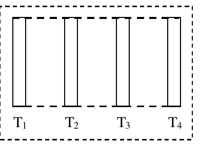

#### 答案

**答案：**

$$T_2=\left(\frac{2T_1^{4}+T_4^{4}}{3}\right)^{1/4},\qquad T_3=\left(\frac{T_1^{4}+2T_4^{4}}{3}\right)^{1/4}.$$

稳定平衡时相邻板之间的净辐射功率相等：

$$\sigma(T_1^{4}-T_2^{4})=\sigma(T_2^{4}-T_3^{4})=\sigma(T_3^{4}-T_4^{4})=\frac{1}{3}\sigma(T_1^{4}-T_4^{4}),$$

由此解出上式。

### 10. $n=4$ 时轨道角动量及其在外磁场方向的投影

#### 题目

10\. 量子力学得出：若氢原子处于主量子数 $n=4$ 的状态，则其轨道角动量可能取的值（用 $\hbar$ 表示）分别为 ________；对应于 $l=3$ 的状态，氢原子的角动量在外磁场方向的投影可能取的值分别为 ________。

#### 答案

**答案：** 轨道角动量可能取值为 $0$、 $\sqrt{2}\hbar$、 $\sqrt{6}\hbar$、 $2\sqrt{3}\hbar$（分别对应 $l=0,1,2,3$）； $l=3$ 时在外磁场方向的投影可能取值为 $-3\hbar$、 $-2\hbar$、 $-\hbar$、 $0$、 $\hbar$、 $2\hbar$、 $3\hbar$。

## 三、计算题（每题 10 分，共 40 分）

### 1. 单原子理想气体的准静态压缩过程

#### 题目

1. 1 摩尔单原子理想气体，从初态 $(p_0,V_0)$ 经过一个准静态压缩过程到达终态 $\left(8p_0,\dfrac{1}{4}V_0\right)$。（ $R$ 为普适气体常量）

   (1) 求此过程气体的熵增量 $\Delta S$；

   (2) 假设全过程的每一小过程中，气体对外做功 $\mathrm{d}A$ 与吸收热量 $\mathrm{d}Q$ 之比 $\dfrac{\mathrm{d}A}{\mathrm{d}Q}=4$，求此准静态过程的过程方程。

#### 答案

**答案：**

(1) 熵变只由初末态决定。 $T_1=\dfrac{p_0V_0}{R}$， $T_2=\dfrac{8p_0\cdot V_0/4}{R}=2T_1$，故

$$\Delta S=C_V\ln\frac{T_2}{T_1}+R\ln\frac{V_2}{V_1}=\frac{3}{2}R\ln 2+R\ln\frac{1}{4}=\frac{3}{2}R\ln2-2R\ln2=-\frac{1}{2}R\ln 2\approx-2.88\ \text{J/K}.$$

(2) 由 $\dfrac{\mathrm{d}A}{\mathrm{d}Q}=4$ 得 $\mathrm{d}Q=\dfrac{1}{4}\mathrm{d}A$，于是

$$\mathrm{d}U=\mathrm{d}Q-\mathrm{d}A=-\frac{3}{4}\mathrm{d}A=-\frac{3}{4}p\,\mathrm{d}V .$$

又 $\mathrm{d}U=\dfrac{3}{2}R\,\mathrm{d}T$，故 $\dfrac{3}{2}R\,\mathrm{d}T=-\dfrac{3}{4}p\,\mathrm{d}V$，即 $R\,\mathrm{d}T=-\dfrac{1}{2}p\,\mathrm{d}V$。代入 $p=\dfrac{RT}{V}$ 得

$$\frac{\mathrm{d}T}{T}=-\frac{1}{2}\frac{\mathrm{d}V}{V}\ \Longrightarrow\ TV^{1/2}=\text{常量}\ \Longrightarrow\ pV^{3/2}=\text{常量},$$

即过程方程为 $pV^{3/2}=p_0V_0^{3/2}$（可验证 $8p_0\left(\dfrac{V_0}{4}\right)^{3/2}=p_0V_0^{3/2}$）。

### 2. 肥皂膜反射光的增强与相消波长

#### 题目

2\. 一肥皂膜的厚度为 0.550 μm，折射率为 1.35，白光（波长范围为 400 nm~700 nm）垂直照射。问在反射光中那些波长的光得到最大增强？哪些波长的光干涉相消？（结果保留两位有效数字）

#### 答案

**答案：** 膜的上下表面反射光之间有一次半波损失，光程差 $\delta=2nd+\dfrac{\lambda}{2}$，其中

$$2nd=2\times1.35\times0.550\ \mu\text{m}=1.485\ \mu\text{m}=1485\ \text{nm}.$$

增强条件 $2nd+\dfrac{\lambda}{2}=k\lambda$，即 $\lambda=\dfrac{2nd}{k-1/2}$：

| $k$ | 1 | 2 | 3 | 4 | 5 |
| --- | --- | --- | --- | --- | --- |
| $\lambda$/nm | 2970 | 990 | 594 | 424 | 330 |

落在 400~700 nm 内的为 $\lambda\approx5.9\times10^{2}$ nm 和 $\lambda\approx4.2\times10^{2}$ nm。

相消条件 $2nd=k\lambda$，即 $\lambda=\dfrac{2nd}{k}$：

| $k$ | 1 | 2 | 3 | 4 |
| --- | --- | --- | --- | --- |
| $\lambda$/nm | 1485 | 743 | 495 | 371 |

落在 400~700 nm 内的为 $\lambda\approx5.0\times10^{2}$ nm。

### 3. 波源两侧的波函数、反射波与合成波

#### 题目

3\. 如图， $O$ 点处有一波源，开始时波源振动的初相位为 0，波源向左右两边发射振幅为 $A$、角频率为 $\omega$ 的余弦简谐波，波速为 $u$。 $BB'$ 为反射面， $O'$ 为 $BB'$ 面与 $x$ 轴的交点， $OO'$ 等于 $5\lambda/4$（ $\lambda$ 为波长）。以 $O$ 点为 $x$ 轴坐标原点。

   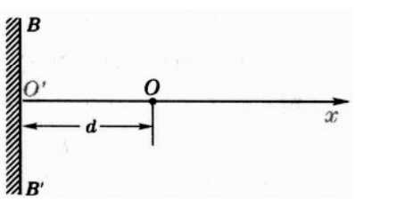

   (1) 写出沿 $x$ 轴正向和沿 $x$ 轴负向传播的简谐波的波函数；

   (2) 当波传播到 $BB'$ 面时，反射波有半波损失，写出反射波的波函数；

   (3) 在 (2) 的条件下，求出 $O$ 点两边合成波的波函数并给出合成波的属性。

#### 答案

**答案：** $O'$ 位于 $x=-\dfrac{5\lambda}{4}$，记 $k=\dfrac{2\pi}{\lambda}=\dfrac{\omega}{u}$。

(1) 沿 $x$ 轴正向： $y_1=A\cos\omega\left(t-\dfrac{x}{u}\right)=A\cos(\omega t-kx)$；沿 $x$ 轴负向： $y_2=A\cos\omega\left(t+\dfrac{x}{u}\right)=A\cos(\omega t+kx)$。

(2) 入射波 $y_2$ 在 $x=-\dfrac{5\lambda}{4}$ 处反射，反射波沿 $+x$ 方向传播，计入半波损失后

$$y_3=-A\cos\left[\omega t+k\left(2x_{O'}-x\right)\right]=-A\cos\left(\omega t-5\pi-kx\right)=A\cos(\omega t-kx),$$

（其中 $2kx_{O'}=2\cdot\dfrac{2\pi}{\lambda}\cdot\left(-\dfrac{5\lambda}{4}\right)=-5\pi$。）

即反射波与正向波 $y_1$ 同相叠加。

(3) $O$ 点右侧（ $x>0$）：

$$y=y_1+y_3=2A\cos(\omega t-kx),$$

为振幅 $2A$、沿 $+x$ 方向传播的行波。

$O$ 点左侧（ $-\dfrac{5\lambda}{4}<x<0$）：

$$y=y_2+y_3=A\cos(\omega t+kx)+A\cos(\omega t-kx)=2A\cos kx\cos\omega t,$$

为驻波，振幅 $2A|\cos kx|$，波节位于 $x=-\dfrac{\lambda}{4},-\dfrac{3\lambda}{4},-\dfrac{5\lambda}{4},\dots$， $O$ 点（ $x=0$）为波腹。

### 4. 一维无限深方势阱中的电子

#### 题目

4\. 设有一电子在宽为 0.20 nm 的一维无限深的方势阱中。(1) 计算电子在最低能级的能量；(2) 当电子处于第一激发态（ $n=2$）时，写出其波函数；并求其在势阱中何处出现的概率最大？（普朗克常量 $h=6.63\times10^{-34}$ J·s，电子静止质量 $m_e=9.11\times10^{-31}$ kg）

#### 答案

**答案：**

(1) 取势阱宽度 $a=0.20$ nm $=2.0\times10^{-10}$ m，

$$E_1=\frac{h^2}{8ma^2}=\frac{(6.63\times10^{-34})^{2}}{8\times9.11\times10^{-31}\times(2.0\times10^{-10})^{2}}\approx1.51\times10^{-18}\ \text{J}\approx9.4\ \text{eV}.$$

(2) 第一激发态 $n=2$：

$$\psi_2(x)=\sqrt{\frac{2}{a}}\sin\frac{2\pi x}{a},\qquad 0<x<a .$$

概率密度 $|\psi_2|^{2}\propto\sin^{2}\dfrac{2\pi x}{a}$，在 $\dfrac{2\pi x}{a}=\dfrac{\pi}{2},\dfrac{3\pi}{2}$ 处取最大值，即

$$x=\frac{a}{4}=0.05\ \text{nm},\qquad x=\frac{3a}{4}=0.15\ \text{nm}.$$
