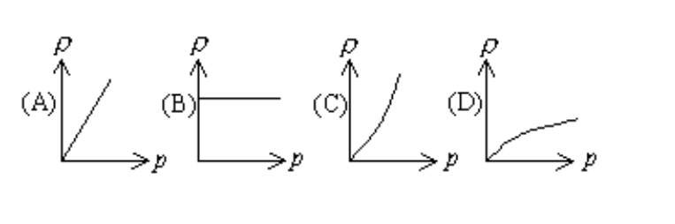
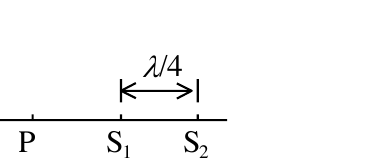
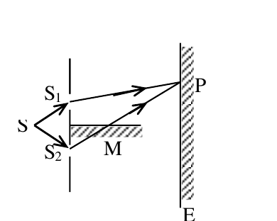
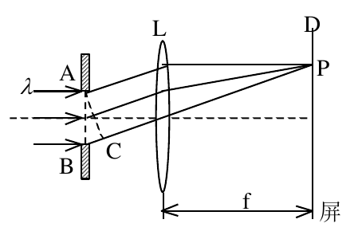
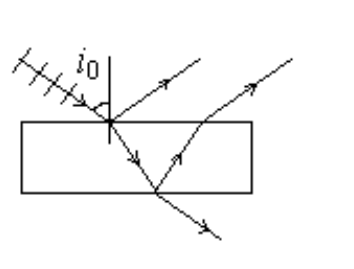
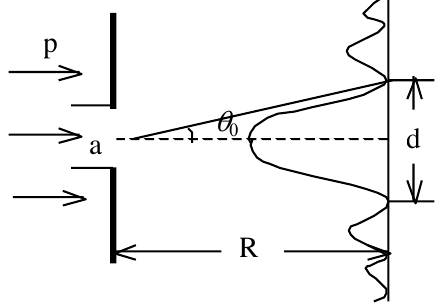
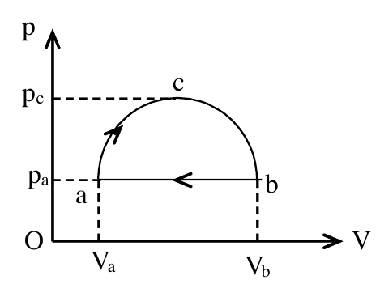
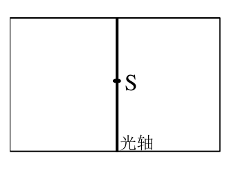
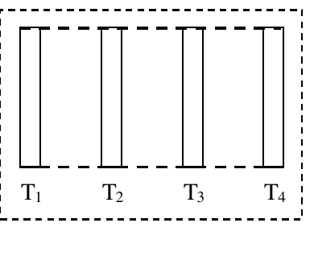
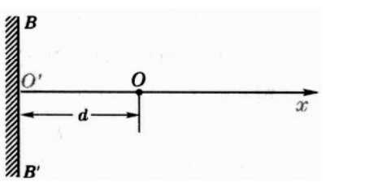

# 基础物理学A(2) 2022–2023 学年第一学期期末试卷

说明：

1. 请在 A4 纸或提前打印的答题纸上作答，不必抄题，顺序作答，不作答的题也需写上题号；
2. 作答结束，按顺序整理成一个 PDF 文件提交，每页均须写学号+名字；
3. PDF 文件要求图像清晰，文件命名：班级+学号+姓名+任课教师.

## 一、选择题（将正确答案的字母填在空格内，每小题 3 分，共 30 分）

1. 下列各式中哪一式表示气体分子的平均平动动能？（式中 $M$ 为气体的质量， $m$ 为气体分子质量， $N$ 为气体分子总数目， $n$ 为气体分子数密度， $N_\mathrm{A}$ 为阿伏加得罗常量）

   (A) $\dfrac{3m}{2M}pV$　　(B) $\dfrac{3M}{2M_\mathrm{mol}}pV$　　(C) $\dfrac{3}{2}npV$　　(D) $\dfrac{3M_\mathrm{mol}}{2M}N_\mathrm{A}pV$

2. 在所给出的四个图象中，哪个图象能够描述一定质量的理想气体，在绝热过程中，密度随压强的变化？

   

3. 设高温热源的热力学温度是低温热源的热力学温度的 $n$ 倍，则理想气体在一次卡诺循环中，传给低温热源的热量是从高温热源吸取热量的

   (A) $n$ 倍　　(B) $n-1$ 倍　　(C) $\dfrac{1}{n}$ 倍　　(D) $\dfrac{n+1}{n}$ 倍

4. 某一周期性振动的数学表达式为
$$x=2a(1+\cos\omega_0 t)\cos\omega t\qquad(\omega=m\omega_0,\ m\ \text{整数}).$$
该振动可以分解为三个简谐振动，它们的角频率分别为 $m\omega_0$、 $(m+1)\omega_0$ 和 $(m-1)\omega_0$；而其中两个简谐振动的振幅分别为 $a$ 和 $2a$，另一个简谐振动的振幅为

   (A) $a$　　(B) $2a$　　(C) $3a$　　(D) $4a$

5. 两相干波源 $S_1$ 和 $S_2$ 相距 $\lambda/4$（ $\lambda$ 为波长）， $S_1$ 的相位比 $S_2$ 的相位超前 $\dfrac{1}{2}\pi$，在 $S_1$、 $S_2$ 的连线上， $S_1$ 外侧各点（例如 $P$ 点）两波引起的两谐振动的相位差是

   

   (A) $0$　　(B) $\dfrac{1}{2}\pi$　　(C) $\pi$　　(D) $\dfrac{3}{2}\pi$

6. 在双缝干涉实验中，屏幕 $E$ 上的 $P$ 点处是明条纹。若将缝 $S_2$ 盖住，并在 $S_1S_2$ 连线的垂直平分面处放一高折射率介质反射面 $M$，如图所示，则此时

   

   (A) $P$ 点处仍为明条纹　　(B) $P$ 点处为暗条纹

   (C) 不能确定 $P$ 点处是明条纹还是暗条纹　　(D) 无干涉条纹

7. 一束波长为 $\lambda$ 的平行单色光垂直入射到一单缝 $AB$ 上，装置如图。在屏幕 $D$ 上形成衍射图样，如果 $P$ 是中央亮纹一侧第一个暗纹所在的位置，则 $BC$ 的长度为

   

   (A) $\lambda/2$　　(B) $\lambda$　　(C) $3\lambda/2$　　(D) $2\lambda$

8. 一束偏振光（偏振方向如图）自空气射向一块平面玻璃，就一般情况而言，它在玻璃的两个界面上会产生如图所示的反射光和透射光。如果入射角恰好等于布儒斯特角 $i_0$，则

   

   (A) 反射光光强为零，透射光光强为最大

   (B) 反射光是完全偏振光，且振动方向垂直于入射面

   (C) 反射光是完全偏振光，且振动方向平行于入射面

   (D) 透射光光强为零，反射光光强为最大

9. 已知用光照的办法将氢原子基态的电子电离，可用的最长波长的光是 91.2 nm 的紫外光，那么氢原子从各受激态跃迁至基态的赖曼系光谱的波长可表示为：

   (A) $\lambda=91.2\dfrac{n-1}{n+1}$ nm　　(B) $\lambda=91.2\dfrac{n+1}{n-1}$ nm

   (C) $\lambda=91.2\dfrac{n^2}{n^2-1}$ nm　　(D) $\lambda=91.2\dfrac{n^2+1}{n^2-1}$ nm

10. 如图所示，一束动量为 $p$ 的电子，通过缝宽为 $a$ 的狭缝，在距离狭缝为 $R$ 处放置一荧光屏，屏上衍射图样中央最大的宽度 $d$ 等于

    

    (A) $2a^2/R$　　(B) $2ha/p$　　(C) $2ha/(Rp)$　　(D) $2Rh/(ap)$

## 二、填空题（将最简结果填在空格内；每题 3 分，共 30 分）

1. 理想气体处于平衡态时，根据麦克斯韦速率分布函数
$$f(v)=4\pi\left(\frac{m}{2\pi kT}\right)^{\frac{3}{2}}e^{-\frac{mv^2}{2kT}}v^2,$$
可导出分子的平均平动动能在 $\varepsilon$ 到 $\varepsilon+\mathrm{d}\varepsilon$ 区间的概率为 $f(\varepsilon)\mathrm{d}\varepsilon=$ ________，其中 $\varepsilon=\dfrac{1}{2}mv^2$。

   再根据这一分布式，可导出分子平均平动能的最概然值 $\varepsilon_P=$ ________。

2. 有 $\nu$ 摩尔理想气体，作如图所示的循环过程 acba，其中 acb 为半圆弧，b-a 为等压线， $p_c=2p_a$，令气体进行 a-b 的等压过程时吸热 $Q_{ab}$，则在此循环过程中气体净吸热量 $Q$ ________ $Q_{ab}$。（填入：>，< 或 =）

   

3. 一质点作简谐振动，速度最大值 $v_m=5$ cm/s，振幅 $A=2$ cm。若令其速度具有正最大值的那一时刻为 $t=0$，则振动表达式为 ________。

4. 一简谐空气波，沿半径为 $R$ 的圆柱形管传播，波的强度为 $I$，频率为 $\nu$，波速为 $u$，则管中波的平均能量密度为 ________，管中每两个相邻同相面间的波段中含有的波的能量为 ________。

5. 一平面简谐波沿 $x$ 轴负方向传播。已知 $x=-1$ m 处质点的振动方程为 $y=A\cos(\omega t+\phi)$，若波速为 $u$，则此波的表达式为 ________。

6. 用 $\lambda=600$ nm 的单色光垂直照射牛顿环装置时，从中央向外数第 4 个（不计中央暗斑）暗环对应的空气膜厚度为 ________ μm。（1 nm= $10^{-9}$ m）

7. 衍射光栅主极大公式 $(a+b)\sin\varphi=\pm k\lambda$， $k=0,1,2\cdots$。在 $k=2$ 的方向上第一条缝与第六条缝对应点发出的两条衍射光的光程差 $\delta=$ ________。

8. 解石晶体（方解石晶体）内有一点光源 $S$，请在通过光轴的平面（见图）上画出晶体中的惠更斯波面图，并分别用点子（表示垂直于图面）和短线（表示平行于图面）标明该平面上 o 光线和 e 光线的振动（电矢量）方向。

   

9. 如图，真空中有四块完全相同且彼此靠近的大金属板平行放置，表面涂黑（可看成绝对黑体）。最外侧两块的热力学温度各维持为 $T_1$ 和 $T_4$，且 $T_1>T_4$。当达到热辐射稳定平衡时，第二块板热力学温度 $T_2=$ ________；第三块板的热力学温度 $T_3=$ ________。

   

10. 量子力学得出：若氢原子处于主量子数 $n=4$ 的状态，则其轨道角动量可能取的值（用 $\hbar$ 表示）分别为 ________；对应于 $l=3$ 的状态，氢原子的角动量在外磁场方向的投影可能取的值分别为 ________。

## 三、计算题（每题 10 分，共 40 分）

1. 1 摩尔单原子理想气体，从初态 $(p_0,V_0)$ 经过一个准静态压缩过程到达终态 $\left(8p_0,\dfrac{1}{4}V_0\right)$。（ $R$ 为普适气体常量）

   (1) 求此过程气体的熵增量 $\Delta S$；

   (2) 假设全过程的每一小过程中，气体对外做功 $\mathrm{d}A$ 与吸收热量 $\mathrm{d}Q$ 之比 $\dfrac{\mathrm{d}A}{\mathrm{d}Q}=4$，求此准静态过程的过程方程。

2. 一肥皂膜的厚度为 0.550 μm，折射率为 1.35，白光（波长范围为 400 nm~700 nm）垂直照射。问在反射光中那些波长的光得到最大增强？哪些波长的光干涉相消？（结果保留两位有效数字）

3. 如图， $O$ 点处有一波源，开始时波源振动的初相位为 0，波源向左右两边发射振幅为 $A$、角频率为 $\omega$ 的余弦简谐波，波速为 $u$。 $BB'$ 为反射面， $O'$ 为 $BB'$ 面与 $x$ 轴的交点， $OO'$ 等于 $5\lambda/4$（ $\lambda$ 为波长）。以 $O$ 点为 $x$ 轴坐标原点。

   

   (1) 写出沿 $x$ 轴正向和沿 $x$ 轴负向传播的简谐波的波函数；

   (2) 当波传播到 $BB'$ 面时，反射波有半波损失，写出反射波的波函数；

   (3) 在 (2) 的条件下，求出 $O$ 点两边合成波的波函数并给出合成波的属性。

4. 设有一电子在宽为 0.20 nm 的一维无限深的方势阱中。(1) 计算电子在最低能级的能量；(2) 当电子处于第一激发态（ $n=2$）时，写出其波函数；并求其在势阱中何处出现的概率最大？（普朗克常量 $h=6.63\times10^{-34}$ J·s，电子静止质量 $m_e=9.11\times10^{-31}$ kg）
