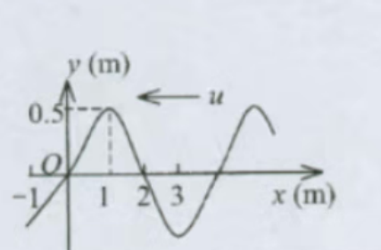
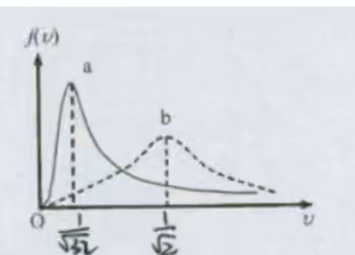
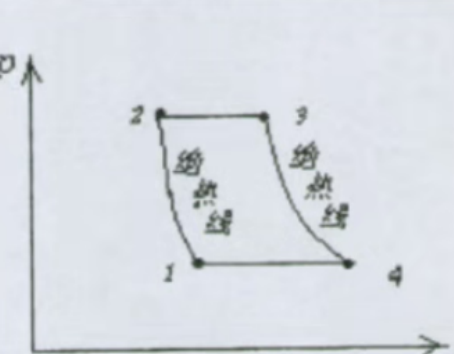
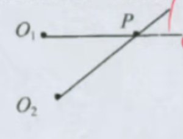

# 基础物理学A(2) 2024 · 秋 期末试卷参考答案

## 一、选择题（将正确答案的字母填在空格内，每小题 3 分，共 30 分）

### 1. 扭摆的转动周期

#### 题目

1. 一金属细杆的上端被固定，下端连接在一水平圆盘的中心组成一个扭摆。将圆盘扭转一小角，金属杆将以一回复力矩 $M=-D\psi$ 作用于圆盘（式中 $D$ 为扭转系数， $\psi$ 为扭转角），使其作往复扭转运动。已知圆盘对它的中心轴的转动惯量为 $J_0$，则扭摆的转动周期为

   (A) $2\pi\sqrt{\dfrac{J_0}{D}}$　　(B) $\dfrac{1}{2\pi}\sqrt{\dfrac{J_0}{D}}$　　(C) $2\pi\sqrt{\dfrac{D}{J_0}}$　　(D) $\dfrac{1}{2\pi}\sqrt{\dfrac{D}{J_0}}$

#### 答案

**答案：** (A)。

转动定律 $J_0\ddot{\psi}=-D\psi$，故 $\omega=\sqrt{D/J_0}$， $T=\dfrac{2\pi}{\omega}=2\pi\sqrt{\dfrac{J_0}{D}}$。

### 2. 由 $t=2$ s 时的波形曲线求原点 $O$ 的振动方程

#### 题目

2\. 一沿 $x$ 轴负方向传播的平面简谐波在 $t=2$ s 时的波形曲线如图所示，则原点 $O$ 的振动方程为

   

   (A) $y=0.50\cos\left(\pi t+\dfrac{1}{2}\pi\right)$，(SI)

   (B) $y=0.50\cos\left(\dfrac{1}{2}\pi t-\dfrac{1}{2}\pi\right)$，(SI)

   (C) $y=0.50\cos\left(\dfrac{1}{2}\pi t+\dfrac{1}{2}\pi\right)$，(SI)

   (D)

#### 答案

**答案：**

由图可读出振幅 $A=0.50$ m，波长 $\lambda=4$ m（波峰在 $x=1$ m、波谷在 $x=3$ m）。 $t=2$ s 时 $O$ 点位移为零，且该处波形斜率为正；波沿 $-x$ 方向传播，故 $O$ 点的振动方程 $y=0.50\cos(\omega t+\varphi)$ 应满足

$$2\omega+\varphi=-\frac{\pi}{2}\pmod{2\pi}.$$

在可辨认的 (A)(B)(C) 中，只有 (C)（ $\omega=\dfrac{\pi}{2}$， $\varphi=\dfrac{\pi}{2}$）满足该条件，对应波速 $u=\dfrac{\omega}{k}=1$ m/s。但题干没有给出波速 $u$ 的数值（图中只标了箭头 $u$），选项 (D) 又被截断，因此不能排除 (D) 才是正确答案。

### 3. 相同温度下氧气与氢气的速率分布曲线

#### 题目

3\. 设图示的两条曲线分别表示在相同温度下氧气和氢气分子的速率分布曲线；令 $(v_p)_{\mathrm{O_2}}$ 和 $(v_p)_{\mathrm{H_2}}$ 分别表示氧气和氢气的最概然速率，则

   

   (A) 图中 a 表示氧气分子的速率分布曲线； $(v_p)_{\mathrm{O_2}}/(v_p)_{\mathrm{H_2}}=1/4$

   (B) 图中 a 表示氧气分子的速率分布曲线； $(v_p)_{\mathrm{O_2}}/(v_p)_{\mathrm{H_2}}=4$

   (C) 图中 b 表示氧气分子的速率分布曲线； $(v_p)_{\mathrm{O_2}}/(v_p)_{\mathrm{H_2}}=1/4$

   (D) 图中 b 表示氧气分子的速率分布曲线； $(v_p)_{\mathrm{O_2}}/(v_p)_{\mathrm{H_2}}=4$

#### 答案

**答案：** (A)。

最概然速率 $v_p=\sqrt{2kT/m}$，同温下与 $\sqrt{1/m}$ 成正比，故

$$\frac{(v_p)_{\mathrm{O_2}}}{(v_p)_{\mathrm{H_2}}}=\sqrt{\frac{m_{\mathrm{H_2}}}{m_{\mathrm{O_2}}}}=\sqrt{\frac{2}{32}}=\frac{1}{4}.$$

$v_p$ 较小者曲线偏左且峰值较高，图中 a 的峰值靠左，故 a 为氧气。

### 4. 温度不变、压强增大一倍时 $\bar{Z}$ 与 $\bar{\lambda}$ 的变化

#### 题目

4\. 气缸内盛有一定量的氢气（可视作理想气体），当温度不变而压强增大一倍时，氢气分子的平均碰撞频率 $\bar{Z}$ 和平均自由程 $\bar{\lambda}$ 的变化情况是：

   (A) $\bar{Z}$ 和 $\bar{\lambda}$ 都增大一倍

   (B) $\bar{Z}$ 和 $\bar{\lambda}$ 都减为原来的一半

   (C) $\bar{Z}$ 增大一倍而 $\bar{\lambda}$ 减为原来的一半

   (D) $\bar{Z}$ 减为原来的一半而 $\bar{\lambda}$ 增大一倍

#### 答案

**答案：** (C)。

温度不变则平均速率 $\bar{v}$ 不变；压强增大一倍即分子数密度 $n$ 增大一倍。由

$$\bar{\lambda}=\frac{1}{\sqrt{2}\pi d^{2}n},\qquad \bar{Z}=\sqrt{2}\pi d^{2}n\bar{v},$$

得 $\bar{\lambda}$ 减为原来的一半， $\bar{Z}$ 增大一倍。

## 三、计算题（每题 10 分，共 40 分）

### 1. 两绝热、两等压循环的热机效率与做功

#### 题目

1. 一理想气体做如图所示的 $1\to2\to3\to4\to1$ 循环过程，其中 $1\to2$、 $3\to4$ 为绝热过程， $2\to3$、 $4\to1$ 为等压过程。

   

   (1) 已知 1 状态温度为 $T_1$，2 状态温度为 $T_2$，求此循环的热机效率；（写出具体求解过程，无求解过程，不给分。）

   (2) 设 $T_1=27\ ^\circ\mathrm{C}$， $T_2=127\ ^\circ\mathrm{C}$。求此热机吸收燃烧 50 kg 汽油放出的热量可得到多少功。已知汽油的燃烧值为 $4.69\times10^{7}$ J·kg $^{-1}$，汽油可看作理想气体。

#### 答案

**答案：**

(1) 吸热发生在等压过程 $2\to3$，放热发生在等压过程 $4\to1$：

$$Q_{\text{吸}}=C_p(T_3-T_2),\qquad Q_{\text{放}}=C_p(T_4-T_1),$$

$$\eta=1-\frac{Q_{\text{放}}}{Q_{\text{吸}}}=1-\frac{T_4-T_1}{T_3-T_2}.$$

两段绝热过程中 $p_2=p_3$、 $p_1=p_4$，由绝热关系 $T\propto p^{(\gamma-1)/\gamma}$ 得

$$\frac{T_2}{T_1}=\left(\frac{p_2}{p_1}\right)^{\frac{\gamma-1}{\gamma}}=\frac{T_3}{T_4}=k,$$

即 $T_2=kT_1$， $T_3=kT_4$，于是

$$\frac{T_4-T_1}{T_3-T_2}=\frac{T_4-T_1}{kT_4-kT_1}=\frac{1}{k}=\frac{T_1}{T_2},$$

$$\boxed{\eta=1-\frac{T_1}{T_2}}.$$

(2) $T_1=300$ K， $T_2=400$ K，故 $\eta=1-\dfrac{300}{400}=25\%$。

$$Q=50\times4.69\times10^{7}\ \text{J}=2.345\times10^{9}\ \text{J},$$

$$W=\eta Q=0.25\times2.345\times10^{9}\ \text{J}\approx5.9\times10^{8}\ \text{J}.$$

### 2. 两列振动方向互相垂直的波在 $P$ 点的合成

#### 题目

2\. 如图， $O_1$ 与 $O_2$ 为二简谐波的波源，它们的频率相同，但振动方向相互垂直。设二波源的振动方程分别是 $x_{10}=A\cos\omega t$ 与 $y_{20}=A\cos(\omega t+\phi)$；若二波在 $P$ 点相遇，求下述两种情况下 $P$ 处质点的振动规律。

   

   (1) 设 $\phi=-\dfrac{1}{2}\pi$， $\overline{O_1P}=5.5\lambda$， $\overline{O_2P}=8.25\lambda$；

   (2) 设 $\phi=0$， $\overline{O_1P}=5.5\lambda$， $\overline{O_2P}=8.25\lambda$；

   其中， $\lambda$ 为二波的波长。

#### 答案

**答案：** 两波到达 $P$ 点时

$$x_P=A\cos\left(\omega t-\frac{2\pi}{\lambda}\cdot5.5\lambda\right)=A\cos(\omega t-11\pi)=-A\cos\omega t,$$

$$y_P=A\cos\left(\omega t+\phi-\frac{2\pi}{\lambda}\cdot8.25\lambda\right)=A\cos\left(\omega t+\phi-\frac{\pi}{2}\right).$$

(1) $\phi=-\dfrac{\pi}{2}$ 时

$$y_P=A\cos\left(\omega t-\frac{\pi}{2}-\frac{\pi}{2}\right)=A\cos(\omega t-\pi)=-A\cos\omega t=x_P .$$

故质点沿直线 $y=x$ 作简谐振动，振幅为 $\sqrt{2}A$，角频率 $\omega$。

(2) $\phi=0$ 时

$$y_P=A\cos\left(\omega t-\frac{\pi}{2}\right)=A\sin\omega t .$$

由 $x_P=-A\cos\omega t$、 $y_P=A\sin\omega t$ 得

$$x_P^{2}+y_P^{2}=A^{2},$$

即质点作半径为 $A$、角速度为 $\omega$ 的匀速圆周运动。 $t=0$ 时质点位于 $(-A,0)$ 且向 $+y$ 方向运动，故为顺时针方向。

### 3. 由不确定关系求痕迹宽度最小时的缝宽

#### 题目

3\. 动量为 $\bar{p}$ 的原子射线垂直通过一个缝宽可以调节的狭缝 $S$，与狭缝相距 $D$ 处有一接收屏 $C$，如图。试根据不确定关系式求狭缝宽度 $a$ 等于多大时接收屏上的痕迹宽度可达到最小。

#### 答案

**答案：** 原子通过狭缝后横向位置的不确定量为 $\Delta x\approx a$，由不确定关系 $\Delta x\,\Delta p_x\approx\hbar$ 得横向动量不确定量 $\Delta p_x\approx\dfrac{\hbar}{a}$，于是在距离 $D$ 处的屏上束流展宽

$$\Delta\approx2D\frac{\Delta p_x}{\bar{p}}=\frac{2D\hbar}{a\bar{p}} .$$

屏上痕迹的总宽度为

$$b=a+\Delta=a+\frac{2D\hbar}{a\bar{p}} .$$

令 $\dfrac{\mathrm{d}b}{\mathrm{d}a}=1-\dfrac{2D\hbar}{a^{2}\bar{p}}=0$，得

$$a=\sqrt{\frac{2D\hbar}{\bar{p}}},\qquad b_{\min}=2\sqrt{\frac{2D\hbar}{\bar{p}}} .$$

### 4. 光栅的可见谱线级次

#### 题目

4\. 将一束波长 $\lambda=589$ nm（1 nm $=10^{-9}$ m）的平行钠光垂直入射在 1 厘米内有 5000 条刻痕的平面衍射光栅上，光栅的透光缝宽度 $a$ 与其间距 $b$ 相等，求：

   (1) 光线垂直入射时，能看到几条谱线？是哪几级？

   (2) 若光线以与光栅平面法线的夹角 $\phi=30^\circ$ 的方向入射时，能看到几条谱线？是哪几级？

#### 答案

**答案：** 光栅常数

$$d=a+b=\frac{1\ \text{cm}}{5000}=2.0\times10^{-6}\ \text{m}=2000\ \text{nm},$$

且 $a=b$，故 $d=2a$， $d/a=2$，偶数级主极大缺级。

(1) 垂直入射： $d\sin\theta=k\lambda$， $|\sin\theta|\le1$ 要求

$$|k|\le\frac{d}{\lambda}=\frac{2000}{589}=3.40,$$

即 $k=0,\pm1,\pm2,\pm3$；去掉缺级的 $k=\pm2$，可见谱线为 $k=0,\pm1,\pm3$，共 **5 条**。

(2) 斜入射 $\phi=30^\circ$：光栅方程 $d(\sin\theta+\sin\phi)=k\lambda$，由 $-1\le\sin\theta\le1$ 得

$$-1+0.5\le\frac{k\lambda}{d}\le1+0.5\ \Longrightarrow\ -1.70\le k\le5.09,$$

即 $k=-1,0,1,2,3,4,5$；去掉缺级的 $k=2,4$，可见谱线为 $k=-1,0,1,3,5$，共 **5 条**。
