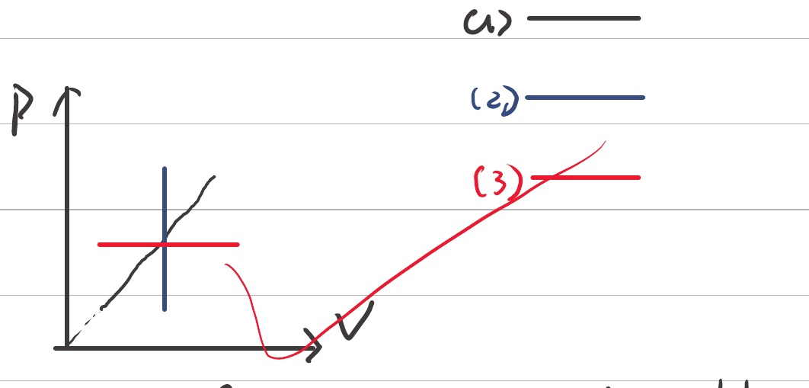

# 基础物理学A(2) 热学3 近平衡态中的输运过程 作业答案（2024秋）

## 习题 3

### 3.12

#### 题目

电子管的真空度为 $1.333\times10^{-3}\ \mathrm{Pa}$，设空气分子的有效直径为 $3.0\times10^{-10}\ \mathrm{m}$，求 $27\ ^\circ\mathrm{C}$ 时单位体积内的分子数 $n$、平均自由程 $\bar{\lambda}$ 和平均碰撞频率 $\bar{Z}$。

#### 答案

**答案：**

$$
\bar{Z}=\sqrt{2}\,n\pi d^2\bar{v},\qquad
\bar{\lambda}=\frac{\bar{v}}{\bar{Z}}=\frac{1}{\sqrt{2}\,n\pi d^2}.
$$

由理想气体状态方程

$$
n=\frac{p}{kT}=\frac{1.333\times10^{-3}}{1.38\times10^{-23}\times 300.15}=3.22\times10^{17}\ \mathrm{m^{-3}}.
$$

代入得

$$
\bar{\lambda}=\frac{1}{\sqrt{2}\times 3.22\times10^{17}\times\pi\times 9\times10^{-20}}=7.76\ \mathrm{m},
$$

$$
\bar{Z}=\frac{\bar{v}}{\bar{\lambda}}=\frac{\sqrt{8RT/(\pi\mu)}}{\bar{\lambda}}=60.2\ \mathrm{s^{-1}}.
$$

## 习题 4

### 4.1

#### 题目

试在 $p\text{-}V$ 图上画出以下理想气体完成的准静态过程：

(1) $p=kV$；(2) $p=kT$；(3) $V=kT$；其中 $k$ 为常数。

并计算当系统体积由 $V_1$ 变至 $V_2$ 时，上述三过程中系统对外界所作的功。

#### 答案

**答案：** $p\text{-}V$ 图如下（黑色为 (1)，蓝色为 (2)，红色为 (3)）：

(1) $p=kV$：

$$
W=\int_{V_1}^{V_2}p\,\mathrm{d}V=\int_{V_1}^{V_2}kV\,\mathrm{d}V=\frac{1}{2}k\left(V_2^2-V_1^2\right).
$$

(2) $p=kT$：由 $pV=\nu RT$ 及 $p=kT$ 得 $V=\nu R/k$ 为常量，即等容过程，故

$$
W=0.
$$

(3) $V=kT$：由 $pV=\nu RT$ 及 $V=kT$ 得 $p=\nu R/k$ 为常量，即等压过程，故

$$
W=\int_{V_1}^{V_2}p\,\mathrm{d}V=p\left(V_2-V_1\right)=\frac{\nu R}{k}\left(V_2-V_1\right).
$$
