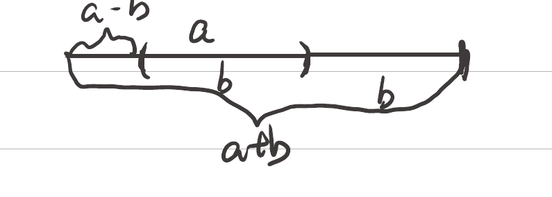

# 抽象代数 第5次作业答案（2024秋）

## §3

### 第 1 题

#### 题目

设已知量 $a$， $b$ 及 $r$ 皆大于 0 且 $a > b$。试用圆规直尺作图作出 $a \pm b$， $ab$， $\dfrac{a}{r}$， $\sqrt{r}$。

#### 答案

**答案：** 数轴上依次标出长度为 $a-b$ 与 $a$ 的两段（上方标注），下方用大括号标出 $b$ 与 $a+b$；另单独写出 $ab$。

### 第 2 题

#### 题目

下列哪些量可以用圆规直尺作图作出：

(1) $\sqrt[4]{5 + 2\sqrt{6}}$；

(2) $\dfrac{2}{1 + \sqrt{7}}$；

(3) $1 - \sqrt[5]{27}$。

#### 答案

**答案：**

(1) 可以；

(2) 可以；

(3) 不可以。

## §4

### 第 2 题

#### 题目

令 $\mathbb{Z}[i] = \{a + bi \mid a, b \in \mathbb{Z}\}$，它是整环。 $2\mathbb{Z}[i] = \{2a + 2bi\}$ 是 $\mathbb{Z}[i]$ 的主理想。问 $\mathbb{Z}[i]/2\mathbb{Z}[i]$ 中是否有零因子？

#### 答案

**答案：** 有。

$\because (1+i)^2 = 2i$， $\left((1+i) + 2\mathbb{Z}[i]\right)^2 = 2i + 2\mathbb{Z}[i] = \bar{0}$，

$\therefore (1+i) + 2\mathbb{Z}[i]$ 是 $\mathbb{Z}[i]/2\mathbb{Z}[i]$ 中零因子。

(i) $\mathbb{Z}_2 = \mathbb{Z}/2\mathbb{Z} = \{\bar{0}, \bar{1}\}$ 是同构；

(ii) $\mathbb{Z}_3 = \mathbb{Z}/3\mathbb{Z} = \{\bar{0}, \bar{1}, \bar{2}\}$ 是交换环， $\therefore (\bar{1})^{-1} = \bar{1}$， $(\bar{2})^{-1} = \bar{2}$，为域；

(iii) 无零因子；

(iv) $\mathbb{Z}_3[x]/(x^2+x+2)$ 是域。

### 第 5 题

#### 题目

找出 $\mathbb{Z}_6$， $\mathbb{Z}_8$ 的全部理想。哪些是极大理想？对所有极大理想 $K$，写出 $\mathbb{Z}_6/K$ 及 $\mathbb{Z}_8/K$ 的全部元素、加法表和乘法表。

#### 答案

**答案：**

$\mathbb{Z}_6$ 全部理想： $\mathbb{Z}_6,\ 2\mathbb{Z}_6,\ 3\mathbb{Z}_6,\ 0 \cdot \mathbb{Z}_6$；极大理想： $2\mathbb{Z}_6,\ 3\mathbb{Z}_6$。

$\mathbb{Z}_8$ 全部： $\mathbb{Z}_8,\ 2\mathbb{Z}_8,\ 4\mathbb{Z}_8,\ 0 \cdot \mathbb{Z}_8$；极大： $2\mathbb{Z}_8$。

$$
\mathbb{Z}_6 / 2\mathbb{Z}_6 = \{\bar{0}, \bar{1}\},\qquad
\mathbb{Z}_6 / 3\mathbb{Z}_6 = \{\bar{0}, \bar{1}, \bar{2}\},\qquad
\mathbb{Z}_8 / 2\mathbb{Z}_8 = \{\bar{0}, \bar{1}\}.
$$

加法表与乘法表：

$\mathbb{Z}_6 / 2\mathbb{Z}_6$

| $+$ | $\bar{0}$ | $\bar{1}$ |
| --- | --- | --- |
| $\bar{0}$ | $0$ | $1$ |
| $\bar{1}$ | $1$ | $0$ |

| $\times$ | $\bar{0}$ | $\bar{1}$ |
| --- | --- | --- |
| $\bar{0}$ | $0$ | $0$ |
| $\bar{1}$ | $0$ | $1$ |

$\mathbb{Z}_6 / 3\mathbb{Z}_6$

| $+$ | $\bar{0}$ | $\bar{1}$ | $\bar{2}$ |
| --- | --- | --- | --- |
| $\bar{0}$ | $0$ | $1$ | $2$ |
| $\bar{1}$ | $1$ | $2$ | $0$ |
| $\bar{2}$ | $2$ | $0$ | $1$ |

| $\times$ | $\bar{0}$ | $\bar{1}$ | $\bar{2}$ |
| --- | --- | --- | --- |
| $\bar{0}$ | $0$ | $0$ | $0$ |
| $\bar{1}$ | $0$ | $1$ | $2$ |
| $\bar{2}$ | $0$ | $2$ | $1$ |
