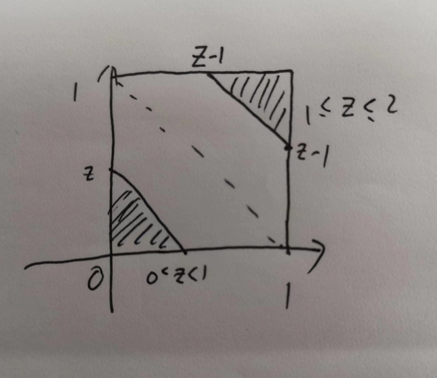

# 概率论 2022–2023 学年第二学期期末试卷（A 卷）参考答案

## 第 1 题　选择题（每题 4 分，共 24 分）

官方答案（A 卷）：(1) C　(2) C　(3) D　(4) A　(5) B　(6) D

### 1

#### 题目

设事件 $A$ 和 $B$ 满足 $P(A)=1$， $P(B)>0$，则以下论述正确的是 ________。

A. $A=\emptyset$；　　B. $A$ 和 $B$ 互不相容；

C. $A$ 和 $B$ 相互独立；　　D. $P(B\mid A)<P(B)$。

#### 答案

**答案：** (C)。

$P(A)=1$ 时 $P(A\cap B)=P(B)$，故 $P(B\mid A)=\frac{P(A\cap B)}{P(A)}=P(B)$，即 $A$ 与 $B$ 相互独立。

### 2

#### 题目

设随机变量 $X,Y$ 的概率分布函数分别是 $F_X(x),F_Y(y)$，则下面论述不正确的是 ________。

A. $F(z)=\frac12\big(F_X(z)+F_Y(z)\big)$ 是一个概率分布函数；

B. $F(z)=F_X(z)\cdot F_Y(z)$ 是一个概率分布函数；

C. $F(z,w)=\frac12\big(F_X(z)+F_Y(w)\big)$ 是一个二维概率分布函数；

D. $F(z,w)=F_X(z)\cdot F_Y(w)$ 是一个二维概率分布函数。

#### 答案

**答案：** (C)。

同第 2 题（补考卷）的分析：令 $z\to+\infty$ 得 $F(+\infty,w)=\frac12\big(1+F_Y(w)\big)\ne F_Y(w)$，故 C 不是二维分布函数。A 是凸组合、B 是独立同分布最大值的分布函数、D 是独立时的联合分布函数，都正确。

### 3

#### 题目

设随机变量 $X$ 是常数 $c$， $Y$ 是任意随机变量，则下面不正确的是 ________。

A. $EX=c$；　　B. $DX=0$；

C. $\operatorname{cov}(X,Y)=0$；　　D. $\operatorname{cov}(X,X^{2})=1$。

#### 答案

**答案：** (D)。

$X\equiv c$ 时 $\operatorname{cov}(X,X^{2})=\operatorname{cov}(c,c^{2})=0\ne 1$。

### 4

#### 题目

已知随机变量 $X>0$， $Y>0$，且常数 $a>0$，如果下面各选项中的矩都存在；则下列不等式不成立的是 ________。

A. $EX^{4}\le(EX)^{4}$；　　B. $E\sqrt{X}\le\sqrt{EX}$；

C. $P(|X-Y|>a)\le\frac{E|X-Y|}{a}$；　　D. $P(|X-Y|>a)\le\frac{E(X-Y)^{4}}{a^{4}}$。

#### 答案

**答案：** (A)。

由 Jensen 不等式（ $t\mapsto t^{4}$ 凸）应有 $EX^{4}\ge(EX)^{4}$，故 A 不成立。B 由 $t\mapsto\sqrt t$ 的凹性成立；C、D 都是 Markov 不等式的形式，成立。

### 5

#### 题目

设 $X_1,X_2,\dots,X_n$ 为来自正态总体 $X\sim N(\mu,\sigma^{2})$ 的一个样本，记 $\overline{X}=\frac1n\sum_{k=1}^{n}X_k$， $B^{2}=\frac1n\sum_{k=1}^{n}(X_k-\mu)^{2}$，则下列各式中不正确的是 ________。

A. $X_1-\overline{X}\sim N\left(0,\frac{n-1}{n}\sigma^{2}\right)$；　　B. $\frac{\overline{X}-\mu}{B/\sqrt n}\sim t(n)$；

C. $\operatorname{cov}(X_2-\overline{X},\overline{X})=0$；　　D. $\frac{nB^{2}}{\sigma^{2}}\sim\chi^{2}(n)$。

#### 答案

**答案：** (B)。

$B^{2}$ 以**已知**的 $\mu$ 为中心： $\sum(X_k-\mu)^{2}=\sum(X_k-\overline{X})^{2}+n(\overline{X}-\mu)^{2}$。 $\overline{X}$ 只与前一项独立，与 $n(\overline{X}-\mu)^{2}$ 显然相依，故 $\overline{X}$ 与 $B^{2}$ 不独立， $\frac{\overline{X}-\mu}{B/\sqrt n}$ 不服从 $t(n)$。

A： $D(X_1-\overline{X})=\sigma^{2}-2\frac{\sigma^{2}}{n}+\frac{\sigma^{2}}{n}=\frac{n-1}{n}\sigma^{2}$，正确；C： $\operatorname{cov}(X_2,\overline{X})-D\overline{X}=\frac{\sigma^{2}}{n}-\frac{\sigma^{2}}{n}=0$，正确；D： $\frac{nB^{2}}{\sigma^{2}}=\sum\left(\frac{X_k-\mu}{\sigma}\right)^{2}\sim\chi^{2}(n)$，正确。

### 6

#### 题目

设总体 $X$ 服从参数为 $\lambda>0$ 的指数分布， $X_1,X_2,\dots,X_n$ 为来自总体 $X$ 的样本，令参数 $\theta=\frac1\lambda$，记 $\overline{X}=\frac1n\sum_{k=1}^{n}X_k$， $Z=\min(X_1,X_2,\dots,X_n)$，则下面论述错误的是 ________。

A. $\overline{X}$ 是 $\theta$ 的无偏估计；　　B. $Z$ 服从参数为 $n\lambda$ 的指数分布；

C. $nZ$ 是 $\theta$ 的无偏估计；　　D. $n^{2}Z^{2}$ 是 $\theta^{2}$ 的无偏估计。

#### 答案

**答案：** (D)。

$Z\sim\mathrm{Exp}(n\lambda)$， $EZ=\frac{1}{n\lambda}$， $EZ^{2}=\frac{2}{n^{2}\lambda^{2}}$，故 $E(n^{2}Z^{2})=n^{2}\cdot\frac{2}{n^{2}\lambda^{2}}=\frac{2}{\lambda^{2}}=2\theta^{2}\ne\theta^{2}$，D 错误。A、B、C 正确。

## 第 2 题　填空题（每题 4 分，共 24 分）

官方答案（A 卷）：(1) $\frac13$； $\frac12$　(2) $\frac1e$； $\frac1e$　(3) $y,\ 0\le y\le 1$　(4) $ze^{-z^{2}/2},\ z\ge 0$　(5) $e^{\lambda}$　(6) $\frac12$

### 1

#### 题目

已知国王有两个小孩。如果知道国王至少有一个女儿，则国王有两个女儿的概率是 ________；如果知道老大是女儿，则国王有两个女儿的概率是 ________。

#### 答案

**答案：** $\dfrac13$； $\dfrac12$。

样本空间为 $\{男男, 男女, 女男, 女女\}$。已知至少有一个女儿，样本空间缩为 $\{男女,女男,女女\}$，其中「两个女儿」占 $\frac13$。已知老大是女儿，样本空间缩为 $\{女男,女女\}$，其中「两个女儿」占 $\frac12$。

### 2

#### 题目

设某电子元件的寿命（以小时为单位）服从 $\lambda=0.01$ 的指数分布 $f(x)=0.01e^{-0.01x}$， $x\ge 0$。则一个元件至少能使用 100 小时的概率是 ________；如果一个元件已经使用了 100 小时，该元件还可以再使用 100 小时以上的概率是 ________。

#### 答案

**答案：** $\dfrac1e$； $\dfrac1e$。

$P(X\ge 100)=e^{-0.01\times 100}=e^{-1}=\frac1e$；由指数分布的无记忆性， $P(X>200\mid X>100)=P(X>100)=\frac1e$。

### 3

#### 题目

设随机变量 $X$ 的分布函数为 $F_X(x)=1-e^{-x^{2}/2}$， $x\ge 0$，则复合随机变量 $Y=F_X(X)$ 的概率分布函数是 $F_Y(y)=$ ________。

#### 答案

**答案：** $y$， $0\le y\le 1$（概率积分变换）。

### 4

#### 题目

如果 $X,Y$ 是互相独立的标准正态分布，则 $Z=\sqrt{X^{2}+Y^{2}}$ 的概率密度函数 $f_Z(z)=$ ________

#### 答案

**答案：** $ze^{-z^{2}/2}$， $z\ge 0$。

$X^{2}+Y^{2}\sim\chi^{2}(2)$，其密度为 $\frac12 e^{-u/2}\ (u>0)$；由 $u=z^{2}$ 得 $f_Z(z)=2z\cdot\frac12 e^{-z^{2}/2}=ze^{-z^{2}/2}$（ $z\ge 0$），即 Rayleigh 分布。

### 5

#### 题目

$X$ 服从 $\lambda>0$ 的泊松分布 $\left(P(X=k)=e^{-\lambda}\frac{\lambda^{k}}{k!},\ k=0,1,\cdots\right)$，有 $E(2^{X})=$ ________

#### 答案

**答案：** $e^{\lambda}$。

$$
E(2^{X})=\sum_{k=0}^{\infty}2^{k}e^{-\lambda}\frac{\lambda^{k}}{k!}=e^{-\lambda}\sum_{k=0}^{\infty}\frac{(2\lambda)^{k}}{k!}=e^{-\lambda}e^{2\lambda}=e^{\lambda}.
$$

### 6

#### 题目

设 $X_1,X_2,\cdots,X_n$ 是来自总体 $X$ 的一个样本，总体 $X$ 服从 $\lambda=1$ 的泊松分布。记 $Y_n=\sum_{k=1}^{n}X_k$，则有 $\lim_{n\to+\infty}P(Y_n\le n)=$ ________。

#### 答案

**答案：** $\dfrac12$。

$Y_n\sim P(n)$， $EY_n=n$， $DY_n=n$。由中心极限定理 $\frac{Y_n-n}{\sqrt n}\xrightarrow{d}N(0,1)$，故

$$
P(Y_n\le n)=P\left(\frac{Y_n-n}{\sqrt n}\le 0\right)\to\Phi(0)=\frac12.
$$

## 第 3 题（15 分）

### 题目

设 $X,Y$ 是 $[0,1]$ 上的均匀分布且相互独立。求 (1) $Z=X+Y$ 的概率密度；(2) $1-Y$ 的概率密度与 $W=X-Y$ 的概率密度；(3) $\operatorname{cov}(Z,W)$。

### 答案

**答案：**

(1) $X$ 和 $Y$ 相互独立，所以 $(X,Y)$ 服从单位正方形上的均匀分布，联合密度函数是 $f(x,y)=1$， $0\le x,y\le 1$。（3 分）

$Z$ 的概率分布函数

$$
F_Z(z)=P(X+Y\le z)=\iint_{X+Y\le z}f(x,y)\,dx\,dy,
$$

积分区域如下图所示：

**解法一：直接积分。**

当 $0\le z\le 1$， $F_Z(z)=\int_0^{z}\int_0^{z-x}1\,dx\,dy=\frac12z^{2}$；

当 $1\le z\le 2$， $F_Z(z)=1-\int_{z-1}^{1}\int_{z-x}^{1}1\,dx\,dy=1-\frac12(2-z)^{2}=2z-\frac{z^{2}}{2}-1$；

求导得到概率密度函数有：

当 $0\le z\le 1$， $f_Z(z)=z$；当 $1\le z\le 2$， $f_Z(z)=2-z$。（3 分）

（ $Z$ 通常可以称为三角形分布。）

**解法二：** 注意到对于均匀分布， $F_Z(z)=P(X+Y\le z)=$ 正方形中集合 $\{X+Y\le z\}$ 的面积，上面的两个积分就是两个三角形的面积，积分结果可以直接得到。

(2) **解法一：** 令 $T=1-Y$，有

$$
f_T(t)=f_Y(1-t)\cdot 1=1,\qquad 0\le t\le 1.
$$

（3 分）

显然 $T$ 是区间 $[0,1]$ 上均匀分布，且与 $X$ 独立，利用 (1) 的结果，可得 $S=X+T$ 和 $Z$ 的分布一样；特别有

$$
W=X-Y=X+1-Y-1=S-1,
$$

即 $f_W(w)=f_S(w+1)=f_Z(w+1)$；可得：当 $-1\le w\le 0$， $f_W(w)=w+1$；当 $0\le w\le 1$， $f_W(w)=1-w$。（3 分）

**解法二：** 直接积分，类似 (1) 中利用复合函数的分布函数，积分可得。

(3)

$$
\operatorname{cov}(Z,W)=\operatorname{cov}(X+Y,X-Y)=\operatorname{cov}(X,X)-\operatorname{cov}(Y,Y)=DX-DY=0.
$$

（3 分）

## 第 4 题（15 分）

### 题目

居民每月收入 $X\sim N(\mu,\sigma^{2})$，调查 9 人得 $\overline{X}=5600$， $S^{2}=10^{6}$。已知 $z_{0.95}=1.645$， $z_{0.975}=1.96$， $t_{0.975}(8)=2.306$， $t_{0.975}(9)=2.262$。求 (1) $\mu$ 的 95% 置信区间；(2) 检验「平均收入 6400 元」；(3) 说明假设检验与区间估计的关联。

### 答案

**答案：**

(1) 样本均值随机变量 $\overline{X}_n$ 是均值 $\mu$ 的无偏估计，且

$$
\frac{\overline{X}_n-\mu}{S/\sqrt n}\sim t(n-1).
$$

（3 分）

给定置信水平 $1-\alpha=0.95$，要求 $\mu$ 满足，

$$
P\left(\left|\frac{\overline{X}_n-\mu}{S/\sqrt n}\right|<t_{0.975}(n-1)\right)=0.95;
$$

即 $|\overline{X}_n-\mu|<\left(S/\sqrt n\right)t_{0.975}(n-1)$；代入 $S=1000$， $n=9$， $t_{0.975}(8)=2.306$ 有 $|\overline{X}_n-\mu|<768.67$；代入 $\overline{X}_n=5600$，得到置信区间为 $[4831.33,6368.67]$。（3 分）

(2) 检验假设 $H_0:\mu=6400$ vs $H_1:\mu\ne 6400$，检验统计量

$$
T=\frac{\overline{X}_n-\mu}{S/\sqrt n}\sim t(n-1);
$$

选择显著水平 $\alpha=0.05$ 的拒绝域 $W=\{|T|>t_{0.975}(n-1)\}$。（3 分）

代入 $S=1000$， $n=9$， $t_{0.975}(8)=2.306$，有 $|\overline{X}_n-\mu|>768.67$，代入 $\overline{X}_n=5600$， $\mu=6400$，有 $800>768.67$；所以拒绝原假设 $\mu=6400$。（3 分）

(3) 从上面的计算可以看到，如果置信区间和假设检验选择上面相同的统计量 $T$；那么 $\mu$ 的置信度为 0.95 的置信区间满足 $|T-\mu|<t_{0.975}(n-1)$；如果零假设 $\mu=\mu_0$ 落在置信区间外面，等价于 $|T-\mu_0|>t_{0.975}(n-1)$，所以 $T$ 属于显著水平 $\alpha=0.05$ 的拒绝域，拒绝原假设；如果 $\mu=\mu_0$ 落在置信区间内，就接受原假设。（3 分）

## 第 5 题（12 分，概率统计 B）

### 题目

已知 $(X,Y)\sim N(0,1,0,1,\rho)$， $0<\rho<1$， $Z=aX+bY$ 服从正态分布。求 (1) $Z$ 的概率密度函数；(2) 若 $Z$ 服从标准正态分布且与 $X$ 独立，求 $a,b$。

### 答案

**答案：**

(1)

$$
EZ=aEX+bEY=0,
$$

$$
DZ=\operatorname{cov}(aX+bY,aX+bY)=a^{2}DX+b^{2}DY+2ab\operatorname{cov}(X,Y)=a^{2}+b^{2}+2ab\rho.
$$

（3 分）

$Z\sim N(0,a^{2}+b^{2}+2ab\rho)$；

$$
f_Z(z)=\frac{1}{\sqrt{2\pi}\sqrt{a^{2}+b^{2}+2ab\rho}}e^{-\frac{z^{2}}{2(a^{2}+b^{2}+2ab\rho)}},\qquad -\infty<z<+\infty.
$$

（3 分）

(2) $Z\sim N(0,1)$ 有 $a^{2}+b^{2}+2ab\rho=1$；（2 分）

$Z$ 与 $X$ 独立等价于 $\operatorname{cov}(X,Z)=0$，即 $\operatorname{cov}(X,aX+bY)=a+b\rho=0$。（2 分）

解方程得到 $a=\pm\frac{-\rho}{\sqrt{1-\rho^{2}}}$； $b=\pm\frac{1}{\sqrt{1-\rho^{2}}}$。（2 分）

## 第 5 题（12 分，概率统计 A）

### 题目

$X(t)=\sin(2\pi\cdot 440t+\Theta)+W(t)$， $\Theta\sim U[0,2\pi]$， $W(t)$ 是独立正态过程， $W(t)\sim N(0,\sigma^{2})$， $W(t)$ 与 $\Theta$ 独立，不同时刻的 $W(t_1),W(t_2)$ 相互独立。求 (1) 均值函数和自相关函数；(2) 证明 $W(t)$ 是严格平稳过程，问 $X(t)$ 是否是广义平稳过程。

### 答案

**答案：**

(1) 记角频率 $\omega=2\pi\cdot 440$，记 $S(t)=\sin(\omega t+\Theta)$，则 $X(t)=S(t)+W(t)$。其中 $EW(t)=0$， $DW(t)=\sigma^{2}$；

$$
EX(t)=ES(t)+EW(t)=\int_0^{2\pi}\sin(\omega t+\theta)\frac{1}{2\pi}\,d\theta+0=0.
$$

（2 分）

注意到 $S(t)$ 和 $W(t)$ 独立；可得

$$
EX(t_1)X(t_2)=E\big(S(t_1)+W(t_1)\big)\big(S(t_2)+W(t_2)\big)=ES(t_1)S(t_2)+0+EW(t_1)W(t_2),
$$

$$
ES(t_1)S(t_2)=\int_0^{2\pi}\sin(\omega t_1+\theta)\sin(\omega t_2+\theta)\frac{1}{2\pi}\,d\theta=\frac12\cos\omega(t_1-t_2).
$$

（2 分）

当 $t_1\ne t_2$， $EW(t_1)W(t_2)=0$，当 $t_1=t_2$， $EW(t_1)W(t_2)=\sigma^{2}$。（2 分）

当 $t_1\ne t_2$ 时， $EX(t_1)X(t_2)=\frac12\cos\omega(t_1-t_2)$；当 $t_1=t_2$ 时， $EX(t_1)X(t_2)=\frac12+\sigma^{2}$。（2 分）

(2) 由上面计算， $EW(t)=0$， $EW(t_1)W(t_2)$ 仅仅依赖于 $(t_1-t_2)$， $W(t)$ 是广义平稳过程，又 $W(t)$ 是正态过程，所以 $W(t)$ 是严格平稳过程。（2 分）

$X(t)$ 是广义平稳过程，因为 $EX(t)=0$，且自相关函数是仅依赖于参数间距 $\tau=t_2-t_1$ 的函数。（2 分）

## 第 6 题（10 分，概率统计 B）

### 题目

设 $T_n=g(X_1,\dots,X_n)$ 为 $\theta$ 的估计量，均方误差 $E(T_n-\theta)^{2}$。证明 (1) $E(T_n-\theta)^{2}=DT_n+(ET_n-\theta)^{2}$；(2) 均方收敛 $\Rightarrow$ 依概率收敛。

### 答案

**答案：**

(1)

$$
\begin{aligned}
E(T_n-\theta)^{2}&=E\big(T_n-E(T_n)+E(T_n)-\theta\big)^{2}\\
&=E\big(T_n-E(T_n)\big)^{2}+2E\big(T_n-E(T_n)\big)\big(E(T_n)-\theta\big)+\big(E(T_n)-\theta\big)^{2},
\end{aligned}
$$

上面第二项为零，

$$
=E\big(T_n-E(T_n)\big)^{2}+\big(E(T_n)-\theta\big)^{2}=DT_n+\big(E(T_n)-\theta\big)^{2}.
$$

等式得证。（5 分）

(2) 给定 $\varepsilon>0$，要证 $\lim_{n\to+\infty}P(|T_n-\theta|>\varepsilon)=0$；利用马尔可夫不等式：

$$
P(|T_n-\theta|>\varepsilon)\le\frac{E(T_n-\theta)^{2}}{\varepsilon^{2}}.
$$

已知 $\lim_{n\to+\infty}E(T_n-\theta)^{2}=0$， $P(|T_n-\theta|>\varepsilon)\ge 0$；有 $\lim_{n\to+\infty}P(|T_n-\theta|>\varepsilon)=0$，即 $T_n$ 依概率收敛到 $\theta$。（5 分）

## 第 6 题（10 分，概率统计 A）

### 题目

猫在任一时刻换房间概率 0.8、留在原房间 0.2；老鼠从房间 1 到房间 2 概率 0.3（留在房间 1 为 0.7），从房间 2 到房间 1 概率 0.6（留在房间 2 为 0.4）。 $X(n),Y(n)$ 分别是猫和老鼠在时刻 $n$ 的房间号。求 (1)(2) 转移概率矩阵与平稳分布；(3) $Z(n)$ 是否为马尔可夫链。

### 答案

**答案：**

(1) $X(n)$ 的转移概率矩阵

$$
P=\begin{bmatrix}0.2 & 0.8\\ 0.8 & 0.2\end{bmatrix},
$$

平稳分布满足

$$
(p_0,p_1)=(p_0,p_1)\begin{bmatrix}0.2 & 0.8\\ 0.8 & 0.2\end{bmatrix},
$$

计算有 $p_0=p_1=\frac12$。（4 分）

(2) $Y(n)$ 的转移概率矩阵

$$
P=\begin{bmatrix}0.7 & 0.3\\ 0.6 & 0.4\end{bmatrix},
$$

平稳分布满足

$$
(p_0,p_1)=(p_0,p_1)\begin{bmatrix}0.7 & 0.3\\ 0.6 & 0.4\end{bmatrix},
$$

计算有 $p_0=\frac23$， $p_1=\frac13$。（4 分）

(3) 按定义

$$
\begin{aligned}
&P\big(Z(n+1)=k_{n+1}\mid Z(n)=k_n,Z(n-1)=k_{n-1},\dots,Z(0)=k_0\big)\\
&=P\big(X(n+1)=i_{n+1},Y(n+1)=j_{n+1}\mid X(n)=i_n,Y(n)=j_n;\dots;X(0)=i_0,Y(0)=j_0\big)\\
&=P\big(X(n+1)=i_{n+1},Y(n+1)=j_{n+1}\mid X(n)=i_n,Y(n)=j_n\big)\\
&=P\big(Z(n+1)=k_{n+1}\mid Z(n)=k_n\big),
\end{aligned}
$$

所以 $Z(n)$ 是马尔可夫链，其中用到 $X(n)$ 和 $Y(n)$ 是马尔可夫链且相互独立。（2 分）

备注：使用文字解释或者算出 $Z(n)$ 的转移概率矩阵也行。

## 附：B 卷选择与填空参考答案

- **第一题（选择题）**：(1) D　(2) C　(3) B　(4) C　(5) D　(6) A
- **第二题（填空题）**：(1) $\dfrac{1}{e},\,\dfrac{1}{e}$　(2) $ze^{-z^2/2},\ z\ge 0$　(3) $\dfrac{1}{3},\,\dfrac{1}{2}$　(4) $\dfrac{1}{2}$　(5) $e^{\lambda}$　(6) $y,\ 0\le y\le 1$
