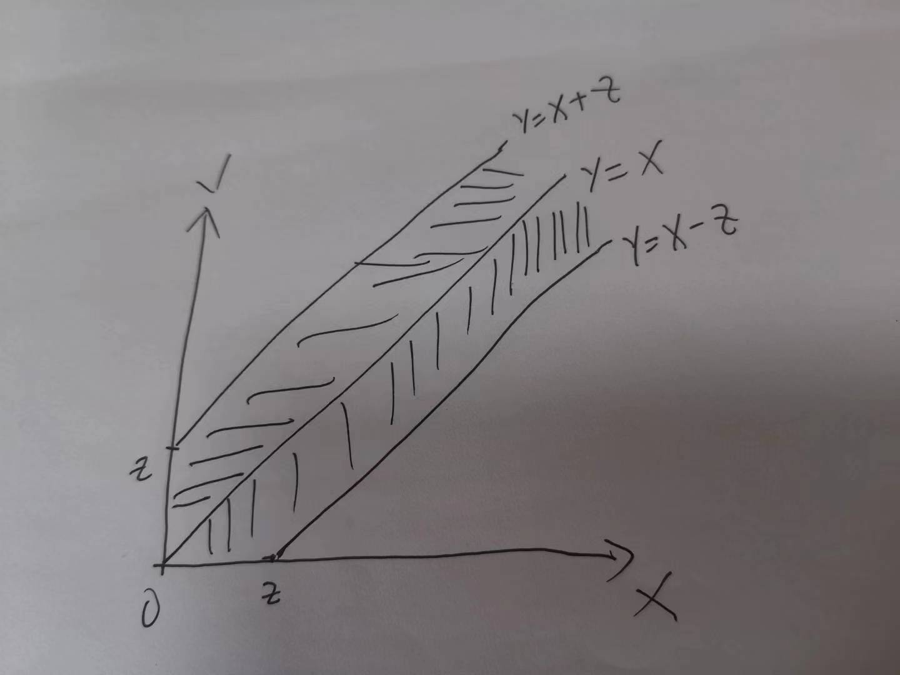
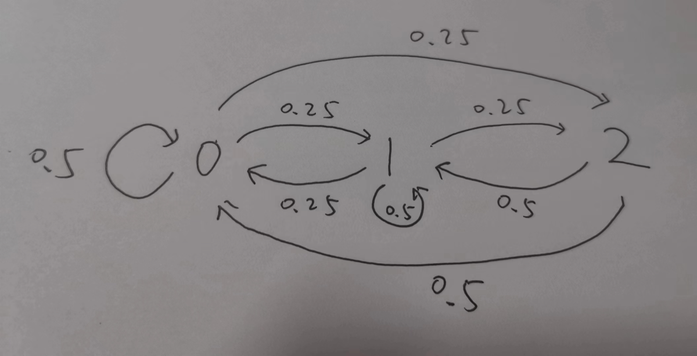

# 概率论 2022–2023 学年第二学期期末补考试卷（C 卷）参考答案

## 第 1 题　选择题（每题 4 分，共 32 分）

官方答案：(1) B　(2) C　(3) D　(4) C　(5) A　(6) B　(7) D　(8) C

### 1. 设事件 $A$ 和 $B$ 满足 $A\cap B=\emptyset$，则以下论述错误的是 ________

#### 题目

A. $P(A\cap B)=0$；　B. $\overline{A}$ 和 $B$ 互逆；　C. $A$ 和 $B$ 互不相容；　D. $A\cap B$ 和 $A\cup B$ 相互独立。

#### 答案

**答案：** (B)。

$A\cap B=\emptyset$ 只能推出互不相容，不能推出 $\overline{A}$ 与 $B$ 互逆，故 B 错误。A、C 显然正确；对 D， $P\big((A\cap B)\cap(A\cup B)\big)=P(A\cap B)=0=P(A\cap B)P(A\cup B)$，故 D 正确。

### 2. 设 $F_X(x),F_Y(y)$ 为分布函数，则下面论述不正确的是 ________

#### 题目

2\. 设随机变量 $X,Y$ 的概率分布函数分别是 $F_X(x),F_Y(y)$，则下面论述不正确的是 ________。

   A. $F(z)=F_X^{2}(z)$ 是一个概率分布函数；

   B. $F(z)=1-(1-F_X(z))^{2}$ 是一个概率分布函数；

   C. $F(z,w)=\frac12\big(F_X(z)+F_Y(w)\big)$ 是一个二维概率分布函数；

   D. $F(z,w)=F_X(z)\cdot F_Y(w)$ 是一个二维概率分布函数。

A. $F(z)=F_X^{2}(z)$ 是一个概率分布函数；　B. $F(z)=1-(1-F_X(z))^{2}$ 是一个概率分布函数；

C. $F(z,w)=\frac12\big(F_X(z)+F_Y(w)\big)$ 是一个二维概率分布函数；　D. $F(z,w)=F_X(z)F_Y(w)$ 是一个二维概率分布函数。

#### 答案

**答案：** (C)。

A 是两个独立同分布随机变量最大值的分布函数，B 是最小值的分布函数，D 是独立时的联合分布函数，都正确。对 C，令 $z\to+\infty$ 得 $F(+\infty,w)=\frac12\big(1+F_Y(w)\big)$，而二维分布函数必须满足 $F(+\infty,w)=F_Y(w)$，两者一般不等，故 C 错误。

### 3. 已知 $X\sim N(0,\sigma^{2})$， $\Phi(x)$ 是标准正态分布的分布函数，设 $k>0$， $\sigma>0$，则下面选项不正确的是 ________

#### 题目

3\. 已知随机变量 $X$ 服从正态分布 $N(0,\sigma^{2})$， $\Phi(x)$ 是标准正态分布的分布函数，设 $k>0$， $\sigma>0$，则下面选项不正确的是 ________。

   A. $P(X\ge k\sigma)=1-\Phi(k)$　　B. $P(|X|\le k\sigma)=2\Phi(k)-1$

   C. $P(X\le k\sigma)+P(X\le -k\sigma)=1$

   D. $P(0\ge X\ge -k\sigma)=\frac12-\Phi(k)$

#### 答案

**答案：** (D)。

由对称性 $P(-k\sigma\le X\le 0)=\Phi(0)-\Phi(-k)=\frac12-\big(1-\Phi(k)\big)=\Phi(k)-\frac12$，而 D 写的是 $\frac12-\Phi(k)$（符号相反），故 D 错误。A、B、C 均正确。

### 4. 设随机变量 $X$ 是常数 $c$， $Y$ 是标准正态分布，则下面不正确的是 ________

#### 题目

A. $EX=c$　B. $DX=0$　C. $\operatorname{cov}(Y,Y^{2})=1$　D. $\operatorname{cov}(X,Y)=0$

#### 答案

**答案：** (C)。

$\operatorname{cov}(Y,Y^{2})=EY^{3}-EY\cdot EY^{2}=0-0=0\ne 1$，故 C 错误。A、B、D 显然正确。

### 5. 已知 $X>0$， $Y>0$，常数 $a>0$，各选项中的矩都存在；则下列不等式不成立的是 ________

#### 题目

5\. 已知随机变量 $X>0$， $Y>0$，且常数 $a>0$，如果下面各选项中的矩都存在；则下列不等式不成立的是 ________。

   A. $E\!\left(\frac{X}{Y}\right)E\!\left(\frac{Y}{X}\right)\le 1$　　B. $EX^{4}\ge(EX)^{4}$；

   C. $|EX^{3}|\le\sqrt{EX^{4}}\sqrt{EX^{2}}$　　D. $P(|X-Y|>a)\le\frac{E(X-Y)^{4}}{a^{4}}$

#### 答案

**答案：** (A)。

由柯西–施瓦茨不等式，

$$
E\!\left(\frac{X}{Y}\right)E\!\left(\frac{Y}{X}\right)\ge\left(E\sqrt{\frac{X}{Y}\cdot\frac{Y}{X}}\right)^{2}=1,
$$

即不等号方向应为 $\ge$，故 A 不成立。B 由 Jensen 不等式成立；C 是柯西–施瓦茨不等式；D 是 Markov 不等式，都成立。

### 6. 设 $X_1,\dots,X_n$ 为来自 $N(\mu,\sigma^{2})$ 的样本， $\overline{X}=\frac1n\sum X_k$， $B^{2}=\frac1n\sum(X_k-\mu)^{2}$，则下列各式中不正确的是 ________

#### 题目

6\. 设 $X_1,X_2,\dots,X_n$ 为来自正态总体 $X\sim N(\mu,\sigma^{2})$ 的一个样本，记 $\overline{X}=\frac1n\sum_{k=1}^{n}X_k$， $B^{2}=\frac1n\sum_{k=1}^{n}(X_k-\mu)^{2}$，则下列各式中不正确的是 ________。

   A. $\frac{X_1-\mu}{\sigma}\sim N(0,1)$　　B. $\frac{\overline{X}-\mu}{B/\sqrt n}\sim t(n)$；

   C. $\operatorname{cov}(X_2-\overline{X},\overline{X})=0$　　D. $\frac{nB^{2}}{\sigma^{2}}\sim\chi^{2}(n)$

#### 答案

**答案：** (B)。

注意 $B^{2}$ 是以**已知**的 $\mu$ 为中心的平方和。 $\overline{X}$ 与 $\sum(X_k-\overline{X})^{2}$ 独立，但与 $\sum(X_k-\mu)^{2}=\sum(X_k-\overline{X})^{2}+n(\overline{X}-\mu)^{2}$ **不独立**，因此 $\frac{\overline{X}-\mu}{B/\sqrt n}$ 并不服从 $t(n)$，B 错误。A、D 显然正确；C： $\operatorname{cov}(X_2-\overline{X},\overline{X})=\operatorname{cov}(X_2,\overline{X})-D\overline{X}=\frac{\sigma^{2}}{n}-\frac{\sigma^{2}}{n}=0$，正确。

### 7. 设 $\overline{X}=\frac1n\sum X_k$， $S_1^{2}=\frac{1}{n-1}\sum(X_k-\overline{X})^{2}$， $S_2^{2}=\frac1n\sum(X_k-\overline{X})^{2}$，则下列各式中不正确的是 ________

#### 题目

7\. 设 $X_1,X_2,\dots,X_n$ 为来自正态总体 $X\sim N(\mu,\sigma^{2})$ 的一个样本，记 $\overline{X}=\frac1n\sum_{k=1}^{n}X_k$， $S_1^{2}=\frac{1}{n-1}\sum_{k=1}^{n}(X_k-\overline{X})^{2}$， $S_2^{2}=\frac1n\sum_{k=1}^{n}(X_k-\overline{X})^{2}$，则下列各式中不正确的是 ________。

   A. $S_1^{2}$ 是 $\sigma^{2}$ 的无偏估计；　　B. $S_2^{2}$ 是 $\sigma^{2}$ 的极大似然估计；

   C. $S_1^{2}$ 是 $\sigma^{2}$ 的一致性估计；　　D. $S_2^{2}$ 不是 $\sigma^{2}$ 的一致性估计；

#### 答案

**答案：** (D)。

$S_2^{2}=\frac{n-1}{n}S_1^{2}\xrightarrow{P}\sigma^{2}$，所以 $S_2^{2}$ **是** $\sigma^{2}$ 的一致估计，D 的说法错误。A、B、C 均正确。

### 8. 设 $X$ 是一个随机变量，则下面论述错误的是 ________

#### 题目

8\. 设 $X$ 是一个随机变量，则下面论述错误的是 ________。

   A. 如果 $X$ 服从二项分布 $B(n,p)$， $0<p<1$，则 $EX>DX$

   B. 如果 $X$ 是区间 $[0,1]$ 上均匀分布，则 $EX>DX$

   C. 如果 $X$ 服从参数为 $\lambda>0$ 的指数分布，则 $EX\ge DX$

   D. 如果 $X$ 服从参数为 $\lambda>0$ 的泊松分布，则 $EX=DX$

A. 若 $X\sim B(n,p)$， $0<p<1$，则 $EX>DX$；　B. 若 $X$ 是 $[0,1]$ 上均匀分布，则 $EX>DX$；

C. 若 $X$ 服从参数 $\lambda>0$ 的指数分布，则 $EX\ge DX$；　D. 若 $X$ 服从参数 $\lambda>0$ 的泊松分布，则 $EX=DX$

#### 答案

**答案：** (C)。

指数分布 $EX=\frac1\lambda$， $DX=\frac{1}{\lambda^{2}}$， $EX\ge DX$ 等价于 $\lambda\ge 1$，对 $\lambda<1$ 不成立，故 C 错误。A： $np>np(1-p)$ ✓；B： $\frac12>\frac1{12}$ ✓；D： $EX=DX=\lambda$ ✓。

## 第 2 题　填空题（每题 4 分，共 32 分）

### 1. 抽烟者得肺癌的概率是不抽烟者的 24 倍；人群中有 $\frac14$ 的人抽烟， $\frac34$ 的人不抽烟，则一个肺癌患者是抽烟者的概率是 ________

#### 题目

1. 已知抽烟者得肺癌的概率是不抽烟者得肺癌的概率的 24 倍；假设人群中有 $\frac14$ 的人抽烟，剩下 $\frac34$ 的人不抽烟，则一个肺癌患者是抽烟者的概率是 ________；

#### 答案

**答案：** $\dfrac89$。设不抽烟者得肺癌的概率为 $p$，则抽烟者为 $24p$。由贝叶斯公式

$$
P(\text{抽烟}\mid\text{肺癌})=\frac{24p\cdot\frac14}{24p\cdot\frac14+p\cdot\frac34}=\frac{6}{6+\frac34}=\frac89.
$$

### 2. $X\sim U[0,1]$，已知 $X>1/3$，则任意 $\frac13<x<1$， $P(X\le x\mid X>1/3)=$ ________

#### 题目

2\. $X$ 是在 $[0,1]$ 上的均匀分布，如果已知 $X>1/3$，则任意 $\frac13<x<1$，有条件概率 $P(X\le x\mid X>1/3)=$ ________

#### 答案

**答案：** $\dfrac{x-1/3}{1-1/3}=\dfrac{3x-1}{2}$。

### 3. 已知 $X\sim N(0,1)$， $\Phi(x)$ 是其概率分布函数；计算 $E\big(X+\Phi(X)\big)=$ ________

#### 题目

3\. 已知 $X\sim N(0,1)$， $\Phi(x)$ 是其概率分布函数；计算 $E\big(X+\Phi(X)\big)=$ ________

#### 答案

**答案：** $\dfrac12$。由概率积分变换， $\Phi(X)\sim U(0,1)$，故 $E\big(X+\Phi(X)\big)=EX+E\Phi(X)=0+\frac12=\frac12$。

### 4. 随机变量 $X$ 服从 $\lambda=1$ 的指数分布。令 $Y=e^{-X}$；则 $F_Y(y)=$ ________

#### 题目

4\. 随机变量 $X$ 服从 $\lambda=1$ 的指数分布。令 $Y=e^{-X}$；则复合随机变量 $Y$ 的概率分布函数是 $F_Y(y)=$ ________。

#### 答案

**答案：** $y$， $0\le y\le 1$。对 $0<y\le 1$，

$$
F_Y(y)=P(e^{-X}\le y)=P(X\ge -\ln y)=e^{-(-\ln y)}=y.
$$

### 5. $(X,Y)$ 是半径为 $R$ 的圆盘上的均匀分布， $f(x,y)=\frac{1}{\pi R^{2}}\ (x^{2}+y^{2}\le R^{2})$。令 $Z=\sqrt{X^{2}+Y^{2}}$，则 $f_Z(z)=$ ________

#### 题目

5\. 如果 $(X,Y)$ 是半径为 $R$ 的圆盘上的均匀分布，即 $f(x,y)=\frac{1}{\pi R^{2}}$，其中 $x^{2}+y^{2}\le R^{2}$。令 $Z=\sqrt{X^{2}+Y^{2}}$，则概率密度函数 $f_Z(z)=$ ________

#### 答案

**答案：** $\dfrac{2z}{R^{2}}$， $0\le z\le R$。 $F_Z(z)=\dfrac{\pi z^{2}}{\pi R^{2}}=\dfrac{z^{2}}{R^{2}}$，求导即得。

### 6. 总体 $X$ 服从 $\lambda=1$ 的泊松分布， $Y_n=\sum_{k=1}^{n}X_k$，则 $n$ 充分大时 $Y_n$ 的近似分布是 ________

#### 题目

6\. 设 $X_1,X_2,\cdots,X_n$ 是来自总体 $X$ 的一个样本，总体 $X$ 是服从 $\lambda=1$ 的泊松分布。记 $Y_n=\sum_{k=1}^{n}X_k$，则 $n$ 充分大时， $Y_n$ 的近似分布是 ________

#### 答案

**答案：** $N(n,n)$。 $Y_n\sim P(n)$，由中心极限定理， $n$ 充分大时 $Y_n$ 近似服从均值 $n$、方差 $n$ 的正态分布。

### 7. $(X,Y)\sim N\left(0,1,0,1,\frac13\right)$，令 $Z=Y-aX$，则当 $a=$ ________ 时， $Z$ 与 $X$ 互不相关

#### 题目

7\. $(X,Y)\sim N\left(0,1,0,1,\frac13\right)$，令 $Z=Y-aX$，则当 $a=$ ________ 时， $Z$ 与 $X$ 互不相关。

#### 答案

**答案：** $\dfrac13$。 $\operatorname{cov}(Z,X)=\operatorname{cov}(Y,X)-aDX=\frac13-a=0$，故 $a=\frac13$。

### 8. 总体 $X\sim N(\mu,\sigma^{2})$， $n\ge 2$。检验假设 $H_0:\sigma^{2}=\sigma_0^{2}$ 时，检验用的统计量和分布是 ________

#### 题目

8\. 设 $X_1,X_2,\cdots,X_n$ 是来自总体 $X$ 的一个样本，设总体 $X\sim N(\mu,\sigma^{2})$， $n\ge 2$。则检验假设 $H_0:\sigma^{2}=\sigma_0^{2}$ 时，检验用的统计量和分布是 ________。

#### 答案

**答案：** 统计量 $S^{2}=\dfrac{1}{n-1}\sum_{k=1}^{n}(X_k-\overline{X})^{2}$， $H_0$ 成立时

$$
\frac{(n-1)S^{2}}{\sigma_0^{2}}\sim\chi^{2}(n-1).
$$

## 第 3 题（16 分）

### 题目

两个人约定在某地见面，不见不散。设到达时间 $X,Y$ 都服从参数为 $\lambda>0$ 的指数分布且相互独立。(1) 求 $Z=|X-Y|$ 的概率密度函数；(2) 求 $E|X-Y|$ 和 $D|X-Y|$。

### 答案

**答案：** $X$ 和 $Y$ 相互独立，服从参数为 $\lambda>0$ 的指数分布，联合密度函数是

$$
f(x,y)=\lambda^{2}e^{-\lambda(x+y)},\qquad 0\le x,y\le+\infty.
$$

（4 分）

$Z$ 的概率分布函数

$$
F_Z(z)=P(|X-Y|\le z)=\iint_{|X-Y|\le z}f(x,y)\,dx\,dy.
$$

**解法一：直接积分。** 积分区域如下图所示，阴影的积分区域可以分为直线 $y=x$ 的上下两个部分：

$$
F_Z(z)=\int_0^{+\infty}dx\int_x^{x+z}f(x,y)\,dy+\int_0^{+\infty}dy\int_y^{y+z}f(x,y)\,dx.
$$

对 $y=x$ 的上面区域积分

$$
\begin{aligned}
I_1&=\int_0^{+\infty}dx\int_x^{x+z}\lambda^{2}e^{-\lambda(x+y)}dy
=\int_0^{+\infty}\lambda e^{-\lambda x}\int_x^{x+z}\lambda e^{-\lambda y}\,dy\,dx\\
&=\int_0^{+\infty}\lambda e^{-\lambda x}(-1)\big(e^{-\lambda(x+z)}-e^{-\lambda x}\big)dx\\
&=\int_0^{+\infty}\big(1-e^{-\lambda z}\big)\lambda e^{-2\lambda x}dx
=\big(1-e^{-\lambda z}\big)\frac12.
\end{aligned}
$$

由对称性容易看到对 $y=x$ 的下面区域积分和上面一样， $I_2=\big(1-e^{-\lambda z}\big)\frac12$；所以

$$
F_Z(z)=I_1+I_2=1-e^{-\lambda z}.
$$

（4 分）

求导得到

$$
f_Z(z)=\lambda e^{-\lambda z},\qquad z>0.
$$

（2 分）

（ $Z$ 也是服从参数为 $\lambda$ 的指数分布。）

**解法二：** 利用指数分布的无记忆性，第一个人到达后，第二个人到达时间的条件分布还是参数为 $\lambda$ 的指数分布。

(2) $Z$ 是服从参数为 $\lambda$ 的指数分布，

$$
EZ=\int_0^{+\infty}z\lambda e^{-\lambda z}dz=\int_0^{+\infty}z\,d\big(-e^{-\lambda z}\big)=\int_0^{+\infty}e^{-\lambda z}dz,
$$

$$
EZ=\frac1\lambda.
$$

（3 分）

$DZ=EZ^{2}-(EZ)^{2}$，同样用分部积分可得

$$
EZ^{2}=\int_0^{+\infty}z^{2}\lambda e^{-\lambda z}dz=\int_0^{+\infty}2ze^{-\lambda z}dz=\frac{2}{\lambda^{2}},
$$

$$
DZ=\frac{1}{\lambda^{2}}.
$$

（3 分）

## 第 4 题（10 分，概率统计 B）

### 题目

（本题学概率统计 B 的学生做，学概率统计 A 的学生不做）

设 $X$ 服从参数为 $\lambda>0$ 的指数分布，即 $f(x)=\lambda e^{-\lambda x}$， $x\ge 0$。求 (1) $EX^{3}$；(2) 对任意正整数 $n>3$， $EX^{n}$。

### 答案

**答案：**

(1) 使用分部积分可得 $EX=\frac1\lambda$， $EX^{2}=\frac{2}{\lambda^{2}}$；（或者直接给出结果）

$$
EX^{3}=\int_0^{+\infty}x^{3}\lambda e^{-\lambda x}dx=\int_0^{+\infty}x^{3}\,d\big(-e^{-\lambda x}\big)=\int_0^{+\infty}3x^{2}e^{-\lambda x}dx,
$$

$$
EX^{3}=\frac3\lambda EX^{2}=\frac{6}{\lambda^{3}}.
$$

（5 分）

(2) 同上利用分部积分有

$$
EX^{n}=\int_0^{+\infty}x^{n}\lambda e^{-\lambda x}dx=\int_0^{+\infty}x^{n}\,d\big(-e^{-\lambda x}\big)
=\int_0^{+\infty}nx^{n-1}e^{-\lambda x}dx=\frac n\lambda EX^{n-1}.
$$

利用上面递推关系，可以得到

$$
EX^{n}=\frac{n!}{\lambda^{n}}.
$$

（5 分）

## 第 4 题（10 分，概率统计 A）

### 题目

（本题学概率统计 A 的学生做，学概率统计 B 的学生不做！）

随机振幅正弦波 $Z(t)=X\cos wt+Y\sin wt$， $X,Y$ 服从标准正态分布且相互独立。求 (1) $Z(t)$ 的一维分布；(2) 均值函数和自相关函数，说明是否是广义平稳过程。

### 答案

**答案：**

(1) 固定 $t$， $Z(t)=X\cos wt+Y\sin wt$ 是两个独立正态分布的线性组合，还是正态分布；

$$
EZ(t)=EX\cos wt+EY\sin wt=0,
$$

$$
DZ(t)=DX(\cos wt)^{2}+DY(\sin wt)^{2}=1;
$$

$Z(t)$ 的一维分布是标准正态分布 $\big(N(0,1)\big)$。（4 分）

(2) 均值函数 $EZ(t)=EX\cos wt+EY\sin wt=0$。已知 $EX=EY=EXY=0$， $EX^{2}=EY^{2}=1$，计算有

$$
\begin{aligned}
EZ(t_1)Z(t_2)&=E(X\cos wt_1+Y\sin wt_1)(X\cos wt_2+Y\sin wt_2)\\
&=EX^{2}\cos wt_1\cos wt_2+EY^{2}\sin wt_1\sin wt_2=\cos w(t_1-t_2).
\end{aligned}
$$

（4 分）

由上面计算， $EZ(t_1)Z(t_2)$ 仅仅依赖于 $(t_1-t_2)$， $Z(t)$ 是广义平稳过程。（2 分）

## 第 5 题（10 分，概率统计 B）

### 题目

（本题学概率统计 B 的学生做，学概率统计 A 的学生不做。）

(1) 假设 $EX^{2}$ 存在，证明 $E(X-c)^{2}=DX+(EX-c)^{2}$；(2) 若 $\lim_{n\to+\infty}E(X_n-c)^{2}=0$，证明 $\{X_n\}$ 依概率收敛到 $c$。

### 答案

**答案：**

(1)

$$
\begin{aligned}
E(X-c)^{2}&=E(X-EX+EX-c)^{2}\\
&=E(X-EX)^{2}+2E(X-EX)(EX-c)+(EX-c)^{2},
\end{aligned}
$$

上面第二项为零，

$$
=E(X-EX)^{2}+(EX-c)^{2}=DX+(EX-c)^{2}.
$$

等式得证。（5 分）

(2) 给定 $\varepsilon>0$，要证 $\lim_{n\to+\infty}P(|X_n-c|>\varepsilon)=0$；利用马尔可夫不等式：

$$
P(|X_n-c|>\varepsilon)\le\frac{E(X_n-c)^{2}}{\varepsilon^{2}}.
$$

已知 $\lim_{n\to+\infty}E(X_n-c)^{2}=0$， $P(|X_n-c|>\varepsilon)\ge 0$；有 $\lim_{n\to+\infty}P(|X_n-c|>\varepsilon)=0$，即 $X_n$ 依概率收敛到 $c$。（5 分）

## 第 5 题（10 分，概率统计 A）

### 题目

（本题学概率统计 A 的学生做，学概率统计 B 的学生不做！）

设一次考试的出题难度分为容易、中等、很难共三类。如果本次考试很难，下一次考试的难度将是容易或者中等（概率各为 0.5）；如果本次考试难度是容易或者中等，则下一次考试有 0.5 的概率保持难度不变，有 0.25 的概率分别变为其他两种难度。请构造合适的马尔可夫链模型，并计算其平稳分布。

### 答案

**答案：** 设考试难度的容易、中等、很难对应的三个状态是 $0,1,2$，则模型为三个状态的离散马尔可夫链 $X(n)$；状态转移图如下：

$X(n)$ 的转移概率矩阵

$$
P=\begin{bmatrix}
0.5 & 0.25 & 0.25\\
0.25 & 0.5 & 0.25\\
0.5 & 0.5 & 0
\end{bmatrix}.
$$

（5 分）

平稳分布满足

$$
(p_0,p_1,p_2)=(p_0,p_1,p_2)\begin{bmatrix}
0.5 & 0.25 & 0.25\\
0.25 & 0.5 & 0.25\\
0.5 & 0.5 & 0
\end{bmatrix}
$$

且 $p_0+p_1+p_2=1$，计算有

$$
p_0=p_1=0.4,\qquad p_2=0.2.
$$

（5 分）
