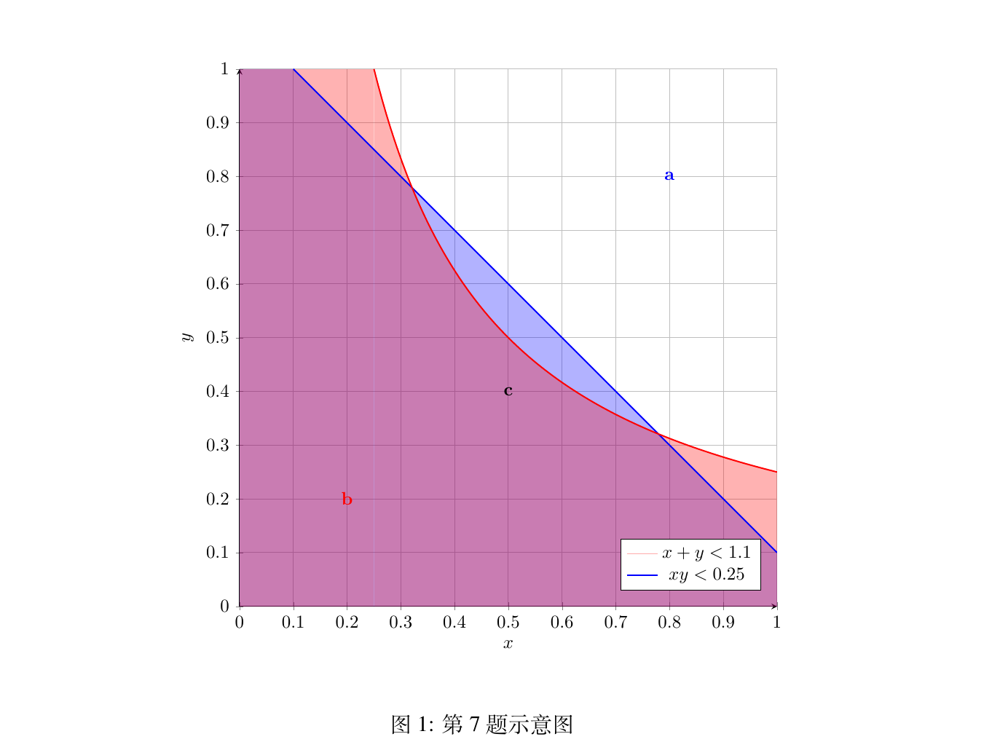

# 概率论 第2次作业答案（2025秋）

> 题目见同目录 [概率论]-[作业]-[第2次作业]-[2025秋]-[题目].md，源出「第2至3次作业」PDF 的第 2 节。
>
## 答案

### 1

#### 题目

请阅读文献「李德毅等 (2004). 不确定性人工智能. 软件学报, 15(11).」，用 100 字以内谈谈对不确定性与 AI 的关系。

#### 答案

**答案：** 客观世界充满不确定性，它是绝对的，而确定性是相对的。人工智能应以不确定性为研究对象，模拟人类在不确定性环境下的思维。AI 需要能够有效地表示和处理随机性、模糊性、不完整信息等不确定性问题，并在这种环境中通过学习、推理和决策来实现智能行为。

### 2

#### 题目

a. 对于任意事件 $A$ 和 $B$，证明 $|P(A\cap B)-P(A)P(B)|\le 1/4$；b. 假设 $P(A)=\dfrac34$ 和 $P(B)=\dfrac13$，证明不等式 $\dfrac{1}{12}\le P(A\cap B)\le\dfrac13$。

#### 答案

**答案：**

**a.** 将样本空间 $\Omega$ 分解为四个互不相交的事件：

- $E_1=A\cap B$
- $E_2=A\cap B^c$
- $E_3=A^c\cap B$
- $E_4=A^c\cap B^c$

令它们的概率分别为 $p_1,p_2,p_3,p_4$。显然 $p_i\ge 0$ 且 $p_1+p_2+p_3+p_4=1$。于是

$$P(A)=P(A\cap B)+P(A\cap B^c)=p_1+p_2,\qquad P(B)=P(A\cap B)+P(A^c\cap B)=p_1+p_3,$$

$$P(A\cap B)=p_1 .$$

代入要证的表达式：

$$P(A\cap B)-P(A)P(B)=p_1-(p_1+p_2)(p_1+p_3)=p_1-(p_1^2+p_1p_3+p_1p_2+p_2p_3)=p_1(1-p_1-p_2-p_3)-p_2p_3 .$$

因为 $p_1+p_2+p_3+p_4=1$，所以 $1-p_1-p_2-p_3=p_4$，代入得

$$P(A\cap B)-P(A)P(B)=p_1p_4-p_2p_3 .$$

现在的目标是证明 $|p_1p_4-p_2p_3|\le 1/4$，其中 $p_i\ge 0$ 且 $\sum p_i=1$。

**上界**（ $p_1p_4-p_2p_3\le 1/4$）：由于 $p_2,p_3\ge 0$，所以 $-p_2p_3\le 0$，因此 $p_1p_4-p_2p_3\le p_1p_4$。由均值不等式 $\bigl(ab\le\left(\frac{a+b}{2}\right)^2\bigr)$，

$$p_1p_4\le\left(\frac{p_1+p_4}{2}\right)^2 .$$

因为 $p_1+p_4\le p_1+p_2+p_3+p_4=1$，所以 $\left(\frac{p_1+p_4}{2}\right)^2\le\left(\frac12\right)^2=1/4$，故 $p_1p_4-p_2p_3\le 1/4$。

**下界**（ $p_1p_4-p_2p_3\ge -1/4$）：由于 $p_1,p_4\ge 0$，所以 $p_1p_4\ge 0$，因此 $p_1p_4-p_2p_3\ge -p_2p_3$。再次使用均值不等式：

$$-p_2p_3\ge-\left(\frac{p_2+p_3}{2}\right)^2 .$$

因为 $p_2+p_3\le 1$，所以 $\left(\frac{p_2+p_3}{2}\right)^2\le 1/4$，故 $-p_2p_3\ge-1/4$，因此 $p_1p_4-p_2p_3\ge-1/4$。

综上，

$$-\frac14\le P(A\cap B)-P(A)P(B)\le\frac14,$$

这等价于 $|P(A\cap B)-P(A)P(B)|\le 1/4$。

**b.** 上界： $A\cap B$ 是 $A$ 和 $B$ 的子集，所以其概率不能超过任意一个的概率，

$$P(A\cap B)\le\min(P(A),P(B))=\min\left(\frac34,\frac13\right)=\frac13 .$$

下界：由加法公式 $P(A\cup B)=P(A)+P(B)-P(A\cap B)$，又 $P(A\cup B)\le 1$，所以

$$P(A)+P(B)-P(A\cap B)\le 1\quad\Longrightarrow\quad P(A\cap B)\ge P(A)+P(B)-1 .$$

代入数值：

$$P(A\cap B)\ge\frac34+\frac13-1=\frac{9+4-12}{12}=\frac{1}{12} .$$

所以 $\dfrac{1}{12}\le P(A\cap B)\le\dfrac13$。

### 3

#### 题目

证明 $\sigma$-代数的限制与逆像仍然是 $\sigma$-代数。

#### 答案

**答案：**

**a. 限制 $\sigma$-代数**

需验证 $\mathcal{A}_E=\{E\cap A: A\in\mathcal{A}\}$ 满足 $\sigma$-代数的三条定义。

(a) 包含全集：因为 $\mathcal{A}$ 是 $\Omega$ 上的 $\sigma$-代数，所以 $\Omega\in\mathcal{A}$，因此 $E=E\cap\Omega\in\mathcal{A}_E$。

(b) 对补集封闭：设 $B\in\mathcal{A}_E$，则存在 $A\in\mathcal{A}$ 使 $B=E\cap A$。 $B$ 在 $E$ 中的补集为 $E\setminus B$，

$$E\setminus B=E\setminus(E\cap A)=E\cap(E\cap A)^c=E\cap(E^c\cup A^c)=(E\cap E^c)\cup(E\cap A^c)=\varnothing\cup(E\cap A^c)=E\cap A^c .$$

因为 $A\in\mathcal{A}$ 且 $\mathcal{A}$ 对补集封闭，所以 $A^c\in\mathcal{A}$，因此 $E\cap A^c\in\mathcal{A}_E$。

(c) 对可数并封闭：设 $\{B_i\}_{i=1}^{\infty}$ 是 $\mathcal{A}_E$ 中的一个序列，对每个 $i$ 存在 $A_i\in\mathcal{A}$ 使 $B_i=E\cap A_i$。于是

$$\bigcup_{i=1}^{\infty}B_i=\bigcup_{i=1}^{\infty}(E\cap A_i)=E\cap\left(\bigcup_{i=1}^{\infty}A_i\right).$$

因为 $\{A_i\}_{i=1}^{\infty}\subset\mathcal{A}$ 且 $\mathcal{A}$ 对可数并封闭，所以 $\bigcup_{i=1}^{\infty}A_i\in\mathcal{A}$，因此 $E\cap\left(\bigcup_{i=1}^{\infty}A_i\right)\in\mathcal{A}_E$。

所以 $\mathcal{A}_E$ 是 $E$ 上的一个 $\sigma$-代数。

**b. 逆像 $\sigma$-代数**

需验证 $\mathcal{A}=\{f^{-1}(A'):A'\in\mathcal{A}'\}$ 满足 $\sigma$-代数的三条定义。

(a) 包含全集：因为 $\mathcal{A}'$ 是 $X'$ 上的 $\sigma$-代数，所以 $X'\in\mathcal{A}'$，因此 $X=f^{-1}(X')\in\mathcal{A}$。

(b) 对补集封闭：设 $A\in\mathcal{A}$，则存在 $A'\in\mathcal{A}'$ 使 $A=f^{-1}(A')$。于是

$$A^c=\bigl(f^{-1}(A')\bigr)^c=f^{-1}\bigl((A')^c\bigr).$$

因为 $A'\in\mathcal{A}'$ 且 $\mathcal{A}'$ 对补集封闭，所以 $(A')^c\in\mathcal{A}'$，因此 $f^{-1}\bigl((A')^c\bigr)\in\mathcal{A}$。

(c) 对可数并封闭：设 $\{A_i\}_{i=1}^{\infty}$ 是 $\mathcal{A}$ 中的一个序列，对每个 $i$ 存在 $A_i'\in\mathcal{A}'$ 使 $A_i=f^{-1}(A_i')$。于是

$$\bigcup_{i=1}^{\infty}A_i=\bigcup_{i=1}^{\infty}f^{-1}(A_i')=f^{-1}\left(\bigcup_{i=1}^{\infty}A_i'\right).$$

因为 $\{A_i'\}_{i=1}^{\infty}\subset\mathcal{A}'$ 且 $\mathcal{A}'$ 对可数并封闭，所以 $\bigcup_{i=1}^{\infty}A_i'\in\mathcal{A}'$，因此 $f^{-1}\left(\bigcup_{i=1}^{\infty}A_i'\right)\in\mathcal{A}$。

所以 $\mathcal{A}$ 是 $X$ 上的一个 $\sigma$-代数。

### 4

#### 题目

设 $a_1,\dots,a_n$ 是任意正数， $\{A_i\}$ 是 $\Omega$ 的一个划分， $P$ 是概率测度，

$$Q(S)=\frac{a_1P(S\cap A_1)+\dots+a_nP(S\cap A_n)}{a_1P(A_1)+\dots+a_nP(A_n)} .$$

证明 $Q$ 是一个概率测度。

#### 答案

**答案：** 令常数 $C=\sum_{j=1}^{n}a_jP(A_j)$。因为 $a_j>0$ 且 $\{A_j\}$ 是 $\Omega$ 的划分，至少存在一个 $P(A_j)>0$，所以 $C>0$。需验证 $Q(S)=\frac1C\sum_{i=1}^{n}a_iP(S\cap A_i)$ 满足概率测度的三条公理。

(a) 非负性：对任意子集 $S\subset\Omega$， $P(S\cap A_i)\ge 0$；又 $a_i>0$ 且 $C>0$，所以 $Q(S)=\frac1C\sum_{i=1}^{n}a_iP(S\cap A_i)\ge 0$。

(b) 规范性：

$$Q(\Omega)=\frac1C\sum_{i=1}^{n}a_iP(\Omega\cap A_i)=\frac1C\sum_{i=1}^{n}a_iP(A_i) .$$

因为分子的和等于 $C$，所以 $Q(\Omega)=C/C=1$。

(c) 可数可加性：设 $\{S_k\}_{k=1}^{\infty}$ 是一列互不相交的集合，

$$Q\left(\bigcup_{k=1}^{\infty}S_k\right)=\frac1C\sum_{i=1}^{n}a_iP\left(\left(\bigcup_{k=1}^{\infty}S_k\right)\cap A_i\right) .$$

利用交对并的分配律，

$$=\frac1C\sum_{i=1}^{n}a_iP\left(\bigcup_{k=1}^{\infty}(S_k\cap A_i)\right).$$

因为 $S_k$ 互不相交，所以对任意固定的 $i$， $S_k\cap A_i$ 也互不相交；由 $P$ 的可数可加性，

$$=\frac1C\sum_{i=1}^{n}a_i\sum_{k=1}^{\infty}P(S_k\cap A_i) .$$

因为所有项非负，可以交换求和次序：

$$=\sum_{k=1}^{\infty}\left(\frac1C\sum_{i=1}^{n}a_iP(S_k\cap A_i)\right)=\sum_{k=1}^{\infty}Q(S_k) .$$

三条公理均满足，因此 $Q$ 是一个概率测度。

### 5

#### 题目

请证明 $I_{A\cup B}=\max\{I_A,I_B\}=I_A+I_B-I_A\cdot I_B$， $I_{A\cap B}=\min\{I_A,I_B\}=I_A\cdot I_B$， $I_{A\triangle B}=I_A+I_B-2I_A\cdot I_B=(I_A-I_B)^2$。

#### 答案

**答案：** 对任意 $\omega\in\Omega$，示性函数 $I_A(\omega)$ 取 $1$（若 $\omega\in A$）或 $0$（若 $\omega\notin A$）。

- $I_{A\cup B}=\max\{I_A,I_B\}$：若 $\omega\in A\cup B$，则 $I_{A\cup B}(\omega)=1$，此时 $\omega\in A$ 或 $\omega\in B$，即 $I_A(\omega)=1$ 或 $I_B(\omega)=1$，所以 $\max\{I_A(\omega),I_B(\omega)\}=1$；若 $\omega\notin A\cup B$，则 $I_{A\cup B}(\omega)=0$，此时 $\omega\notin A$ 且 $\omega\notin B$，即 $I_A(\omega)=0$ 且 $I_B(\omega)=0$，所以 $\max\{I_A(\omega),I_B(\omega)\}=0$。等式成立。

- $I_A+I_B-I_A\cdot I_B$：逐情形验证。若 $\max\{I_A,I_B\}=1$，则至少一个为 $1$，代入 $1+0-0=1$ 或 $1+1-1=1$；若 $\max\{I_A,I_B\}=0$，则两者都为 $0$，代入 $0+0-0=0$。等式成立。

- $I_{A\cap B}=\min\{I_A,I_B\}$：若 $\omega\in A\cap B$，则 $I_{A\cap B}(\omega)=1$，此时 $I_A(\omega)=1$ 且 $I_B(\omega)=1$，所以 $\min\{I_A(\omega),I_B(\omega)\}=1$；若 $\omega\notin A\cap B$，则 $I_{A\cap B}(\omega)=0$，此时 $I_A(\omega)=0$ 或 $I_B(\omega)=0$，所以 $\min\{I_A(\omega),I_B(\omega)\}=0$。等式成立。

- $I_A\cdot I_B$： $I_A(\omega)\cdot I_B(\omega)=1$ 当且仅当 $I_A(\omega)=1$ 且 $I_B(\omega)=1$，这等价于 $\omega\in A\cap B$；否则乘积为 $0$。这与 $I_{A\cap B}$ 的定义一致。等式成立。

- $I_{A\triangle B}=I_A+I_B-2I_A\cdot I_B$： $A\triangle B=(A\setminus B)\cup(B\setminus A)$。若 $\omega\in A\setminus B$，则 $I_A=1,I_B=0$， $I_{A\triangle B}=1$， $1+0-2(0)=1$；若 $\omega\in B\setminus A$，则 $I_A=0,I_B=1$， $I_{A\triangle B}=1$， $0+1-2(0)=1$；若 $\omega\in A\cap B$，则 $I_A=1,I_B=1$， $I_{A\triangle B}=0$， $1+1-2(1)=0$；若 $\omega\notin A\cup B$，则 $I_A=0,I_B=0$， $I_{A\triangle B}=0$， $0+0-2(0)=0$。所有情况均成立。

- $(I_A-I_B)^2$：因为 $I_A,I_B$ 只能取 $0$ 或 $1$， $(I_A-I_B)^2$ 只在 $I_A\ne I_B$ 时为 $1$，在 $I_A=I_B$ 时为 $0$，这正好对应 $A\triangle B$ 的定义，所以 $(I_A-I_B)^2=I_{A\triangle B}$。

### 6

#### 题目

a. 请证明 $I_{A\triangle B}=|I_A-I_B|=I_A+I_B\ (\mathrm{mod}\ 2)$；b. 然后用示性函数证明 $A\triangle B=C$ 当且仅当 $A=B\triangle C$。

#### 答案

**答案：**

**a.** 通过检验示性函数的所有可能取值组合来证明。示性函数 $I_X(\omega)$ 的取值仅为 $0$ 或 $1$，真值表如下：

| $I_A$ | $I_B$ | $I_{A\triangle B}$ | $\lvert I_A-I_B\rvert$ | $I_A+I_B\ (\mathrm{mod}\ 2)$ |
| --- | --- | --- | --- | --- |
| 0 | 0 | 0 | $\lvert 0-0\rvert=0$ | $0+0\equiv 0$ |
| 0 | 1 | 1 | $\lvert 0-1\rvert=1$ | $0+1\equiv 1$ |
| 1 | 0 | 1 | $\lvert 1-0\rvert=1$ | $1+0\equiv 1$ |
| 1 | 1 | 0 | $\lvert 1-1\rvert=0$ | $1+1=2\equiv 0$ |

对于 $I_A$ 和 $I_B$ 的任意取值组合，后三列的值完全相同，因此 $I_{A\triangle B}=|I_A-I_B|=I_A+I_B\ (\mathrm{mod}\ 2)$ 成立。

**b.** 两个集合相等，当且仅当它们的示性函数相等。因此待证命题可以转化为示性函数的等价关系：

$$I_{A\triangle B}=I_C\iff I_A=I_{B\triangle C} .$$

根据 a 问中证明的代数表示 $I_{X\triangle Y}\equiv I_X+I_Y\ (\mathrm{mod}\ 2)$，上述关系转化为模 2 加法的形式：

$$I_A+I_B\equiv I_C\ (\mathrm{mod}\ 2)\iff I_A\equiv I_B+I_C\ (\mathrm{mod}\ 2) .$$

( $\Rightarrow$) 假设 $I_A+I_B\equiv I_C\ (\mathrm{mod}\ 2)$ 成立，两边同时加上 $I_B$：

$$(I_A+I_B)+I_B\equiv I_C+I_B\ (\mathrm{mod}\ 2),$$

$$I_A+(I_B+I_B)\equiv I_B+I_C\ (\mathrm{mod}\ 2) .$$

因为在模 2 算术中 $I_B+I_B=2I_B\equiv 0\ (\mathrm{mod}\ 2)$，所以上式简化为 $I_A\equiv I_B+I_C\ (\mathrm{mod}\ 2)$。

( $\Leftarrow$) 假设 $I_A\equiv I_B+I_C\ (\mathrm{mod}\ 2)$ 成立，两边同时加上 $I_B$：

$$I_A+I_B\equiv(I_B+I_C)+I_B\ (\mathrm{mod}\ 2),$$

$$I_A+I_B\equiv I_C+(I_B+I_B)\equiv I_C\ (\mathrm{mod}\ 2) .$$

双向蕴含均成立，故原命题得证。

### 7

#### 题目

从 $(0,1)$ 中随机地取两个数，求下列概率：a. 两数之和小于 $1.1$；b. 两数之积小于 $0.25$；c. 以上两个要求同时满足。

#### 答案

**答案：** 设这两个数为 $x,y$，它们服从 $(0,1)\times(0,1)$ 上的均匀分布，样本空间是面积为 $1$ 的单位正方形。

**a.** 计算对立事件的概率 $P(x+y\ge 1.1)$：该区域是单位正方形内直线 $x+y=1.1$ 右上方的部分，是一个直角三角形，顶点为 $(0.1,1),(1,1),(1,0.1)$，两直角边长为 $1-0.1=0.9$，

$$\mathrm{Area}(x+y\ge 1.1)=\frac12\times 0.9\times 0.9=0.405 .$$

所以 $P(x+y<1.1)=1-P(x+y\ge 1.1)=1-0.405=0.595$。

**b.** 计算由 $y=0.25/x$ 曲线、坐标轴以及 $x=1,y=1$ 所围成的区域中位于曲线下方的面积。曲线 $y=0.25/x$ 与 $x=1$ 交于 $(1,0.25)$，与 $y=1$ 交于 $(0.25,1)$。分两部分计算：

- 当 $0<x\le 0.25$ 时， $0.25/x\ge 1$，所以此区间内所有 $(x,y)$ 均满足 $y<1\le 0.25/x$，此部分面积为 $0.25\times 1=0.25$。

- 当 $0.25<x<1$ 时，面积为曲线下方的面积，通过积分计算：

$$\int_{0.25}^{1}\frac{0.25}{x}\,dx=0.25[\ln x]_{0.25}^{1}=0.25(\ln 1-\ln 0.25)=-0.25\ln(0.25)=0.25\ln 4 .$$

总概率为 $P(xy<0.25)=0.25+0.25\ln 4\approx 0.25+0.25\times 1.386=0.5965$。

**c.** 该概率为两个区域相交的面积，直接计算比较复杂，转而计算其补集的面积。记 $A=\{x+y<1.1\}$， $B=\{xy<0.25\}$，则 $A^c=\{x+y\ge 1.1\}$， $B^c=\{xy\ge 0.25\}$，且

$$P(A^c\cup B^c)=P(A^c)+P(B^c)-P(A^c\cap B^c),$$

其中 $P(A^c)=0.405$， $P(B^c)=1-(0.25+0.25\ln 4)=0.75-0.25\ln 4$。 $A^c\cap B^c$ 的边界由 $x+y=1.1$ 与 $xy=0.25$ 的交点确定，即 $t^2-1.1t+0.25=0$ 的根

$$t=\frac{1.1\pm\sqrt{1.1^2-1}}{2}=\frac{1.1\pm\sqrt{0.21}}{2} .$$

令 $t_1=\dfrac{1.1-\sqrt{0.21}}{2}$， $t_2=\dfrac{1.1+\sqrt{0.21}}{2}$，则

$$\mathrm{Area}(A^c\cap B^c)=\int_{t_1}^{t_2}\left((1.1-x)-\frac{0.25}{x}\right)dx .$$

因此本题的答案可以表示为

$$P(\text{同时满足})=1-\left(0.405+(0.75-0.25\ln 4)-\int_{t_1}^{t_2}(1.1-x-0.25/x)\,dx\right),$$

这是一个精确的表达式（原答案至此为止，未继续作数值计算）。

图 1: 第 7 题示意图

### 8

#### 题目

在线段 $[0,1]$ 上任意投三个点，问由 $0$ 至三点的三线段能构成三角形与不能构成三角形这两个事件中哪一个事件的概率大？

#### 答案

**答案：** 设三个点的位置（即三条线段的长度）为 $x,y,z$，它们独立且均匀地分布在 $[0,1]$ 上，样本空间是边长为 $1$ 的单位立方体，体积为 $1$。三条线段不能构成三角形的条件是任意两边之和小于或等于第三边（违反三角不等式），即

$$x+y\le z\quad\text{或}\quad x+z\le y\quad\text{或}\quad y+z\le x .$$

计算这三个事件发生的概率（即对应区域的体积）。考虑区域 $R_1=\{(x,y,z)\in[0,1]^3\mid x+y\le z\}$，其体积为

$$V_1=\iiint_{R_1}dx\,dy\,dz=\int_0^1\int_0^1\int_0^1 I(x+y\le z)\,dz\,dy\,dx
=\int_0^1 dx\int_0^{1-x}dy\int_{x+y}^{1}dz ,$$

这里积分区域需要 $x+y\le 1$。于是

$$V_1=\int_0^1 dx\int_0^{1-x}(1-x-y)\,dy=\int_0^1\left[(1-x)y-\frac{y^2}{2}\right]_0^{1-x}dx
=\int_0^1\left((1-x)^2-\frac{(1-x)^2}{2}\right)dx=\int_0^1\frac12(1-x)^2\,dx ,$$

$$V_1=\frac12\left[-\frac{(1-x)^3}{3}\right]_0^1=\frac12\left(0-\left(-\frac13\right)\right)=\frac16 .$$

由于对称性，区域 $R_2=\{(x,y,z)\mid x+z\le y\}$ 和 $R_3=\{(x,y,z)\mid y+z\le x\}$ 的体积也是 $1/6$。这三个区域的交集是测度为零的线或点（例如 $x+y\le z$ 和 $x+z\le y$ 同时成立要求 $x=0$）。因此不能构成三角形的总体积是三个区域体积之和：

$$P(\text{不能构成三角形})=V_1+V_2+V_3=\frac16+\frac16+\frac16=\frac36=\frac12 .$$

因此能构成三角形的概率是

$$P(\text{能构成三角形})=1-P(\text{不能构成三角形})=1-\frac12=\frac12 .$$

结论：两个事件的概率相等，都是 $1/2$，所以没有哪个事件的概率更大。
