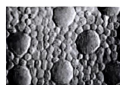
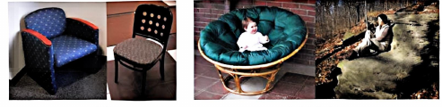
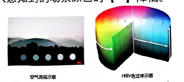
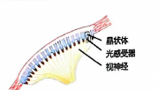
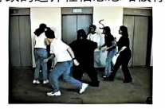
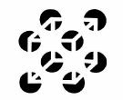
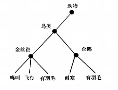
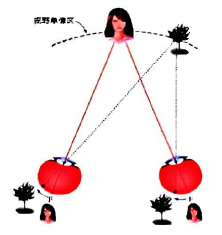
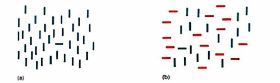
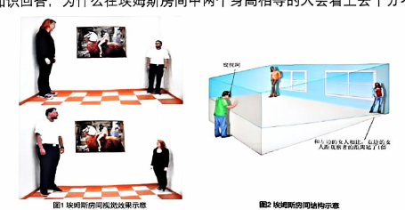

# 认知基础 2022–2023 学年第一学期期末试卷参考答案

## 一、填空题（共 10 题，每空 1 分，共 19 分）

### 1. 知觉加工的起点

#### 题目

1. 人的知觉加工开始于外界的环境刺激，如气味和声音，经过 ______ 和神经加工进而知觉和识别物体，最终引导行为活动。

#### 答案

**答案：** 感觉。

外界环境刺激先经感觉（感受器换能与神经加工）形成感觉信息，再经进一步加工而知觉和识别物体。

### 2. Sensation / Perception / Cognition 的中文翻译

#### 题目

2\. 请翻译以下名词：

   Sensation: ______ ；Perception: ______ ；Cognition: ______ 。

#### 答案

**答案：** Sensation: 感觉；Perception: 知觉；Cognition: 认知。

### 3. 任课教师的全名

#### 题目

3\. 任课教师的全名是 ______ 。

### 4. 视锥细胞 / 视杆细胞 / 中央凹的英文

#### 题目

4\. 请翻译以下名词成英文：

   视锥细胞: ______ ；视杆细胞: ______ ；中央凹: ______ 。

#### 答案

**答案：** 视锥细胞: cone cell（cone photoreceptor）；视杆细胞: rod cell（rod photoreceptor）；中央凹: fovea（fovea centralis）。

### 5. 摄像机覆盖区域类比成什么

#### 题目

5\. 如果将直播足球比赛的场外摄像机类比成视神经纤维，每个摄像机所看到或覆盖的区域可以类比成 ______ 。

#### 答案

**答案：** 感受野（receptive field）。

神经节细胞的感受野即其所连接的多个感光细胞在视网膜上覆盖的区域，正如一台摄像机所看到或覆盖的区域。

### 6. 两个似动现象的例子

#### 题目

6\. 请列举 2 个似动现象的例子： ______ ， ______ 等。

#### 答案

**答案：** 例如：动景运动（apparent movement，phi 现象）、诱发运动（induced movement）；也可用自主运动（autokinetic movement）、运动后效（瀑布效应）。

### 7. 格式塔知觉组织原则

#### 题目

7\. 格式塔知觉组织原则中主要有 **临近性** ， ______ ， ______ ， ______ 等。

#### 答案

**答案：** 临近性、相似性、闭合性、连续性（良好图形）；此外还有共同命运等。

### 8. 二维图片中物体深度信息的线索

#### 题目

8\. 获取二维图片中物体深度信息的线索主要有 **遮挡** ， ______ ， ______ ， ______ 等。

#### 答案

**答案：** 遮挡、相对大小、相对高度、线性透视、纹理梯度、明暗阴影、空气透视等（运动视差需运动才产生，严格说不属于静态二维图片线索）。

### 9. 工作记忆模型的第三个成分

#### 题目

9\. 工作记忆模型中，短时记忆分为语音回路，视觉画板和 ______ 这三个部分。

#### 答案

**答案：** 中央执行系统（central executive）。

Baddeley 与 Hitch 的工作记忆模型包含语音回路（phonological loop）、视觉画板（visuospatial sketchpad）与中央执行系统三部分。

### 10. 增强短时记忆储存能力的方法

#### 题目

10\. ______ 是增强短时记忆储存能力的重要方法之一，它将若干小单元组合成较大的有意义的单位。

#### 答案

**答案：** 组块（chunking）。

组块把若干个小单元组合成较大的、有意义的单位，从而扩大短时记忆的有效容量。

## 二、判断题（共 25 题，每题 1 分，共 25 分）

### 1. 图中较小的细胞是视锥细胞

#### 题目

1. 图中所示解剖结构中，较小的细胞是视锥细胞。【 】

   

#### 答案

**答案：** 错。

图中体积较大、呈膨大锥形的是视锥细胞；体积较小、数量明显更多的是视杆细胞。视杆细胞总数约 1.2 亿，视锥细胞约 600 万。

### 2. 现有人工智能在所有认知过程与感觉信息处理中性能都远不如人脑

#### 题目

2\. 现有人工智能在所有认知过程与感觉信息处理中性能都远不如人脑。【 】

#### 答案

**答案：** 错。

现有 AI 在部分感知与认知任务（如大规模图像分类、棋类对弈、特定模式识别）上已经达到或超过人类水平，「所有认知过程都远不如人脑」的说法过于绝对。

### 3. 认知科学对人工智能网络结构设计和训练优化算法等方面还未有过启发作用

#### 题目

3\. 认知科学对人工智能网络结构设计和训练优化算法等方面还未有过启发作用，未来有望带动人工智能技术变革。【 】

#### 答案

**答案：** 错。

认知科学已经对人工智能产生过重要启发：卷积神经网络的设计直接源自 Hubel 与 Wiesel 对猫视觉皮层简单细胞、复杂细胞感受野的研究；赫布学习规则也是神经网络建模的重要依据。

### 4. 人类大脑中的神经元会通过动态连接产生认知功能

#### 题目

4\. 人类大脑中的神经元会通过动态连接产生认知功能。【 】

#### 答案

**答案：** 对。

赫布学习规则指出，同步激发的突触会被强化，大脑据此发展神经回路、建立神经元间的网络联系，认知功能正是在这种动态连接中产生的。

### 5. 感受器的定义

#### 题目

5\. 感受器指的是一群专门响应来自环境的各种能量的细胞，它们可以将光能、化学能等转换成电信号。【 】

#### 答案

**答案：** 对。

感受器是一群专门响应来自环境的各种能量形式的细胞，可将光能、化学能、机械能等转换成电信号。

### 6. 物理强度 20 的光的主观度量一定为强度 10 的光的两倍

#### 题目

6\. 人眼对物理强度为 20 的光进行评价时，对该光强的主观度量一定为物理强度为 10 的光的两倍。【 】

#### 答案

**答案：** 错。

心理物理函数（费希纳的对数定律、斯蒂文斯的幂定律）表明主观感受量与物理强度之间是非线性关系，主观亮度不会随物理强度成正比地翻倍。

### 7. 中央凹上只分布有视锥细胞，个数约 1.2 亿

#### 题目

7\. 中央凹上只分布有视锥细胞，个数约 1.2 亿。【 】

#### 答案

**答案：** 错。

前半句正确（中央凹上只有视锥细胞），但数量错误：视锥细胞总数约 600 万（0.06 亿），1.2 亿是视杆细胞的总数。

### 8. 盲点上少量分布有视锥细胞或视杆细胞

#### 题目

8\. 由于视野中并未有明显空洞或缺失，因此判断盲点上少量分布有视锥细胞或视杆细胞。【 】

#### 答案

**答案：** 错。

盲点即视神经盘，是视神经穿出眼球的位置，该处既无视锥细胞也无视杆细胞。视野中没有明显空洞，是因为大脑的知觉填充以及双眼视野的互补。

### 9. 暗适应过程中视杆细胞的视敏度逐渐增强

#### 题目

9\. 突然进入黑暗环境后眼睛短暂失明，随着对黑暗环境的适应，视杆细胞的视敏度逐渐增强。【 】

#### 答案

**答案：** 对。

突然进入黑暗环境时视锥细胞主导的视觉暂时失效，随后视杆细胞逐渐适应，敏感度（视敏度）不断提高，暗适应约 20–30 分钟达到峰值。

### 10. 猫和猴子的眼睛结构与人类相同

#### 题目

10\. 猫和猴子都属于陆生哺乳动物，因此眼睛结构也与人类相同。【 】

#### 答案

**答案：** 错。

同为陆生哺乳动物并不意味着眼睛结构相同。猫的视网膜以视杆细胞为主、瞳孔呈竖缝状、并具有反光层（tapetum lucidum），与人类差异明显。

### 11. 感光细胞总数约为神经节细胞的 100 倍

#### 题目

11\. 神经加工的开端是光信号转化成电信号，由于视锥细胞与视杆细胞的总数约为神经节细胞的 100 倍，因此每个神经节细胞都需要与多个感受器细胞相连。【 】

#### 答案

**答案：** 对。

课件数据为 1.2 亿视杆细胞 + 0.06 亿视锥细胞，神经节细胞约 100 万，比值约 126 倍，与「约 100 倍」相符；因此每个神经节细胞需要与多个感光细胞相连（存在聚合）。

### 12. 神经加工是人类一切想法、感觉和认知行为的基础

#### 题目

12\. 神经加工是人类一切想法、感觉和认知行为的基础。【 】

#### 答案

**答案：** 对。

### 13. 未被激活的神经元处于静默状态不发送电信号

#### 题目

13\. 神经元被激活时会产生神经冲动（电脉冲信号），未被激活的神经元处于静默状态不发送电信号。【 】

#### 答案

**答案：**

课件（史忠植《脑认知的神经基础》部分）只讲到「单个突触短暂激发不足以使神经元发放冲动，需要许多突触一起激发才产生动作电位」，未讨论未激活神经元是否放电。若按神经科学通行结论（许多神经元在无外周刺激时仍有自发放电），本题应判**错**；若按本课「未达阈值的神经元不发放动作电位」的简化讲法，应判**对**。

### 14. 刺激更强时动作电位随之升高

#### 题目

14\. 神经元受到更强刺激时，所激发的神经冲动的动作电位也随之升高。【 】

#### 答案

**答案：** 错。

动作电位是「全或无」的，其幅度不随刺激强度变化；刺激增强表现为放电频率（单位时间内的动作电位个数）升高。

### 15. 格式塔心理学的核心主张是整体不等于部分之和

#### 题目

15\. 格式塔心理学的核心主张是：整体不等于部分之和。【 】

#### 答案

**答案：** 对。

### 16. 非注意盲视的原因是外周视网膜成像模糊

#### 题目

16\. 人会出现非注意盲视，可能原因是外周视网膜成像模糊，因此在中央凹上呈现的视觉内容就不会被忽视。【 】

#### 答案

**答案：** 错。

非注意盲视的原因是注意力没有分配到该客体，与成像清晰度无关；呈现在中央凹（成像最清晰）的内容在未被注意时同样会被忽视。

### 17. 注意力带来的增强效应会扩散到客体的其它部分

#### 题目

17\. 注意力带来的增强效应会扩散到客体的其它部分，举个例子：人们注意到客体上的某个位置时，该位置所在的整个客体都会被注意力机制所加工。【 】

#### 答案

**答案：** 对。

这是基于客体的注意（object-based attention）：注意到客体上的某个位置后，该位置所在的整个客体都会得到注意机制的优先加工。

### 18. 近期活动记忆犹新、久远经历遗忘说明短时记忆仅有数天

#### 题目

18\. 大二的同学们对近期内学校举办过的活动记忆犹新，但可能忘记大一办理入学手续的过程。这说明人对刺激信息的短时记忆仅有数天。【 】

#### 答案

**答案：** 错。

该现象反映的是长时记忆随时间的衰退（或编码与提取方式的差异），不能说明短时记忆只有数天。短时记忆在不经复述的情况下只能维持十几秒至几十秒。

### 19. 工作记忆模型中中央执行系统的一个重要功能是抑制无关刺激

#### 题目

19\. 认知心理学家 Baddeley，Hitch 于 1974 年提出了工作记忆模型。在工作记忆模型中，中央执行系统的一个重要功能是抑制无关的刺激。【 】

#### 答案

**答案：** 对。

### 20. 维特根斯坦 1953 年提出"家族相似性"

#### 题目

20\. 哲学家 Ludwig Wittgenstein 在 1953 年提出了"家族相似性"的概念，以解决定义理论不能涵盖一个类别中全部成员的问题（如下图所示）。【 】

    

#### 答案

**答案：** 对。

维特根斯坦在《哲学研究》（1953）中提出「家族相似性」，用以说明一个类别中的成员并不共享一组充要特征，而是通过彼此交叠的相似性联系在一起，从而解决定义理论无法涵盖类别全部成员的问题。

### 21. 层级网络模型中路径长度与提取时间成正相关

#### 题目

21\. 根据层级网络模型理论，语义网络中提取信息所经过路径的长度与人们提取该概念所需时间成正相关。【 】

#### 答案

**答案：** 对。

Collins 与 Quillian 的层级网络模型认为，语义网络中两个结点之间的路径越长，提取（句子确认）所需时间越长，反应时与语义距离正相关。

### 22. 花园路径模型

#### 题目

22\. 语法分析中的花园路径模型指的是，个体在对句子进行加工的过程中，会不断修订之前认可的句义猜测。【 】

#### 答案

**答案：** 对。

花园路径模型认为，读者在句子加工中先按某一句法／语义假设进行解析，遇到不一致时再回头修订先前认可的句义猜测。

### 23. 知觉识别与知觉分割相互辅助、相互依赖

#### 题目

23\. 知觉识别与知觉分割相互辅助、相互依赖。【 】

#### 答案

**答案：** 对。

### 24. 功能固着的定义

#### 题目

24\. 功能固着是人们在解决问题时常常遇到的一种障碍，它表现为人们关于物体功能会产生先入为主的观念。【 】

#### 答案

**答案：** 对。

功能固着表现为人们对物体的功能抱有先入为主的观念，从而在解决问题时难以想到该物体的其他用途，构成一种常见的解题障碍。

### 25. 短时记忆可以持续数分钟

#### 题目

25\. 短时记忆可以持续数分钟。【 】

#### 答案

**答案：** 错。

短时记忆在不经复述的情况下只能维持约 15–30 秒；能持续数分钟以上的是长时记忆。

## 三、单选题（共 20 题，每题 1 分，共 20 分）

### 1. 启发了最初卷积神经网络设计的观测

#### 题目

1. 对人类大脑的观测促进了人工智能理论的发展，例如【 】启发了最初的卷积神经网络设计。

   A. 猫视觉通路的感受野

   B. 听觉神经通路的结构

   C. 猴脑中脸特异性区域结构

   D. 纹状皮层的分层结构

#### 答案

**答案：** A（猫视觉通路的感受野）。

Hubel 与 Wiesel 对猫视觉皮层简单细胞、复杂细胞感受野的研究，直接启发了卷积神经网络中局部感受野与权值共享的设计。

### 2. 初级视皮层的解剖部位

#### 题目

2\. 初级视皮层位于大脑的哪个解剖部位【 】

   A. 顶叶

   B. 额叶

   C. 颞叶

   D. 枕叶

#### 答案

**答案：** D（枕叶）。

初级视皮层（V1，纹状皮层）位于大脑后部的枕叶。

### 3. 难以通过视觉识别物体但能通过声音判别别人物

#### 题目

3\. 某位患者难以通过视觉识别物体，但可以通过声音判别别人物。他可能患的是【 】

   A. 色盲

   B. 视觉失认症

   C. 色素性视网膜炎

   D. 帕金森综合征

   E. 巴林特综合征

#### 答案

**答案：** B（视觉失认症）。

视觉失认症患者的视觉通路与初级视觉正常，但无法把视觉输入与已有知识匹配、识别物体；听觉识别则不受影响。

### 4. 激光近视手术改变哪个部位的屈光度

#### 题目

4\. 用激光做近视手术是改变哪个部位的屈光度【 】

   A. 视网膜

   B. 晶状体

   C. 虹膜

   D. 角膜

#### 答案

**答案：** D（角膜）。

激光近视手术通过切削角膜组织改变角膜曲率，从而改变整个眼球的屈光力。

### 5. 朝霞和晚霞为什么不是蓝色的

#### 题目

5\. 朝霞和晚霞为什么不是蓝色的？【 】

   A. 因为海水反射的光少了

   B. 因为暖色的光最先到达人眼

   C. 因为蓝色光散射得多了

   D. 因为暖色光散射得多了

   E. 因为在适应不同光照条件后，对特定波长的视觉感受敏感程度不同（浦肯野位移）

#### 答案

**答案：** E（因为在适应不同光照条件后，对特定波长的视觉感受敏感程度不同，即浦肯野位移）。

朝霞、晚霞出现在光照很弱的时段，此时视杆细胞主导视觉。浦肯野位移表明暗适应后视觉系统的光谱敏感度峰值向短波方向移动，对长波（红、橙）的敏感度下降，红色因此显得更暗而不会呈现为蓝色。课件的课堂实验也演示了：闭上一只眼 5–10 分钟、暗适应后，暗适应眼中红色花比另一只眼中更暗。

### 6. 微弱星星直视看不见、外周视网膜可见

#### 题目

6\. 用天文望远镜探测深空时，有时候直视看不见一些微弱星星，但用外周视网膜区域可以观察到亮光。关于这种现象，以下说法正确的是【 】

   A. 视杆细胞比视锥细胞具有更高的敏感度（sensitivity）

   B. 视锥细胞比视杆细胞具有更高的敏感度（sensitivity）

   C. 视杆细胞比视锥细胞具有更高的视敏度（acuity）

   D. 视锥细胞比视杆细胞具有更高的视敏度（acuity）

#### 答案

**答案：** A（视杆细胞比视锥细胞具有更高的敏感度（sensitivity））。

中央凹只有视锥细胞，外周视网膜富含视杆细胞；视杆细胞的敏感度远高于视锥细胞，因此微弱星光在外周视野反而可见（旁视法）。选项 D「视锥细胞具有更高的视敏度」本身虽然正确，但并不能解释这一现象。

### 7. 关于 V1 视皮层的说法

#### 题目

7\. 以下关于 V1 视皮层说法正确的是【 】

   A. 左脑 V1 区主要处理左眼看到的画面

   B. 左脑 V1 区主要处理右眼看到的画面

   C. 左脑 V1 区主要处理左视野看到的画面

   D. 左脑 V1 区主要处理右视野看到的画面

#### 答案

**答案：** D（左脑 V1 区主要处理右视野看到的画面）。

视觉信息在视交叉处部分交叉，左半球 V1 接收来自右侧视野的信息（两眼视网膜左半侧），而不是「左眼／右眼」的划分。

### 8. 支持"整体不等于部分之和"的现象

#### 题目

8\. 以下现象哪些可以支持格式塔心理学中"整体不等于部分之和"的观点【 】

   A. 人很难快速分辨倒置的面孔

   B. 人可以快速识别场景中物体

   C. 婴儿可以识别面部的不同表情

   D. 双眼竞争现象

#### 答案

**答案：** D（双眼竞争现象）。

双眼竞争中两眼分别接收不同图像，知觉到的是一个完整的、不断交替的图像，既不等于左眼图像也不等于右眼图像，是「整体不等于部分之和」的典型例证。

### 9. 关于绑定问题的说法

#### 题目

9\. 以下关于绑定问题说法正确的是【 】

   A. 对物体颜色、形状、运动、位置等的视觉特征是在视网膜上进行处理并绑定的

   B. 对物体颜色、形状、运动、位置等的视觉特征是在 V1 区上进行处理并绑定的

   C. 对物体颜色、形状、运动、位置等的视觉特征初期是在相互独立的脑区处理的

   D. 对物体颜色、形状、运动、位置等的视觉特征始终是在相互独立的脑区处理的

#### 答案

**答案：** C（视觉特征初期是在相互独立的脑区处理的）。

颜色、形状、运动、位置等特征在早期由相互独立的脑区分别加工（V1、V2、V4、MT 等），随后才需要被「绑定」成一个统一客体，这正是绑定问题的由来。

### 10. 空气透视使感知到的场景颜色的什么降低

#### 题目

10\. 空气透视是深度感知的重要因素，距离越远的物体需要经过越多的空气和颗粒物才能被看到。从 HSV 色立体空间上看，下图中的空气和颗粒物会使得人感知到的场景颜色的【 】降低。

    

    A. 色调

    B. 饱和度

    C. 明度

#### 答案

**答案：** B（饱和度）。

空气透视中，距离越远的物体需要透过越多的空气和颗粒物才能被看到，散射光叠加使颜色被「冲淡」，在 HSV 色空间中表现为饱和度下降。

### 11. Hartline 等人选择鲎来证明侧抑制的原因

#### 题目

11\. 如图为鲎的复眼结构示意图，Hartline 等人(1956)选择了鲎来证明侧抑制的存在，这是因为【 】：

    A. 相比于选择其他的原始动物，鲎有多个眼睛

    B. 相比于选择其他的原始动物，在实验室培养会更加简单

    C. 鲎具备上百个复眼，各光感受器间互不干扰

    D. 鲎具备直径显著大于人眼的晶状体，能够保证在照亮一个单独感受器时不照亮相邻的感受器

    

#### 答案

**答案：** D（鲎具备直径显著大于人眼的晶状体，能够保证在照亮一个单独感受器时不照亮相邻的感受器）。

鲎的复眼由许多彼此光学隔离的小眼（小眼面）组成，直径大且相邻小眼之间不发生光学串扰，因此可以单独刺激一个小眼并记录其反应，从而干净地验证侧抑制效应。

### 12. 由于注意导致的选择性信息忽略

#### 题目

12\. 下图展示了为 Daniel Simons 和 Christopher Chabris（1999）在研究注意对个体知觉复杂场景的影响时所设计的实验。实验影片中有两支三人团队在进行传球比赛，被试需要看清楚球被传了几次。实验结束后 46% 的被试报告没有看见图中的大猩猩。这种由于注意导致的的选择性信息忽略被称为【 】

    

    A. 非注意盲视

    B. 注意盲视

    C. 非变化盲视

    D. 变化盲视

#### 答案

**答案：** B（注意盲视）。

Simons 与 Chabris（1999）的「看不见大猩猩」实验所展示的现象称为注意盲视（inattentional blindness）。

### 13. 注意力转移导致的激活

#### 题目

13\. 在一项由 Datta 和 DeYoe(2009)进行的功能磁共振成像研究中，参与者在显示器中偷偷转移他们的注意力。这种注意力的转移导致了【 】的激活。

    A. 相同的大脑区域，因为参与者的眼睛没有移动。

    B. 相同的大脑区域，因为参与者集中注意力。

    C. 不同的大脑区域，因为参与者关注不同的位置。

    D. 不同的大脑区域，因为参与者的眼睛在移动。

#### 答案

**答案：** C（不同的大脑区域，因为参与者关注不同的位置）。

Datta 与 DeYoe 的研究显示，在眼睛不移动的情况下把注意力转移到视野的不同位置，会激活 V1 中对应的不同视网膜拓扑位置，即不同的大脑区域。

### 14. 错觉轮廓支持的基本原理

#### 题目

14\. 格式塔心理学家用图中所示的错觉轮廓例子来支持【 】的基本原理。

    A. 感知是由感受器的复杂组合构成的

    B. 计算机处理能够模拟人的视觉

    C. 整体不同于部分的总和

    D. 人的感知受到经验的影响

    

#### 答案

**答案：** C（整体不同于部分的总和）。

主观轮廓（如卡尼萨三角形）并不存在于物理刺激中，却能被知觉到，说明知觉是整体组织的结果而非各部分感觉元素的简单相加。

### 15. 证明经验在知觉中所起作用的例子

#### 题目

15\. 以下【 】例子证明了经验在知觉中所起的作用。

    A. 人能够很轻松的判断出与对照物体有明显特征差别的目标。

    B. 人难以阅读书面句子中书写不清晰的线条。

    C. 人能够快速识别出特定情景中不寻常的物体(例如冰箱里的电话)。

    D. 尽管在专注于某件事情，人能够快速捕捉到异常巨响

#### 答案

**答案：** C（人能够快速识别出特定情景中不寻常的物体，例如冰箱里的电话）。

对场景中「不该出现」的物体的快速察觉，依赖于已有经验形成的场景图式（冰箱里应当放食物），因此最能说明经验在知觉中的作用。

### 16. 与晶状体屈光度变化有关的动眼线索

#### 题目

16\. 小明用一只眼睛盯着他的手指，当手指逐渐靠近时，他感到他的眼部肌肉的变化，同时远处的物体也变得模糊。该动眼线索【 】与晶状体屈光度变化有关。

    A. 调节 accommodation

    B. 汇聚 convergence

    C. 适应

    D. 运动视差

#### 答案

**答案：** A（调节 accommodation）。

调节指聚焦不同距离物体时睫状肌收缩、晶状体形状改变，从而改变屈光度；题干中小明只用一只眼睛，排除需要双眼的汇聚线索。

### 17. 抑制中心—兴奋周边感受野的神经元

#### 题目

17\. 诺贝尔奖获得者 Hubel&Wiesel 发现了猫视觉通路中不同的神经元可能有着不同类型，不同位置的感受野。下列关于一个有着抑制中心—兴奋周边感受野的神经元的说法正确的是：

    A. 当使用球形光刺激该神经元感受野中心时神经元的动作电位峰值最高

    B. 当使用球形光刺激该神经元感受野周边时神经元的动作电位峰值最高

    C. 当使用环形光刺激该神经元感受野周边时神经元的动作电位频率最高

    D. 当使用环形光刺激该神经元感受野中心时神经元的动作电位频率最高

    

#### 答案

**答案：** C（当使用环形光刺激该神经元感受野周边时神经元的动作电位频率最高）。

抑制中心—兴奋周边（off-center/on-surround）细胞在中心受光时放电受抑制，只有周边受光时放电最强；环形光恰好只照亮周边而避开中心，因此放电频率最高。动作电位幅度是全或无的，故涉及「峰值」的 A、B 两项本身就不成立。

### 18. 属于程序性记忆的是

#### 题目

18\. 下列属于程序性记忆的是【 】

    A. 头脑中储存的关于猫能捉老鼠的知识

    B. 记得上一道题的内容

    C. 使用键盘按键（WASD）控制游戏人物行走

    D. 记得和室友道别时的画面

#### 答案

**答案：** C（使用键盘按键（WASD）控制游戏人物行走）。

A 属于语义记忆，B、D 属于情景记忆，都属于陈述性（外显）记忆；操作技能属于程序性（内隐）记忆。

### 19. 多重记忆模型中的多重记忆

#### 题目

19\. 多重记忆模型中的多重记忆是指【 】

    A. 内隐记忆和外显记忆

    B. 感觉记忆、短时记忆和长时记忆

    C. 短时记忆和长时记忆

    D. 感觉记忆、短时记忆和程序性记忆

#### 答案

**答案：** B（感觉记忆、短时记忆和长时记忆）。

Atkinson–Shiffrin 的多重存储（多重记忆）模型包含感觉记忆、短时记忆与长时记忆三个成分。

### 20. 查电话簿拨号码时号码存在什么记忆中

#### 题目

20\. 我们查阅电话簿，找到某个号码记住，合上电话簿，拨打这个号码。打完电话，这个号码通常就不再记得。这个过程中号码存在了什么记忆中？【 】

    A. 程序性记忆

    B. 短时记忆

    C. 长时记忆

    D. 情景记忆

#### 答案

**答案：** B（短时记忆）。

号码在拨打期间被临时保持、拨完即遗忘，正是短时记忆的典型表现。

## 四、不定项选择题（共 6 题，每题 2 分，少选得 1 分，选错不得分，共 12 分）

### 1. 关于人类视觉速度的说法

#### 题目

1. 以下说法正确的是【 】：

   A. 人类视觉在亚秒内可实现特征搜索，如在数百水平线段中寻找一个同颜色的竖直线段

   B. 人类视觉在毫秒内会对场景中物体颜色、形状、语义等特征进行整合

   C. 人类视觉在对场景中颜色分布有所察觉先于对场景的理解

   D. 人类视觉可以在毫秒内感知并理解场景

#### 答案

**答案：** A、C、D（本题把握不足）。

- A 正确：特征搜索是平行的，目标会「跳出」，反应时不随项目数增长，可在亚秒内完成。
- C 正确：对场景颜色分布等低水平统计信息的察觉先于对场景内容的语义理解。
- D 正确：场景概貌（gist）可在约 100–250 毫秒的呈现时间内被感知并理解。
- B 存疑：课件与特征整合理论都指出，早期阶段各特征是相互独立加工的，颜色、形状、语义等特征的整合（绑定）需要集中注意，很难说是「在毫秒内自动完成」。

### 2. 现有人工智能技术的痛点和不足

#### 题目

2\. 现有人工智能技术都有哪些痛点和不足【 】：

   A. 鲁棒性强

   B. 迁移性弱

   C. 能效比低

   D. 可解释性差

#### 答案

**答案：** B、C、D（迁移性弱、能效比低、可解释性差）。

A「鲁棒性强」是优点而非不足，故不选。

### 3. 人类视觉感受细胞的分布位置

#### 题目

3\. 人类视觉感受细胞分布在【 】上。

   A. 角膜

   B. 中央凹

   C. 纹状皮层

   D. 视网膜

   E. 晶状体

   F. 盲点

   G. 睫状肌

#### 答案

**答案：** B、D（中央凹、视网膜）。

视锥细胞与视杆细胞都分布在视网膜上，其中视锥细胞密集于中央凹。盲点（视神经盘）处没有感光细胞；角膜、晶状体、睫状肌是屈光与调节结构；纹状皮层属于中枢而非感受细胞所在。

### 4. 关于层级语义网络的说法

#### 题目

4\. 认知心理学家 Ross Quillian 和 Allan Collins 在 1969 年提出了概念表征的层级语义网络，下图给出了关于金丝雀、鸵鸟的层级语义网络图。以下说法正确的是【 】：

   A. 层级语义网络具有认知经济性，高层级结点存储了底层级结点的所有属性。

   B. 对于鸟的原型，图中低典型性的鸵鸟与高典型性的金丝雀被划分到了同一层级上，这说明了层级语义网络不能解释典型性效应。

   C. 在进行句子确认实验时，被试对"金丝雀是鸟类"的反应时间比"金丝雀是动物"的反应时间短能称为支撑层级语义网络的行为学依据。

   D. 在进行句子确认实验时，被试对"金丝雀是鸟类"的反应时间比"金丝雀是动物"的反应时间长能称为支撑层级语义网络的生理学依据。

   

#### 答案

**答案：** A、B、C。

- A 正确：层级语义网络的认知经济性在于属性只存储在尽可能高的层级结点上，低层级结点继承高层级结点的属性。
- B 正确：图中低典型性的鸵鸟与高典型性的金丝雀处于同一层级，模型无法预测典型性差异，这正是 Collins 与 Loftus 之后提出扩散激活模型的原因之一。
- C 正确：「金丝雀是鸟类」比「金丝雀是动物」反应更快，反应时是行为学指标，可作为层级语义网络的行为学依据。
- D 错误：反应时属于行为学指标而非生理学指标，且方向也写反了。

### 5. 深度知觉的产生可能根据哪些线索

   

#### 题目

5\. 深度知觉的产生可能根据【 】提供的线索所产生的。

   

   A. 双眼像差

   B. 双眼汇聚

   C. 单眼调节

   D. 先验知识

#### 答案

**答案：** A、B、C、D（双眼像差、双眼汇聚、单眼调节、先验知识）。

课件「第 8 章 深度知觉和大小知觉」把深度知觉线索分为单眼线索（图示线索、运动线索）、动眼线索（调节、汇聚）与双眼线索（双眼像差），并指出「人的知觉通过先前对环境的经验来学习场景线索和深度间的联系」，即先验知识／经验是这些线索得以成为深度线索的前提，故四项都选。

### 6. 有助于更好学习与记忆的习惯或方法

#### 题目

6\. 根据记忆的研究成果，有哪些习惯或方法，可以帮助你更好的学习与记忆呢？

   A. 配对联想

   B. 生成与测验

   C. 对信息深层加工

   D. 成为一个主动记笔记的人

#### 答案

**答案：** A、B、C、D（配对联想、生成与测验、对信息深层加工、成为一个主动记笔记的人）。

四项都是记忆研究支持的策略：精细编码（配对联想）、生成效应与提取练习（生成与测验）、深加工（语义加工优于浅加工）、主动记笔记（促进编码与组织）。

## 五、简答题（共 6 题，每题 4 分，每题不超过 100 字，共 24 分）

### 1. 人类视觉的两种恒常性

#### 题目

1. 请列举人类视觉的两种恒常性，并用一句话加以描述。

#### 答案

**答案：**

- 大小恒常性：物体在视网膜上的像随距离增大而变小，但人知觉到的物体实际大小保持相对稳定。
- 形状恒常性：物体在视网膜上的投影随观察角度变化，但人知觉到的物体形状保持相对稳定。

（也可答：颜色恒常性——照明光谱改变时，人知觉到的物体颜色保持相对稳定；亮度恒常性同理。）

### 2. 两种视错觉现象及其物理刺激与主观感受的差异

#### 题目

2\. 请列举 2 种视错觉现象，并简要描述其客观物理刺激与主观人眼感受的差异。

#### 答案

**答案：**

- 缪勒-莱尔错觉：物理上两条线段等长，仅两端箭羽朝向不同，主观上却感到一条明显更长。
- 蓬佐错觉：物理上两个图形等大，因背景透视线条汇聚而主观上感到位于「远处」的一个更大。

### 3. 选择性适应和选择性饲养的区别

#### 题目

3\. 请简述选择性适应和选择性饲养的区别。

#### 答案

**答案：**

- 选择性适应：心理物理学方法。让被试持续接受某一特征刺激，使对应的特征探测器疲劳或适应、放电频率下降，再测适应前后的知觉变化，间接推断「生理—知觉」关系。
- 选择性饲养：动物神经科学方法。把动物饲养在只有一种特定刺激的环境中，使对该刺激反应的神经元变得更为普遍（「用进废退」），直接测量「刺激—生理」关系。

### 4. 双眼竞争和边界归属的 1 个共同点和 1 个差异点

#### 题目

4\. 请简述双眼竞争和边界归属两种现象的 1 个共同点和 1 个差异点。

#### 答案

**答案：**

- 共同点：两者都表明知觉不是感觉输入的简单复制，大脑需要对输入主动组织与选择，主观知觉与客观物理刺激并不一一对应。
- 差异点：双眼竞争发生在两眼输入之间，知觉在两个整体解释之间随时间交替（时间维度上的竞争）；边界归属发生在同一时刻的同一条边缘上，需要判定该边缘归属于哪一侧图形（空间维度上的图形—背景归属）。

### 5. 特征搜索与联合搜索实验结论的区别

#### 题目

5\. 请比较(a)特征搜索和(b)联合搜索实验结论的区别

   

#### 答案

**答案：**

- (a) 特征搜索：目标与干扰项在单一特征上不同（如在竖线中找水平线），无需把注意集中到特定位置，反应时不随干扰项数量增加，表现为「跳出」式的平行搜索。
- (b) 联合搜索：目标由两个及以上特征组合定义（如在绿色竖线与红色水平线中找绿色水平线），必须集中注意逐项检查，反应时随干扰项数量线性增加，表现为序列搜索。

结论区别：特征搜索说明早期阶段各特征是独立、并行加工的；联合搜索说明特征整合（绑定）必须依赖集中注意——这正是特征整合理论的核心证据。

### 6. 为什么埃姆斯房间中两个身高相等的人看上去十分不同

#### 题目

6\. 如图 1 所示的埃姆斯房间使两个身高相等的人看上去十分不同(Ittelson，1952)。图 2 给出了艾姆森房间的结构示意，在埃姆斯房间中尽管两人的实际身高相同，但房间的特殊构造使得观察者对两个人的知觉深度一致，而实际上站在右墙角的人与被试的距离相比比左墙角的人与被试的距离多出一倍。利用大小知觉的知识回答，为什么在埃姆斯房间中两个身高相等的人会看上去十分不同？

   

#### 答案

**答案：**

大小知觉由视网膜像的大小与知觉到的距离共同决定（大小恒常性）。埃姆斯房间是梯形结构，但窥孔视角使其被知觉为规则矩形，于是观察者把两人判断为处于相同距离。两人实际身高相同，站在实际距离远一倍处的人在视网膜上的像只有一半大；由于被知觉为同样远，按「距离相同则像越大物体越大」的关系，他就被判断为更矮，另一人则被判断为更高，因而看上去十分不同。

## 六、附加题（共 2 题，每题 0 分，每题不超过 10000 字，共 0 分）

### 1. 听课过程中的"顿悟"时刻或印象深刻的点

#### 题目

1. 请列举几点在听课过程中，你的"顿悟"时刻或印象深刻的点。

#### 答案

**答案：** 开放性主观题，无标准答案，由作答者结合自身听课体验作答。

### 2. 本课程需要完善的方面

#### 题目

2\. 请列举几点本课程需要完善的方面。

#### 答案

**答案：** 开放性主观题，无标准答案，由作答者结合自身听课体验作答。
