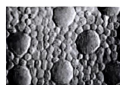
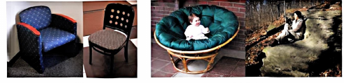
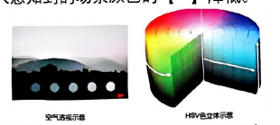
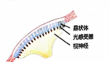
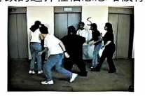
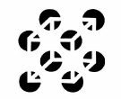
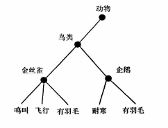
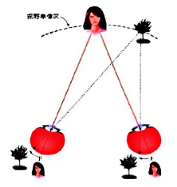
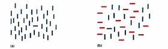
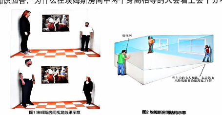

# 认知基础 2022–2023 学年第一学期期末试卷

## 一、填空题（共 10 题，每空 1 分，共 19 分）

1. 人的知觉加工开始于外界的环境刺激，如气味和声音，经过 ______ 和神经加工进而知觉和识别物体，最终引导行为活动。

2. 请翻译以下名词：

   Sensation: ______ ；Perception: ______ ；Cognition: ______ 。

3. 任课教师的全名是 ______ 。

4. 请翻译以下名词成英文：

   视锥细胞: ______ ；视杆细胞: ______ ；中央凹: ______ 。

5. 如果将直播足球比赛的场外摄像机类比成视神经纤维，每个摄像机所看到或覆盖的区域可以类比成 ______ 。

6. 请列举 2 个似动现象的例子： ______ ， ______ 等。

7. 格式塔知觉组织原则中主要有 **临近性** ， ______ ， ______ ， ______ 等。

8. 获取二维图片中物体深度信息的线索主要有 **遮挡** ， ______ ， ______ ， ______ 等。

9. 工作记忆模型中，短时记忆分为语音回路，视觉画板和 ______ 这三个部分。

10. ______ 是增强短时记忆储存能力的重要方法之一，它将若干小单元组合成较大的有意义的单位。

## 二、判断题（共 25 题，每题 1 分，共 25 分）

1. 图中所示解剖结构中，较小的细胞是视锥细胞。【 】

   

2. 现有人工智能在所有认知过程与感觉信息处理中性能都远不如人脑。【 】

3. 认知科学对人工智能网络结构设计和训练优化算法等方面还未有过启发作用，未来有望带动人工智能技术变革。【 】

4. 人类大脑中的神经元会通过动态连接产生认知功能。【 】

5. 感受器指的是一群专门响应来自环境的各种能量的细胞，它们可以将光能、化学能等转换成电信号。【 】

6. 人眼对物理强度为 20 的光进行评价时，对该光强的主观度量一定为物理强度为 10 的光的两倍。【 】

7. 中央凹上只分布有视锥细胞，个数约 1.2 亿。【 】

8. 由于视野中并未有明显空洞或缺失，因此判断盲点上少量分布有视锥细胞或视杆细胞。【 】

9. 突然进入黑暗环境后眼睛短暂失明，随着对黑暗环境的适应，视杆细胞的视敏度逐渐增强。【 】

10. 猫和猴子都属于陆生哺乳动物，因此眼睛结构也与人类相同。【 】

11. 神经加工的开端是光信号转化成电信号，由于视锥细胞与视杆细胞的总数约为神经节细胞的 100 倍，因此每个神经节细胞都需要与多个感受器细胞相连。【 】

12. 神经加工是人类一切想法、感觉和认知行为的基础。【 】

13. 神经元被激活时会产生神经冲动（电脉冲信号），未被激活的神经元处于静默状态不发送电信号。【 】

14. 神经元受到更强刺激时，所激发的神经冲动的动作电位也随之升高。【 】

15. 格式塔心理学的核心主张是：整体不等于部分之和。【 】

16. 人会出现非注意盲视，可能原因是外周视网膜成像模糊，因此在中央凹上呈现的视觉内容就不会被忽视。【 】

17. 注意力带来的增强效应会扩散到客体的其它部分，举个例子：人们注意到客体上的某个位置时，该位置所在的整个客体都会被注意力机制所加工。【 】

18. 大二的同学们对近期内学校举办过的活动记忆犹新，但可能忘记大一办理入学手续的过程。这说明人对刺激信息的短时记忆仅有数天。【 】

19. 认知心理学家 Baddeley，Hitch 于 1974 年提出了工作记忆模型。在工作记忆模型中，中央执行系统的一个重要功能是抑制无关的刺激。【 】

20. 哲学家 Ludwig Wittgenstein 在 1953 年提出了"家族相似性"的概念，以解决定义理论不能涵盖一个类别中全部成员的问题（如下图所示）。【 】

    

21. 根据层级网络模型理论，语义网络中提取信息所经过路径的长度与人们提取该概念所需时间成正相关。【 】

22. 语法分析中的花园路径模型指的是，个体在对句子进行加工的过程中，会不断修订之前认可的句义猜测。【 】

23. 知觉识别与知觉分割相互辅助、相互依赖。【 】

24. 功能固着是人们在解决问题时常常遇到的一种障碍，它表现为人们关于物体功能会产生先入为主的观念。【 】

25. 短时记忆可以持续数分钟。【 】

## 三、单选题（共 20 题，每题 1 分，共 20 分）

1. 对人类大脑的观测促进了人工智能理论的发展，例如【 】启发了最初的卷积神经网络设计。

   A. 猫视觉通路的感受野

   B. 听觉神经通路的结构

   C. 猴脑中脸特异性区域结构

   D. 纹状皮层的分层结构

2. 初级视皮层位于大脑的哪个解剖部位【 】

   A. 顶叶

   B. 额叶

   C. 颞叶

   D. 枕叶

3. 某位患者难以通过视觉识别物体，但可以通过声音判别别人物。他可能患的是【 】

   A. 色盲

   B. 视觉失认症

   C. 色素性视网膜炎

   D. 帕金森综合征

   E. 巴林特综合征

4. 用激光做近视手术是改变哪个部位的屈光度【 】

   A. 视网膜

   B. 晶状体

   C. 虹膜

   D. 角膜

5. 朝霞和晚霞为什么不是蓝色的？【 】

   A. 因为海水反射的光少了

   B. 因为暖色的光最先到达人眼

   C. 因为蓝色光散射得多了

   D. 因为暖色光散射得多了

   E. 因为在适应不同光照条件后，对特定波长的视觉感受敏感程度不同（浦肯野位移）

6. 用天文望远镜探测深空时，有时候直视看不见一些微弱星星，但用外周视网膜区域可以观察到亮光。关于这种现象，以下说法正确的是【 】

   A. 视杆细胞比视锥细胞具有更高的敏感度（sensitivity）

   B. 视锥细胞比视杆细胞具有更高的敏感度（sensitivity）

   C. 视杆细胞比视锥细胞具有更高的视敏度（acuity）

   D. 视锥细胞比视杆细胞具有更高的视敏度（acuity）

7. 以下关于 V1 视皮层说法正确的是【 】

   A. 左脑 V1 区主要处理左眼看到的画面

   B. 左脑 V1 区主要处理右眼看到的画面

   C. 左脑 V1 区主要处理左视野看到的画面

   D. 左脑 V1 区主要处理右视野看到的画面

8. 以下现象哪些可以支持格式塔心理学中"整体不等于部分之和"的观点【 】

   A. 人很难快速分辨倒置的面孔

   B. 人可以快速识别场景中物体

   C. 婴儿可以识别面部的不同表情

   D. 双眼竞争现象

9. 以下关于绑定问题说法正确的是【 】

   A. 对物体颜色、形状、运动、位置等的视觉特征是在视网膜上进行处理并绑定的

   B. 对物体颜色、形状、运动、位置等的视觉特征是在 V1 区上进行处理并绑定的

   C. 对物体颜色、形状、运动、位置等的视觉特征初期是在相互独立的脑区处理的

   D. 对物体颜色、形状、运动、位置等的视觉特征始终是在相互独立的脑区处理的

10. 空气透视是深度感知的重要因素，距离越远的物体需要经过越多的空气和颗粒物才能被看到。从 HSV 色立体空间上看，下图中的空气和颗粒物会使得人感知到的场景颜色的【 】降低。

    

    A. 色调

    B. 饱和度

    C. 明度

11. 如图为鲎的复眼结构示意图，Hartline 等人(1956)选择了鲎来证明侧抑制的存在，这是因为【 】：

    A. 相比于选择其他的原始动物，鲎有多个眼睛

    B. 相比于选择其他的原始动物，在实验室培养会更加简单

    C. 鲎具备上百个复眼，各光感受器间互不干扰

    D. 鲎具备直径显著大于人眼的晶状体，能够保证在照亮一个单独感受器时不照亮相邻的感受器

    

12. 下图展示了为 Daniel Simons 和 Christopher Chabris（1999）在研究注意对个体知觉复杂场景的影响时所设计的实验。实验影片中有两支三人团队在进行传球比赛，被试需要看清楚球被传了几次。实验结束后 46% 的被试报告没有看见图中的大猩猩。这种由于注意导致的的选择性信息忽略被称为【 】

    

    A. 非注意盲视

    B. 注意盲视

    C. 非变化盲视

    D. 变化盲视

13. 在一项由 Datta 和 DeYoe(2009)进行的功能磁共振成像研究中，参与者在显示器中偷偷转移他们的注意力。这种注意力的转移导致了【 】的激活。

    A. 相同的大脑区域，因为参与者的眼睛没有移动。

    B. 相同的大脑区域，因为参与者集中注意力。

    C. 不同的大脑区域，因为参与者关注不同的位置。

    D. 不同的大脑区域，因为参与者的眼睛在移动。

14. 格式塔心理学家用图中所示的错觉轮廓例子来支持【 】的基本原理。

    A. 感知是由感受器的复杂组合构成的

    B. 计算机处理能够模拟人的视觉

    C. 整体不同于部分的总和

    D. 人的感知受到经验的影响

    

15. 以下【 】例子证明了经验在知觉中所起的作用。

    A. 人能够很轻松的判断出与对照物体有明显特征差别的目标。

    B. 人难以阅读书面句子中书写不清晰的线条。

    C. 人能够快速识别出特定情景中不寻常的物体(例如冰箱里的电话)。

    D. 尽管在专注于某件事情，人能够快速捕捉到异常巨响

16. 小明用一只眼睛盯着他的手指，当手指逐渐靠近时，他感到他的眼部肌肉的变化，同时远处的物体也变得模糊。该动眼线索【 】与晶状体屈光度变化有关。

    A. 调节 accommodation

    B. 汇聚 convergence

    C. 适应

    D. 运动视差

17. 诺贝尔奖获得者 Hubel&Wiesel 发现了猫视觉通路中不同的神经元可能有着不同类型，不同位置的感受野。下列关于一个有着抑制中心—兴奋周边感受野的神经元的说法正确的是：

    A. 当使用球形光刺激该神经元感受野中心时神经元的动作电位峰值最高

    B. 当使用球形光刺激该神经元感受野周边时神经元的动作电位峰值最高

    C. 当使用环形光刺激该神经元感受野周边时神经元的动作电位频率最高

    D. 当使用环形光刺激该神经元感受野中心时神经元的动作电位频率最高

    

18. 下列属于程序性记忆的是【 】

    A. 头脑中储存的关于猫能捉老鼠的知识

    B. 记得上一道题的内容

    C. 使用键盘按键（WASD）控制游戏人物行走

    D. 记得和室友道别时的画面

19. 多重记忆模型中的多重记忆是指【 】

    A. 内隐记忆和外显记忆

    B. 感觉记忆、短时记忆和长时记忆

    C. 短时记忆和长时记忆

    D. 感觉记忆、短时记忆和程序性记忆

20. 我们查阅电话簿，找到某个号码记住，合上电话簿，拨打这个号码。打完电话，这个号码通常就不再记得。这个过程中号码存在了什么记忆中？【 】

    A. 程序性记忆

    B. 短时记忆

    C. 长时记忆

    D. 情景记忆

## 四、不定项选择题（共 6 题，每题 2 分，少选得 1 分，选错不得分，共 12 分）

1. 以下说法正确的是【 】：

   A. 人类视觉在亚秒内可实现特征搜索，如在数百水平线段中寻找一个同颜色的竖直线段

   B. 人类视觉在毫秒内会对场景中物体颜色、形状、语义等特征进行整合

   C. 人类视觉在对场景中颜色分布有所察觉先于对场景的理解

   D. 人类视觉可以在毫秒内感知并理解场景

2. 现有人工智能技术都有哪些痛点和不足【 】：

   A. 鲁棒性强

   B. 迁移性弱

   C. 能效比低

   D. 可解释性差

3. 人类视觉感受细胞分布在【 】上。

   A. 角膜

   B. 中央凹

   C. 纹状皮层

   D. 视网膜

   E. 晶状体

   F. 盲点

   G. 睫状肌

4. 认知心理学家 Ross Quillian 和 Allan Collins 在 1969 年提出了概念表征的层级语义网络，下图给出了关于金丝雀、鸵鸟的层级语义网络图。以下说法正确的是【 】：

   A. 层级语义网络具有认知经济性，高层级结点存储了底层级结点的所有属性。

   B. 对于鸟的原型，图中低典型性的鸵鸟与高典型性的金丝雀被划分到了同一层级上，这说明了层级语义网络不能解释典型性效应。

   C. 在进行句子确认实验时，被试对"金丝雀是鸟类"的反应时间比"金丝雀是动物"的反应时间短能称为支撑层级语义网络的行为学依据。

   D. 在进行句子确认实验时，被试对"金丝雀是鸟类"的反应时间比"金丝雀是动物"的反应时间长能称为支撑层级语义网络的生理学依据。

   

5. 深度知觉的产生可能根据【 】提供的线索所产生的。

   

   A. 双眼像差

   B. 双眼汇聚

   C. 单眼调节

   D. 先验知识

6. 根据记忆的研究成果，有哪些习惯或方法，可以帮助你更好的学习与记忆呢？

   A. 配对联想

   B. 生成与测验

   C. 对信息深层加工

   D. 成为一个主动记笔记的人

## 五、简答题（共 6 题，每题 4 分，每题不超过 100 字，共 24 分）

1. 请列举人类视觉的两种恒常性，并用一句话加以描述。

2. 请列举 2 种视错觉现象，并简要描述其客观物理刺激与主观人眼感受的差异。

3. 请简述选择性适应和选择性饲养的区别。

4. 请简述双眼竞争和边界归属两种现象的 1 个共同点和 1 个差异点。

5. 请比较(a)特征搜索和(b)联合搜索实验结论的区别

   

6. 如图 1 所示的埃姆斯房间使两个身高相等的人看上去十分不同(Ittelson，1952)。图 2 给出了艾姆森房间的结构示意，在埃姆斯房间中尽管两人的实际身高相同，但房间的特殊构造使得观察者对两个人的知觉深度一致，而实际上站在右墙角的人与被试的距离相比比左墙角的人与被试的距离多出一倍。利用大小知觉的知识回答，为什么在埃姆斯房间中两个身高相等的人会看上去十分不同？

   

## 六、附加题（共 2 题，每题 0 分，每题不超过 10000 字，共 0 分）

1. 请列举几点在听课过程中，你的"顿悟"时刻或印象深刻的点。

2. 请列举几点本课程需要完善的方面。
