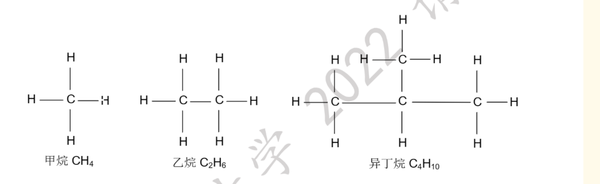
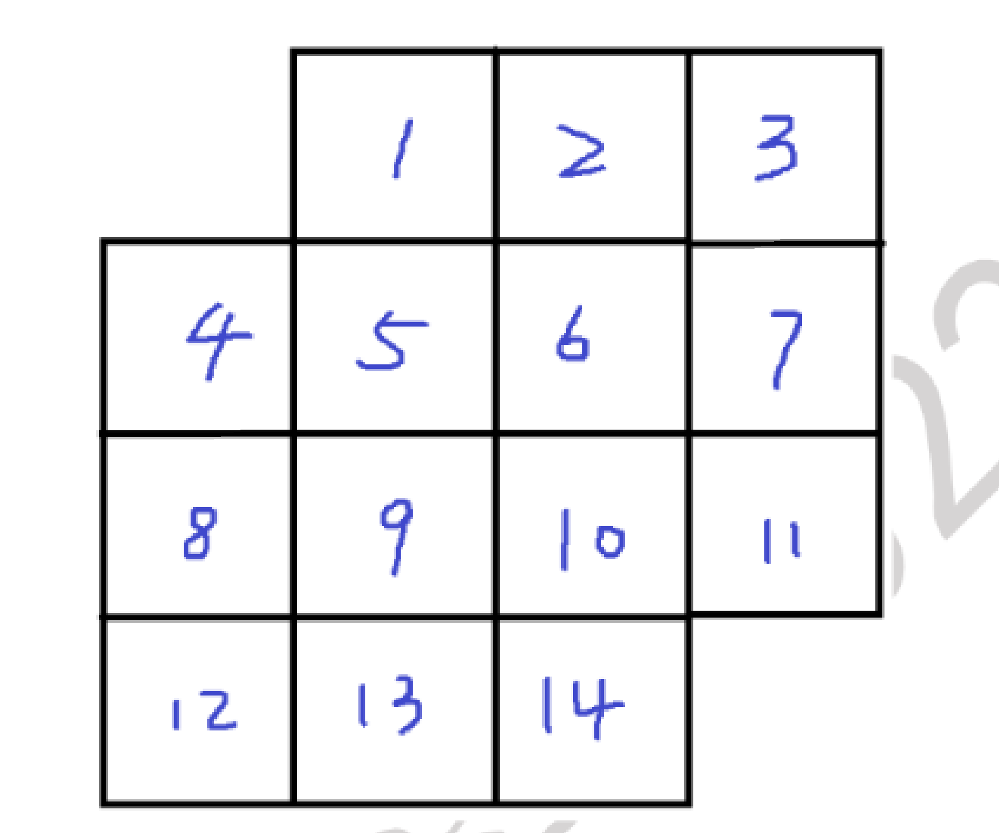

# 集合论与图论 2022–2023 学年第一学期期末试卷参考答案

> 注意事项：1、请将答案按题目顺序写在答题纸上；2、请在每页答题纸上写清楚姓名和学号。

## 试题（共 16 题）

### 1

#### 题目

【8 分】判断下列哪些关系成立。只需要给出判断结果，不需要给出理由：

(1) $\{a\}\in\{\{a\}\}$

(2) $d\in\{a,b,c,\{d\}\}$

(3) $\{b\}\in\{a,b,\{b\}\}$

(4) $\Phi\in\{\Phi,a,\{b\},\{a,b\}\}$

(5) $\{\Phi\}\subseteq\{\Phi,\{\Phi\}\}$

(6) $\{\Phi\}\subseteq\{\{\Phi,\{\Phi\}\}\}$

(7) $\{\{\Phi\}\}\subseteq\{\Phi,\{\Phi\}\}$

(8) $\{\{\Phi\}\}\subseteq\{\Phi,\{\Phi,\{\Phi\}\}\}$

注意：这里的 $\Phi$ 表示空集。

#### 答案

**答案：** 成立的是 **(1)(3)(4)(5)(7)**。

(2) 不成立： $d$ 本身不是该集合的元素，该集合含有的元素是 $a,b,c$ 和 $\{d\}$。

(6) 不成立：右端集合只有一个元素 $\{\Phi,\{\Phi\}\}$，而左端集合的元素 $\Phi$ 不在其中。

(8) 不成立：右端集合的元素是 $\Phi$ 和 $\{\Phi,\{\Phi\}\}$，左端集合的元素 $\{\Phi\}$ 不在其中。

### 2

#### 题目

【6 分】下面的 $A$ 和 $B$ 均为集合。请分别给出下面式子成立的（尽可能简单的）充要条件，并证明其充要性：

(1) $A-B=B$

(2) $A-B=B-A$

#### 答案

**答案：**

(1) $A-B=B$ $\iff$ $A=B=\Phi$。

必要性：恒有 $(A-B)\cap B=\Phi$。若 $A-B=B$，则 $B\cap B=\Phi$，即 $B=\Phi$；此时 $A=A-\Phi=A-B=B=\Phi$。

充分性： $A=B=\Phi$ 时 $A-B=\Phi=B$。

(2) $A-B=B-A$ $\iff$ $A=B$。

必要性：恒有 $(A-B)\cap(B-A)=\Phi$。若 $A-B=B-A$，则该集合与自身不交，故 $A-B=B-A=\Phi$，于是 $A\subseteq B$ 且 $B\subseteq A$，即 $A=B$。

充分性： $A=B$ 时 $A-B=B-A=\Phi$。

### 3

#### 题目

【6 分】某门课程的期末考试题目都是从题库中抽取的，而且每次考试恰好包括 20 道题目。此外，按照规定，每次考试与前 2 年每次考试重复的题目，均不能超过 6 道。例如，2022 年期末考试的题目，最多只能有 6 道在 2021 年期末考试中出现过，也最多只能有 6 道在 2020 年期末考试中出现过。那么题库中最少需要有多少道题目？请计算并简要说明理由。

#### 答案

**答案：** 至少需要 **42** 道题目。

设连续三次考试的题目集合为 $A_1,A_2,A_3$，则 $|A_i|=20$，且按规定 $|A_i\cap A_j|\le 6$（ $i\ne j$）。由容斥原理，

$$|A_1\cup A_2\cup A_3|=|A_1|+|A_2|+|A_3|-\sum_{i<j}|A_i\cap A_j|+|A_1\cap A_2\cap A_3|$$

$$\ge 20\times3-6\times3+0=42 .$$

下界可以达到。取 42 道题，按手写解答的构造令

$$A_1=\{1,2,\ldots,20\},\qquad A_2=\{1,2,\ldots,6\}\cup\{21,22,\ldots,34\},$$

$$A_3=\{7,8,\ldots,12\}\cup\{21,22,\ldots,26\}\cup\{35,36,\ldots,42\}.$$

则 $|A_1|=|A_2|=|A_3|=20$，且

$$A_1\cap A_2=\{1,\ldots,6\},\qquad A_1\cap A_3=\{7,\ldots,12\},\qquad A_2\cap A_3=\{21,\ldots,26\},$$

三个两两交集都恰为 6 道题，并集为 42 道题，满足规定。故题库最少需要 42 道题目。

### 4

#### 题目

【6 分】如果关系 $R$ 和 $S$ 都是自反的、对称的和传递的，请证明： $R\cap S$ 也是自反的、对称的和传递的。

#### 答案

**答案：** 设 $R,S$ 都是集合 $X$ 上的自反、对称、传递关系。

自反性：对 $\forall x$，有 $xRx$ 且 $xSx$，故 $x(R\cap S)x$。

对称性：设 $x(R\cap S)y$，则 $xRy$ 且 $xSy$；由对称性得 $yRx$ 且 $ySx$，故 $y(R\cap S)x$。

传递性：设 $x(R\cap S)y$ 且 $y(R\cap S)z$，则 $xRy$、 $yRz$ 且 $xSy$、 $ySz$；由传递性得 $xRz$ 且 $xSz$，故 $x(R\cap S)z$。

### 5

#### 题目

【6 分】请构造一个从闭区间 $[-1,1]$ 到开区间 $(0,1)$ 的双射函数。

#### 答案

**答案：** 把有理数部分单独"挪开"，无理数部分用线性映射。

记 $A=[-1,1]\cap\mathbf{Q}$， $B=(0,1)\cap\mathbf{Q}$。二者都是可数无穷集，故存在双射 $f:A\to B$。定义

$$g(x)=\begin{cases}f(x), & x\in A\\[4pt] \dfrac{x+1}{2}, & x\in[-1,1]\setminus\mathbf{Q}\end{cases}$$

则 $g$ 把 $A$ 双射地映到 $B$（即 $(0,1)$ 中的全部有理数），把 $[-1,1]$ 中的无理数双射地映到 $(0,1)$ 中的无理数（因 $x\mapsto\frac{x+1}{2}$ 是 $[-1,1]$ 到 $[0,1]$ 的双射，且保持有理性）。两部分像集不交且并为 $(0,1)$，故 $g$ 是 $[-1,1]$ 到 $(0,1)$ 的双射。

### 6

#### 题目

【6 分】证明：在一个无向图 $G$ 中，如果有且仅有两个顶点 $u$ 和 $v$ 的度为奇数，则 $u$ 和 $v$ 必然是连通的。

#### 答案

**答案：** 用握手定理最简：任何图中奇度顶点的个数必为偶数。

设 $u$ 所在连通分支为 $C$。若 $v$ 与 $u$ 不连通，则 $v\notin C$，于是 $C$ 中恰有 $u$ 一个奇度顶点，与握手定理矛盾。故 $u$ 与 $v$ 必然连通。

### 7

#### 题目

【6 分】无向连通图 $G$ 的顶点数不少于 3。对于 $G$ 的任意两个顶点 $u$ 和 $v$，如果这两个顶点是连通的，连接它们的所有链的长度要么全部为偶数，要么全部为奇数。请证明： $G$ 是一个二分图。

#### 答案

**答案：** 取 $G$ 的生成树 $T$，固定一个顶点 $x\in V(T)$，按到 $x$ 的距离的奇偶性作划分：

$$V_1=\{v\mid d_T(x,v)\ \text{为奇数}\},\qquad V_2=\{v\mid d_T(x,v)\ \text{为偶数}\}.$$

显然 $V_1\cap V_2=\varnothing$， $V_1\cup V_2=V$。

对 $\forall u,v\in V_i$（ $i=1,2$），设 $w$ 是 $T$ 中 $u$ 到 $x$ 的链与 $v$ 到 $x$ 的链的最后一个公共顶点，则 $T$ 中 $u$ 与 $v$ 之间的唯一链长为 $d_T(u,v)=d_T(x,u)+d_T(x,v)-2d_T(x,w)$，与 $d_T(x,u)+d_T(x,v)$ 同奇偶。因 $u,v$ 同属 $V_i$， $d_T(x,u)$ 与 $d_T(x,v)$ 同奇偶，故 $d_T(u,v)$ 为偶数。这条链也是 $G$ 中的链，由题设， $G$ 中连接 $u,v$ 的所有链长度都同为偶数，因此不存在长度为 1 的链，即 $uv\notin E(G)$。

于是 $V_1$ 内部、 $V_2$ 内部都没有边， $\{V_1,V_2\}$ 是 $G$ 的一个二部划分，故 $G$ 是二分图。

### 8

#### 题目

【6 分】树 $T$ 的邻接矩阵为 $A$。如果正整数 $k$ 使得 $A^{k}$ 的第 $u$ 行第 $v$ 列元素非零，则称 $k$ 满足 $u$ 和 $v$。请证明：对于任意给定的 $u$ 和 $v$，

(1) 至少存在一个正整数 $k$ 可以满足 $u$ 和 $v$；

(2) 满足 $u$ 和 $v$ 的正整数，要么全部为奇数，要么全部为偶数。

#### 答案

**答案：** 邻接矩阵的幂满足： $A^{k}$ 的第 $u$ 行第 $v$ 列元素等于从 $u$ 到 $v$ 长度为 $k$ 的通道（walk）的条数。

(1) 当 $u\ne v$ 时，树是连通图， $u$ 与 $v$ 之间存在唯一的一条链 $P$，取 $k=|P|\ge 1$，则 $A^{k}$ 的第 $u$ 行第 $v$ 列元素至少为 1（非零）。当 $u=v$ 时，唯一的链长度为 0，不是正整数；此时取 $k=2$，沿 $u$ 的任一条关联边走一个来回即得长度为 2 的通道， $A^{2}$ 的第 $u$ 行第 $u$ 列元素非零。故至少存在一个正整数 $k$ 满足 $u$ 和 $v$（当 $T$ 只有一个顶点时不存在这样的正整数 $k$，此时题目 (1) 的结论需假设 $\lvert V(T)\rvert\ge 2$）。

(2) 对 $n=\lvert V(T)\rvert$ 归纳，证明「 $T$ 中任意两点之间的所有通道长度奇偶性相同」。

**归纳基础：** $n\le 2$ 时直接验证即可。

**归纳步骤：** 设结论对 $n$ 个顶点的树成立， $T$ 有 $n+1$ 个顶点（ $n\ge 2$）。取 $T$ 的一个叶结点 $x$（ $d_T(x)=1$），设 $xy\in E(T)$，令 $T'=T-x$，则 $T'$ 是 $n$ 个顶点的树。

$x$ 在 $T$ 中只有 $y$ 一个邻点，故 $T$ 中任一通道 $W$ 经过 $x$ 的方式只有三种： $x$ 在 $W$ 内部（此时必为片段 $\cdots-y-x-y-\cdots$）、 $x$ 是 $W$ 的终点（ $\cdots-y-x$）、 $x$ 是 $W$ 的起点（ $x-y-\cdots$）。

先反复删去 $W$ 中所有形如 $y-x-y$ 的片段，每删一次长度减少 2，奇偶性不变；删完后 $x$ 只可能出现在 $W$ 的两端。记 $u'=u$（当 $u\ne x$）或 $u'=y$（当 $u=x$）， $v'$ 同理，则剩下的部分是 $T'$ 中从 $u'$ 到 $v'$ 的一条通道 $W'$，且

$$\lvert W\rvert=\lvert W'\rvert+[u=x]+[v=x],$$

其中 $[\cdot]$ 为示性函数。反之 $T'$ 中的通道也是 $T$ 中的通道。由归纳假设， $T'$ 中任意两点之间的所有通道长度奇偶性相同，故 $T$ 中从 $u$ 到 $v$ 的所有通道长度奇偶性也相同（只相差一个只依赖于 $u,v$ 是否等于 $x$ 的常数）。

因此使 $A^{k}$ 的第 $u$ 行第 $v$ 列元素非零的 $k$，要么全部为偶数，要么全部为奇数。

### 9

#### 题目

【6 分】在链烷烃类分子中，分子结构不存在环，而且每个碳原子的化合价都是 4，每个氢原子的化合价都是 1。请使用图论方法证明：每个链烷烃的分子的形式都是 $\mathrm{C}_n\mathrm{H}_{2n+2}$（ $n$ 是某个正整数）。

#### 答案

**答案：** 把分子看成一张无向图：碳原子和氢原子是顶点，化学键是边。链烷烃分子中不存在环，且分子是连通的，故该图是一棵树。

设分子中有 $n$ 个碳原子、 $m$ 个氢原子，则

$$|V|=n+m,\qquad |E|=|V|-1=n+m-1 .$$

另一方面，每个碳原子的度为 4，每个氢原子的度为 1，由握手定理

$$2|E|=4n+m .$$

代入得 $4n+m=2(n+m-1)$，即

$$4n+m=2n+2m-2\ \Longrightarrow\ m=2n+2 .$$

故每个链烷烃分子的形式都是 $\mathrm{C}_n\mathrm{H}_{2n+2}$。

### 10

#### 题目

【8 分】在有 $n$ 个顶点的无向连通图 $G$ 中，最多可能有多少条割边？

 (1) 请举例给出一个这样有最多割边的图 $G$；

 (2) 请证明你的结论的最大性，即割边不可能更多。

#### 答案

**答案：** 最多有 **$n-1$** 条割边。

**引理：** 任何有 $n$ 个顶点、至少 $n$ 条边的图必含圈。设该图的连通分支为 $G_1,\ldots,G_k$，顶点数为 $n_1,\ldots,n_k$。若它无圈，则每个 $G_i$ 都是树， $|E(G_i)|=n_i-1$，于是 $|E|=\sum_{i=1}^{k}(n_i-1)=n-k\le n-1<n$，与它至少有 $n$ 条边矛盾。

(1) 例子：星形图 $K_{1,n-1}$（一个中心顶点连 $n-1$ 个叶顶点），它的每一条边都是割边，共 $n-1$ 条。路径图 $P_n$ 同样有 $n-1$ 条割边。

(2) 最大性：假设某连通图 $G$ 的割边数 $m_0\ge n$。取子图 $G'=(V(G),E_0)$，其中 $E_0$ 是这些割边构成的边集，则 $|E(G')|=m_0\ge n$，由引理， $G'$ 中必有圈。设 $e_0\in E_0$ 是该圈上的一条边。由于圈上任意一条边被删除后圈仍连通（其余部分仍把它的两个端点连起来），故删去 $e_0$ 不会破坏 $G$ 的连通性，这与 $e_0$ 是割边矛盾。所以割边不可能多于 $n-1$ 条。

### 11

#### 题目

【6 分】对于边权非负的无向连通图 $G$，其中一个顶点为 $u$。证明：可以选出从 $u$ 到其他各顶点的最短路径，使得这些路径中的边（以及全部顶点）恰好构成 $G$ 的一棵生成树。

#### 答案

**答案：** 以 $u$ 为源点，在边权非负的连通图 $G$ 上执行 Dijkstra 算法。算法结束时，对每个顶点 $v\ne u$ 都记录了一条从 $u$ 到 $v$ 的最短路径（由前驱指针给出）。

Dijkstra 算法中每个顶点只被标记（加入已确定集合）一次，每个非源顶点只被指派一次前驱，因此这些前驱边一共 $|V|-1$ 条。这些前驱边不会构成圈：顶点 $v$ 的前驱在 $v$ 被标记之前就已进入已确定集合，故沿前驱指针回溯时被标记的时刻严格递减，不可能回到出发的顶点（该论证不要求边权严格为正，零权边同样成立）。这些路径中的边和全部顶点恰好覆盖 $G$ 的所有顶点，且边数为 $|V|-1$、连通、无圈，故它们构成 $G$ 的一棵生成树。

### 12

#### 题目

【6 分】证明：(1) 一颗树必然也是二分图；(2) 一棵树最多只有一个完美匹配。

#### 答案

**答案：**

(1) 树是连通图，且树中任意两点之间只有唯一的一条链，故连接它们的所有链长度自然相同（也可用第 8 题 (2) 的结论：该结论对通道成立，链是通道的特例）。于是树满足第 7 题的条件，由第 7 题即得树是二分图。

(2) 设树 $T$ 有 $2n$ 个顶点， $E_1,E_2$ 是它的两个完美匹配， $|E_1|=|E_2|=n$。反设 $E_1\ne E_2$，令 $r=|E_1\cap E_2|<n$。

设 $S$ 是被 $E_1\cap E_2$ 中的边关联的顶点集合，则 $|S|=2r$。由于每个顶点恰被 $E_1$ 的一条边覆盖， $S$ 中的顶点不再关联 $E_1-E_2$ 中的边；同理也不再关联 $E_2-E_1$ 中的边。于是 $E_1-E_2$ 与 $E_2-E_1$ 中的共 $2(n-r)$ 条边全部落在 $V\setminus S$ 这个含 $2(n-r)$ 个顶点的集合内部。

由第 10 题的引理， $2(n-r)$ 个顶点、 $2(n-r)$ 条边的子图必含圈，这与 $T$ 是树矛盾。故 $E_1=E_2$，即一棵树最多只有一个完美匹配。

### 13

#### 题目

【6 分】有 8 种化学药品需要空运，运输费用取决于集装箱的数量。运送一个集装箱的费用是 1250 元，而每增加一个集装箱，费用就会提高 850 元。有的化学药品会和其他药品发生反应，因此用同一个集装箱运送会有危险。这些化学药品标记为 $C_1,C_2,\ldots,C_8$，按照顺序，列出与其放在一起会发生反应的药品如下：

| 药品 | 与其放在一起会发生反应的药品 |
| --- | --- |
| $C_1$ | $C_2,C_5,C_6$ |
| $C_2$ | $C_1,C_3,C_5,C_7$ |
| $C_3$ | $C_2,C_4,C_7$ |
| $C_4$ | $C_3,C_6,C_7,C_8$ |
| $C_5$ | $C_1,C_2,C_6,C_7,C_8$ |
| $C_6$ | $C_1,C_4,C_5,C_8$ |
| $C_7$ | $C_2,C_3,C_4,C_5,C_8$ |
| $C_8$ | $C_4,C_5,C_6,C_7$ |

 请问，应该如何装箱，才能使得运送费用最少？

#### 答案

**答案：** 把 8 种药品看成 8 个顶点，会发生反应的两种药品之间连边，则"装箱"就是把顶点正常着色，集装箱数就是色数。由于每多一个集装箱费用就增加，最少费用对应最少的集装箱数。

**下界：至少需要 4 个集装箱。** 反设 3 种颜色够用。

- $C_4,C_7,C_8$ 两两相邻（ $C_4C_7$、 $C_7C_8$、 $C_4C_8$ 都在表中），构成三角形，故三者颜色互不相同，记为 $C_4=1$， $C_7=2$， $C_8=3$。
- $C_3,C_4,C_7$ 也构成三角形，故 $C_3=3$。
- $C_2,C_5,C_7$ 也构成三角形，故 $\{C_2,C_5\}=\{1,3\}$。
- 若 $C_2=3$，则与 $C_3=3$ 冲突（ $C_2C_3$ 是边）；故只能 $C_2=1$， $C_5=3$。
- 但 $C_5C_8$ 是边，而 $C_5=C_8=3$，矛盾。

故 3 个集装箱不够，至少需要 4 个。

**达到下界的装箱方案（4 个集装箱）：**

| 集装箱 | 药品 |
| --- | --- |
| ① | $C_1,C_3,C_8$ |
| ② | $C_2,C_6$ |
| ③ | $C_4,C_5$ |
| ④ | $C_7$ |

每个集装箱内部的药品两两之间都没有边（逐一核对上表即可），故方案可行。

**费用：** 按题意，运送 1 个集装箱的费用是 1250 元，每增加一个集装箱费用提高 850 元，故用 $k$ 个集装箱的总费用为

$$1250+850(k-1)\ \text{元}.$$

取 $k=4$，总费用为

$$1250+850\times 3=3800\ \text{元},$$

这是满足安全要求的最小费用。

### 14

#### 题目

【6 分】如果平面图 $G$ 的对偶图 $G^{*}$ 同构于 $G$ 自身，则称 $G$ 为自对偶图。请证明：如果一个有 $n$ 个顶点、 $m$ 条边的图是自对偶图，则必有 $m=2(n-1)$。

#### 答案

**答案：** 设平面图 $G$ 有 $n$ 个顶点、 $m$ 条边、 $k$ 个面，其对偶图 $G^{*}$ 有 $n^{*}=k$ 个顶点、 $m^{*}=m$ 条边、 $k^{*}=n$ 个面。

$G$ 自对偶即 $G\cong G^{*}$，比较顶点数得 $n=n^{*}=k$，即 $n=k$。

由平面图的欧拉公式 $n-m+k=2$，代入 $k=n$ 得

$$n-m+n=2\ \Longrightarrow\ m=2n-2=2(n-1).$$

### 15

#### 题目

【6 分】一张圆桌上坐着 6 个人。证明：存在某种位置调整方式，在所有人重新就坐后，每个人都不再和他原来相邻的人相邻。

#### 答案

**答案：** 把原来围坐的 6 个人按顺时针编号为 $1,2,3,4,5,6$，原来相邻的"禁配"对为

$$\{1,2\},\{2,3\},\{3,4\},\{4,5\},\{5,6\},\{6,1\}.$$

重新就坐时按顺时针顺序安排为

$$1,\ 3,\ 6,\ 4,\ 2,\ 5 .$$

此时圆桌上的相邻对为

$$\{1,3\},\{3,6\},\{6,4\},\{4,2\},\{2,5\},\{5,1\},$$

逐一比对，均不在上面的禁配集合中，故每个人都不同他原来相邻的人相邻。这样的调整方式存在。

### 16

#### 题目

【6 分】下面的图形是由 14 个大小相同的正方形组成的。证明：不论如何用剪刀沿着图形中的线进行裁剪，都剪不出 7 个由相邻的两个小正方形组成的矩形。

 

#### 答案

**答案：** 用国际象棋棋盘的方式给图形染色：相邻的小正方形颜色相反。

每个由相邻两个小正方形组成的矩形（多米诺骨牌）恰好覆盖一个黑格和一个白格，因此若能用 7 个这样的矩形恰好覆盖整个图形，图形中黑格与白格的数目必须相等，都是 7 个。

但按上图逐格染色可以数出，图形中一种颜色有 8 格，另一种颜色有 6 格（黑白格数不等，差为 2），与"必须相等"矛盾。

故不论如何沿着图形中的线裁剪，都剪不出 7 个由相邻两个小正方形组成的矩形。

## 附：手写答案中的例题

### 例 1　 $n$ 个顶点、无三角形的图最多有多少条边

#### 题目

**问题：** 设 $G$ 有 $n$ 个顶点且不含三角形，问 $G$ 最多有多少条边？

#### 答案

**答案：** 最多 $\left\lfloor\dfrac{n^{2}}{4}\right\rfloor$ 条边。

**构造（达到上界）：** 取完全二分图 $K_{\lfloor n/2\rfloor,\ \lceil n/2\rceil}$。它不含三角形，边数为

$$\left\lfloor\frac n2\right\rfloor\cdot\left\lceil\frac n2\right\rceil=\left\lfloor\frac{n^{2}}{4}\right\rfloor .$$

**证明（不超过上界）：** 设 $G$ 有 $m$ 条边，往证 $m\le\left\lfloor\dfrac{n^{2}}{4}\right\rfloor$。

对任意 $uv\in E(G)$，在剩下的 $n-2$ 个顶点中，任一顶点都不能同时与 $u$、 $v$ 相邻，否则它与 $u,v$ 构成三角形。故 $u$、 $v$ 连向其余 $n-2$ 个顶点的边不重复计数，有

$$\big(d(u)-1\big)+\big(d(v)-1\big)\le n-2,\qquad\text{即}\qquad d(u)+d(v)\le n .$$

对所有边求和：

$$\sum_{uv\in E(G)}\big[d(u)+d(v)\big]\le mn .$$

左端中，每个 $d(u)$ 在 $u$ 所关联的每条边里各被计算一次，共被计算 $d(u)$ 次，故左端等于 $\displaystyle\sum_{u\in V(G)}d^{2}(u)$。于是

$$\sum_{u\in V(G)}d^{2}(u)\le mn .$$

由 Cauchy 不等式，

$$n\sum_{u\in V(G)}d^{2}(u)\ \ge\ \left(\sum_{u\in V(G)}d(u)\right)^{2}=(2m)^{2}=4m^{2},$$

故 $4m^{2}\le mn^{2}$，即 $m\le\dfrac{n^{2}}{4}$；又 $m$ 为整数，故 $m\le\left\lfloor\dfrac{n^{2}}{4}\right\rfloor$。与构造合起来即得结论。

### 例 2　 $(2n+1)\times(2n+1)$ 棋盘上的马不能走遍所有格子并回到起点

**问题：** 在 $(2n+1)\times(2n+1)$ 的棋盘上，国际象棋中的马不可能走完所有格子再回到最开始的格子。

**证明：** 把棋盘按国际象棋的方式黑白相间染色。马每走一步必从黑格走到白格、或从白格走到黑格，即马步路径上黑格与白格交替出现。

若马能经过所有格子后回到起点，则该路径是一条经过全部格子的闭合回路，其上黑格与白格出现的次数必须相等（交替且首尾相接）。但 $(2n+1)\times(2n+1)$ 的棋盘共有 $(2n+1)^{2}$ 个格子，是奇数，黑格与白格的数目不相等（相差 1），故这样的闭合路径不存在。

所以马不可能走完所有格子再回到起点。
