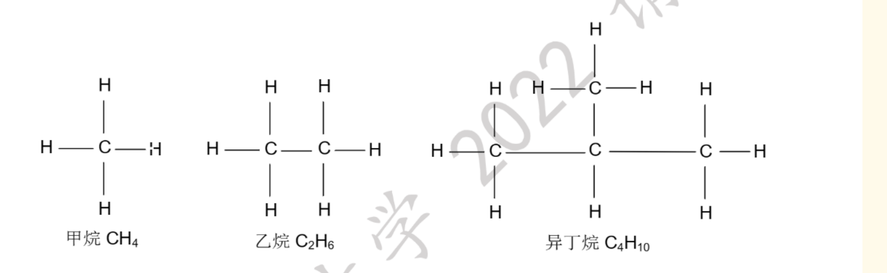
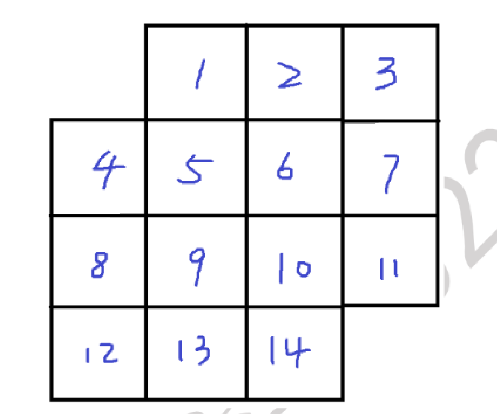

# 集合论与图论 2022–2023 学年第一学期期末试卷

> 注意事项：1、请将答案按题目顺序写在答题纸上；2、请在每页答题纸上写清楚姓名和学号。

## 试题（共 16 题）

1. 【8 分】判断下列哪些关系成立。只需要给出判断结果，不需要给出理由：

   (1) $\{a\}\in\{\{a\}\}$

   (2) $d\in\{a,b,c,\{d\}\}$

   (3) $\{b\}\in\{a,b,\{b\}\}$

   (4) $\Phi\in\{\Phi,a,\{b\},\{a,b\}\}$

   (5) $\{\Phi\}\subseteq\{\Phi,\{\Phi\}\}$

   (6) $\{\Phi\}\subseteq\{\{\Phi,\{\Phi\}\}\}$

   (7) $\{\{\Phi\}\}\subseteq\{\Phi,\{\Phi\}\}$

   (8) $\{\{\Phi\}\}\subseteq\{\Phi,\{\Phi,\{\Phi\}\}\}$

   注意：这里的 $\Phi$ 表示空集。

2. 【6 分】下面的 $A$ 和 $B$ 均为集合。请分别给出下面式子成立的（尽可能简单的）充要条件，并证明其充要性：

   (1) $A-B=B$

   (2) $A-B=B-A$

3. 【6 分】某门课程的期末考试题目都是从题库中抽取的，而且每次考试恰好包括 20 道题目。此外，按照规定，每次考试与前 2 年每次考试重复的题目，均不能超过 6 道。例如，2022 年期末考试的题目，最多只能有 6 道在 2021 年期末考试中出现过，也最多只能有 6 道在 2020 年期末考试中出现过。那么题库中最少需要有多少道题目？请计算并简要说明理由。

4. 【6 分】如果关系 $R$ 和 $S$ 都是自反的、对称的和传递的，请证明： $R\cap S$ 也是自反的、对称的和传递的。

5. 【6 分】请构造一个从闭区间 $[-1,1]$ 到开区间 $(0,1)$ 的双射函数。

6. 【6 分】证明：在一个无向图 $G$ 中，如果有且仅有两个顶点 $u$ 和 $v$ 的度为奇数，则 $u$ 和 $v$ 必然是连通的。

7. 【6 分】无向连通图 $G$ 的顶点数不少于 3。对于 $G$ 的任意两个顶点 $u$ 和 $v$，如果这两个顶点是连通的，连接它们的所有链的长度要么全部为偶数，要么全部为奇数。请证明： $G$ 是一个二分图。

8. 【6 分】树 $T$ 的邻接矩阵为 $A$。如果正整数 $k$ 使得 $A^{k}$ 的第 $u$ 行第 $v$ 列元素非零，则称 $k$ 满足 $u$ 和 $v$。请证明：对于任意给定的 $u$ 和 $v$，

   (1) 至少存在一个正整数 $k$ 可以满足 $u$ 和 $v$；

   (2) 满足 $u$ 和 $v$ 的正整数，要么全部为奇数，要么全部为偶数。

9. 【6 分】在链烷烃类分子中，分子结构不存在环，而且每个碳原子的化合价都是 4，每个氢原子的化合价都是 1。请使用图论方法证明：每个链烷烃的分子的形式都是 $\mathrm{C}_n\mathrm{H}_{2n+2}$（ $n$ 是某个正整数）。

   

10. 【8 分】在有 $n$ 个顶点的无向连通图 $G$ 中，最多可能有多少条割边？

    (1) 请举例给出一个这样有最多割边的图 $G$；

    (2) 请证明你的结论的最大性，即割边不可能更多。

11. 【6 分】对于边权非负的无向连通图 $G$，其中一个顶点为 $u$。证明：可以选出从 $u$ 到其他各顶点的最短路径，使得这些路径中的边（以及全部顶点）恰好构成 $G$ 的一棵生成树。

12. 【6 分】证明：(1) 一颗树必然也是二分图；(2) 一棵树最多只有一个完美匹配。

13. 【6 分】有 8 种化学药品需要空运，运输费用取决于集装箱的数量。运送一个集装箱的费用是 1250 元，而每增加一个集装箱，费用就会提高 850 元。有的化学药品会和其他药品发生反应，因此用同一个集装箱运送会有危险。这些化学药品标记为 $C_1,C_2,\ldots,C_8$，按照顺序，列出与其放在一起会发生反应的药品如下：

| 药品 | 与其放在一起会发生反应的药品 |
| --- | --- |
| $C_1$ | $C_2,C_5,C_6$ |
| $C_2$ | $C_1,C_3,C_5,C_7$ |
| $C_3$ | $C_2,C_4,C_7$ |
| $C_4$ | $C_3,C_6,C_7,C_8$ |
| $C_5$ | $C_1,C_2,C_6,C_7,C_8$ |
| $C_6$ | $C_1,C_4,C_5,C_8$ |
| $C_7$ | $C_2,C_3,C_4,C_5,C_8$ |
| $C_8$ | $C_4,C_5,C_6,C_7$ |

    请问，应该如何装箱，才能使得运送费用最少？

14. 【6 分】如果平面图 $G$ 的对偶图 $G^{*}$ 同构于 $G$ 自身，则称 $G$ 为自对偶图。请证明：如果一个有 $n$ 个顶点、 $m$ 条边的图是自对偶图，则必有 $m=2(n-1)$。

1. 【6 分】一张圆桌上坐着 6 个人。证明：存在某种位置调整方式，在所有人重新就坐后，每个人都不再和他原来相邻的人相邻。

2. 【6 分】下面的图形是由 14 个大小相同的正方形组成的。证明：不论如何用剪刀沿着图形中的线进行裁剪，都剪不出 7 个由相邻的两个小正方形组成的矩形。

    
