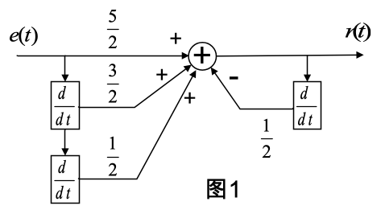
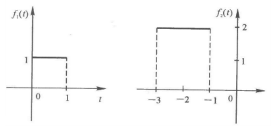
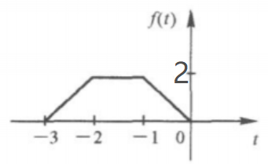

# 信号与系统 2022–2023 学年第二学期期末试卷（A 卷）参考答案

## 一、单项选择题（每题有且仅有一个答案是正确的，10 空，每空 2 分，共 20 分）

### 1. 系统 $r(t)=e(3t)$ 的性质

#### 题目

1. 已知某系统方程为 $r(t)=e(3t)$ ，则该系统是 ① 。

   A．LTI、因果系统　　B．LTI、非因果系统

   C．非 LTI、因果系统　　D．非 LTI、非因果系统

#### 答案

**答案：** ① D（非 LTI、非因果系统）。

时间尺度变换使系统时变：把激励平移 $t_0$ 后 $T[e(t-t_0)]=e(3t-t_0)$ ，而 $r(t-t_0)=e(3t-3t_0)$ ，两者不等。因果性方面， $t>0$ 时 $3t>t$ ， $r(t)$ 依赖 $t$ 之后时刻的输入，故非因果。

### 2. 零初始状态下激励加倍时的全响应

#### 题目

2\. 已知某连续线性时不变系统的初始状态为零，设当激励为 $e(t)$ 时，全响应为 $r(t)$ ，则当激励增大为 $2e(t)$ 时，其全响应为 ② 。

   A． $r(t)$　　B． $r(t)/2$　　C． $2r(t)$　　D．发生变化，但以上答案均不正确

#### 答案

**答案：** ② C（ $2r(t)$）。

零初始状态下全响应即零状态响应，由线性性，激励变为 $2e(t)$ 时响应变为 $2r(t)$ 。

### 3. $\displaystyle\int_{-\infty}^{+\infty}(t^{2}+2t)\delta(t+1)\,\mathrm{d}t$

#### 题目

3\. 应用冲激信号的抽样特性，积分式 $\displaystyle\int_{-\infty}^{+\infty}(t^{2}+2t)\delta(t+1)\,\mathrm{d}t$ 的结果是 ③ 。

   A．0　　B． $-1$　　C． $1$　　D． $\infty$

#### 答案

**答案：** ③ B（ $-1$）。

由冲激的抽样特性，积分等于被积函数在 $t=-1$ 处的值： $(-1)^{2}+2(-1)=-1$ 。

### 4. 由 $f(t)$ 画 $f(3t+2)$ 的正确顺序

#### 题目

4\. 已知 $f(t)$ 的波形，为画出 $f(3t+2)$ 的波形，下列哪种画图顺序结果正确 ④ 。

   A．波形压缩至 $\dfrac{1}{3}$ 后左移 2　　B．波形压缩至 $\dfrac{1}{3}$ 后右移 2

   C．波形左移 2 后压缩至 $\dfrac{1}{3}$　　D．波形右移 2 后压缩至 $\dfrac{1}{3}$

#### 答案

**答案：** ④ C（波形左移 2 后压缩至 $\dfrac{1}{3}$）。

$f(3t+2)=[f(t+2)]\big|_{t\to 3t}$ ：先把 $f(t)$ 左移 2 得到 $f(t+2)$ ，再作尺度压缩 $t\to 3t$ 。

### 5. 离散非周期信号频谱的性质

#### 题目

5\. 离散非周期信号的频谱具有 ⑤ 。

   A．连续性、周期性　　B．连续性、非周期性

   C．离散性、周期性　　D．离散性、非周期性

#### 答案

**答案：** ⑤ A（连续性、周期性）。

离散时间信号的频谱都以 $2\pi$ 为周期；非周期信号的频谱是 $\omega$ 的连续函数。

### 6. 关于各种信号转换的正确描述

#### 题目

6\. 以下哪一个关于各种信号转换的描述是正确的？ ⑥

   A．FS 是一种将连续信号转换为离散信号的处理方法。

   B．FFT 是 DFT 的一种优化算法，但不能在计算机上高效实现。

   C．DCT 在图像压缩，特别是在 JPEG 中，没有任何应用。

   D．DTFT 可以处理连续时间的非周期性信号。

#### 答案

**答案：** ⑥ A。

B 错：FFT 正是为了在计算机上高效实现 DFT 而提出的。C 错：DCT 是 JPEG 压缩的核心变换之一。D 错：DTFT 处理的是离散时间信号，其频谱是 $\omega$ 的连续周期函数。A 若按「FS 把连续周期信号分解为离散的谐波分量（离散频谱）」理解，是四项中唯一可成立的。

### 7. $x(t)-x\left(t+\dfrac{5}{2}T\right)$ 的傅里叶级数

#### 题目

7\. 已知 $x(t)$ 是周期为 T 的函数，则 $x(t)-x\left(t+\dfrac{5}{2}T\right)$ 的傅里叶级数中 ⑦ 。

   A．只可能有正弦分量

   B．只可能有余弦分量

   C．只可能有奇次谐波分量

   D．只可能有偶次谐波分量

#### 答案

**答案：** ⑦ C（只可能有奇次谐波分量）。

设 $x(t)=\displaystyle\sum_{k=-\infty}^{\infty}a_{k}e^{jk\omega_{0}t}$ ， $\omega_{0}=\dfrac{2\pi}{T}$ 。因 $\dfrac{5}{2}T=2T+\dfrac{T}{2}$ ，

$$x\left(t+\frac{5}{2}T\right)=\sum_{k}a_{k}e^{jk\omega_{0}t}e^{jk\omega_{0}\frac{5T}{2}}=\sum_{k}e^{jk5\pi}a_{k}e^{jk\omega_{0}t}=\sum_{k}(-1)^{k}a_{k}e^{jk\omega_{0}t},$$

故

$$x(t)-x\left(t+\frac{5}{2}T\right)=\sum_{k}\left[1-(-1)^{k}\right]a_{k}e^{jk\omega_{0}t}=\sum_{k\ \text{奇}}2a_{k}e^{jk\omega_{0}t},$$

偶次谐波全部抵消，只剩奇次谐波分量。

### 8. 关于数字滤波器错误的说法

#### 题目

8\. 下面关于数字滤波器的说法中错误的是 ⑧ ：

   A．数字滤波器的频率响应都是以 $2\pi$ 为周期的

   B．IIR 滤波器有极点，也有零点，可借用模拟滤波器设计方法进行设计

   C．若要求 FIR 滤波器具有线性相位，则 $h(n)$ 必须满足奇对称或偶对称条件

   D．IIR 滤波器设计方法包括窗函数法、频率采样法等

#### 答案

**答案：** ⑧ D。

窗函数法、频率采样法是 FIR 滤波器的设计方法，不属于 IIR 的设计方法；IIR 常借助模拟滤波器（冲激响应不变法、双线性变换法）设计。

### 9. $F(s)=\dfrac{e^{-(s+\alpha)T}}{s+\alpha}$ 的拉普拉斯逆变换

#### 题目

9\. $F(s)=\dfrac{e^{-(s+\alpha)T}}{s+\alpha}$ 的拉普拉斯逆变换为 ⑨ 。

   A． $e^{-\alpha(t-T)}u(t-T)$　　B． $e^{-\alpha t}u(t-T)$

   C． $e^{-\alpha t}u(t-\alpha)$　　D． $e^{-\alpha(t-\alpha)}u(t-T)$

#### 答案

**答案：** ⑨ A（ $e^{-\alpha(t-T)}u(t-T)$）。

令 $G(s)=\dfrac{1}{s+\alpha}\leftrightarrow g(t)=e^{-\alpha t}u(t)$ ，则 $F(s)=G(s)e^{-sT}$ ，由时移性质得 $f(t)=g(t-T)=e^{-\alpha(t-T)}u(t-T)$ 。

### 10. $x(n)=\left(\dfrac{1}{2}\right)^{n}u(n)+3^{n}u(-n-1)$ 的收敛区

#### 题目

10\. 已知某序列 $x(n)=\left(\dfrac{1}{2}\right)^{n}u(n)+3^{n}u(-n-1)$ ，则其收敛区为 ⑩ 。

    A． $0.5<|z|<3$　　B． $|z|>3$　　C． $|z|<0.5$　　D． $|z|>3$ 或 $|z|<0.5$

#### 答案

**答案：** ⑩ A（ $0.5<|z|<3$）。

第一项是右边序列，收敛域 $|z|>0.5$ ；第二项是左边序列，收敛域 $|z|<3$ ；两者之和的收敛域为交集 $0.5<|z|<3$ 。

## 二、填空题（10 空，每空 2 分，共 20 分）

### 1. $x(t)x(2t)\sin\omega_{2}t$ 的 Nyquist 抽样频率

#### 题目

1. 信号 $x(t)$ 的 Nyquist 抽样频率为 $\omega_{1}$ ，则信号 $x(t)x(2t)\sin\omega_{2}t$ 的 Nyquist 抽样频率为 ① 。

#### 答案

**答案：** ① $2\omega_{2}+3\omega_{1}$ （官方答案另给一种写法 $2\dfrac{\omega_{2}}{\pi}+3\omega_{1}$ ，对应把 $\omega_{2}$ 记作频率 $f_{2}$ 的情形）。

$x(t)$ 的 Nyquist 抽样频率为 $\omega_{1}$ ，即最高角频率为 $\omega_{1}/2$ ； $x(2t)$ 的最高角频率为 $\omega_{1}$ ；两者相乘后频谱卷积，最高角频率为 $\omega_{1}/2+\omega_{1}=3\omega_{1}/2$ ；再乘 $\sin\omega_{2}t$ 后频谱搬移 $\pm\omega_{2}$ ，最高角频率为 $3\omega_{1}/2+\omega_{2}$ ，故 Nyquist 抽样频率为 $2\left(3\omega_{1}/2+\omega_{2}\right)=3\omega_{1}+2\omega_{2}$ 。

### 2. $\{1,2t-1\}$ 在 $(0,2)$ 上的正交性

#### 题目

2\. 函数集 $\{1,2t-1\}$ 在区间 $(0,2)$ 上是 ② （正交/非正交）的。

#### 答案

**答案：** ② 非正交。

$$\int_{0}^{2}1\cdot(2t-1)\,\mathrm{d}t=\left[t^{2}-t\right]_{0}^{2}=2\ne 0 .$$

### 3. 连续与离散 LTI 系统稳定的充分必要条件

#### 题目

3\. 一线性时不变连续时间系统是稳定系统的充分必要条件是系统函数的极点位于 s 平面的 ③ 。一个线性时不变离散时间系统是稳定系统的充分必要条件是系统函数的极点都位于 Z 平面的 ④ 。

#### 答案

**答案：** ③ 左半平面；④ 单位圆内。

### 4. $X(s)=\dfrac{s^{3}+s^{2}+2s+1}{(s+1)(s+2)(s+3)}$ 的初值

#### 题目

4\. $X(s)=\dfrac{s^{3}+s^{2}+2s+1}{(s+1)(s+2)(s+3)}$ 原信号的初值 ⑤ 。

#### 答案

**答案：** ⑤ 不存在（或 −5）。

由初值定理 $f(0_{+})=\lim_{s\to\infty}sX(s)$ 。分子分母同为 3 次， $X(s)\to 1$ ，故 $sX(s)\to\infty$ ，初值不存在（趋于无穷）。

### 5. 图 1 系统的微分方程

#### 题目

5\. 图 1 所示的连续时间系统的微分方程为 ⑥ 。

   

#### 答案

**答案：** ⑥ $\dfrac{\mathrm{d}}{\mathrm{d}t}r(t)+2r(t)=\dfrac{\mathrm{d}^{2}}{\mathrm{d}t^{2}}e(t)+3\dfrac{\mathrm{d}}{\mathrm{d}t}e(t)+5e(t)$ 。

由框图，求和点输出为

$$r(t)=\frac{5}{2}e(t)+\frac{3}{2}\frac{\mathrm{d}e(t)}{\mathrm{d}t}+\frac{1}{2}\frac{\mathrm{d}^{2}e(t)}{\mathrm{d}t^{2}}-\frac{1}{2}\frac{\mathrm{d}r(t)}{\mathrm{d}t},$$

两边乘 2 并移项即得。

### 6. 图像二维 DFT 的低频分量与人类视觉敏感度

#### 题目

6\. 图像的二维离散傅里叶变换中低频分量表示 ⑦ ，人类视觉系统对 ⑧ （低频/高频）信号的敏感程度更低。

#### 答案

**答案：** ⑦ 代表了大面积背景区域和缓慢变化部分；⑧ 低频。

### 7. $r''(t)+4r'(t)+3r(t)=e'(t)+e(t)$ 的系统函数

#### 题目

7\. 已知某连续时间系统的微分方程为 $r''(t)+4r'(t)+3r(t)=e'(t)+e(t)$ ，则该系统的系统函数为 ⑨ 。

#### 答案

**答案：** ⑨ $\dfrac{s+1}{s^{2}+4s+3}$ ，即 $\dfrac{1}{s+3}$ 。

$(s^{2}+4s+3)R(s)=(s+1)E(s)$ ，故 $H(s)=\dfrac{s+1}{s^{2}+4s+3}=\dfrac{s+1}{(s+1)(s+3)}=\dfrac{1}{s+3}$ 。

### 8. 两种常用的模拟低通滤波器

#### 题目

8\. 写出两种常用的模拟低通滤波器 ⑩ 。

#### 答案

**答案：** ⑩ 巴特沃斯（Butterworth）滤波器、切比雪夫（Chebyshev）滤波器（I 型、II 型）。

## 三、简答计算题（共 60 分）

### 1. （每小题 5 分，共 10 分）判断系统稳定性

#### 题目

1. （每小题 5 分，共 10 分）判断系统稳定性并说明原因。

   (1) 连续系统微分方程： $r^{(3)}(t)+2r''(t)+r'(t)+2r(t)=e(t)$ 。

   (2) 离散系统差分方程： $y(n)-\dfrac{7}{4}y(n-1)+\dfrac{5}{8}y(n-2)=x(n)+\dfrac{1}{2}x(n-1)$ 。

#### 答案

**答案：**

(1) 给出系统函数 $\dfrac{1}{s^{3}+2s^{2}+s+2}$ ……（2 分）

$D(s)=s^{3}+2s^{2}+1s+2$ 有 3 个极点， $s_{1}=-2,\ s_{2}=j,\ s_{3}=-j$ ……（2 分）

∵ 极点在左半平面，虚轴上的极点是单极点

∴ 系统稳定（临界稳定）……（1 分）
(2) 给出系统函数 $\dfrac{z+\frac{1}{2}}{z^{2}-\frac{7}{4}z+\frac{5}{8}}$ ……（2 分）

$D(z)=z^{2}-\dfrac{7}{4}z+\dfrac{5}{8}=\left(z-\dfrac{1}{2}\right)\left(z-\dfrac{5}{4}\right)$ 有两个极点 $z_{1}=1/2,\ z_{2}=5/4$ ……（2 分）

∵ 有一个极点在单位圆外

∴ 系统不稳定 ……（1 分）

### 2. （每小题 5 分，共 10 分）求变换

#### 题目

2\. （每小题 5 分，共 10 分）

   (1) 已知 $\mathrm{F}[f(t)]=\mathrm{F}(j\omega)$ ，求 $(t-1)f(-3t)$ 的傅里叶变换。

   (2) 求信号 $f(t)=(t+2)u(t-1)$ 的单边拉氏变换 $\mathrm{F}(s)$ 。

#### 答案

**答案：**

(1) 先由尺度变换性质，有 $F[f(-3t)]=\dfrac{1}{3}F\left(\dfrac{-\omega}{3}\right)$ ……（2 分）

再由频域微分性质，有

$$F[tf(-3t)]=j\frac{\mathrm{d}}{\mathrm{d}\omega}\left[\frac{1}{3}F\left(\frac{-\omega}{3}\right)\right]=\frac{1}{3}j\frac{\mathrm{d}F\left(-\frac{\omega}{3}\right)}{\mathrm{d}\omega}\quad ……\text{（2 分）}$$

故有

$$F[(t-1)f(-3t)]=\frac{1}{3}j\frac{\mathrm{d}F\left(-\frac{\omega}{3}\right)}{\mathrm{d}\omega}-\frac{1}{3}F\left(\frac{-\omega}{3}\right)\quad ……\text{（1 分）}$$

(2) 根据常用拉氏变换可知：

$$(t+3)u(t)\ \rightarrow\ \frac{1}{s^{2}}+\frac{3}{s}=\frac{1+3s}{s^{2}}\quad ……\text{（2 分）}$$

再由时移性质：

$$f(t)=[(t+3)-1]u(t-1)\ \rightarrow\ \frac{1+3s}{s^{2}}e^{-s}\quad ……\text{（3 分）}$$

### 3. （每小题 4 分，共 12 分）由零点、极点与 $H(\infty)$ 求离散系统

#### 题目

3\. （每小题 4 分，共 12 分）对某离散线性时不变因果系统，已知：

   a) 两个零点为 $0$ 和 $-3$ ；

   b) 两个极点为 $-2$ 和 $-4$ ；

   c) $H(\infty)=2$ 。

   求：

   (1) 系统函数 $H(z)$ ；

   (2) 写出系统的差分方程；

   (3) 求系统的单位样值响应 $h(n)$ 。

#### 答案

**答案：**

(1) 由 a、b，知

$$H(z)=k\frac{z(z+3)}{(z+2)(z+4)}\quad ……\text{（2 分）}$$

将 c 带入得： $k=2$ 。……（1 分）

故：

$$H(z)=\frac{2z(z+3)}{(z+2)(z+4)}\quad ……\text{（1 分）}$$

(2)

$$H(z)=\frac{2z(z+3)}{(z+2)(z+4)}=\frac{2+6z^{-1}}{1+6z^{-1}+8z^{-2}},$$

得：

$$Y(z)+6Y(z)z^{-1}+8Y(z)z^{-2}=2X(z)+6X(z)z^{-1}\quad ……\text{（2 分）}$$

故：

$$y(n)+6y(n-1)+8y(n-2)=2x(n)+6x(n-1)\quad ……\text{（2 分）}$$

(3) $H(z)=\dfrac{z}{z+2}+\dfrac{z}{z+4}$ ，故

$$h(n)=\left[(-2)^{n}+(-4)^{n}\right]u(n)\quad ……\text{（4 分）}$$

### 4. （每小题 6 分，共 12 分）求零状态响应与零输入响应

#### 题目

4\. （每小题 6 分，共 12 分）已知一线性时不变因果系统连续系统的输入输出方程为 $y''(t)+3y'(t)+2y'(t)=x'(t)+5x(t)$ ，已知输入 $x(t)=e^{-3t}u(t)$ 时系统全响应初始值为 $y(0_{+})=1$ ， $y'(0_{+})=3$ ，求：

   (1) 零状态响应 $y_{zs}(t)$ ；

   (2) 零输入响应 $y_{zi}(t)$ 。

#### 答案

**答案：**

(1) 由系统的输入输出方程，可得 $(s^{2}+3s+2)Y(s)=(s+5)F(s)$ ……（2 分）

由于： $Y(s)=\dfrac{s+5}{s^{2}+3s+2}F(s),\ F(s)=\dfrac{1}{s+3}$

所以：

$$Y_{zs}(s)=\frac{s+5}{(s^{2}+3s+2)(s+3)}=\frac{1}{s+3}-\frac{3}{s+2}+\frac{2}{s+1}\quad ……\text{（2 分）}$$

$$y_{zs}(t)=\left(e^{-3t}-3e^{-2t}+2e^{-t}\right)u(t)\quad ……\text{（2 分）}$$

(2) 因为系统极点为 −1、−2，所以零输入响应为：

$$y_{zi}(t)=\left(Ae^{-t}+Be^{-2t}\right)u(t)\quad ……\text{（2 分）}$$

$y_{zi}(0_{+})=y(0_{+})-y_{zs}(0_{+})=1$ ， $y'_{zi}(0_{+})=y'(0_{+})-y'_{zs}(0_{+})=2$ ……（2 分）

代入得：

$$y_{zi}(t)=\left(4e^{-t}-3e^{-2t}\right)u(t)\quad ……\text{（2 分）}$$

### 5. （每小题 5 分，共 10 分）卷积

#### 题目

5\. （每小题 5 分，共 10 分）

   (1) 设 $x[n]=\delta[n]+2\delta[n-1]-\delta[n-3]$ 和 $h[n]=2\delta[n+1]+2\delta[n-1]$ ，求 $x[n]*h[n]$ 。

   (2) 已知 $f_{1}$ 和 $f_{2}(t)$ 的波形图如图所示，计算其卷积 $f_{1}(t)*f_{2}(t)$ ，并画出大致图像。

   

#### 答案

**答案：**

(1) 列竖式或者利用定义给出算式 ……（2 分）

$$x[n]*h[n]=2\delta[n+1]+4\delta[n]+2\delta[n-1]+2\delta[n-2]-2\delta[n-4]\quad ……\text{（3 分）}$$

(2) 列出算式 ……（1 分）

由图， $f_{1}(t)=u(t)-u(t-1)$ ， $f_{2}(t)=2[u(t+3)-u(t+1)]$ ，故

$$f_{1}(t)*f_{2}(t)=\begin{cases}2t+6, & -3\le t<-2\\ 2, & -2\le t<-1\\ -2t, & -1\le t<0\\ 0, & \text{其他}\end{cases}\quad ……\text{（2 分）}$$

大致图像（梯形，支撑区间 $[-3,0]$ ，平顶高度为 2）：

……（2 分）

### 6. （6 分）简述 DTFT、DFT 与 FFT 的关系与区别

#### 题目

6\. （6 分）请简述离散时间傅里叶变换、离散傅里叶变换和快速傅里叶变换的关系与区别。

#### 答案

**答案：**

**离散时间傅里叶变换：** 对离散非周期信号进行傅里叶分析/频域分析，其频谱是连续且周期的。（2 分）

**离散傅里叶变换：** 类似傅里叶级数，处理离散非周期信号。由于计算机只能处理离散值，离散时间傅里叶变换的连续频谱不是离散的数字信号，不方便进行存储和分析。因此通过离散非周期的频谱（DFT）去逼近真实的连续频谱（DTFT）。（2 分）

**快速傅里叶变换：** 是离散傅里叶变换的一种快速实现，通过蝶形算法等，将离散傅里叶变换的算法复杂度由 $O(N^{2})$ 降为了 $O(N\log_{2}N)$ ，促进了离散傅里叶变换的广泛应用。（2 分）
