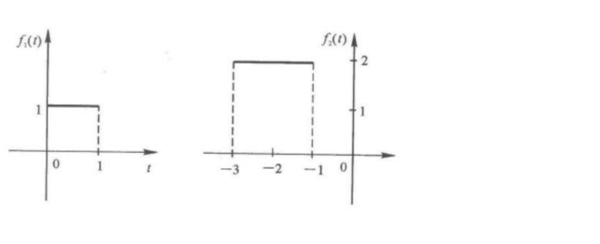
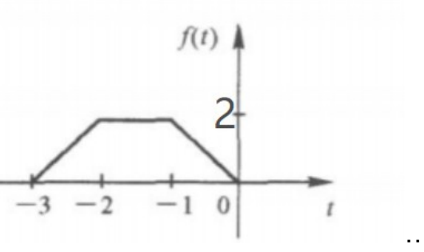

# 信号与系统 2022–2023 学年第二学期期末试卷（B 卷）参考答案

## 一、单项选择题（每题有且仅有一个答案是正确的，10 空，每空 2 分，共 20 分）

### 1. 系统 $r(t)=3e(t)$ 的性质

#### 题目

1. 已知某系统方程为 $r(t)=3e(t)$，则该系统是 ① 。

   A．线性、时不变系统　　B．线性、时变系统

   C．非线性、时不变系统　　D．非线性、时变系统

#### 答案

**答案：** ① A（线性、时不变系统）。

$r(t)=3e(t)$ 满足叠加性且系数与时间无关，故为线性、时不变系统。

### 2. 零初始状态下激励减半时的全响应

#### 题目

2\. 已知某连续线性时不变系统的初始状态为零，设当激励为 $e(t)$ 时，全响应为 $r(t)$，则当激励减小为 $0.5e(t)$ 时，其全响应为 ② 。

   A． $r(t)$　　B． $r(t)/2$　　C． $2r(t)$　　D．发生变化，但以上答案均不正确

#### 答案

**答案：** ② B（ $r(t)/2$）。

零初始状态下全响应即零状态响应，由线性性，激励变为 $0.5e(t)$ 时响应变为 $0.5r(t)=r(t)/2$。

### 3. $\displaystyle\int_{-\infty}^{+\infty}(e^{t}+1)\delta(t+1)\,\mathrm{d}t$

#### 题目

3\. 应用冲激信号的抽样特性，可得积分式 $\displaystyle\int_{-\infty}^{+\infty}(e^{t}+1)\delta(t+1)\,\mathrm{d}t$ 的积分结果是 ③ 。

   A． $e-1$　　B． $e+1$　　C． $e^{-1}-1$　　D． $e^{-1}+1$

#### 答案

**答案：** ③ D（ $e^{-1}+1$）。

由冲激的抽样特性，积分等于被积函数在 $t=-1$ 处的值： $e^{-1}+1$。

### 4. $f(t)\sin(\omega_0 t)$ 的傅里叶变换

#### 题目

4\. 若 $f(t)\leftrightarrow F(j\omega)$，则 $f(t)\sin(\omega_0 t)\leftrightarrow$ ④ 。

   A． $\dfrac{1}{2}\{F[j(\omega+\omega_0)]+F[j(\omega-\omega_0)]\}$　　B． $\dfrac{1}{2}\{F[j(\omega+\omega_0)]-F[j(\omega-\omega_0)]\}$

   C． $\dfrac{j}{2}\{F[j(\omega+\omega_0)]-F[j(\omega-\omega_0)]\}$　　D． $\dfrac{j}{2}\{F[j(\omega+\omega_0)]+F[j(\omega-\omega_0)]\}$

#### 答案

**答案：** ④ C（ $\dfrac{j}{2}\{F[j(\omega+\omega_0)]-F[j(\omega-\omega_0)]\}$）。

$$\sin(\omega_0t)=\frac{e^{j\omega_0t}-e^{-j\omega_0t}}{2j},$$

由移频性质 $f(t)e^{j\omega_0t}\leftrightarrow F[j(\omega-\omega_0)]$、 $f(t)e^{-j\omega_0t}\leftrightarrow F[j(\omega+\omega_0)]$，得

$$f(t)\sin(\omega_0t)\leftrightarrow\frac{1}{2j}\{F[j(\omega-\omega_0)]-F[j(\omega+\omega_0)]\}=\frac{j}{2}\{F[j(\omega+\omega_0)]-F[j(\omega-\omega_0)]\}.$$

### 5. 离散非周期信号频谱的性质

#### 题目

5\. 离散非周期信号的频谱具有 ⑤ 。

   A．连续性、周期性　　B．连续性、非周期性

   C．离散性、周期性　　D．离散性、非周期性

#### 答案

**答案：** ⑤ A（连续性、周期性）。

离散时间信号的频谱都以 $2\pi$ 为周期；非周期信号的频谱是 $\omega$ 的连续函数。

### 6. $H(z)=\dfrac{z}{z-3(2-k)}$ 稳定时 $k$ 的取值

#### 题目

6\. 设有一个离散反馈系统，其系统函数为： $H(z)=\dfrac{z}{z-3(2-k)}$，若要使该系统稳定，常数 $k$ 应该满足的条件是 ⑥ 。

   A． $k>\dfrac{5}{3}$　　B． $k<\dfrac{7}{3}$　　C． $\dfrac{5}{3}<k<\dfrac{7}{3}$　　D． $-\infty<k<+\infty$

#### 答案

**答案：** ⑥ C（ $\dfrac{5}{3}<k<\dfrac{7}{3}$）。

极点为 $z=3(2-k)=6-3k$，稳定要求 $|6-3k|<1$，即 $-1<6-3k<1$，解得 $\dfrac{5}{3}<k<\dfrac{7}{3}$。

### 7. $g(t)=f(2t-3)$ 的傅里叶变换

#### 题目

7\. 已知 $f(t)\leftrightarrow F(\omega)$，则 $g(t)=f(2t-3)$ 的傅里叶变换为 ⑦ 。

   A． $\dfrac{1}{2}F(\omega)e^{-j\frac{3}{2}\omega}$　　B． $\dfrac{1}{2}F\left(\dfrac{\omega}{2}\right)e^{-j\frac{3}{2}\omega}$

   C． $\dfrac{1}{2}F(\omega)e^{-j3\omega}$　　D． $\dfrac{1}{2}F\left(\dfrac{\omega}{2}\right)e^{-j3\omega}$

#### 答案

**答案：** ⑦ B（ $\dfrac{1}{2}F\left(\dfrac{\omega}{2}\right)e^{-j\frac{3}{2}\omega}$）。

$g(t)=f\left(2\left(t-\dfrac{3}{2}\right)\right)$。先由尺度性质 $f(2t)\leftrightarrow\dfrac{1}{2}F\left(\dfrac{\omega}{2}\right)$，再由时移性质得 $\dfrac{1}{2}F\left(\dfrac{\omega}{2}\right)e^{-j\frac{3}{2}\omega}$。

### 8. $g(t)=e^{-\frac{t}{a}}f(at)$（ $a>0$）的拉普拉斯变换

#### 题目

8\. 已知 $f(t)\leftrightarrow F(s)$，则 $g(t)=e^{-\frac{t}{a}}f(at)$（ $a>0$）的拉普拉斯变换为 ⑧ 。

   A． $\dfrac{1}{a}F\left(\dfrac{1}{a}s+\dfrac{1}{a^{2}}\right)$　　B． $\dfrac{1}{a}F\left(\dfrac{1}{a^{2}}s+\dfrac{1}{a^{2}}\right)$　　C． $aF\left(as+\dfrac{1}{a^{2}}\right)$　　D． $aF\left(a^{2}s+a^{2}\right)$

#### 答案

**答案：** ⑧ A（ $\dfrac{1}{a}F\left(\dfrac{1}{a}s+\dfrac{1}{a^{2}}\right)$）。

先由尺度性质 $f(at)\leftrightarrow\dfrac{1}{a}F\left(\dfrac{s}{a}\right)$，再乘 $e^{-\frac{t}{a}}$ 相当于 $s$ 域平移 $s\to s+\dfrac{1}{a}$，得 $\dfrac{1}{a}F\left(\dfrac{s+\frac{1}{a}}{a}\right)=\dfrac{1}{a}F\left(\dfrac{1}{a}s+\dfrac{1}{a^{2}}\right)$。

### 9. 傅里叶变换在图像处理中不正确的说法

#### 题目

9\. 下列关于傅里叶变换在图像处理中的说法中不正确的是 ⑨ 。

   A．图像去噪：可通过低通滤波器滤除高频噪声

   B．图像增强：可通过加强低频分量增强原始图像边缘

   C．直流分量：表示图像的平均灰度

   D．相位：决定了图像灰度的位置信息

#### 答案

**答案：** ⑨ B。

图像的边缘对应高频分量，增强边缘应加强高频分量而不是低频分量，故 B 不正确。A、C、D 均正确（去噪用低通；直流分量即平均灰度；相位决定位置信息）。

### 10. 关于数字滤波器错误的说法

#### 题目

10\. 下面关于数字滤波器的说法中错误的是 ⑩ ：

    A．数字滤波器的频率响应都是以 $2\pi$ 为周期的

    B．IIR 滤波器设计方法包括窗函数法、频率采样法等

    C．若要求 FIR 滤波器具有线性相位，则 $h(n)$ 必须满足奇对称或偶对称条件

    D．IIR 滤波器有极点，也有零点，可借用模拟滤波器设计方法进行设计

#### 答案

**答案：** ⑩ B。

窗函数法、频率采样法是 FIR 滤波器的设计方法，不是 IIR 的设计方法，故 B 错误。IIR 常借助模拟滤波器（冲激响应不变法、双线性变换法）设计。

## 二、填空题（10 空，每空 2 分，共 20 分）

### 1. $\{1,t,t^{2},t^{3}\}$ 在 $(0,1)$ 上的正交性

#### 题目

1. 函数集 $\{1,t,t^{2},t^{3}\}$ 在区间 $(0,1)$ 上是 ① （正交/非正交）的。

#### 答案

**答案：** ① 非正交。

### 2. 人类视觉系统敏感程度更低的信号

#### 题目

2\. 人类视觉系统对 ② （低频/高频）信号的敏感程度更低。

#### 答案

**答案：** ② 高频。

### 3. 离散 LTI 系统渐近稳定的充要条件

#### 题目

3\. 一个离散时间线性时不变系统是渐近稳定系统的充分必要条件是系统函数的极点都位于 z 平面的 ③ 。

#### 答案

**答案：** ③ 单位圆内。

### 4. 长度为 4 和 6 的两个序列卷积的长度

#### 题目

4\. 长度分别为 4 和 6 的两个离散序列的卷积的长度为 ④ 。

#### 答案

**答案：** ④ 9。

$L=4+6-1=9$。

### 5. $r(t)=(4e^{-t}-3e^{-2t})u(t)$ 的自由响应与受迫响应

#### 题目

5\. 若全响应为 $r(t)=(4e^{-t}-3e^{-2t})u(t)$，则自由响应为 ⑤ ，受迫响应为 ⑥ 。

#### 答案

**答案：** ⑤ 自由响应为 $(4e^{-t}-3e^{-2t})u(t)$；⑥ 受迫响应为 $0$。

### 6. $X(s)=\dfrac{s^{2}+2s+1}{(s+1)(s+2)(s+3)}$ 的初值

#### 题目

6\. $X(s)=\dfrac{s^{2}+2s+1}{(s+1)(s+2)(s+3)}$ 原信号的初值 ⑦ 。

#### 答案

**答案：** ⑦ 1。

由初值定理 $f(0_+)=\lim_{s\to\infty}sF(s)=\lim_{s\to\infty}\dfrac{s(s^{2}+2s+1)}{(s+1)(s+2)(s+3)}=1$。

### 7. $r''(t)+3r'(t)+r(t)=2e(t)$ 的系统函数

#### 题目

7\. 已知某连续时间系统的微分方程为 $r''(t)+3r'(t)+r(t)=2e(t)$，则该系统的系统函数为 ⑧ 。

#### 答案

**答案：** ⑧ $H(s)=\dfrac{2}{s^{2}+3s+1}$。

### 8. $D(z)=z^{2}-0.75z+0.125$ 的稳定性

#### 题目

8\. 已知离散系统特征方程 $D(z)=z^{2}-0.75z+0.125$，则该系统是 ⑨ （稳定/不稳定）的。

#### 答案

**答案：** ⑨ 稳定。

特征根为 $z=\dfrac{0.75\pm0.25}{2}$，即 $z=0.5$ 与 $z=0.25$，都在单位圆内。

### 9. $X(z)=\dfrac{-3z^{-1}}{2-5z^{-1}+2z^{-2}}$， $|z|<0.5$

#### 题目

9\. 对于 $X(z)=\dfrac{-3z^{-1}}{2-5z^{-1}+2z^{-2}}$，若收敛域为 $|z|<0.5$ 则对应 ⑩ （左边序列/右边序列/双边序列）。

#### 答案

**答案：** ⑩ 左边序列。

分母因式分解得极点 $z=2$ 与 $z=0.5$；收敛域 $|z|<0.5$ 位于最内层极点的内侧，对应左边序列。

## 三、简答计算题（共 60 分）

### 1. （每小题 4 分，共 8 分）求傅里叶变换

#### 题目

1. （每小题 4 分，共 8 分）已知 $F[f(t)]=F(\omega)$，求下列信号的傅里叶变换。

   (1) $f(2t+1)$；　　(2) $t\dfrac{\mathrm{d}f(t)}{\mathrm{d}t}$。

#### 答案

**答案：**

(1) 利用尺度变换性质有 $F[f(2t)]=\dfrac{1}{2}F\left(\dfrac{\omega}{2}\right)$……（2 分）

则根据时移性质有

$$F[f(2t+1)]=F\left[f\left(2\left(t+\frac{1}{2}\right)\right)\right]=\frac{1}{2}F\left(\frac{\omega}{2}\right)e^{j\frac{\omega}{2}} \quad ……\text{（2 分）}$$

或：先由时移性质有 $F[f(t+1)]=F(\omega)e^{j\omega}$，再由尺度性质得 $F[f(2t+1)]=\dfrac{1}{2}F\left(\dfrac{\omega}{2}\right)e^{j\frac{\omega}{2}}$。

(2) 先由时域微分性质可得 $F\left[\dfrac{\mathrm{d}f(t)}{\mathrm{d}t}\right]=j\omega F(\omega)$……（2 分）

再由频域微分性质可得

$$F\left[t\frac{\mathrm{d}f(t)}{\mathrm{d}t}\right]=j\frac{\mathrm{d}}{\mathrm{d}\omega}F\left[\frac{\mathrm{d}f(t)}{\mathrm{d}t}\right]=-F(\omega)-\omega\frac{\mathrm{d}F(\omega)}{\mathrm{d}\omega}\quad ……\text{（2 分）}$$

### 2. （10 分）由零点、极点与 $H(\infty)$ 求系统

#### 题目

2\. （10 分）对某离散线性时不变因果系统，已知：

   a) 两个零点为 $0$ 和 $-4$；

   b) 两个极点为 $-1$ 和 $-7$；

   c) $H(\infty)=2$。

   求：

   (1) 系统函数 $H(z)$；（4 分）

   (2) 写出系统的差分方程；（3 分）

   (3) 求系统的单位样值响应 $h(n)$。（3 分）

#### 答案

**答案：**

(1) 由 a、b 知

$$H(z)=k\frac{z(z+4)}{(z+1)(z+7)}\quad ……\text{（2 分）}$$

将 c 代入得 $k=2$……（1 分）

故

$$H(z)=\frac{2z(z+4)}{(z+1)(z+7)}\quad ……\text{（1 分）}$$

(2)

$$H(z)=\frac{2z(z+4)}{(z+1)(z+7)}=\frac{2+8z^{-1}}{1+8z^{-1}+7z^{-2}},$$

得

$$Y(z)+8Y(z)z^{-1}+7Y(z)z^{-2}=2X(z)+8X(z)z^{-1}\quad ……\text{（2 分）}$$

故差分方程为

$$y(n)+8y(n-1)+7y(n-2)=2x(n)+8x(n-1)\quad ……\text{（1 分）}$$

(3) $H(z)=\dfrac{z}{z+1}+\dfrac{z}{z+7}$，故

$$h(n)=\left[(-1)^{n}+(-7)^{n}\right]u(n)\quad ……\text{（3 分）}$$

### 3. （12 分）反馈系统 $H(s)=\dfrac{Ks}{s^{2}+(4-K)s+4}$

#### 题目

3\. （12 分）已知一反馈系统系统函数为 $H(s)=\dfrac{Ks}{s^{2}+(4-K)s+4}$，据此回答以下小问：

   (1) $K=4$ 时，判断系统是否稳定，并求出系统单位冲激响应 $h(t)$；（4 分）

   (2) $K=-1$ 时，判断系统是否稳定，并求出系统单位冲激响应 $h(t)$；（4 分）

   (3) $K=-1$ 时，若输入为 $x(t)=u(t)$，求系统输出的零状态响应 $y(t)$。（4 分）

#### 答案

**答案：**

(1) $K=4$ 时， $H(s)=\dfrac{4s}{s^{2}+4}$，极点为 $s=\pm 2j$，临界稳定。……（2 分）

$$h(t)=4\cos(2t)u(t)\quad ……\text{（2 分）}$$

(2) $K=-1$ 时，

$$H(s)=\frac{-s}{s^{2}+5s+4}=-\frac{4}{3}\cdot\frac{1}{s+4}+\frac{1}{3}\cdot\frac{1}{s+1},$$

极点为 $s=-1,-4$，稳定。……（2 分）

$$h(t)=\frac{1}{3}\left(e^{-t}-4e^{-4t}\right)u(t)\quad ……\text{（2 分）}$$

(3) $X(s)=\dfrac{1}{s}$，

$$Y(s)=H(s)X(s)=\frac{-1}{s^{2}+5s+4}=\frac{1}{3}\left(\frac{1}{s+4}-\frac{1}{s+1}\right)\quad ……\text{（2 分）}$$

故

$$y(t)=\frac{1}{3}\left(e^{-4t}-e^{-t}\right)u(t)\quad ……\text{（2 分）}$$

### 4. （12 分） $r''(t)+4r'(t)+3r(t)=2e(t)$ 的零输入、零状态与全响应

#### 题目

4\. （12 分）已知某连续时间系统的微分方程为 $r''(t)+4r'(t)+3r(t)=2e(t)$，激励 $e(t)=u(t)$，初始状态 $r(0_-)=2$， $r'(0_-)=0$ 时，求：

   (1) 系统的零输入响应 $r_{zi}(t)$；（4 分）

   (2) 系统的零状态响应 $r_{zs}(t)$；（4 分）

   (3) 系统的全响应 $r(t)$。（4 分）

#### 答案

**答案：**

(1) 微分方程特征方程： $\lambda^{2}+4\lambda+3=0$，解得 $\lambda=-3,-1$。……（2 分）

故 $r_{zi}(t)=(C_1e^{-3t}+C_2e^{-t})u(t)$。代入初值，有

$$r_{zi}(0)=C_1+C_2=2,\qquad r'_{zi}(0)=-3C_1-C_2=0,$$

解得 $C_1=-1$， $C_2=3$，故

$$r_{zi}(t)=\left(-e^{-3t}+3e^{-t}\right)u(t)\quad ……\text{（2 分）}$$

(2) 由 $H(s)=\dfrac{2}{s^{2}+4s+3}$， $E(s)=\dfrac{1}{s}$，……（1 分）

故

$$R_{zs}(s)=H(s)E(s)=\frac{2}{s(s+1)(s+3)}=\frac{1}{3}\left(\frac{2}{s}-\frac{3}{s+1}+\frac{1}{s+3}\right)\quad ……\text{（1 分）}$$

得到

$$r_{zs}(t)=\frac{1}{3}\left(2-3e^{-t}+e^{-3t}\right)u(t)\quad ……\text{（2 分）}$$

(3) 由 $r_{zi}(t)=\left(-e^{-3t}+3e^{-t}\right)u(t)$， $r_{zs}(t)=\dfrac{1}{3}\left(2-3e^{-t}+e^{-3t}\right)u(t)$……（2 分）

得到

$$r(t)=r_{zi}(t)+r_{zs}(t)=\frac{1}{3}\left(2+6e^{-t}-2e^{-3t}\right)u(t)\quad ……\text{（2 分）}$$

### 5. （每小题 5 分，共 10 分）卷积

#### 题目

5\. （每小题 5 分，共 10 分）

   (1) 设 $x[n]=\delta[n]+2\delta[n-1]-\delta[n-3]$ 和 $h[n]=2\delta[n+1]+2\delta[n-1]$，求 $x[n]*h[n]$。

   (2) 已知 $f_1(t)$ 和 $f_2(t)$ 的波形图如图所示，计算其卷积 $f_1(t)*f_2(t)$，并画出大致图像。

   

#### 答案

**答案：**

(1) 列竖式或者利用定义给出算式……（2 分）

$$x[n]*h[n]=2\delta[n+1]+4\delta[n]+2\delta[n-1]+2\delta[n-2]-2\delta[n-4]\quad ……\text{（3 分）}$$

(2) 由图， $f_1(t)=u(t)-u(t-1)$， $f_2(t)=2[u(t+3)-u(t+1)]$。列出算式……（1 分）

$$f_1(t)*f_2(t)=\begin{cases}2t+6, & -3\le t<-2\\ 2, & -2\le t<-1\\ -2t, & -1\le t<0\\ 0, & \text{其他}\end{cases}\quad ……\text{（2 分）}$$

大致图像（梯形，支撑区间 $[-3,0]$，平顶高度为 2）：

……（2 分）

### 6. （8 分）简述连续傅里叶变换与拉普拉斯变换的物理意义及其关系

#### 题目

6\. （8 分）请简述连续傅里叶变换和拉普拉斯变换的物理意义及其之间的关系。

#### 答案

**答案：**

**傅里叶变换：** 傅里叶变换的主要作用是将通常在时域表示的信号分解为多个正弦信号的叠加。这种变换将信号从时间域转换到频域，从而表征出每个正弦信号的幅度、频率和相位。变换后的信号通常被称为频谱，其中包括幅度谱和相位谱，它们分别表示幅度和相位随频率的变化。简单地说，傅里叶变换的目标是将复杂信号分解成一系列基本的正弦和余弦信号，并识别出主要的振动频率，从而揭示复杂信号的主要特征。（3 分）

**拉普拉斯变换：** 尽管傅里叶变换很有用且物理意义明确，但其存在的条件相对严苛，需要待变换的信号符合狄利赫里条件，即在时域内是绝对可积的。这就限制了傅里叶变换的适用范围，它只能分析稳定系统。而拉普拉斯变换则推广了这一概念，通过给待变换的信号乘以一个实指数信号 $e^{-at}$，使得原信号收敛，进而可以对这个信号进行频域分析。因此，拉普拉斯变换能够处理更广泛的问题，包括稳定和不稳定的系统。（3 分）

**两者的关系：** 拉普拉斯变换可以看作是傅里叶变换的一种推广，它通过在变换过程中引入一个额外的衰减因子，使得原本不收敛的信号变得收敛。在某种意义上，傅里叶变换可以视为拉普拉斯变换在衰减因子为零（ $a=0$）时的特例。因此，这两种变换在数学形式和物理意义上有着密切的联系，但也各自具有独特的应用领域。（2 分）
