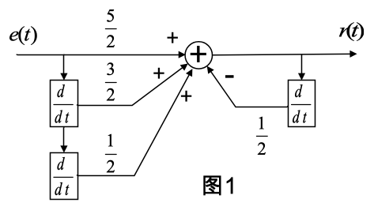
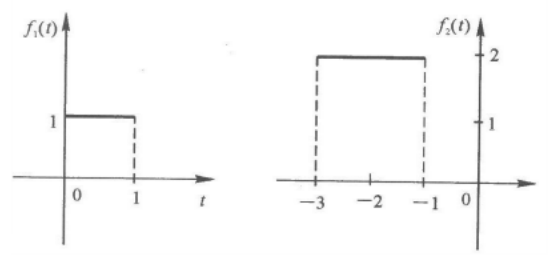

# 信号与系统 2022–2023 学年第二学期期末试卷（A 卷）

> 注意事项：1、请先仔细检查试卷，如试卷缺页、破损或字迹不清，请举手报告更换。2、请将答案直接写在试卷内，不得将试卷及草稿纸带出考场。
>
> ★注：请将各题答案做在答题纸上，答在试题纸上无效。

## 一、单项选择题（每题有且仅有一个答案是正确的，10 空，每空 2 分，共 20 分）

1. 已知某系统方程为 $r(t)=e(3t)$ ，则该系统是 ① 。

   A．LTI、因果系统　　B．LTI、非因果系统

   C．非 LTI、因果系统　　D．非 LTI、非因果系统

2. 已知某连续线性时不变系统的初始状态为零，设当激励为 $e(t)$ 时，全响应为 $r(t)$ ，则当激励增大为 $2e(t)$ 时，其全响应为 ② 。

   A． $r(t)$　　B． $r(t)/2$　　C． $2r(t)$　　D．发生变化，但以上答案均不正确

3. 应用冲激信号的抽样特性，积分式 $\displaystyle\int_{-\infty}^{+\infty}(t^{2}+2t)\delta(t+1)\,\mathrm{d}t$ 的结果是 ③ 。

   A．0　　B． $-1$　　C． $1$　　D． $\infty$

4. 已知 $f(t)$ 的波形，为画出 $f(3t+2)$ 的波形，下列哪种画图顺序结果正确 ④ 。

   A．波形压缩至 $\dfrac{1}{3}$ 后左移 2　　B．波形压缩至 $\dfrac{1}{3}$ 后右移 2

   C．波形左移 2 后压缩至 $\dfrac{1}{3}$　　D．波形右移 2 后压缩至 $\dfrac{1}{3}$

5. 离散非周期信号的频谱具有 ⑤ 。

   A．连续性、周期性　　B．连续性、非周期性

   C．离散性、周期性　　D．离散性、非周期性

6. 以下哪一个关于各种信号转换的描述是正确的？ ⑥

   A．FS 是一种将连续信号转换为离散信号的处理方法。

   B．FFT 是 DFT 的一种优化算法，但不能在计算机上高效实现。

   C．DCT 在图像压缩，特别是在 JPEG 中，没有任何应用。

   D．DTFT 可以处理连续时间的非周期性信号。

7. 已知 $x(t)$ 是周期为 T 的函数，则 $x(t)-x\left(t+\dfrac{5}{2}T\right)$ 的傅里叶级数中 ⑦ 。

   A．只可能有正弦分量

   B．只可能有余弦分量

   C．只可能有奇次谐波分量

   D．只可能有偶次谐波分量

8. 下面关于数字滤波器的说法中错误的是 ⑧ ：

   A．数字滤波器的频率响应都是以 $2\pi$ 为周期的

   B．IIR 滤波器有极点，也有零点，可借用模拟滤波器设计方法进行设计

   C．若要求 FIR 滤波器具有线性相位，则 $h(n)$ 必须满足奇对称或偶对称条件

   D．IIR 滤波器设计方法包括窗函数法、频率采样法等

9. $F(s)=\dfrac{e^{-(s+\alpha)T}}{s+\alpha}$ 的拉普拉斯逆变换为 ⑨ 。

   A． $e^{-\alpha(t-T)}u(t-T)$　　B． $e^{-\alpha t}u(t-T)$

   C． $e^{-\alpha t}u(t-\alpha)$　　D． $e^{-\alpha(t-\alpha)}u(t-T)$

10. 已知某序列 $x(n)=\left(\dfrac{1}{2}\right)^{n}u(n)+3^{n}u(-n-1)$ ，则其收敛区为 ⑩ 。

    A． $0.5<|z|<3$　　B． $|z|>3$　　C． $|z|<0.5$　　D． $|z|>3$ 或 $|z|<0.5$

## 二、填空题（10 空，每空 2 分，共 20 分）

1. 信号 $x(t)$ 的 Nyquist 抽样频率为 $\omega_{1}$ ，则信号 $x(t)x(2t)\sin\omega_{2}t$ 的 Nyquist 抽样频率为 ① 。

2. 函数集 $\{1,2t-1\}$ 在区间 $(0,2)$ 上是 ② （正交/非正交）的。

3. 一线性时不变连续时间系统是稳定系统的充分必要条件是系统函数的极点位于 s 平面的 ③ 。一个线性时不变离散时间系统是稳定系统的充分必要条件是系统函数的极点都位于 Z 平面的 ④ 。

4. $X(s)=\dfrac{s^{3}+s^{2}+2s+1}{(s+1)(s+2)(s+3)}$ 原信号的初值 ⑤ 。

5. 图 1 所示的连续时间系统的微分方程为 ⑥ 。

   

6. 图像的二维离散傅里叶变换中低频分量表示 ⑦ ，人类视觉系统对 ⑧ （低频/高频）信号的敏感程度更低。

7. 已知某连续时间系统的微分方程为 $r''(t)+4r'(t)+3r(t)=e'(t)+e(t)$ ，则该系统的系统函数为 ⑨ 。

8. 写出两种常用的模拟低通滤波器 ⑩ 。

## 三、简答计算题（共 60 分）

1. （每小题 5 分，共 10 分）判断系统稳定性并说明原因。

   (1) 连续系统微分方程： $r^{(3)}(t)+2r''(t)+r'(t)+2r(t)=e(t)$ 。

   (2) 离散系统差分方程： $y(n)-\dfrac{7}{4}y(n-1)+\dfrac{5}{8}y(n-2)=x(n)+\dfrac{1}{2}x(n-1)$ 。

2. （每小题 5 分，共 10 分）

   (1) 已知 $\mathrm{F}[f(t)]=\mathrm{F}(j\omega)$ ，求 $(t-1)f(-3t)$ 的傅里叶变换。

   (2) 求信号 $f(t)=(t+2)u(t-1)$ 的单边拉氏变换 $\mathrm{F}(s)$ 。

3. （每小题 4 分，共 12 分）对某离散线性时不变因果系统，已知：

   a) 两个零点为 $0$ 和 $-3$ ；

   b) 两个极点为 $-2$ 和 $-4$ ；

   c) $H(\infty)=2$ 。

   求：

   (1) 系统函数 $H(z)$ ；

   (2) 写出系统的差分方程；

   (3) 求系统的单位样值响应 $h(n)$ 。

4. （每小题 6 分，共 12 分）已知一线性时不变因果系统连续系统的输入输出方程为 $y''(t)+3y'(t)+2y'(t)=x'(t)+5x(t)$ ，已知输入 $x(t)=e^{-3t}u(t)$ 时系统全响应初始值为 $y(0_{+})=1$ ， $y'(0_{+})=3$ ，求：

   (1) 零状态响应 $y_{zs}(t)$ ；

   (2) 零输入响应 $y_{zi}(t)$ 。
5. （每小题 5 分，共 10 分）

   (1) 设 $x[n]=\delta[n]+2\delta[n-1]-\delta[n-3]$ 和 $h[n]=2\delta[n+1]+2\delta[n-1]$ ，求 $x[n]*h[n]$ 。

   (2) 已知 $f_{1}$ 和 $f_{2}(t)$ 的波形图如图所示，计算其卷积 $f_{1}(t)*f_{2}(t)$ ，并画出大致图像。

   

6. （6 分）请简述离散时间傅里叶变换、离散傅里叶变换和快速傅里叶变换的关系与区别。
