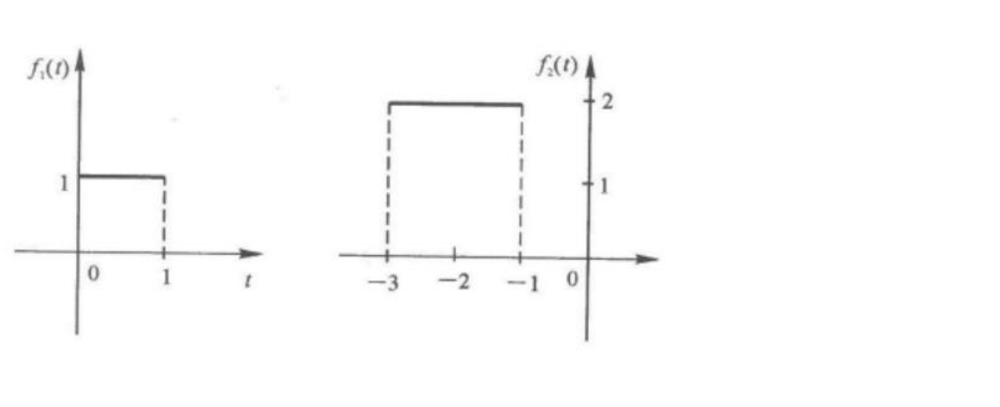

# 信号与系统 2022–2023 学年第二学期期末试卷（B 卷）

> 注意事项：1、请先仔细检查试卷，如试卷缺页、破损或字迹不清，请举手报告更换。2、请将答案直接写在试卷内，不得将试卷及草稿纸带出考场。
>
> ★注：请将各题答案做在答题纸上，答在试题纸上无效。

## 一、单项选择题（每题有且仅有一个答案是正确的，10 空，每空 2 分，共 20 分）

1. 已知某系统方程为 $r(t)=3e(t)$，则该系统是 ① 。

   A．线性、时不变系统　　B．线性、时变系统

   C．非线性、时不变系统　　D．非线性、时变系统

2. 已知某连续线性时不变系统的初始状态为零，设当激励为 $e(t)$ 时，全响应为 $r(t)$，则当激励减小为 $0.5e(t)$ 时，其全响应为 ② 。

   A． $r(t)$　　B． $r(t)/2$　　C． $2r(t)$　　D．发生变化，但以上答案均不正确

3. 应用冲激信号的抽样特性，可得积分式 $\displaystyle\int_{-\infty}^{+\infty}(e^{t}+1)\delta(t+1)\,\mathrm{d}t$ 的积分结果是 ③ 。

   A． $e-1$　　B． $e+1$　　C． $e^{-1}-1$　　D． $e^{-1}+1$

4. 若 $f(t)\leftrightarrow F(j\omega)$，则 $f(t)\sin(\omega_0 t)\leftrightarrow$ ④ 。

   A． $\dfrac{1}{2}\{F[j(\omega+\omega_0)]+F[j(\omega-\omega_0)]\}$　　B． $\dfrac{1}{2}\{F[j(\omega+\omega_0)]-F[j(\omega-\omega_0)]\}$

   C． $\dfrac{j}{2}\{F[j(\omega+\omega_0)]-F[j(\omega-\omega_0)]\}$　　D． $\dfrac{j}{2}\{F[j(\omega+\omega_0)]+F[j(\omega-\omega_0)]\}$

5. 离散非周期信号的频谱具有 ⑤ 。

   A．连续性、周期性　　B．连续性、非周期性

   C．离散性、周期性　　D．离散性、非周期性

6. 设有一个离散反馈系统，其系统函数为： $H(z)=\dfrac{z}{z-3(2-k)}$，若要使该系统稳定，常数 $k$ 应该满足的条件是 ⑥ 。

   A． $k>\dfrac{5}{3}$　　B． $k<\dfrac{7}{3}$　　C． $\dfrac{5}{3}<k<\dfrac{7}{3}$　　D． $-\infty<k<+\infty$

7. 已知 $f(t)\leftrightarrow F(\omega)$，则 $g(t)=f(2t-3)$ 的傅里叶变换为 ⑦ 。

   A． $\dfrac{1}{2}F(\omega)e^{-j\frac{3}{2}\omega}$　　B． $\dfrac{1}{2}F\left(\dfrac{\omega}{2}\right)e^{-j\frac{3}{2}\omega}$

   C． $\dfrac{1}{2}F(\omega)e^{-j3\omega}$　　D． $\dfrac{1}{2}F\left(\dfrac{\omega}{2}\right)e^{-j3\omega}$

8. 已知 $f(t)\leftrightarrow F(s)$，则 $g(t)=e^{-\frac{t}{a}}f(at)$（ $a>0$）的拉普拉斯变换为 ⑧ 。

   A． $\dfrac{1}{a}F\left(\dfrac{1}{a}s+\dfrac{1}{a^{2}}\right)$　　B． $\dfrac{1}{a}F\left(\dfrac{1}{a^{2}}s+\dfrac{1}{a^{2}}\right)$　　C． $aF\left(as+\dfrac{1}{a^{2}}\right)$　　D． $aF\left(a^{2}s+a^{2}\right)$

9. 下列关于傅里叶变换在图像处理中的说法中不正确的是 ⑨ 。

   A．图像去噪：可通过低通滤波器滤除高频噪声

   B．图像增强：可通过加强低频分量增强原始图像边缘

   C．直流分量：表示图像的平均灰度

   D．相位：决定了图像灰度的位置信息

10. 下面关于数字滤波器的说法中错误的是 ⑩ ：

    A．数字滤波器的频率响应都是以 $2\pi$ 为周期的

    B．IIR 滤波器设计方法包括窗函数法、频率采样法等

    C．若要求 FIR 滤波器具有线性相位，则 $h(n)$ 必须满足奇对称或偶对称条件

    D．IIR 滤波器有极点，也有零点，可借用模拟滤波器设计方法进行设计

## 二、填空题（10 空，每空 2 分，共 20 分）

1. 函数集 $\{1,t,t^{2},t^{3}\}$ 在区间 $(0,1)$ 上是 ① （正交/非正交）的。

2. 人类视觉系统对 ② （低频/高频）信号的敏感程度更低。

3. 一个离散时间线性时不变系统是渐近稳定系统的充分必要条件是系统函数的极点都位于 z 平面的 ③ 。

4. 长度分别为 4 和 6 的两个离散序列的卷积的长度为 ④ 。

5. 若全响应为 $r(t)=(4e^{-t}-3e^{-2t})u(t)$，则自由响应为 ⑤ ，受迫响应为 ⑥ 。

6. $X(s)=\dfrac{s^{2}+2s+1}{(s+1)(s+2)(s+3)}$ 原信号的初值 ⑦ 。

7. 已知某连续时间系统的微分方程为 $r''(t)+3r'(t)+r(t)=2e(t)$，则该系统的系统函数为 ⑧ 。

8. 已知离散系统特征方程 $D(z)=z^{2}-0.75z+0.125$，则该系统是 ⑨ （稳定/不稳定）的。

9. 对于 $X(z)=\dfrac{-3z^{-1}}{2-5z^{-1}+2z^{-2}}$，若收敛域为 $|z|<0.5$ 则对应 ⑩ （左边序列/右边序列/双边序列）。

## 三、简答计算题（共 60 分）

> 注：使用定理时请注意注明定理的使用条件。

1. （每小题 4 分，共 8 分）已知 $F[f(t)]=F(\omega)$，求下列信号的傅里叶变换。

   (1) $f(2t+1)$；　　(2) $t\dfrac{\mathrm{d}f(t)}{\mathrm{d}t}$。
2. （10 分）对某离散线性时不变因果系统，已知：

   a) 两个零点为 $0$ 和 $-4$；

   b) 两个极点为 $-1$ 和 $-7$；

   c) $H(\infty)=2$。

   求：

   (1) 系统函数 $H(z)$；（4 分）

   (2) 写出系统的差分方程；（3 分）

   (3) 求系统的单位样值响应 $h(n)$。（3 分）

3. （12 分）已知一反馈系统系统函数为 $H(s)=\dfrac{Ks}{s^{2}+(4-K)s+4}$，据此回答以下小问：

   (1) $K=4$ 时，判断系统是否稳定，并求出系统单位冲激响应 $h(t)$；（4 分）

   (2) $K=-1$ 时，判断系统是否稳定，并求出系统单位冲激响应 $h(t)$；（4 分）

   (3) $K=-1$ 时，若输入为 $x(t)=u(t)$，求系统输出的零状态响应 $y(t)$。（4 分）

4. （12 分）已知某连续时间系统的微分方程为 $r''(t)+4r'(t)+3r(t)=2e(t)$，激励 $e(t)=u(t)$，初始状态 $r(0_-)=2$， $r'(0_-)=0$ 时，求：

   (1) 系统的零输入响应 $r_{zi}(t)$；（4 分）

   (2) 系统的零状态响应 $r_{zs}(t)$；（4 分）

   (3) 系统的全响应 $r(t)$。（4 分）

5. （每小题 5 分，共 10 分）

   (1) 设 $x[n]=\delta[n]+2\delta[n-1]-\delta[n-3]$ 和 $h[n]=2\delta[n+1]+2\delta[n-1]$，求 $x[n]*h[n]$。

   (2) 已知 $f_1(t)$ 和 $f_2(t)$ 的波形图如图所示，计算其卷积 $f_1(t)*f_2(t)$，并画出大致图像。

   

6. （8 分）请简述连续傅里叶变换和拉普拉斯变换的物理意义及其之间的关系。
