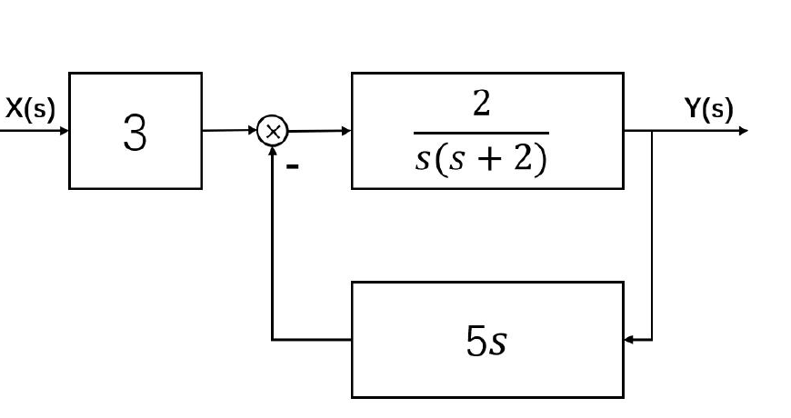

# 信号与系统 2023–2024 学年第二学期期末试卷（A 卷）参考答案

## 一、单项选择题（每题有且仅有一个答案是正确的，10 空，每空 2 分，共 20 分）

### 1. $r(t)=\int_{1}^{t}e(\tau)\,\mathrm{d}\tau$ 的系统性质

#### 题目

1. 已知某系统方程为 $r(t)=\displaystyle\int_{1}^{t}e(\tau)\,\mathrm{d}\tau$，则该系统是 ① 。

   A．线性、时变系统　　B．线性、时不变系统

   C．非线性、时变系统　　D．非线性、时不变系统

#### 答案

**答案：** ① A（线性、时变系统）。

积分运算满足叠加性，故线性；但积分下限是固定常数 $1$ 而不是 $-\infty$ ，平移激励后下限随之改变，故系统时变。

取 $e(t)=u(t)$ 验证： $r(t)=T[u(t)]$ 在 $t<1$ 时为 $0$ 、在 $t\ge 1$ 时为 $t-1$ 。把激励平移 $t_0=2$ 后， $T[u(t-2)]$ 在 $t<2$ 时为 $0$ 、在 $t\ge 2$ 时为 $t-2$ ；而 $r(t-2)$ 在 $t<3$ 时为 $0$ 、在 $t\ge 3$ 时为 $t-3$ 。取 $t=2.5$ 得 $T[u(t-2)]=0.5$ 而 $r(t-2)=0$ ，两者不等，故系统时变。（一般地，平移激励 $t_0$ 后积分下限变为 $1-t_0$ ，不再与原下限一致。）

### 2. $\dfrac{\mathrm{d}r}{\mathrm{d}t}+2r=3\dfrac{\mathrm{d}e}{\mathrm{d}t}$ ， $r(0_-)=0$ ， $e(t)=u(t)$ 时 $r(0_+)$

#### 题目

2\. 给定系统方程为 $\dfrac{\mathrm{d}}{\mathrm{d}t}r(t)+2r(t)=3\dfrac{\mathrm{d}}{\mathrm{d}t}e(t)$，起始状态 $r(0_-)=0$，激励信号 $e(t)=u(t)$，则 $r(0_+)$ 的值是 ② 。

   A．0　　B．3　　C．1　　D．均不正确

#### 答案

**答案：** ② B（3）。

方程两端在 $t=0$ 的无穷小区间上积分，含 $\delta$ 的项决定跳变：

$$r(0_+)-r(0_-)=3\,[e(0_+)-e(0_-)]=3(1-0)=3,$$

故 $r(0_+)=0+3=3$ 。

### 3. 下列说法错误的是

#### 题目

3\. 下列说法错误的是 ③ ：

   A． $\displaystyle\int_{-\infty}^{+\infty}\delta(t)\sin(t)\,\mathrm{d}t=0$

   B． $\{\cos(t),\cos(2t)\}$ 不是 $\left(0,\dfrac{\pi}{2}\right)$ 上的正交函数集

   C．模拟信号一定是数字信号

   D．任意信号都可以做奇偶分解

#### 答案

**答案：** ③ C。

A 正确： $\delta(t)$ 只在 $t=0$ 处取值， $\sin 0=0$ ，故积分为 $0$ 。

B 正确： $\displaystyle\int_{0}^{\pi/2}\cos t\cos 2t\,\mathrm{d}t=\int_{0}^{\pi/2}\frac{\cos 3t+\cos t}{2}\mathrm{d}t=\left[\frac{\sin 3t}{6}+\frac{\sin t}{2}\right]_{0}^{\pi/2}=-\frac{1}{6}+\frac{1}{2}=\frac{1}{3}\ne 0$ ，确实不是正交函数集。

C 错误：模拟信号（连续时间、连续幅度）不一定是数字信号。

D 正确：任意信号都可分解为奇分量与偶分量之和。

### 4. 由 $f(t)$ 画 $f(3t+2)$ 的正确顺序

#### 题目

4\. 已知 $f(t)$ 的波形，为画出 $f(3t+2)$ 的波形，下列哪种画图顺序结果正确 ④ 。

   A．波形压缩至 $\dfrac{1}{3}$ 后右移 2　　B．波形压缩至 $\dfrac{1}{3}$ 后左移 2

   C．波形左移 2 后压缩至 $\dfrac{1}{3}$　　D．波形右移 2 后压缩至 $\dfrac{1}{3}$

#### 答案

**答案：** ④ C（波形左移 2 后压缩至 $\dfrac{1}{3}$）。

$f(3t+2)=[f(t+2)]\big|_{t\to 3t}$ ：先把 $f(t)$ 左移 2 得到 $f(t+2)$ ，再作尺度压缩 $t\to 3t$ ，即得 $f(3t+2)$ 。

### 5. 离散周期信号频谱的性质

#### 题目

5\. 离散周期信号的频谱具有 ⑤ 。

   A．连续性、周期性　　B．离散性、周期性

   C．连续性、非周期性　　D．离散性、非周期性

#### 答案

**答案：** ⑤ B（离散性、周期性）。

### 6. 关于各种信号转换的正确描述

#### 题目

6\. 以下哪一个关于各种信号转换的描述是正确的？ ⑥

   A．对离散信号而言，单位圆上的 Z 变换就是信号的傅里叶变换。

   B．FFT 是 DFT 的一种优化算法，但不能在计算机上高效实现。

   C．DCT 在图像压缩，特别是在 JPEG 中，没有任何应用。

   D．离散信号的傅里叶变换，就是序列的离散傅里叶变换——DFT。

#### 答案

**答案：** ⑥ A。

A 正确： $z=e^{j\omega}$ （单位圆）上的 Z 变换即序列的傅里叶变换（DTFT）。

B 错误：FFT 正是为了在计算机上高效实现 DFT 而提出的。

C 错误：DCT 是 JPEG 压缩的核心变换之一。

D 错误：离散信号的傅里叶变换是 DTFT（ $\omega$ 的连续周期函数），DFT 是对它的频域采样，二者不同。

### 7. $x(t)-x\left(t+\dfrac{T}{2}\right)$ 的傅里叶级数

#### 题目

7\. 已知 $x(t)$ 是周期为 T 的函数，则 $x(t)-x\left(t+\dfrac{T}{2}\right)$ 的傅里叶级数中 ⑦ 。

   A．只可能有正弦分量

   B．只可能有余弦分量

   C．只可能有奇次谐波分量

   D．只可能有偶次谐波分量

#### 答案

**答案：** ⑦ C（只可能有奇次谐波分量）。

设 $x(t)=\displaystyle\sum_{k=-\infty}^{\infty}a_k e^{jk\omega_0t}$ ， $\omega_0=\dfrac{2\pi}{T}$ ，则

$$x\left(t+\frac{T}{2}\right)=\sum_k a_k e^{jk\omega_0t}e^{jk\pi}=\sum_k(-1)^{k}a_ke^{jk\omega_0t},$$

故

$$x(t)-x\left(t+\frac{T}{2}\right)=\sum_k\left[1-(-1)^{k}\right]a_ke^{jk\omega_0t}=\sum_{k\ \text{奇}}2a_ke^{jk\omega_0t},$$

即只剩奇次谐波分量（偶次谐波全部抵消）。

### 8. 关于数字滤波器错误的说法

#### 题目

8\. 下面关于数字滤波器的说法中错误的是 ⑧ ：

   A．数字滤波器的频率响应都是以 $2\pi$ 为周期的

   B．IIR 滤波器有极点，也有零点，可借用模拟滤波器设计方法进行设计

   C．若要求 FIR 滤波器具有线性相位，则 $h(n)$ 必须满足奇对称或偶对称条件

   D．IIR 滤波器设计方法包括冲激响应不变法、窗函数法等

#### 答案

**答案：** ⑧ D。

窗函数法是 FIR 滤波器的设计方法，不属于 IIR 的设计方法；IIR 的常用设计方法是冲激响应不变法、双线性变换法等借助模拟滤波器的方法。

### 9. $f(t)=e^{-(t-2)}u(t)$ 的拉普拉斯变换

#### 题目

9\. $f(t)=e^{-(t-2)}u(t)$ 的拉普拉斯变换是 ⑨ 。

   A． $\dfrac{1}{s+1}$　　B． $\dfrac{e^{-2s}}{s+1}$　　C． $\dfrac{e^{2}}{s+1}$　　D． $\dfrac{e^{2s}}{s+1}$

#### 答案

**答案：** ⑨ C（ $\dfrac{e^{2}}{s+1}$）。

$f(t)=e^{-(t-2)}u(t)=e^{2}e^{-t}u(t)$ ，故 $F(s)=\dfrac{e^{2}}{s+1}$ 。

注意 $u(t)$ 的跳变点在 $t=0$ ，因此不能用时移性质写成 $e^{-2s}$ 形式。

### 10. $X(z)=\dfrac{1}{\left(z+\frac{1}{2}\right)(z+2)}$ 为因果序列时的收敛域

#### 题目

10\. 已知 $x(n)$ 的 Z 变换 $X(z)=\dfrac{1}{\left(z+\dfrac{1}{2}\right)(z+2)}$，当 $X(z)$ 收敛域为 ⑩ 时， $x(n)$ 为因果序列。

    A． $|z|>0.5$　　B． $|z|>2$　　C． $2<|z|<\infty$　　D． $0.5<|z|<2$

#### 答案

**答案：** ⑩ B（ $|z|>2$）。

极点为 $z=-\dfrac{1}{2}$ 与 $z=-2$ 。因果（右边）序列的收敛域在最外层极点之外，即 $|z|>2$ 。

## 二、填空题（10 空，每空 2 分，共 20 分）

### 1. 三种信号的 Nyquist 抽样频率

#### 题目

1. 信号 $x_1(t)$ 的最高频率为 $\omega_1$，则信号 $x(t)+x(2t)$ 的 Nyquist 抽样频率为 ① ； $x(t)x(2t+1)\cos(\omega_2t)$ 的 Nyquist 抽样频率为 ② ； $x(t)\otimes x(2t+1)$ 的 Nyquist 抽样频率为 ③ 。

#### 答案

**答案：**

① $x(t)+x(2t)$ ： $4\omega_{1}$ ；

② $x(t)x(2t+1)\cos(\omega_{2}t)$ ： $6\omega_{1}+2\omega_{2}$ （官方答案另给一种写法 $6\omega_{1}+\dfrac{\omega_{2}}{\pi}$ ，对应把 $\omega_{2}$ 记作频率 $f_{2}$ 的情形）；

③ $x(t)\otimes x(2t+1)$ （卷积）： $2\omega_{1}$ 。

### 2. $\{\sin(t),\sin(2t)\}$ 在 $(0,1)$ 上的正交性

#### 题目

2\. 函数集 $\{\sin(t),\sin(2t)\}$ 在区间 $(0,1)$ 上是 ④ （正交/非正交）的。

#### 答案

**答案：** ④ 非正交的。

$$\int_{0}^{1}\sin t\sin 2t\,\mathrm{d}t=\left[\frac{\sin t}{2}-\frac{\sin 3t}{6}\right]_{0}^{1}=\frac{\sin 1}{2}-\frac{\sin 3}{6}\approx0.397\ne 0 .$$

### 3. 图 1 系统的微分方程与单位冲激响应终值

#### 题目

3\. 图 1 所示的连续时间系统的微分方程为 ⑤ ，其对应的单位冲激响应终值是 ⑥ 。

   

#### 答案

**答案：** ⑤ $r''(t)+12r'(t)=6e(t)$ ；⑥ 终值为 $\dfrac{1}{2}$ 。

由框图，求和点输出为 $3X(s)-5sY(s)$ ，故

$$Y(s)=\frac{2}{s(s+2)}\left[3X(s)-5sY(s)\right],$$

整理得 $Y(s)\left[s(s+2)+10s\right]=6X(s)$ ，即

$$H(s)=\frac{Y(s)}{X(s)}=\frac{6}{s^{2}+12s}=\frac{6}{s(s+12)} .$$

对应的微分方程为

$$r''(t)+12r'(t)=6e(t).$$

单位冲激响应

$$h(t)=\mathcal{L}^{-1}\left[\frac{6}{s(s+12)}\right]=\frac{1}{2}\left(1-e^{-12t}\right)u(t),$$

由终值定理 $h(\infty)=\lim_{s\to0}sH(s)=\lim_{s\to0}\dfrac{6}{s+12}=\dfrac{1}{2}$ 。

### 4. 图像二维 DFT 中低频与高频分量的含义

#### 题目

4\. 图像的二维离散傅里叶变换中低频分量表示 ⑦ ，高频分量表示 ⑧ 。

#### 答案

**答案：** ⑦ 代表了大面积背景区域和缓慢变化部分；⑧ 表示边缘、细节等。

### 5. $y(n)-3y(n-1)-4y(n-2)=x(n)-x(n-1)$ 的系统函数

#### 题目

5\. 已知某离散系统的差分方程为 $y(n)-3y(n-1)-4y(n-2)=x(n)-x(n-1)$，则该系统的系统函数为 ⑨ 。

#### 答案

**答案：** ⑨ $\dfrac{z^{2}-z}{z^{2}-3z-4}$ 。

$$H(z)=\frac{1-z^{-1}}{1-3z^{-1}-4z^{-2}}=\frac{z^{2}-z}{z^{2}-3z-4}=\frac{z(z-1)}{(z-4)(z+1)} .$$

### 6. 两个常用的滤波器性能指标

#### 题目

6\. 写出两个常用的滤波器性能指标 ⑩ 。

#### 答案

**答案：** ⑩ 通带（上限）截止频率、阻带（下限）截止频率、通带波纹峰值、阻带波纹峰值、通带最大衰减、阻带最小衰减（或上述对应的常用符号）。（写对 1 个给 1 分，2 分为止。）

## 三、简答计算题（共 60 分）

### 1. （每小题 5 分，共 10 分）判断系统稳定性

#### 题目

1. （每小题 5 分，共 10 分）判断系统稳定性并说明原因。

   (1) 连续系统微分方程： $r^{(3)}(t)-19r'(t)+30r(t)=e(t)$

   (2) 离散系统差分方程： $y(n)-\dfrac{7}{4}y(n-1)+\dfrac{5}{8}y(n-2)=x(n)+x(n-1)$

#### 答案

**答案：**

(1) 给出系统函数 $\dfrac{1}{s^{3}-19s+30}$ ……（2 分）

$D(s)=s^{3}-19s+30=(s+5)(s-2)(s-3)$ 有 3 个极点

$s_{1}=2,\ s_{2}=3,\ s_{3}=-5$ ……（2 分）

∵ 两个极点在 s 右半平面

∴ 系统不稳定 ……（1 分）
(2) 给出系统函数 $\dfrac{z^{2}+z}{z^{2}-\frac{7}{4}z+\frac{5}{8}}$ ……（2 分）

$D(z)=z^{2}-\dfrac{7}{4}z+\dfrac{5}{8}=\left(z-\dfrac{1}{2}\right)\left(z-\dfrac{5}{4}\right)$ 有两个极点 $z_{1}=1/2,\ z_{2}=5/4$ ……（2 分）

∵ 有一个极点在单位圆外

∴ 系统不稳定 ……（1 分）

### 2. （每小题 5 分，共 10 分）求变换

#### 题目

2\. （每小题 5 分，共 10 分）

   (1) 已知 $F[f(t)]=F(\omega)$，求 $f(-3t)\cos(\omega_0t)$ 的傅里叶变换。

   (2) 求信号 $f(t)=(2t-2t^{2})e^{-2t}$ 的单边拉氏变换 $F(s)$。

#### 答案

**答案：**

(1) 先由尺度变换性质，有 $F[f(-3t)]=\dfrac{1}{3}F\left(\dfrac{-\omega}{3}\right)$ ……（2 分）

再有 $\cos(\omega_{0}t)=\dfrac{e^{j\omega_{0}t}+e^{-j\omega_{0}t}}{2}$ ……（2 分）

故有

$$F\left[f(-3t)\cos(\omega_{0}t)\right]=\frac{1}{6}\left(F\left(\frac{-\omega+\omega_{0}}{3}\right)+F\left(\frac{-\omega-\omega_{0}}{3}\right)\right)\quad ……\text{（1 分）}$$
(2) 根据全微分方程性质可知： $(2t-2t^{2})e^{-2t}=\left(t^{2}e^{-2t}\right)'$ ……（2 分）

由常用拉氏变换和频移性质可得： $t^{2}e^{-2t}\ \rightarrow\ \dfrac{2}{(s+2)^{3}}$ ……（2 分）

再由时域微分性质可得： $\left(t^{2}e^{-2t}\right)'\ \rightarrow\ \dfrac{2s}{(s+2)^{3}}$ ……（1 分）

### 3. （共 12 分）由零点、极点与 $H(\infty)$ 求离散系统

#### 题目

3\. （共 12 分）已知一离散因果 LTI 系统的系统函数满足：

   a) 两个零点为 $0$ 和 $\dfrac{5}{18}$；

   b) 两个极点为 $\dfrac{1}{3}$ 和 $\dfrac{1}{4}$；

   c) $H(\infty)=3$。

   求：

   (1) 系统函数 $H(z)$，系统差分方程，单位冲激响应 $h(n)$（6 分）；

   (2) $y(-1)=1$， $y(-2)=0$，激励为 $\delta(n)$，求 $n\ge 0$ 时的全响应 $y(n)$（6 分）。

#### 答案

**答案：**

(1) 由 a、b，知

$$H(z)=k\frac{z\left(z-\frac{5}{18}\right)}{\left(z-\frac{1}{3}\right)\left(z-\frac{1}{4}\right)}$$

将 c 带入得： $k=3$ 。

故：

$$H(z)=\frac{3z\left(z-\frac{5}{18}\right)}{\left(z-\frac{1}{3}\right)\left(z-\frac{1}{4}\right)}\quad ……\text{（2 分）}$$
对应的系统差分方程为：

$$y(n)-\frac{7}{12}y(n-1)+\frac{1}{12}y(n-2)=3x(n)-\frac{5}{6}x(n-1)\quad ……\text{（2 分）}$$

对系统函数 $H(z)$ 进行 z 逆变换，得到冲激响应为：

$$\left[2\left(\frac{1}{3}\right)^{k}+\left(\frac{1}{4}\right)^{k}\right]u(k)\quad ……\text{（2 分）}$$

(2) 对差分方程进行 z 变换得：

$$Y(z)-\frac{7}{12}\left[z^{-1}Y(z)+y(-1)\right]+\frac{1}{12}\left[z^{-2}Y(z)+z^{-1}y(-1)+y(-2)\right]=\left(3-\frac{5}{6}z^{-1}\right)X(z),\quad ……\text{（2 分）}$$

将状态和 $X(z)$ 代入：

$$Y(z)=\frac{z}{4z-1}+\frac{10z}{3z-1}\quad ……\text{（2 分）}$$

故

$$y(n)=\left[\frac{10}{3}\left(\frac{1}{3}\right)^{n}+\frac{1}{4}\left(\frac{1}{4}\right)^{n}\right]u(n)\quad ……\text{（2 分）}$$

### 4. （每小题 6 分，共 12 分）求零状态响应与零输入响应

#### 题目

4\. （每小题 6 分，共 12 分）已知一线性时不变因果系统连续系统的输入输出方程为 $y''(t)+3y'(t)+2y(t)=x'(t)+6x(t)$，已知输入 $x(t)=e^{-3t}u(t)$ 时系统全响应初始值为 $y(0_+)=1$， $y'(0_+)=4$，求在此输入下：

   (1) 零状态响应 $y_{zs}(t)$；

   (2) 零输入响应 $y_{zi}(t)$。

#### 答案

**答案：**

(1) 由系统的输入输出方程，可得 $(s^{2}+3s+2)Y(s)=(s+5)F(s)$ ……（2 分）

由于： $Y(s)=\dfrac{s+5}{s^{2}+3s+2}F(s),\ F(s)=\dfrac{1}{s+3}$

所以：

$$Y_{zs}(s)=\frac{s+5}{(s^{2}+3s+2)(s+3)}=\frac{1}{s+3}-\frac{3}{s+2}+\frac{2}{s+1}\quad ……\text{（2 分）}$$

$$y_{zs}(t)=\left(e^{-3t}-3e^{-2t}+2e^{-t}\right)u(t)\quad ……\text{（2 分）}$$

(2) 因为系统极点为 −1、−2，所以零输入响应为：

$$y_{zi}(t)=\left(Ae^{-t}+Be^{-2t}\right)u(t)\quad ……\text{（2 分）}$$

$y_{zi}(0_{+})=y(0_{+})-y_{zs}(0_{+})=1$ ， $y'_{zi}(0_{+})=y'(0_{+})-y'_{zs}(0_{+})=2$ ……（2 分）

代入得：

$$y_{zi}(t)=\left(4e^{-t}-3e^{-2t}\right)u(t)\quad ……\text{（2 分）}$$

> $$y_{zi}(t)=\left(5e^{-t}-4e^{-2t}\right)u(t).$$
>
### 5. （共 10 分） $x(t)=\sum_{n=0}^{\infty}e^{-nT}\delta(t-nT)$ 的变换

#### 题目

5\. （共 10 分）设 $x(t)=\displaystyle\sum_{n=0}^{\infty}e^{-nT}\delta(t-nT)$，其中 $T>0$，求：

   (1) 求拉普拉斯变换 $X(s)$，包括它的收敛域。（5 分）

   (2) 证明傅里叶变换 $X(\omega)$ 是周期的。（5 分）

#### 答案

**答案：**

(1) 根据拉普拉斯变换的基本性质，可以写出：

$$X(s)=\sum_{n=0}^{\infty}e^{-nT(s+1)}\quad ……\text{（3 分）}$$

使用求和公式，可以得到下式以及收敛域：

$$X(s)=\frac{1}{1-e^{-T(s+1)}},\qquad \mathrm{Re}(s)>-1\quad ……\text{（2 分）（收敛域错误扣 1 分）}$$

(2) 考察拉普拉斯变换与傅里叶变换的联系，仅需恢复 $s=\sigma+j\omega$ 并令 $\sigma=0$ ：

$$X(\omega)=\frac{1}{1-e^{-T(j\omega+1)}}\quad ……\text{（3 分）（从求和出发求解傅里叶变换但后续证明正确扣 1 分）}$$

根据欧拉公式，较易可以得到周期为 $\dfrac{2\pi}{T}$ ，从而可以证明。……（2 分）（求得周期不正确的扣 1 分，未写出周期扣 2 分）

### 6. （共 6 分）简述拉普拉斯变换和 z 变换的含义及 s 域与 z 域的关系

#### 题目

6\. （共 6 分）请简述拉普拉斯变换和 z 变换的含义，并说明 s 域和 z 域的关系。

#### 答案

**答案：**

拉普拉斯变换用于将连续时间信号转换到 s 域，而 Z 变换用于将离散时间信号转换到 z 域。（定义，2 分）

它们之间的关系可以通过采样周期来理解：当连续信号以一定的采样周期进行采样后，s 域中的点会通过指数映射到 z 域。这种映射关系是 $z=e^{sT}$ ，其中 T 是采样周期。（转换关系（采样），2 分）

这意味着，s 域中的极点在采样后会变成 z 域中的极点，因此 z 域可以看作是 s 域在离散时间系统中的等效表示。这种关系反映了从连续时间到离散时间的转换过程。（极点、收敛域关系，画图或文字说明，2 分）
