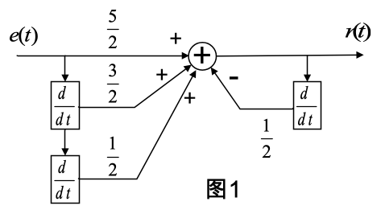

# 信号与系统 2023–2024 学年第二学期期末试卷（B 卷）参考答案

## 一、单项选择题（每题有且仅有一个答案是正确的，10 空，每空 2 分，共 20 分）

### 1. 系统 $r(t)=2e(t)$ 的性质

#### 题目

1. 已知某系统方程为 $r(t)=2e(t)$ ，则该系统是 ① 。

   A．线性、时不变系统　　B．线性、时变系统

   C．非线性、时不变系统　　D．非线性、时变系统

#### 答案

**答案：** ① A（线性、时不变系统）。

$r(t)=2e(t)$ 满足叠加性，且比例系数与时间无关，故为线性、时不变系统。

### 2. $\dfrac{\mathrm{d}r}{\mathrm{d}t}+2r=3\dfrac{\mathrm{d}e}{\mathrm{d}t}$ ， $r(0_{-})=1$ ， $e(t)=u(t)$ 时 $r(0_{+})$

#### 题目

2\. 给定系统方程为 $\dfrac{\mathrm{d}}{\mathrm{d}t}r(t)+2r(t)=3\dfrac{\mathrm{d}}{\mathrm{d}t}e(t)$ ，起始状态 $r(0_{-})=1$ ，激励信号 $e(t)=u(t)$ ，则 $r(0_{+})$ 的值是 ② 。

   A．1　　B． $3$　　C． $4$　　D．均不正确

#### 答案

**答案：** ② C（4）。

方程两端在 $t=0$ 的无穷小区间上积分，含 $\delta$ 的项决定跳变：

$$r(0_{+})-r(0_{-})=3\left[e(0_{+})-e(0_{-})\right]=3(1-0)=3,$$

故 $r(0_{+})=1+3=4$ 。

### 3. 下列说法错误的是

#### 题目

3\. 下列说法错误的是 ③ ：

   A． $\displaystyle\int_{-\infty}^{+\infty}\delta(t)\sin(t)\,\mathrm{d}t=0$

   B． $\{\cos(t),\ \cos(2t)\}$ 不是 $\left(0,\ \dfrac{\pi}{2}\right)$ 上的正交函数集

   C．模拟信号一定是数字信号

   D．任意信号都可以做奇偶分解

#### 答案

**答案：** ③ C。

A 正确： $\delta(t)$ 只在 $t=0$ 处取值， $\sin 0=0$ ，故积分为 $0$ 。B 正确： $\displaystyle\int_{0}^{\pi/2}\cos t\cos 2t\,\mathrm{d}t=\dfrac{1}{3}\ne 0$ ，确实不是正交函数集。C 错误：模拟信号（连续时间、连续幅度）不一定是数字信号。D 正确：任意信号都可分解为奇分量与偶分量之和。

### 4. 由 $f(t)$ 画 $f(2t+3)$ 的正确顺序

#### 题目

4\. 已知 $f(t)$ 的波形，为画出 $f(2t+3)$ 的波形，下列哪种画图顺序结果正确 ④ 。

   A．波形压缩至 $\dfrac{1}{2}$ 后左移 3　　B．波形压缩至 $\dfrac{1}{2}$ 后右移 3

   C．波形左移 3 后压缩至 $\dfrac{1}{2}$　　D．波形右移 1.5 后压缩至 $\dfrac{1}{2}$

#### 答案

**答案：** ④ C（波形左移 3 后压缩至 $\dfrac{1}{2}$）。

$f(2t+3)=[f(t+3)]\big|_{t\to 2t}$ ：先把 $f(t)$ 左移 3 得到 $f(t+3)$ ，再作尺度压缩 $t\to 2t$ ，即得 $f(2t+3)$ 。选项 D 的方向错误（应为压缩后左移 1.5，而非右移）。

### 5. 离散周期信号频谱的性质

#### 题目

5\. 离散周期信号的频谱具有 ⑤ 。

   A．连续性、周期性　　B．离散性、周期性

   C．连续性、非周期性　　D．离散性、非周期性

#### 答案

**答案：** ⑤ B（离散性、周期性）。

### 6. 关于图像处理不正确的说法

#### 题目

6\. 下列关于图像处理的说法中不正确的是 ⑥ 。

   A．图像去噪：可通过低通滤波器滤除高频噪声

   B．图像增强：可通过加强低频分量增强原始图像边缘

   C．直流分量：表示图像的平均灰度

   D．相位：决定了图像灰度的位置信息

#### 答案

**答案：** ⑥ B。

图像的边缘对应高频分量，增强边缘应加强高频分量而不是低频分量，故 B 不正确。A、C、D 均正确（去噪用低通；直流分量即平均灰度；相位决定位置信息）。

### 7. $\delta(2t)$

#### 题目

7\. $\delta(2t)=$ ⑦ 。

   A． $\delta(t)$　　B． $\dfrac{1}{2}\delta(t)$　　C． $2\delta(t)$　　D． $\delta^{2}(t)$

#### 答案

**答案：** ⑦ B（ $\dfrac{1}{2}\delta(t)$）。

由冲激的尺度变换性质 $\delta(at)=\dfrac{1}{|a|}\delta(t)$ ，取 $a=2$ 即得。

### 8. 关于数字滤波器错误的说法

#### 题目

8\. 下面关于数字滤波器的说法中错误的是 ⑧ ：

   A．数字滤波器的频率响应都是以 $2\pi$ 为周期的

   B．若要求 FIR 滤波器具有线性相位，则 $h(n)$ 必须满足奇对称或偶对称条件

   C．IIR 滤波器设计方法包括窗函数法、频率采样法等

   D．IIR 滤波器有极点，也有零点，可借用模拟滤波器设计方法进行设计

#### 答案

**答案：** ⑧ C。

窗函数法、频率采样法是 FIR 滤波器的设计方法，不属于 IIR 的设计方法；IIR 常借助模拟滤波器（冲激响应不变法、双线性变换法）设计。

### 9. $g(t)=e^{-\frac{t}{a}}f\left(\dfrac{t}{a}\right)$ 的拉普拉斯变换

#### 题目

9\. 已知 $f(t)\leftrightarrow F(s)$ ，则 $g(t)=e^{-\frac{t}{a}}f\left(\dfrac{t}{a}\right)$ 的拉普拉斯变换为 ⑨ 。

   A． $|a|F(as+1)$　　B． $|a|F(a^{2}s+a^{2})$

   C． $|a|F(as+a^{2})$　　D． $|a|F(as+a)$

#### 答案

**答案：** ⑨ A（ $|a|F(as+1)$）。

先由尺度性质 $f\left(\dfrac{t}{a}\right)\leftrightarrow|a|F(as)$ ，再乘 $e^{-\frac{t}{a}}$ 相当于 $s$ 域平移 $s\to s+\dfrac{1}{a}$ ，得 $|a|F\left(a\left(s+\dfrac{1}{a}\right)\right)=|a|F(as+1)$ 。

### 10. $x(n)=\left(\dfrac{1}{2}\right)^{n}u(n)+3^{n}u(-n-1)$ 的收敛区

#### 题目

10\. 已知某序列 $x(n)=\left(\dfrac{1}{2}\right)^{n}u(n)+3^{n}u(-n-1)$ ，则其收敛区为 ⑩ 。

    A． $0.5<|z|<3$　　B． $|z|>3$　　C． $|z|<0.5$　　D． $|z|>3$ 或 $|z|<0.5$

#### 答案

**答案：** ⑩ A（ $0.5<|z|<3$）。

第一项是右边序列，收敛域 $|z|>0.5$ ；第二项是左边序列，收敛域 $|z|<3$ ；两者之和的收敛域为交集 $0.5<|z|<3$ 。

## 二、填空题（10 空，每空 2 分，共 20 分）

### 1. $x(2t)$ 的最高角频率与 Nyquist 角频率

#### 题目

1. 信号 $x(t)$ 的最高角频率为 $\omega_{1}$ ，则信号 $x(2t)$ 的最高角频率是 ① ；信号 $x(2t)$ 的 Nyquist 角频率为 ② 。

#### 答案

**答案：** ① $2\omega_{1}$ ；② $4\omega_{1}$ 。

由尺度性质， $x(2t)$ 的频谱是 $X(\omega/2)/2$ ，最高角频率变为 $2\omega_{1}$ ；Nyquist 角频率为最高角频率的 2 倍，即 $4\omega_{1}$ 。

### 2. 图 1 系统的微分方程

#### 题目

2\. 图 1 所示的连续时间系统的微分方程为 ③ 。

   

#### 答案

**答案：** ③ $\dfrac{\mathrm{d}}{\mathrm{d}t}r(t)+2r(t)=\dfrac{\mathrm{d}^{2}}{\mathrm{d}t^{2}}e(t)+3\dfrac{\mathrm{d}}{\mathrm{d}t}e(t)+5e(t)$ 。

由框图，求和点输出为

$$r(t)=\frac{5}{2}e(t)+\frac{3}{2}\frac{\mathrm{d}e(t)}{\mathrm{d}t}+\frac{1}{2}\frac{\mathrm{d}^{2}e(t)}{\mathrm{d}t^{2}}-\frac{1}{2}\frac{\mathrm{d}r(t)}{\mathrm{d}t},$$

两边乘 2 并移项即得。

### 3. $\{\sin(t),\sin(2t)\}$ 在 $(0,1)$ 上的正交性

#### 题目

3\. 函数集 $\{\sin(t),\sin(2t)\}$ 在区间 $(0,1)$ 上是 ④ （正交/非正交）的。

#### 答案

**答案：** ④ 非正交。

$$\int_{0}^{1}\sin t\sin 2t\,\mathrm{d}t=\int_{0}^{1}\frac{\cos t-\cos 3t}{2}\,\mathrm{d}t=\left[\frac{\sin t}{2}-\frac{\sin 3t}{6}\right]_{0}^{1}=\frac{\sin 1}{2}-\frac{\sin 3}{6}\approx0.397\ne 0 .$$

### 4. $X(s)=\dfrac{s^{3}+s^{2}+2s+1}{s(s+1)(s+2)(s+3)}$ 的终值

#### 题目

4\. $X(s)=\dfrac{s^{3}+s^{2}+2s+1}{s(s+1)(s+2)(s+3)}$ 原信号的终值 ⑤ 。

#### 答案

**答案：** ⑤ $\dfrac{1}{6}$ 。

由终值定理 $f(\infty)=\lim_{s\to 0}sX(s)=\dfrac{1}{1\times 2\times 3}=\dfrac{1}{6}$ 。

### 5. 图像二维 DFT 的低频分量与人类视觉敏感度

#### 题目

5\. 图像的二维离散傅里叶变换中低频分量表示 ⑥ ，人类视觉系统对 ⑦ （低频/高频）信号的敏感程度更低。

#### 答案

**答案：** ⑥ 代表了大面积背景区域和缓慢变化的部分；⑦ 低频。

### 6. $D(z)=z^{2}-z+0.25$ 的稳定性

#### 题目

6\. 已知离散系统特征方程 $D(z)=z^{2}-z+0.25$ ，则该系统是 ⑧ （稳定/不稳定）的。

#### 答案

**答案：** ⑧ 稳定。

$D(z)=z^{2}-z+0.25=(z-0.5)^{2}$ ，特征根为二重根 $z=0.5$ ，在单位圆内，故系统稳定。

### 7. $r''(t)+4r'(t)+3r(t)=e'(t)+e(t)$ 的系统函数

#### 题目

7\. 已知某连续时间系统的微分方程为 $r''(t)+4r'(t)+3r(t)=e'(t)+e(t)$ ，则该系统的系统函数为 ⑨ 。

#### 答案

**答案：** ⑨ $\dfrac{s+1}{s^{2}+4s+3}$ ，即 $\dfrac{1}{s+3}$ 。

### 8. 两个常用的滤波器性能指标

#### 题目

8\. 写出两个常用的滤波器性能指标 ⑩ 。

#### 答案

**答案：** ⑩ 通带（上限）截止频率、阻带（下限）截止频率、通带波纹峰值、阻带波纹峰值、通带最大衰减、阻带最小衰减（或上述对应的常用符号）。（写对 1 个给 1 分，2 分为止。）

## 三、简答计算题（共 60 分）

### 1. （每小题 5 分，共 10 分）判断系统稳定性

#### 题目

1. （每小题 5 分，共 10 分）判断系统稳定性并说明原因。（每小题 5 分，共 10 分）
   (1) 连续系统微分方程： $r^{(3)}(t)+5r''(t)+4r'(t)+20r(t)=e(t)$ 。

   (2) 离散系统差分方程： $y(n)-\dfrac{3}{4}y(n-1)+\dfrac{1}{8}y(n-2)=x(n)+\dfrac{1}{3}x(n-1)$ 。

#### 答案

**答案：**

(1) $D(s)=s^{3}+5s^{2}+4s+20$ 有 3 个极点， $s_{1}=-5,\ s_{2}=2j,\ s_{3}=-2j$ ……（2 分）

∵ 极点在左半平面，虚轴上的极点是单极点 ……（2 分）

∴ 系统临界稳定（不稳定）……（1 分）
(2) $D(z)=z^{2}-\dfrac{3}{4}z+\dfrac{1}{8}=\left(z-\dfrac{1}{2}\right)\left(z-\dfrac{1}{4}\right)$ 有两个极点 ……（2 分）

∵ 各极点均在单位圆内 ……（2 分）

∴ 系统稳定 ……（1 分）

### 2. （每小题 5 分，共 10 分）求变换

#### 题目

2\. （每小题 5 分，共 10 分）

   (1) 已知 $\mathrm{F}[f(t)]=\mathrm{F}(\omega)$ ，求 $f(-3t)\cos(\omega_{0}t)$ 的傅里叶变换。

   (2) 求信号 $f(t)=(2t-2t^{2})e^{-2t}$ 的单边拉氏变换 $\mathrm{F}(s)$ 。

#### 答案

**答案：**

(1) 先由尺度变换性质，有 $F[f(-3t)]=\dfrac{1}{3}F\left(\dfrac{-\omega}{3}\right)$ ……（2 分）

再有 $\cos(\omega_{0}t)=\dfrac{e^{j\omega_{0}t}+e^{-j\omega_{0}t}}{2}$ ……（2 分）

故有

$$F\left[f(-3t)\cos(\omega_{0}t)\right]=\frac{1}{6}\left(F\left(\frac{-\omega+\omega_{0}}{3}\right)+F\left(\frac{-\omega-\omega_{0}}{3}\right)\right)\quad ……\text{（1 分）}$$
(2) 根据全微分方程性质可知： $(2t-2t^{2})e^{-2t}=\left(t^{2}e^{-2t}\right)'$ ……（2 分）

由常用拉氏变换和频移性质可得： $t^{2}e^{-2t}\ \rightarrow\ \dfrac{2}{(s+2)^{3}}$ ……（2 分）

再由时域微分性质可得： $\left(t^{2}e^{-2t}\right)'\ \rightarrow\ \dfrac{2s}{(s+2)^{3}}$ ……（1 分）

### 3. （共 10 分）由零点、极点与 $H(\infty)$ 求离散系统

#### 题目

3\. （共 10 分）对某离散线性时不变系统，已知：

   a) 两个零点为 $0$ 和 $-2$ ；

   b) 两个极点为 $-1$ 和 $-3$ ；

   c) $H(\infty)=4$ 。

   求：

   (1) 系统函数 $H(z)$ ；（4 分）

   (2) 写出系统的差分方程；（3 分）

   (3) 求系统的单位样值响应 $h(n)$ 。（3 分）

#### 答案

**答案：**

(1) 由 a、b，知

$$H(z)=k\frac{z(z+2)}{(z+1)(z+3)}\quad ……\text{（2 分）}$$

将 c 带入得： $k=4$ 。……（1 分）

故：

$$H(z)=\frac{4z(z+2)}{(z+1)(z+3)}\quad ……\text{（1 分）}$$

(2)

$$H(z)=\frac{4z(z+2)}{(z+1)(z+3)}=\frac{4+8z^{-1}}{1+4z^{-1}+3z^{-2}},$$

得：

$$Y(z)+4Y(z)z^{-1}+3Y(z)z^{-2}=4X(z)+8X(z)z^{-1}\quad ……\text{（2 分）}$$

故：

$$y(n)+4y(n-1)+3y(n-2)=4x(n)+8x(n-1)\quad ……\text{（1 分）}$$

(3) $H(z)=\dfrac{2z}{z+1}+\dfrac{2z}{z+3}$ ，故

$$h(n)=2\left[(-1)^{n}+(-3)^{n}\right]u(n)\quad ……\text{（3 分）}$$

### 4. （每小题 7 分，共 14 分）求零状态响应与零输入响应

#### 题目

4\. （每小题 7 分，共 14 分）已知一线性时不变因果系统连续系统的输入输出方程为 $y''(t)+3y'(t)+2y(t)=x'(t)+5x(t)$ ，已知输入 $x(t)=e^{-3t}u(t)$ 时系统全响应初始值为 $y(0_{+})=1$ ， $y'(0_{+})=3$ ，求：

   (1) 零状态响应 $y_{zs}(t)$ ；

   (2) 零输入响应 $y_{zi}(t)$ 。

#### 答案

**答案：**

(1) 由系统的输入输出方程，可得 $(s^{2}+3s+2)Y(s)=(s+5)F(s)$ ……（2 分）

由于： $Y(s)=\dfrac{s+5}{s^{2}+3s+2}F(s),\ F(s)=\dfrac{1}{s+3}$

所以：

$$Y_{zs}(s)=\frac{s+5}{(s^{2}+3s+2)(s+3)}=\frac{1}{s+3}-\frac{3}{s+2}+\frac{2}{s+1}\quad ……\text{（2 分）}$$

$$y_{zs}(t)=\left(e^{-3t}-3e^{-2t}+2e^{-t}\right)u(t)\quad ……\text{（3 分）}$$

(2) 因为系统极点为 −1、−2，所以零输入响应为：

$$y_{zi}(t)=\left(Ae^{-t}+Be^{-2t}\right)u(t)\quad ……\text{（2 分）}$$

$y_{zi}(0_{+})=y(0_{+})-y_{zs}(0_{+})=1$ ， $y'_{zi}(0_{+})=y'(0_{+})-y'_{zs}(0_{+})=2$ ……（2 分）

代入得：

$$y_{zi}(t)=\left(4e^{-t}-3e^{-2t}\right)u(t)\quad ……\text{（3 分）}$$

### 5. （10 分）积分恒等式与卷积

#### 题目

5\. （10 分）

   (1) 已知 $f(t)$ 为任一信号，设 $F(t)=\displaystyle\int_{-\infty}^{t}f(\tau)\,\mathrm{d}\tau$ ，证明： $\displaystyle\int\left(f(t)u(t)\right)\mathrm{d}t=\left(F(t)-F(0)\right)u(t)$ 。（2 分）

   (2) 已知 $f_{1}(t)=e^{-t}u(t)$ ， $f_{2}(t)=tu(t)$ ，计算其卷积 $f_{1}(t)*f_{2}(t)$ 。（6 分）

#### 答案

**答案：**

(1) 右端

$$\int\left[\left(F(t)-F(0)\right)u(t)\right]'\mathrm{d}t=\int\left[f(t)u(t)+\left(F(t)-F(0)\right)\delta(t)\right]\mathrm{d}t$$

由于 $(F(t)-F(0))\delta(t)=(F(0)-F(0))\delta(t)=0$ ，故

$$=\int f(t)u(t)\,\mathrm{d}t\quad ……\text{（2 分）}$$

即左端等于右端，恒等式得证。

(2) **解法 1：** 基于微分性质和 (1) 中结论

$$f_{1}(t)*f_{2}(t)=\left[e^{-t}u(t)\right]*\left[t\cdot u(t)\right]$$

$$=\int_{-\infty}^{t}e^{-\tau}u(\tau)\,\mathrm{d}\tau*\left[t\cdot u(t)\right]'\quad \text{（微分性质）}$$

$$=\int_{0}^{t}e^{-\tau}\,\mathrm{d}\tau*\left[u(t)+t\delta(t)\right]=\int_{0}^{t}e^{-\tau}\,\mathrm{d}\tau*u(t)\quad ……\text{（1 分）}$$

$$=-e^{-\tau}\Big|_{0}^{t}*u(t)=\left[\left(1-e^{-t}\right)u(t)\right]*u(t)\quad ……\text{（2 分）}$$

或由 (1) 中结论，有

$$\int_{0}^{t}e^{-\tau}\,\mathrm{d}\tau=\int_{0}^{t}e^{-\tau}u(\tau)\,\mathrm{d}\tau=\left(-e^{-t}+e^{0}\right)u(t)=\left(1-e^{-t}\right)u(t)$$

所以 $f_{1}(t)*f_{2}(t)=\left[\left(1-e^{-t}\right)u(t)\right]*u(t)$ ……（同上，2 分）

继续使用微积分性质，有

$$f_{1}(t)*f_{2}(t)=\int_{-\infty}^{t}\left(1-e^{-\tau}\right)u(\tau)\,\mathrm{d}\tau*\left[u(t)\right]'\quad ……\text{（1 分）}$$

由 (1) 中结论，有

$$\int_{-\infty}^{t}\left(1-e^{-\tau}\right)u(\tau)\,\mathrm{d}\tau=\left(t+e^{-t}-e^{0}\right)u(t)=\left(t+e^{-t}-1\right)u(t)\quad ……\text{（2 分）}$$

所以：

$$f_{1}(t)*f_{2}(t)=\left(t+e^{-t}-1\right)u(t)*\delta(t)=\left(t+e^{-t}-1\right)u(t)$$

**解法 2：** 基于卷积定义

根据卷积定义：

$$f_{1}(t)*f_{2}(t)=e^{-t}u(t)*t\cdot u(t)=\int_{-\infty}^{+\infty}e^{-\tau}u(\tau)(t-\tau)\cdot u(t-\tau)\,\mathrm{d}\tau\quad ……\text{（2 分）}$$

由 $u(\tau)$ 和 $u(t-\tau)$ 的定义可得仅当 $\tau>0,\ t-\tau>0$ 即 $0<\tau<t$ 时上式非零，则

$$\text{原式}=\int_{0}^{t}e^{-\tau}(t-\tau)\,\mathrm{d}\tau\quad ……\text{（1 分）}$$

$$=-te^{-t}+t+\tau e^{-\tau}\Big|_{0}^{t}-\int_{0}^{t}e^{-\tau}\,\mathrm{d}\tau\quad \text{（分部积分）}$$

$$=-te^{-t}+t+te^{-t}+e^{-t}-1=e^{-t}+t-1\quad (t>0)\quad ……\text{（3 分）}$$

与直接使用微分性质的结果相同。

### 6. （8 分）简述 s 域与 z 域的关系

#### 题目

6\. （8 分）请简述拉普拉斯变换和 z 变换中，s 域和 z 域的关系。

#### 答案

**答案：**

拉普拉斯变换用于将连续时间信号转换到 s 域，而 Z 变换用于将离散时间信号转换到 z 域。（定义，2 分）

它们之间的关系可以通过采样周期来理解：当连续信号以一定的采样周期进行采样后，s 域中的点会通过指数映射到 z 域。这种映射关系是 $z=e^{sT}$ ，其中 T 是采样周期。（转换关系（采样），3 分）

这意味着，s 域中的极点在采样后会变成 z 域中的极点，因此 z 域可以看作是 s 域在离散时间系统中的等效表示。这种关系反映了从连续时间到离散时间的转换过程。（极点、收敛域关系，画图或文字说明，3 分）
