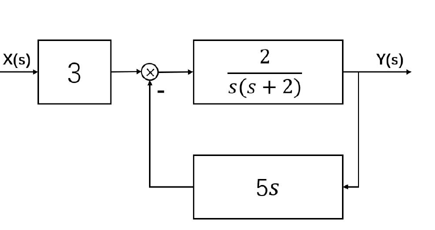

# 信号与系统 2023–2024 学年第二学期期末试卷（A 卷）

> 注意事项：1、请先仔细检查试卷，如试卷缺页、破损或字迹不清，请举手报告更换。2、请将各题答案做在答题纸上，答在试题纸上无效。3、不得将试卷及草稿纸带出考场。

## 一、单项选择题（每题有且仅有一个答案是正确的，10 空，每空 2 分，共 20 分）

1. 已知某系统方程为 $r(t)=\displaystyle\int_{1}^{t}e(\tau)\,\mathrm{d}\tau$，则该系统是 ① 。

   A．线性、时变系统　　B．线性、时不变系统

   C．非线性、时变系统　　D．非线性、时不变系统

2. 给定系统方程为 $\dfrac{\mathrm{d}}{\mathrm{d}t}r(t)+2r(t)=3\dfrac{\mathrm{d}}{\mathrm{d}t}e(t)$，起始状态 $r(0_-)=0$，激励信号 $e(t)=u(t)$，则 $r(0_+)$ 的值是 ② 。

   A．0　　B．3　　C．1　　D．均不正确

3. 下列说法错误的是 ③ ：

   A． $\displaystyle\int_{-\infty}^{+\infty}\delta(t)\sin(t)\,\mathrm{d}t=0$

   B． $\{\cos(t),\cos(2t)\}$ 不是 $\left(0,\dfrac{\pi}{2}\right)$ 上的正交函数集

   C．模拟信号一定是数字信号

   D．任意信号都可以做奇偶分解

4. 已知 $f(t)$ 的波形，为画出 $f(3t+2)$ 的波形，下列哪种画图顺序结果正确 ④ 。

   A．波形压缩至 $\dfrac{1}{3}$ 后右移 2　　B．波形压缩至 $\dfrac{1}{3}$ 后左移 2

   C．波形左移 2 后压缩至 $\dfrac{1}{3}$　　D．波形右移 2 后压缩至 $\dfrac{1}{3}$

5. 离散周期信号的频谱具有 ⑤ 。

   A．连续性、周期性　　B．离散性、周期性

   C．连续性、非周期性　　D．离散性、非周期性

6. 以下哪一个关于各种信号转换的描述是正确的？ ⑥

   A．对离散信号而言，单位圆上的 Z 变换就是信号的傅里叶变换。

   B．FFT 是 DFT 的一种优化算法，但不能在计算机上高效实现。

   C．DCT 在图像压缩，特别是在 JPEG 中，没有任何应用。

   D．离散信号的傅里叶变换，就是序列的离散傅里叶变换——DFT。

7. 已知 $x(t)$ 是周期为 T 的函数，则 $x(t)-x\left(t+\dfrac{T}{2}\right)$ 的傅里叶级数中 ⑦ 。

   A．只可能有正弦分量

   B．只可能有余弦分量

   C．只可能有奇次谐波分量

   D．只可能有偶次谐波分量

8. 下面关于数字滤波器的说法中错误的是 ⑧ ：

   A．数字滤波器的频率响应都是以 $2\pi$ 为周期的

   B．IIR 滤波器有极点，也有零点，可借用模拟滤波器设计方法进行设计

   C．若要求 FIR 滤波器具有线性相位，则 $h(n)$ 必须满足奇对称或偶对称条件

   D．IIR 滤波器设计方法包括冲激响应不变法、窗函数法等

9. $f(t)=e^{-(t-2)}u(t)$ 的拉普拉斯变换是 ⑨ 。

   A． $\dfrac{1}{s+1}$　　B． $\dfrac{e^{-2s}}{s+1}$　　C． $\dfrac{e^{2}}{s+1}$　　D． $\dfrac{e^{2s}}{s+1}$

10. 已知 $x(n)$ 的 Z 变换 $X(z)=\dfrac{1}{\left(z+\dfrac{1}{2}\right)(z+2)}$，当 $X(z)$ 收敛域为 ⑩ 时， $x(n)$ 为因果序列。

    A． $|z|>0.5$　　B． $|z|>2$　　C． $2<|z|<\infty$　　D． $0.5<|z|<2$

## 二、填空题（10 空，每空 2 分，共 20 分）

1. 信号 $x_1(t)$ 的最高频率为 $\omega_1$，则信号 $x(t)+x(2t)$ 的 Nyquist 抽样频率为 ① ； $x(t)x(2t+1)\cos(\omega_2t)$ 的 Nyquist 抽样频率为 ② ； $x(t)\otimes x(2t+1)$ 的 Nyquist 抽样频率为 ③ 。
2. 函数集 $\{\sin(t),\sin(2t)\}$ 在区间 $(0,1)$ 上是 ④ （正交/非正交）的。

3. 图 1 所示的连续时间系统的微分方程为 ⑤ ，其对应的单位冲激响应终值是 ⑥ 。

   

4. 图像的二维离散傅里叶变换中低频分量表示 ⑦ ，高频分量表示 ⑧ 。

5. 已知某离散系统的差分方程为 $y(n)-3y(n-1)-4y(n-2)=x(n)-x(n-1)$，则该系统的系统函数为 ⑨ 。

6. 写出两个常用的滤波器性能指标 ⑩ 。

## 三、简答计算题（共 60 分）

1. （每小题 5 分，共 10 分）判断系统稳定性并说明原因。

   (1) 连续系统微分方程： $r^{(3)}(t)-19r'(t)+30r(t)=e(t)$

   (2) 离散系统差分方程： $y(n)-\dfrac{7}{4}y(n-1)+\dfrac{5}{8}y(n-2)=x(n)+x(n-1)$

2. （每小题 5 分，共 10 分）

   (1) 已知 $F[f(t)]=F(\omega)$，求 $f(-3t)\cos(\omega_0t)$ 的傅里叶变换。

   (2) 求信号 $f(t)=(2t-2t^{2})e^{-2t}$ 的单边拉氏变换 $F(s)$。

3. （共 12 分）已知一离散因果 LTI 系统的系统函数满足：

   a) 两个零点为 $0$ 和 $\dfrac{5}{18}$；

   b) 两个极点为 $\dfrac{1}{3}$ 和 $\dfrac{1}{4}$；

   c) $H(\infty)=3$。

   求：

   (1) 系统函数 $H(z)$，系统差分方程，单位冲激响应 $h(n)$（6 分）；

   (2) $y(-1)=1$， $y(-2)=0$，激励为 $\delta(n)$，求 $n\ge 0$ 时的全响应 $y(n)$（6 分）。

4. （每小题 6 分，共 12 分）已知一线性时不变因果系统连续系统的输入输出方程为 $y''(t)+3y'(t)+2y(t)=x'(t)+6x(t)$，已知输入 $x(t)=e^{-3t}u(t)$ 时系统全响应初始值为 $y(0_+)=1$， $y'(0_+)=4$，求在此输入下：

   (1) 零状态响应 $y_{zs}(t)$；

   (2) 零输入响应 $y_{zi}(t)$。
5. （共 10 分）设 $x(t)=\displaystyle\sum_{n=0}^{\infty}e^{-nT}\delta(t-nT)$，其中 $T>0$，求：

   (1) 求拉普拉斯变换 $X(s)$，包括它的收敛域。（5 分）

   (2) 证明傅里叶变换 $X(\omega)$ 是周期的。（5 分）

6. （共 6 分）请简述拉普拉斯变换和 z 变换的含义，并说明 s 域和 z 域的关系。
