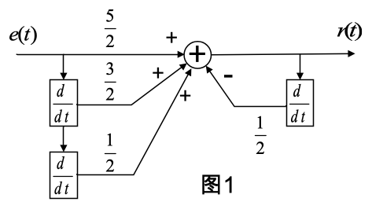

# 信号与系统 2023–2024 学年第二学期期末试卷（B 卷）

> 注意事项：1、请先仔细检查试卷，如试卷缺页、破损或字迹不清，请举手报告更换。2、请将答案直接写在试卷内，不得将试卷及草稿纸带出考场。
>
> ★注：请将各题答案做在答题纸上，答在试题纸上无效。

## 一、单项选择题（每题有且仅有一个答案是正确的，10 空，每空 2 分，共 20 分）

1. 已知某系统方程为 $r(t)=2e(t)$ ，则该系统是 ① 。

   A．线性、时不变系统　　B．线性、时变系统

   C．非线性、时不变系统　　D．非线性、时变系统

2. 给定系统方程为 $\dfrac{\mathrm{d}}{\mathrm{d}t}r(t)+2r(t)=3\dfrac{\mathrm{d}}{\mathrm{d}t}e(t)$ ，起始状态 $r(0_{-})=1$ ，激励信号 $e(t)=u(t)$ ，则 $r(0_{+})$ 的值是 ② 。

   A．1　　B． $3$　　C． $4$　　D．均不正确

3. 下列说法错误的是 ③ ：

   A． $\displaystyle\int_{-\infty}^{+\infty}\delta(t)\sin(t)\,\mathrm{d}t=0$

   B． $\{\cos(t),\ \cos(2t)\}$ 不是 $\left(0,\ \dfrac{\pi}{2}\right)$ 上的正交函数集

   C．模拟信号一定是数字信号

   D．任意信号都可以做奇偶分解

4. 已知 $f(t)$ 的波形，为画出 $f(2t+3)$ 的波形，下列哪种画图顺序结果正确 ④ 。

   A．波形压缩至 $\dfrac{1}{2}$ 后左移 3　　B．波形压缩至 $\dfrac{1}{2}$ 后右移 3

   C．波形左移 3 后压缩至 $\dfrac{1}{2}$　　D．波形右移 1.5 后压缩至 $\dfrac{1}{2}$

5. 离散周期信号的频谱具有 ⑤ 。

   A．连续性、周期性　　B．离散性、周期性

   C．连续性、非周期性　　D．离散性、非周期性

6. 下列关于图像处理的说法中不正确的是 ⑥ 。

   A．图像去噪：可通过低通滤波器滤除高频噪声

   B．图像增强：可通过加强低频分量增强原始图像边缘

   C．直流分量：表示图像的平均灰度

   D．相位：决定了图像灰度的位置信息

7. $\delta(2t)=$ ⑦ 。

   A． $\delta(t)$　　B． $\dfrac{1}{2}\delta(t)$　　C． $2\delta(t)$　　D． $\delta^{2}(t)$

8. 下面关于数字滤波器的说法中错误的是 ⑧ ：

   A．数字滤波器的频率响应都是以 $2\pi$ 为周期的

   B．若要求 FIR 滤波器具有线性相位，则 $h(n)$ 必须满足奇对称或偶对称条件

   C．IIR 滤波器设计方法包括窗函数法、频率采样法等

   D．IIR 滤波器有极点，也有零点，可借用模拟滤波器设计方法进行设计

9. 已知 $f(t)\leftrightarrow F(s)$ ，则 $g(t)=e^{-\frac{t}{a}}f\left(\dfrac{t}{a}\right)$ 的拉普拉斯变换为 ⑨ 。

   A． $|a|F(as+1)$　　B． $|a|F(a^{2}s+a^{2})$

   C． $|a|F(as+a^{2})$　　D． $|a|F(as+a)$

10. 已知某序列 $x(n)=\left(\dfrac{1}{2}\right)^{n}u(n)+3^{n}u(-n-1)$ ，则其收敛区为 ⑩ 。

    A． $0.5<|z|<3$　　B． $|z|>3$　　C． $|z|<0.5$　　D． $|z|>3$ 或 $|z|<0.5$

## 二、填空题（10 空，每空 2 分，共 20 分）

1. 信号 $x(t)$ 的最高角频率为 $\omega_{1}$ ，则信号 $x(2t)$ 的最高角频率是 ① ；信号 $x(2t)$ 的 Nyquist 角频率为 ② 。

2. 图 1 所示的连续时间系统的微分方程为 ③ 。

   

3. 函数集 $\{\sin(t),\sin(2t)\}$ 在区间 $(0,1)$ 上是 ④ （正交/非正交）的。

4. $X(s)=\dfrac{s^{3}+s^{2}+2s+1}{s(s+1)(s+2)(s+3)}$ 原信号的终值 ⑤ 。

5. 图像的二维离散傅里叶变换中低频分量表示 ⑥ ，人类视觉系统对 ⑦ （低频/高频）信号的敏感程度更低。

6. 已知离散系统特征方程 $D(z)=z^{2}-z+0.25$ ，则该系统是 ⑧ （稳定/不稳定）的。

7. 已知某连续时间系统的微分方程为 $r''(t)+4r'(t)+3r(t)=e'(t)+e(t)$ ，则该系统的系统函数为 ⑨ 。

8. 写出两个常用的滤波器性能指标 ⑩ 。

## 三、简答计算题（共 60 分）

1. （每小题 5 分，共 10 分）判断系统稳定性并说明原因。（每小题 5 分，共 10 分）
   (1) 连续系统微分方程： $r^{(3)}(t)+5r''(t)+4r'(t)+20r(t)=e(t)$ 。

   (2) 离散系统差分方程： $y(n)-\dfrac{3}{4}y(n-1)+\dfrac{1}{8}y(n-2)=x(n)+\dfrac{1}{3}x(n-1)$ 。

2. （每小题 5 分，共 10 分）

   (1) 已知 $\mathrm{F}[f(t)]=\mathrm{F}(\omega)$ ，求 $f(-3t)\cos(\omega_{0}t)$ 的傅里叶变换。

   (2) 求信号 $f(t)=(2t-2t^{2})e^{-2t}$ 的单边拉氏变换 $\mathrm{F}(s)$ 。

3. （共 10 分）对某离散线性时不变系统，已知：

   a) 两个零点为 $0$ 和 $-2$ ；

   b) 两个极点为 $-1$ 和 $-3$ ；

   c) $H(\infty)=4$ 。

   求：

   (1) 系统函数 $H(z)$ ；（4 分）

   (2) 写出系统的差分方程；（3 分）

   (3) 求系统的单位样值响应 $h(n)$ 。（3 分）
4. （每小题 7 分，共 14 分）已知一线性时不变因果系统连续系统的输入输出方程为 $y''(t)+3y'(t)+2y(t)=x'(t)+5x(t)$ ，已知输入 $x(t)=e^{-3t}u(t)$ 时系统全响应初始值为 $y(0_{+})=1$ ， $y'(0_{+})=3$ ，求：

   (1) 零状态响应 $y_{zs}(t)$ ；

   (2) 零输入响应 $y_{zi}(t)$ 。
5. （10 分）

   (1) 已知 $f(t)$ 为任一信号，设 $F(t)=\displaystyle\int_{-\infty}^{t}f(\tau)\,\mathrm{d}\tau$ ，证明： $\displaystyle\int\left(f(t)u(t)\right)\mathrm{d}t=\left(F(t)-F(0)\right)u(t)$ 。（2 分）

   (2) 已知 $f_{1}(t)=e^{-t}u(t)$ ， $f_{2}(t)=tu(t)$ ，计算其卷积 $f_{1}(t)*f_{2}(t)$ 。（6 分）

6. （8 分）请简述拉普拉斯变换和 z 变换中，s 域和 z 域的关系。
