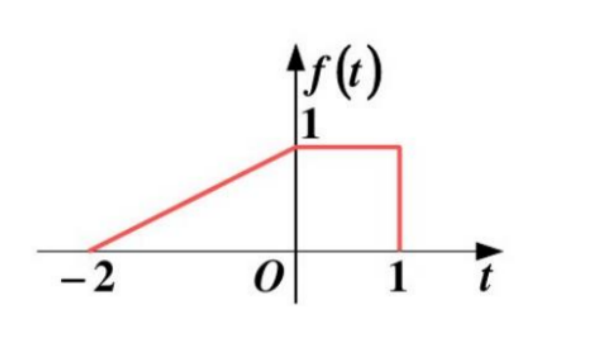
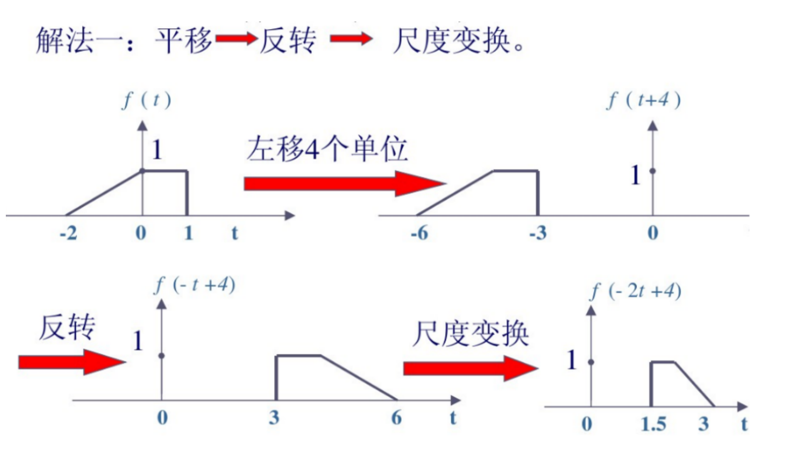
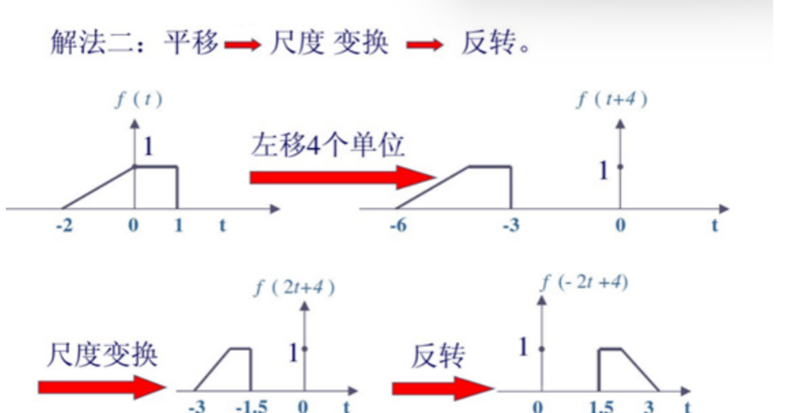
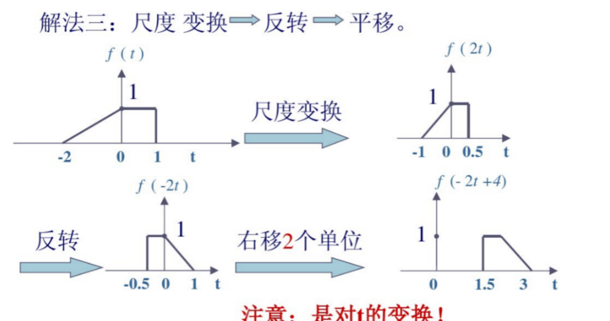
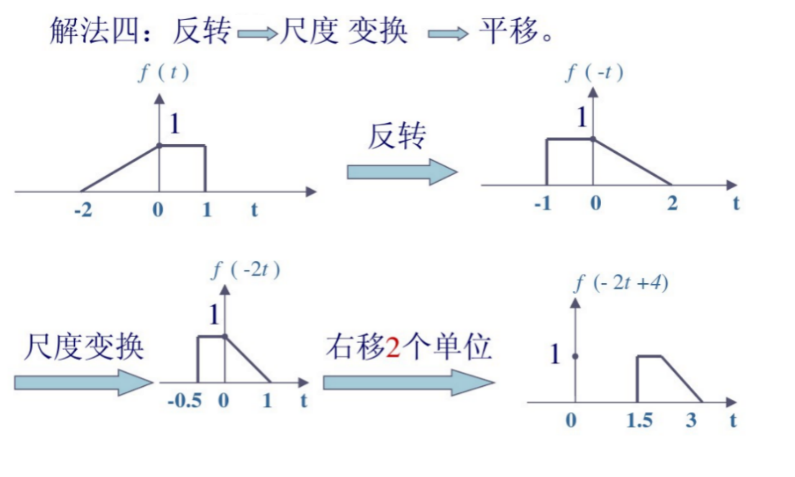
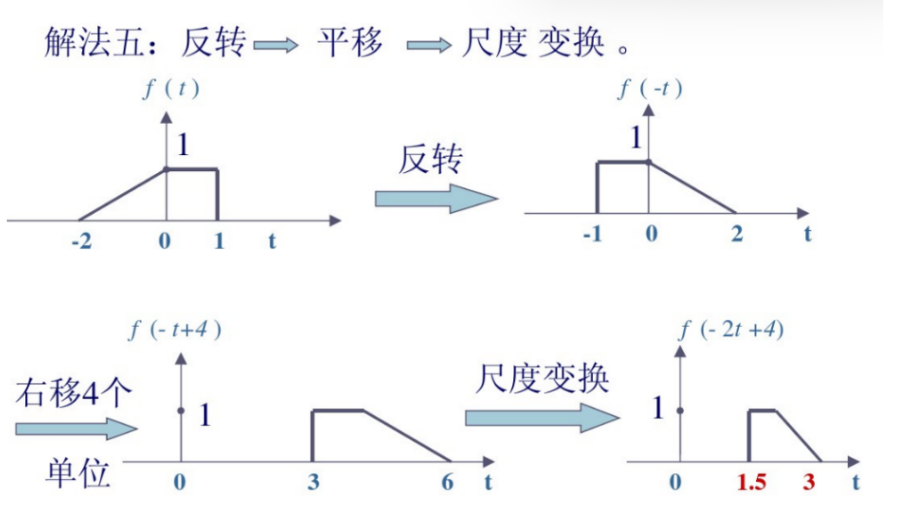
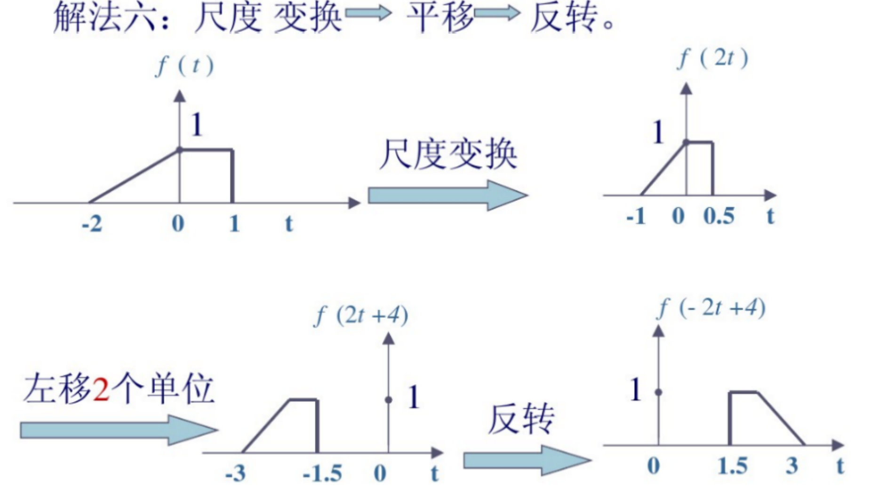

# 信号与系统 第1次作业答案（2023春）

## 助教总结

- Q1 其实不用想的那么复杂，直接用定义即可。
- Q3 主要考察一些基本的概念和定义。
- Q4 题有点问题，是我疏忽了。以后对题有疑问请及时告诉我。
- Q5 只有少数同学画错。
- Q6 主要考冲激信号的抽样特性。注意 $u(t)$ 是单位阶跃信号。
- Q9 部分同学理解错题意了。

## 题目与答案

### 1

#### 题目

求单位冲激信号 $\delta(t)$ 与 $\delta(\alpha t)$ 的关系（ $\alpha>0$）

#### 答案

**答案：**

$$1=\int_{-\infty}^{\infty}\delta(\alpha t)\,\mathrm{d}\alpha t=\int_{-\infty}^{\infty}\delta(t)\,\mathrm{d}t$$

$$\int_{-\infty}^{\infty}\delta(\alpha t)\,\mathrm{d}\alpha t=\int_{-\infty}^{\infty}\alpha\delta(\alpha t)\,\mathrm{d}t$$

且有 $\forall t\neq 0,\ \delta(\alpha t)=0$

故有 $\alpha\delta(\alpha t)=\delta(t)$

### 2

#### 题目

判断下列信号是否为周期信号，若是，则给出周期。

1. $\cos^{2}t$
2. $e^{j5t}$
3. $\sin(t)+\sin(\pi t)$

#### 答案

**答案：** 周期依次为 $\pi$、 $\dfrac{2}{5}\pi$，第 3 小题不是周期函数。

### 3

#### 题目

判断正误

1. $x[n]=\cos(n)$ 是数字信号
2. 周期信号之和也是周期信号
3. 能量信号都是非周期信号（不考虑 0）

#### 答案

**答案：**

1. 错误，幅值连续
2. 错误
3. 正确

### 4

#### 题目

$f_{1}(t)$、 $f_{2}(t)$ 为周期信号，周期分别为 $T_{1}$、 $T_{2}$，在什么条件下 $f_{1}(t)+f_{2}(t)$ 也是周期信号。

#### 答案

**答案：** 题有点问题。大部分同学的想法是 $T_{1},T_{2}$ 的比是有理数，对绝大部分的函数是正确的，但存在特例，即存在周期之比是无理数的两个周期函数，和依旧是周期函数。特例的构造和证明有些超纲了，故不再赘述。

### 5

#### 题目

$f(t)$ 波形如下，用两种不同的运算顺序求 $f(-2t+4)$ 的波形

#### 答案

**答案：** 6 种运算顺序结果一致： $f(-2t+4)$ 的波形在 $1.5\le t\le 3$ 上先恒为 1、再线性下降到 0，区间外为 0。各方法的三步运算如下。

| 方法 | 第一步 | 第二步 | 第三步 |
| --- | --- | --- | --- |
| 一：平移→反转→尺度变换 | $f(t+4)$，左移 4 个单位 | $f(-t+4)$，反转 | $f(-2t+4)$，尺度变换 |
| 二：平移→尺度变换→反转 | $f(t+4)$，左移 4 个单位 | $f(2t+4)$，尺度变换 | $f(-2t+4)$，反转 |
| 三：尺度变换→反转→平移 | $f(2t)$，尺度变换 | $f(-2t)$，反转 | $f(-2t+4)$，右移 2 个单位 |
| 四：反转→尺度变换→平移 | $f(-t)$，反转 | $f(-2t)$，尺度变换 | $f(-2t+4)$，右移 2 个单位 |
| 五：反转→平移→尺度变换 | $f(-t)$，反转 | $f(-t+4)$，右移 4 个单位 | $f(-2t+4)$，尺度变换 |
| 六：尺度变换→平移→反转 | $f(2t)$，尺度变换 | $f(2t+4)$，左移 2 个单位 | $f(-2t+4)$，反转 |

### 6

#### 题目

计算

1. $\displaystyle\int_{-\infty}^{\infty}f(t_{0}-t)\delta(t)\,\mathrm{d}x$
2. $\displaystyle\int_{-\infty}^{\infty}\left(e^{t}-t\right)\delta(t+1)\,\mathrm{d}x$
3. $t\delta(t)$
4. $\displaystyle\int_{-\infty}^{\infty}u(t-2)\delta(t-4)\,\mathrm{d}x$

#### 答案

**答案：** 主要利用冲激信号抽样特性 $\displaystyle\int_{-\infty}^{\infty}f(t)\delta(t-t_{0})\,\mathrm{d}t=f(t_{0})$

1. $f(t_{0})$
2. $e^{-1}+1$
3. $0$
4. $1$（ $u(2)=1$）

### 7

#### 题目

证明：函数集 $\left\{1,x^{1},x^{2},\dots\right\}$ 不是区间 $(0,2)$ 上的正交函数集

#### 答案

**答案：** 证明 $\displaystyle\int_{0}^{2}x^{i}x^{j}\,\mathrm{d}t\neq 0$ 即可。

### 9

#### 题目

用 $f(t)=kt+b$ 在区间 $(0,1)$ 上近似表示信号 $e^{t}$

（提示：考虑均方误差或正交分解）

#### 答案

**答案：**

法一：考虑均方误差

$$\Delta^{2}=\int_{0}^{1}\left[e^{t}-kt-b\right]^{2}\mathrm{d}t$$

对 $k$ 和 $b$ 求偏导

$$\frac{\partial\Delta^{2}}{\partial k}=\int_{0}^{1}2\left[e^{t}-kt-b\right](-t)\,\mathrm{d}t$$

$$=2\int_{0}^{1}\left[-te^{t}+kt^{2}+bt\right]\mathrm{d}t$$

$$=2\left\{-\int_{0}^{1}t\,\mathrm{d}\left(e^{t}\right)+\left.\left[\frac{k}{3}t^{3}+\frac{b}{2}t^{2}\right]\right|_{0}^{1}\right\}$$

$$=2\left\{-\left[\left.te^{t}\right|_{0}^{1}-\int_{0}^{1}e^{t}\,\mathrm{d}t\right]+\frac{k}{3}+\frac{b}{2}\right\}$$

$$=2\left\{-\left[e-\left.e^{t}\right|_{0}^{1}\right]+\frac{k}{3}+\frac{b}{2}\right\}$$

$$=2\left(-1+\frac{k}{3}+\frac{b}{2}\right)$$

$$\frac{\partial\Delta^{2}}{\partial b}=\int_{0}^{1}2\left[e^{t}-kt-b\right](-1)\,\mathrm{d}t$$

$$=2\left.\left[-e^{t}+\frac{k}{2}t^{2}+bt\right]\right|_{0}^{1}$$

$$=2\left(-e+1+\frac{k}{2}+b\right)$$

联立两式等于 0，解得：

$$k=18-6e,\qquad b=4e-10$$

验证略。

法二：考虑正交函数

找出一个 $(0,1)$ 上的正交函数集即可，例如 $\left\{1,\ t-\dfrac{1}{2}\right\}$

$$c_{1}=\frac{\displaystyle\int_{0}^{1}e^{t}\,\mathrm{d}t}{\displaystyle\int_{0}^{1}1^{2}\,\mathrm{d}t}=e-1$$

$$c_{2}=\frac{\displaystyle\int_{0}^{1}e^{t}\left(t-\frac{1}{2}\right)\mathrm{d}t}{\displaystyle\int_{0}^{1}\left(t-\frac{1}{2}\right)^{2}\mathrm{d}t}=\frac{\left.e^{t}\left(t-\frac{3}{2}\right)\right|_{0}^{1}}{\left.\left[\frac{1}{3}t^{3}-\frac{1}{2}t^{2}+\frac{1}{4}t\right]\right|_{0}^{1}}=\frac{-\frac{1}{2}e+\frac{3}{2}}{\frac{1}{12}}=6(3-e)$$
$$f(t)=6(3-e)\left(t-\frac{1}{2}\right)+e-1=(18-6e)t+4e-10$$

或者取正交函数集 $\{t,\ 3t-2\}$

$$c_{1}=\frac{\displaystyle\int_{0}^{1}e^{t}t\,\mathrm{d}t}{\displaystyle\int_{0}^{1}t^{2}\,\mathrm{d}t}=\frac{\left.e^{t}(t-1)\right|_{0}^{1}}{\frac{1}{3}}=3$$

$$c_{2}=\frac{\displaystyle\int_{0}^{1}e^{t}(3t-2)\,\mathrm{d}t}{\displaystyle\int_{0}^{1}(3t-2)^{2}\,\mathrm{d}t}=\frac{\left.e^{t}(3t-5)\right|_{0}^{1}}{\left.\left[3t^{3}-6t^{2}+4t\right]\right|_{0}^{1}}=\frac{5-2e}{1}=5-2e$$

$$f(t)=3t+(5-2e)(3t-2)=(18-6e)t+4e-10$$
