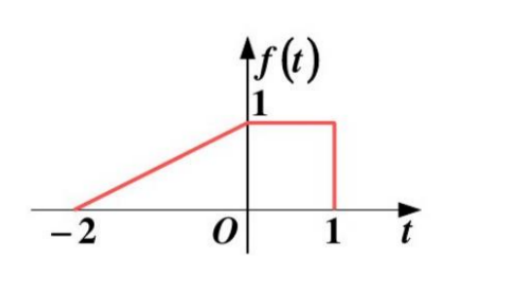

# 信号与系统 第1次作业题目（2023春）

## 题目

### 1

求单位冲激信号 $\delta(t)$ 与 $\delta(\alpha t)$ 的关系（ $\alpha>0$）

### 2

判断下列信号是否为周期信号，若是，则给出周期。

1. $\cos^{2}t$
2. $e^{j5t}$
3. $\sin(t)+\sin(\pi t)$

### 3

判断正误

1. $x[n]=\cos(n)$ 是数字信号
2. 周期信号之和也是周期信号
3. 能量信号都是非周期信号（不考虑 0）

### 4

$f_{1}(t)$、 $f_{2}(t)$ 为周期信号，周期分别为 $T_{1}$、 $T_{2}$，在什么条件下 $f_{1}(t)+f_{2}(t)$ 也是周期信号。

### 5

$f(t)$ 波形如下，用两种不同的运算顺序求 $f(-2t+4)$ 的波形

### 6

计算

1. $\displaystyle\int_{-\infty}^{\infty}f(t_{0}-t)\delta(t)\,\mathrm{d}x$
2. $\displaystyle\int_{-\infty}^{\infty}\left(e^{t}-t\right)\delta(t+1)\,\mathrm{d}x$
3. $t\delta(t)$
4. $\displaystyle\int_{-\infty}^{\infty}u(t-2)\delta(t-4)\,\mathrm{d}x$

### 7

证明：函数集 $\left\{1,x^{1},x^{2},\dots\right\}$ 不是区间 $(0,2)$ 上的正交函数集

### 8

1. 将 $f(t)=e^{t}+t^{2}+t$ 做奇偶分解
2. 将 $f(t)=\cos^{2}t$ 做直流交流分解

### 9

用 $f(t)=kt+b$ 在区间 $(0,1)$ 上近似表示信号 $e^{t}$

（提示：考虑均方误差或正交分解）
