# 信号与系统 第2次作业答案（2023春）

## 助教总结

- Q2. 部分同学对奇偶函数、奇谐函数和偶谐函数的定义以及在傅里叶变换中的性质还不太熟悉。
- Q4、Q5 相关性质希望能熟练运用。

## 题目与答案

### 1

#### 题目

求信号 $f(t)$ 的傅里叶级数，定义域为 R。

（1）

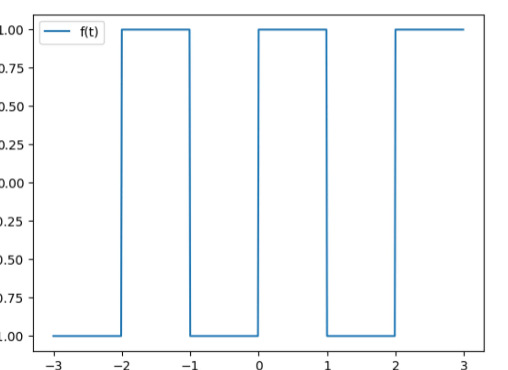

（2）

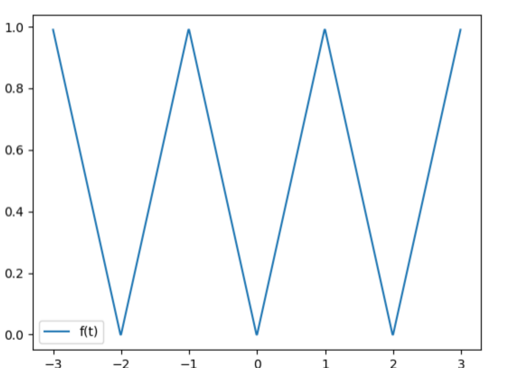

#### 答案

**答案：**

（1）

$$f(t)=\sum_{n=1,3,\dots}^{\infty}\frac{4}{n\pi}\sin(n\pi t)$$

（2）

$$f(t)=-\sum_{n=1,3,\dots}^{\infty}\frac{4}{n^{2}\pi^{2}}\cos(n\pi t)+\frac{1}{2}$$

### 2

#### 题目

利用信号 $f(t)$ 的对称性，定性判断下面各周期信号的傅里叶级数中所含有的频率分量。

（1）

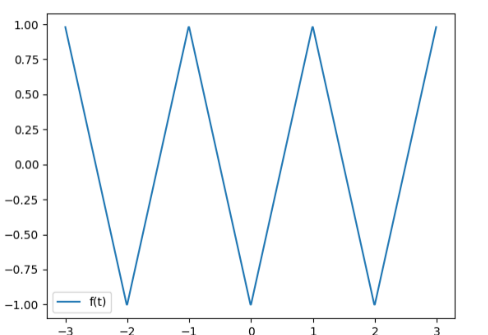

（2）

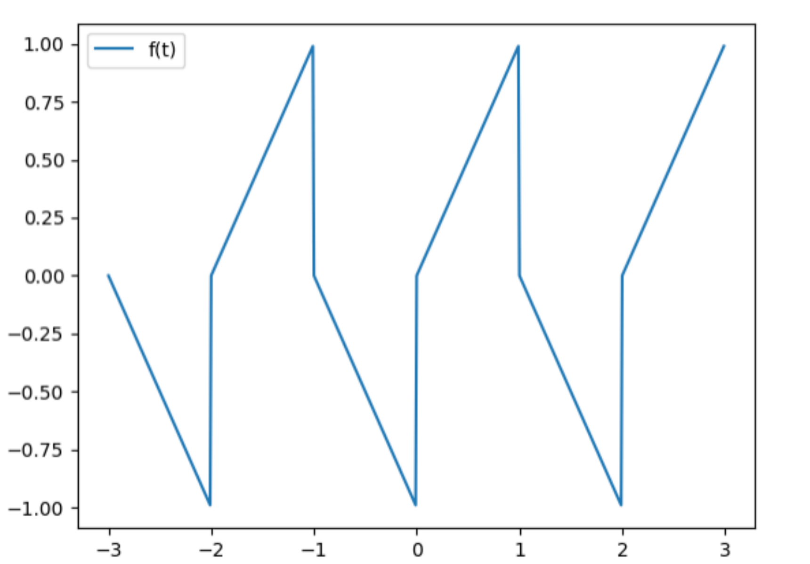

（3）

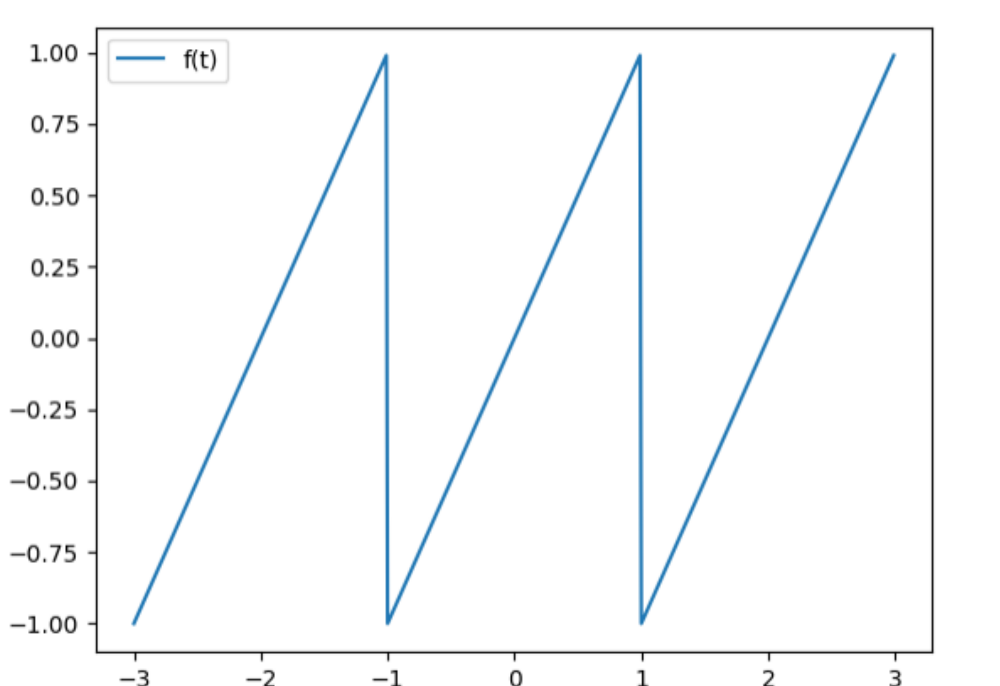

（4）

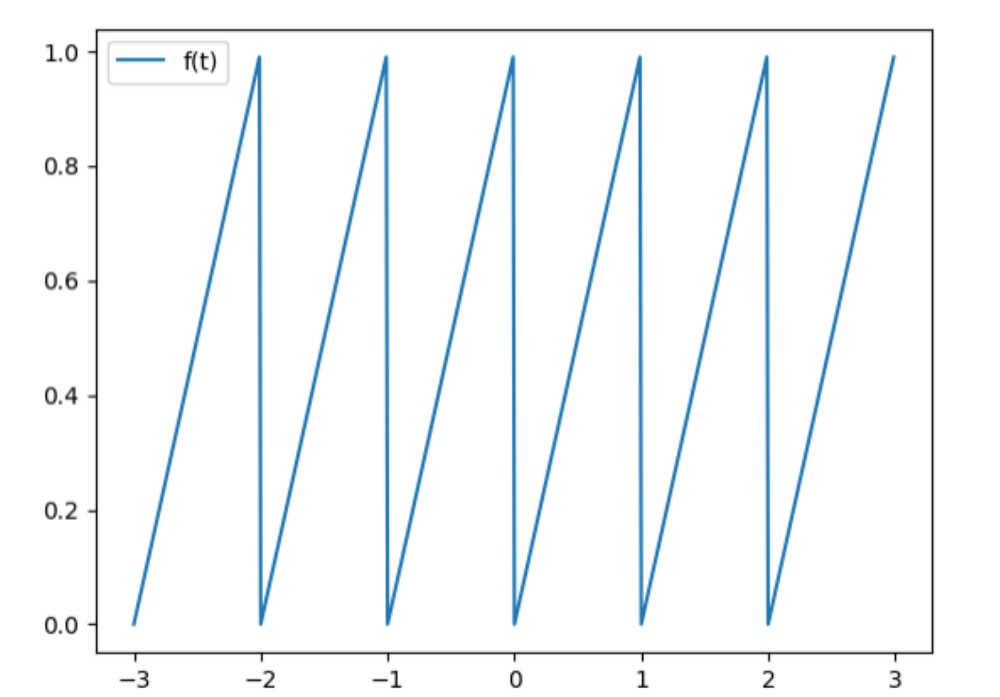

#### 答案

**答案：**

（1）奇谐函数 + 偶函数，只有奇次余弦分量。

（2）奇谐函数，只有奇次谐波分量。

（3）奇函数，只有正弦分量。

（4）去除直流分量是奇函数，同时是偶谐函数，直流和偶次正弦分量。

### 3

#### 题目

已知周期信号 $f(t)$ 的前四分之一周期波形如图所示，根据要求补全一个周期的波形（大致即可）

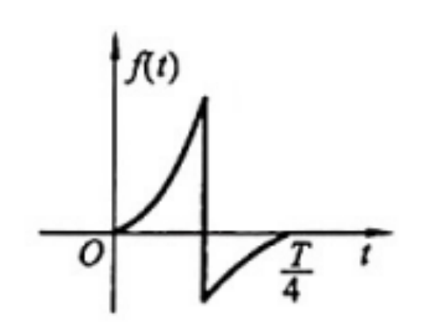

（1）偶函数，只有偶次谐波。

（2）偶函数，只有奇次谐波。

（3）奇函数，只有奇次谐波。

（4）奇函数，含有偶次和奇次谐波。

#### 答案

**答案：**

（1）

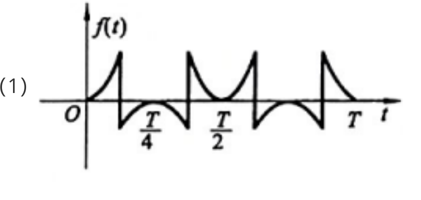

（2）

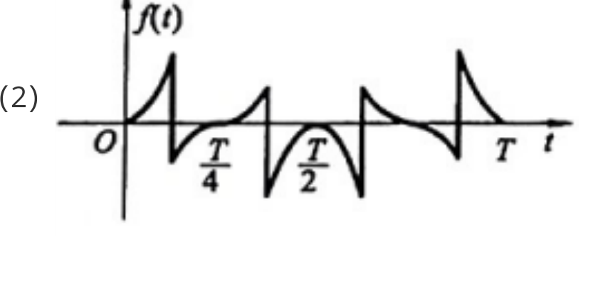

（3）

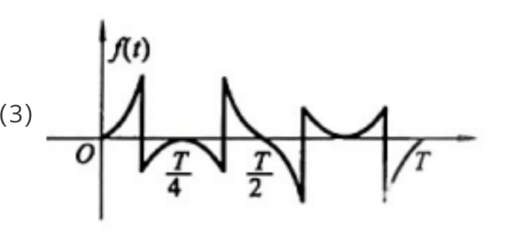

（4）

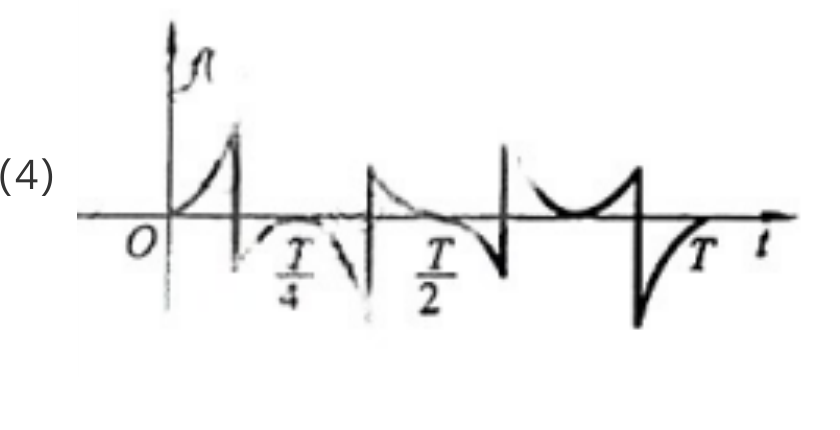

### 4

#### 题目

利用时域和频域对称性，求下列傅里叶变换的时间函数：

（1） $F(\omega)=\delta(\omega-\omega_{0})$

（2） $F(\omega)=u(\omega+\omega_{0})-u(\omega-\omega_{0})$

（3）

$$F(\omega)=\begin{cases}\dfrac{\omega_{0}}{\pi} & (|\omega|\le\omega_{0})\\[4pt] 0 & （其它）\end{cases}$$

#### 答案

**答案：**

（1）因为 $\delta(t)\leftrightarrow 1$， $\delta(t+\omega_{0})\leftrightarrow e^{j\omega_{0}\omega}$

所以由傅里叶变换的时、频对称性，有

$$e^{j\omega_{0}t}\leftrightarrow 2\pi\delta(-\omega+\omega_{0})=2\pi\delta\left[-(\omega-\omega_{0})\right]=2\pi\delta(\omega-\omega_{0})$$

即 $F(\omega)=\delta(\omega-\omega_{0})$ 的时间函数为

$$f(t)=\frac{1}{2\pi}e^{j\omega_{0}t}$$

（2）因为 $u(t+\omega_{0})-u(t-\omega_{0})\leftrightarrow 2\omega_{0}\,\mathrm{Sa}(\omega_{0}\omega)$

所以由傅里叶变换的时、频对称性，有

$$2\omega_{0}\,\mathrm{Sa}(\omega_{0}t)\leftrightarrow 2\pi\left[u(-\omega+\omega_{0})-u(-\omega-\omega_{0})\right]=2\pi\left[u(\omega+\omega_{0})-u(\omega-\omega_{0})\right]$$

即

$$\frac{\omega_{0}}{\pi}\,\mathrm{Sa}(\omega_{0}t)\leftrightarrow u(\omega+\omega_{0})-u(\omega-\omega_{0})$$

所求时间函数为

$$f(t)=\frac{\omega_{0}}{\pi}\,\mathrm{Sa}(\omega_{0}t)$$

（3）

$$F(\omega)=\begin{cases}\dfrac{\omega_{0}}{\pi} & (|\omega|\le\omega_{0})\\[4pt] 0 & （其他）\end{cases}=\frac{\omega_{0}}{\pi}\left[u(\omega+\omega_{0})-u(\omega-\omega_{0})\right]$$

由（2）已知

$$\frac{\omega_{0}}{\pi}\,\mathrm{Sa}(\omega_{0}t)\leftrightarrow u(\omega+\omega_{0})-u(\omega-\omega_{0})$$

则

$$\frac{\omega_{0}^{2}}{\pi^{2}}\,\mathrm{Sa}(\omega_{0}t)\leftrightarrow\frac{\omega_{0}}{\pi}\left[u(\omega+\omega_{0})-u(\omega-\omega_{0})\right]$$

即所求时间函数为

$$f(t)=\left(\frac{\omega_{0}}{\pi}\right)^{2}\mathrm{Sa}(\omega_{0}t)$$

### 5

#### 题目

若已知 $\mathscr{F}[f(t)]=F(\omega)$，利用傅里叶变换的性质求：

（1） $t f(2t)$

（2） $(t-2)f(t)$

（3） $t\dfrac{\mathrm{d}}{\mathrm{d}t}f(t)$

（4） $f(2t-5)$

#### 答案

**答案：**

（1）由尺度变换特性，有

$$f(2t)\leftrightarrow\frac{1}{2}F\left(\frac{\omega}{2}\right)$$

再由频域微分特性，有

$$t f(2t)\leftrightarrow j\cdot\frac{\mathrm{d}}{\mathrm{d}\omega}\left[\frac{1}{2}F\left(\frac{\omega}{2}\right)\right]=\frac{1}{2}j\frac{\mathrm{d}F\left(\frac{\omega}{2}\right)}{\mathrm{d}\omega}$$

（2）由频域微分特性，有

$$t f(t)\leftrightarrow j\frac{\mathrm{d}F(\omega)}{\mathrm{d}\omega}$$

再由线性特性，有

$$(t-2)f(t)\leftrightarrow j\frac{\mathrm{d}F(\omega)}{\mathrm{d}\omega}-2F(\omega)$$

（3）由时域微分特性，有

$$\frac{\mathrm{d}f(t)}{\mathrm{d}t}\leftrightarrow (j\omega)F(\omega)$$

再由频域微分特性，有

$$t\frac{\mathrm{d}f(t)}{\mathrm{d}t}\leftrightarrow j\cdot\frac{\mathrm{d}}{\mathrm{d}\omega}\left[(j\omega)F(\omega)\right]=-F(\omega)-\omega\frac{\mathrm{d}F(\omega)}{\mathrm{d}\omega}$$

（4）由尺度变换特性，有

$$f(2t)\leftrightarrow\frac{1}{2}F\left(\frac{\omega}{2}\right)$$

再由时移特性，有

$$f\left[2\left(t-\frac{5}{2}\right)\right]=f(2t-5)\leftrightarrow\frac{1}{2}F\left(\frac{\omega}{2}\right)e^{-j\frac{5}{2}\omega}$$

### 6

#### 题目

已知 $\mathscr{F}[f(t)]=F(\omega)$，计算 $\mathscr{F}\left[f(t)\cos(\omega_{0}t)\right]$

#### 答案

**答案：** 利用欧拉公式：

$$f(t)\cos(\omega_{0}t)=\frac{1}{2}f(t)\left(e^{j\omega_{0}t}+e^{-j\omega_{0}t}\right)$$

则：

$$\mathscr{F}\left[f(t)\cos(\omega_{0}t)\right]=\mathscr{F}\left[\frac{1}{2}f(t)\left(e^{j\omega_{0}t}+e^{-j\omega_{0}t}\right)\right]=\frac{1}{2}F(\omega-\omega_{0})+\frac{1}{2}F(\omega+\omega_{0})$$
