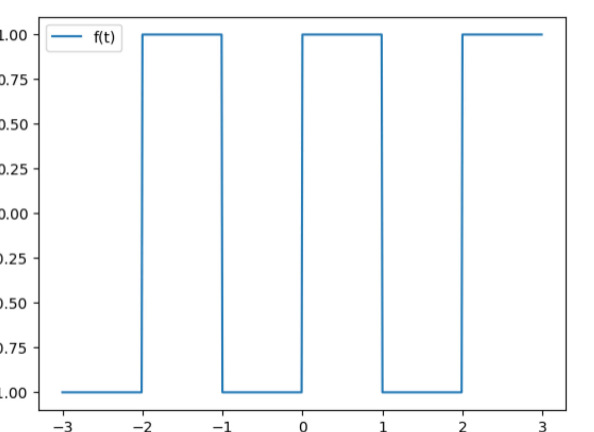
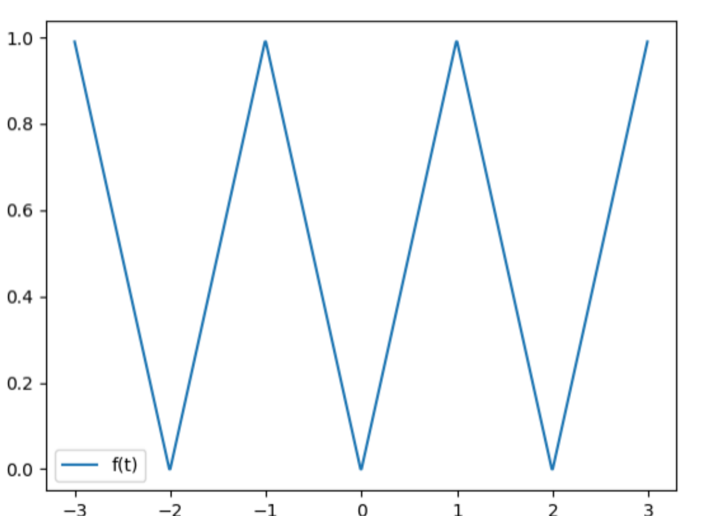
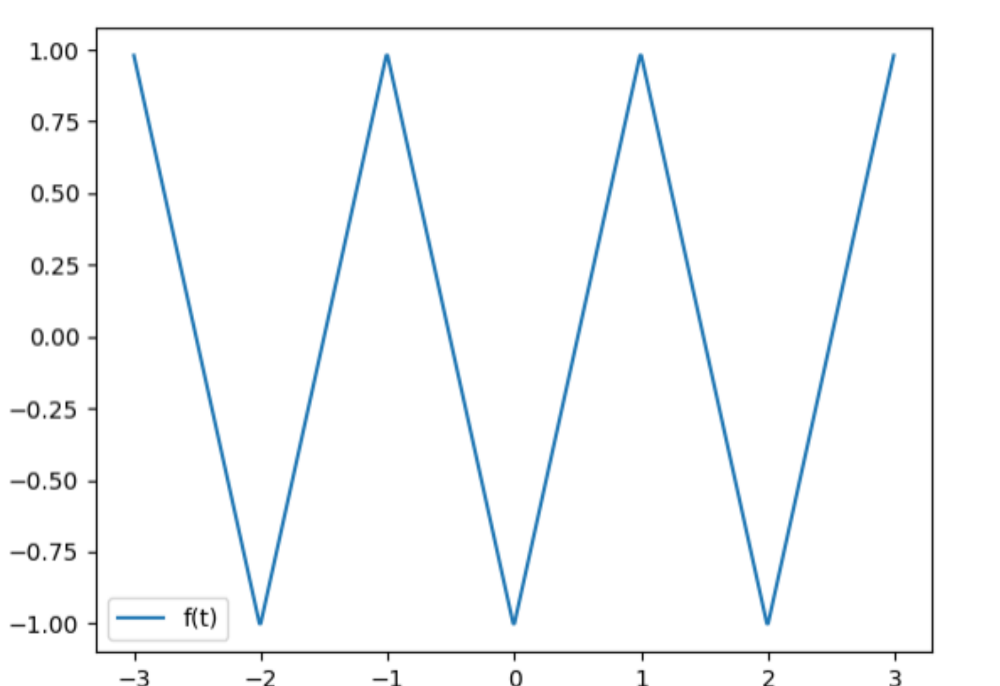
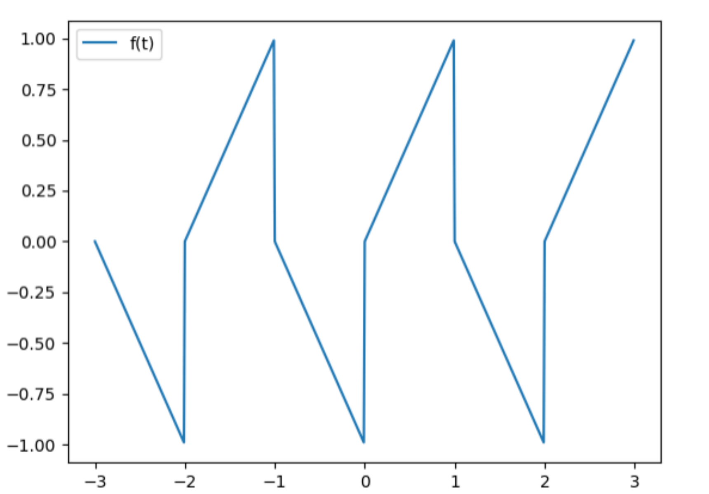
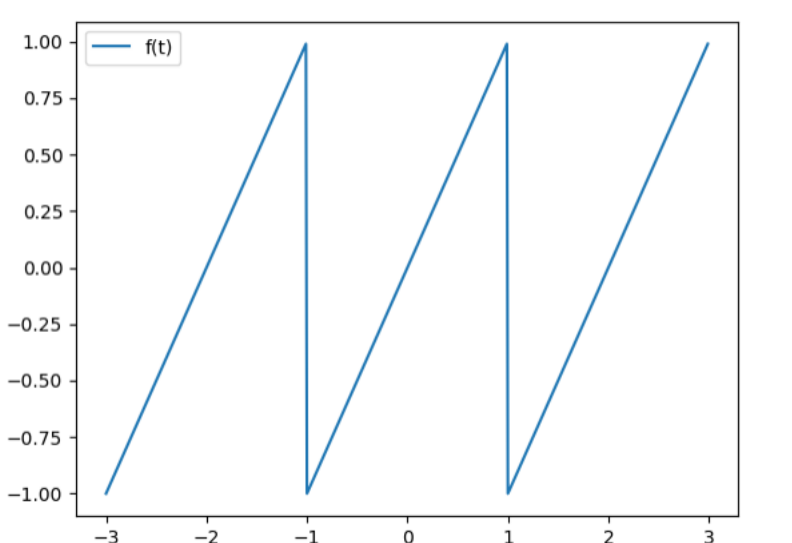
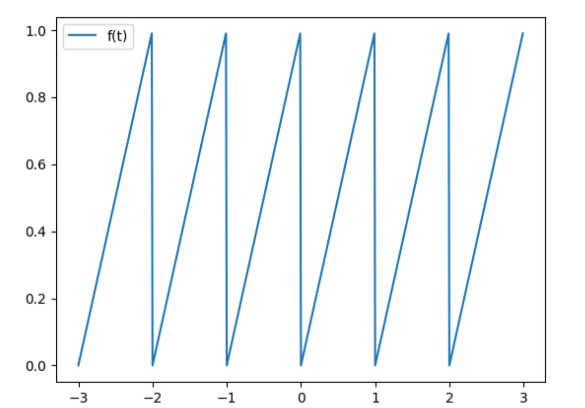
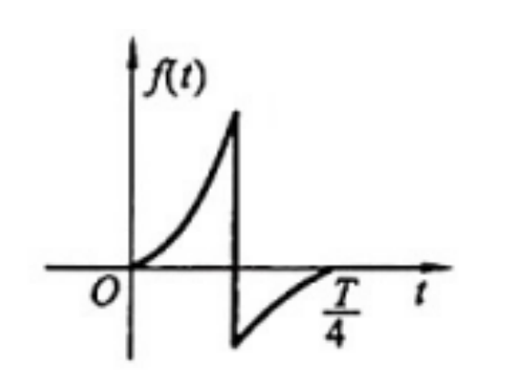

# 信号与系统 第2次作业题目（2023春）

## 题目

### 1

求信号 $f(t)$ 的傅里叶级数，定义域为 R。

（1）

（2）

### 2

利用信号 $f(t)$ 的对称性，定性判断下面各周期信号的傅里叶级数中所含有的频率分量。

（1）

（2）

（3）

（4）

### 3

已知周期信号 $f(t)$ 的前四分之一周期波形如图所示，根据要求补全一个周期的波形（大致即可）

（1）偶函数，只有偶次谐波。

（2）偶函数，只有奇次谐波。

（3）奇函数，只有奇次谐波。

（4）奇函数，含有偶次和奇次谐波。

### 4

利用时域和频域对称性，求下列傅里叶变换的时间函数：

（1） $F(\omega)=\delta(\omega-\omega_{0})$

（2） $F(\omega)=u(\omega+\omega_{0})-u(\omega-\omega_{0})$

（3）

$$F(\omega)=\begin{cases}\dfrac{\omega_{0}}{\pi} & (|\omega|\le\omega_{0})\\[4pt] 0 & （其它）\end{cases}$$

### 5

若已知 $\mathscr{F}[f(t)]=F(\omega)$，利用傅里叶变换的性质求：

（1） $t f(2t)$

（2） $(t-2)f(t)$

（3） $t\dfrac{\mathrm{d}}{\mathrm{d}t}f(t)$

（4） $f(2t-5)$

### 6

已知 $\mathscr{F}[f(t)]=F(\omega)$，计算 $\mathscr{F}\left[f(t)\cos(\omega_{0}t)\right]$
