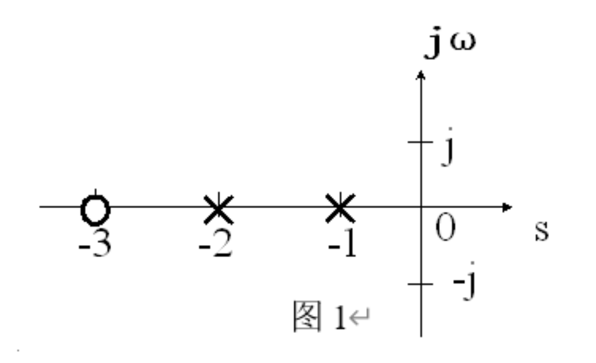
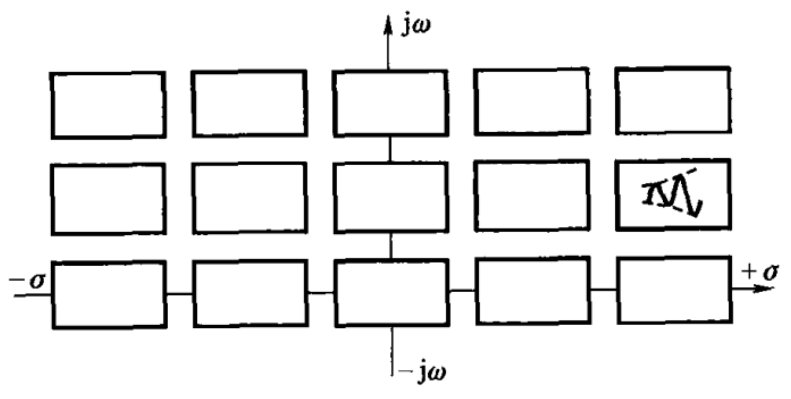
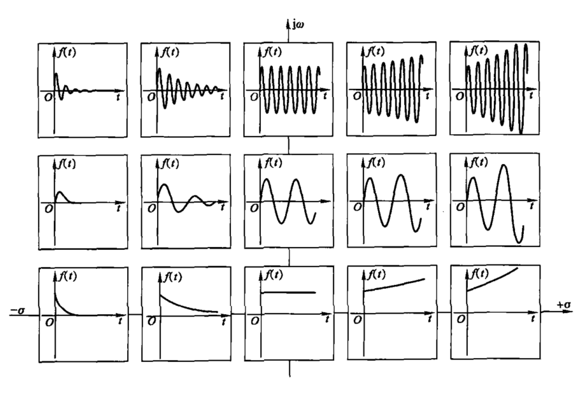
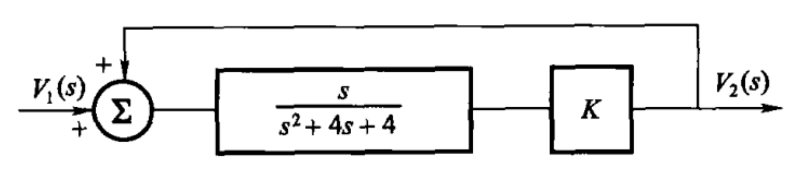

# 信号与系统 第4次作业答案（2023春）

## 题目与答案

### 1

#### 题目

判断下列系统为线性/非线性、时变/时不变、因果/非因果系统

（1） $y(t)=f^{2}(t)$

（2） $y[n]=f[n]-2f[n-1]$

#### 答案

**答案：**

（1）非线性、时不变、因果

（2）线性、时不变、因果

### 2

#### 题目

给定系统微分方程、起始状态以及激励信号分别为以下两种情况：

（1） $\dfrac{\mathrm{d}}{\mathrm{d}t}r(t)+2r(t)=e(t),\ r(0_{-})=0,\ e(t)=u(t)$

（2） $\dfrac{\mathrm{d}}{\mathrm{d}t}r(t)+2r(t)=3\dfrac{\mathrm{d}}{\mathrm{d}t}e(t),\ r(0_{-})=0,\ e(t)=u(t)$

判断在起始点是否发生跳变，写出 $r(0_{+})$ 的值。

#### 答案

**答案：**

（1）将 $e(t)=u(t)$ 带入微分方程，有： $\dfrac{\mathrm{d}}{\mathrm{d}t}r(t)+2r(t)=u(t)$。为了平衡，则一阶导数项含有 $u(t)$ 分量，因此有：

$$r(0_{+})-r(0_{-})=\int_{0_{-}}^{0_{+}}\frac{\mathrm{d}}{\mathrm{d}t}r(t)\,\mathrm{d}t=\int_{0_{-}}^{0_{+}}u(t)\,\mathrm{d}t=0$$

故不跳变， $r(0_{+})=r(0_{-})=0$。

（2）将 $e(t)=u(t)$ 带入微分方程，有： $\dfrac{\mathrm{d}}{\mathrm{d}t}r(t)+2r(t)=3\delta(t)$。为了平衡，则一阶导数项含有 $\delta(t)$ 分量，因此有：

$$r(0_{+})-r(0_{-})=\int_{0_{-}}^{0_{+}}\frac{\mathrm{d}}{\mathrm{d}t}r(t)\,\mathrm{d}t=\int_{0_{-}}^{0_{+}}3\delta(t)\,\mathrm{d}t=3$$

故跳变， $r(0_{+})=r(0_{-})+3=3$。

### 3

#### 题目

给定系统微分方程

$$\frac{\mathrm{d}^{2}}{\mathrm{d}t^{2}}r(t)+3\frac{\mathrm{d}}{\mathrm{d}t}r(t)+2r(t)=\frac{\mathrm{d}}{\mathrm{d}t}e(t)+3e(t)$$

$$e(t)=u(t),\quad r(0_{-})=1,\quad r'(0_{-})=2$$

试求

（1）完全响应

（2）零输入响应

（3）零状态响应

（4）自由响应

（5）受迫响应

#### 答案

**答案：**

先求齐次解。特征方差 $\lambda^{2}+3\lambda+2=0$，解得 $\lambda=-1\ or\ -2$。

根据激励信号 $e(t)=u(t)$，得到特解形式 $r_{p}(t)=B$，得到完全解：

$$r(t)=A_{1}e^{-t}+A_{2}e^{-2t}+\frac{3}{2}$$

由于系统为二阶，故需要 $r'(0_{+})$ 的边界调节，对上式求导，有：

$$\frac{\mathrm{d}}{\mathrm{d}t}r(t)=-A_{1}e^{-t}-2A_{2}e^{-2t}$$

根据冲激函数匹配法，将 $e(t)=u(t)$ 代入原式，得到：

$$\frac{\mathrm{d}^{2}}{\mathrm{d}t^{2}}r(t)+3\frac{\mathrm{d}}{\mathrm{d}t}r(t)+2r(t)=\delta(t)+3u(t)$$

因此最高阶含有 $\delta(t)$ 分量，故

$$r'(0_{+})=r'(0_{-})+\int_{0_{-}}^{0_{+}}\delta(t)\,\mathrm{d}t=3$$

且 $r(0_{+})=r(0_{-})=1$，带入式子解出：

$$\begin{cases}A_{1}=2\\[4pt] A_{2}=-\dfrac{5}{2}\end{cases}$$

（1）完全响应：

$$r(t)=\left(2e^{-t}-\frac{5}{2}e^{-2t}+\frac{3}{2}\right)u(t)$$

（2）零输入响应：将 $r(0_{-})=1,\ r'(0_{-})=2$ 分别带入齐次解与求导后的式子，解出：

$$r_{zi}(t)=\left(4e^{-t}-3e^{-2t}\right)u(t)$$

（3）零状态响应：将 $r(0_{+})=0,\ r'(0_{+})=1$ 分别带入非齐次解与求导后的式子，解出：

$$r_{zs}(t)=\left(-2e^{-t}+\frac{1}{2}e^{-2t}+\frac{3}{2}\right)u(t)$$

（4）自由响应： $r_{h}(t)=2e^{-t}-\dfrac{5}{2}e^{-2t}$

（5）受迫响应： $\dfrac{3}{2}$

### 4

#### 题目

求拉普拉斯逆变换

（1） $\dfrac{3}{(s+4)(s+2)}$

（2） $\dfrac{3s}{(s+4)(s+2)}$

#### 答案

**答案：**

（1）

$$\mathscr{L}^{-1}\left[\frac{3}{(s+4)(s+2)}\right]=\frac{3}{2}\mathscr{L}^{-1}\left[\frac{1}{s+2}-\frac{1}{s+4}\right]=\frac{3}{2}\left(e^{-2t}-e^{-4t}\right)u(t)$$
（2）

$$\mathscr{L}^{-1}\left[\frac{3s}{(s+4)(s+2)}\right]=3\mathscr{L}^{-1}\left[\frac{2}{s+4}-\frac{1}{s+2}\right]=3\left(2e^{-4t}-e^{-2t}\right)u(t)$$

### 5

#### 题目

已知连续线性时不变时间系统零极图如图 1 所示（其中 O 表示零点，X 表示极点），且该系统的单位阶跃响应终值为 1，试求：

（1）系统函数 $H(s)$

（2）系统单位冲激响应 $h(t)$

#### 答案

**答案：**

（1）由已知： $H(s)=\dfrac{K(s+3)}{(s+2)(s+1)}$，又因为单位阶跃响应拉氏变换 $R(s)=\dfrac{1}{s}H(s)$，根据终值定理，有：

$$r(\infty)=\lim_{s\to 0}sR_{zs}(s)=\frac{3}{2}K=1$$

故 $K=\dfrac{2}{3}$， $H(s)=\dfrac{2}{3}\dfrac{(s+3)}{(s+2)(s+1)}$

（2） $H(s)=\dfrac{2}{3}\left(\dfrac{2}{s+1}-\dfrac{1}{s+2}\right)$， $h(t)=\dfrac{2}{3}\left(2e^{-t}-e^{-2t}\right)$

### 6

#### 题目

当 $F(s)$ 极点（一阶）落在下图所示 s 平面图中各方框的所处位置时，画出对应 $f(t)$ 波形。图中给出了示例。

#### 答案

**答案：**

### 7

#### 题目

通过下图所示的反馈系统，回答：

（1）写出 $H(s)=\dfrac{V_{2}(s)}{V_{1}(s)}$

（2）求出 $K$ 在什么条件下系统才稳定

（3）在临界稳定条件下，求系统的冲激响应

#### 答案

**答案：**

（1）由图可知：

$$\left[V_{1}(s)+V_{2}(s)\right]\cdot\frac{s}{s^{2}+4s+4}\cdot K=V_{2}(s)$$

两端同除 $V_{1}(s)$，得：

$$H(s)=\frac{Ks}{s^{2}+(4-K)s+4}$$

（2）系统稳定：全部极点均落在左半平面，由分母二次函数恒过 $(0,4)$ 易知：只需要对称轴在左半平面，则 $K-4<0$ 即可。

（3）临界稳定：极点在虚轴上，故 $K=4$， $H(s)=\dfrac{4s}{s^{2}+4}$， $h(t)=4\cos(2t)u(t)$
