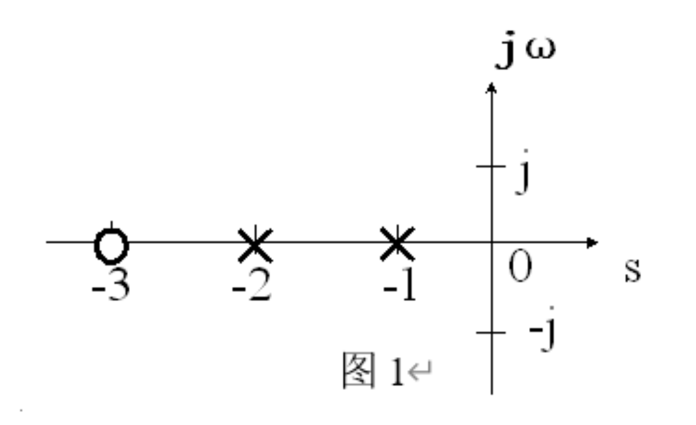
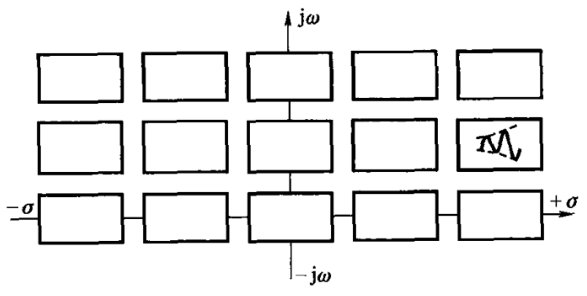
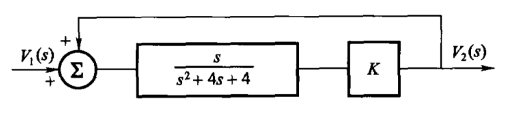

# 信号与系统 第4次作业题目（2023春）

## 题目

### 1

判断下列系统为线性/非线性、时变/时不变、因果/非因果系统

（1） $y(t)=f^{2}(t)$

（2） $y[n]=f[n]-2f[n-1]$

### 2

给定系统微分方程、起始状态以及激励信号分别为以下两种情况：

（1） $\dfrac{\mathrm{d}}{\mathrm{d}t}r(t)+2r(t)=e(t),\ r(0_{-})=0,\ e(t)=u(t)$

（2） $\dfrac{\mathrm{d}}{\mathrm{d}t}r(t)+2r(t)=3\dfrac{\mathrm{d}}{\mathrm{d}t}e(t),\ r(0_{-})=0,\ e(t)=u(t)$

判断在起始点是否发生跳变，写出 $r(0_{+})$ 的值。

### 3

给定系统微分方程

$$\frac{\mathrm{d}^{2}}{\mathrm{d}t^{2}}r(t)+3\frac{\mathrm{d}}{\mathrm{d}t}r(t)+2r(t)=\frac{\mathrm{d}}{\mathrm{d}t}e(t)+3e(t)$$

$$e(t)=u(t),\quad r(0_{-})=1,\quad r'(0_{-})=2$$

试求

（1）完全响应

（2）零输入响应

（3）零状态响应

（4）自由响应

（5）受迫响应

### 4

求拉普拉斯逆变换

（1） $\dfrac{3}{(s+4)(s+2)}$

（2） $\dfrac{3s}{(s+4)(s+2)}$

### 5

已知连续线性时不变时间系统零极图如图 1 所示（其中 O 表示零点，X 表示极点），且该系统的单位阶跃响应终值为 1，试求：

（1）系统函数 $H(s)$

（2）系统单位冲激响应 $h(t)$

### 6

当 $F(s)$ 极点（一阶）落在下图所示 s 平面图中各方框的所处位置时，画出对应 $f(t)$ 波形。图中给出了示例。

### 7

通过下图所示的反馈系统，回答：

（1）写出 $H(s)=\dfrac{V_{2}(s)}{V_{1}(s)}$

（2）求出 $K$ 在什么条件下系统才稳定

（3）在临界稳定条件下，求系统的冲激响应
