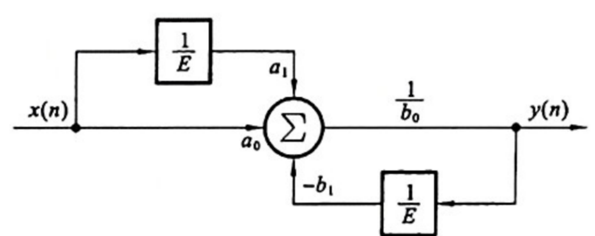
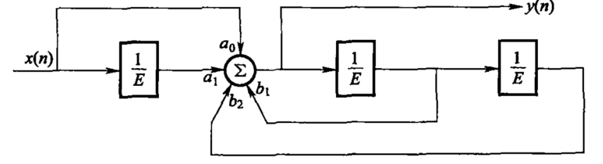

# 信号与系统 第5次作业答案（2023春）

## 题目与答案

### 1

#### 题目

判断下列各序列是否为周期序列，如果是，请确定其周期。

（1） $x[n]=A\cos\left(\dfrac{3\pi}{7}n-\dfrac{\pi}{8}\right)$

（2） $x[n]=e^{j\left(\frac{n}{8}-\pi\right)}$

#### 答案

**答案：**

（1）周期性的，周期为 14

（2）非周期性的。

### 2

#### 题目

解差分方程 $y[n]+2y[n-1]=n-2$，给定初值 $y[0]=1$

#### 答案

**答案：**

解：特征方程为 $\alpha+2=0$，求得特征根 $\alpha=-2$，于是齐次解

$$y_{h}(n)=C(-2)^{n}$$

令特解 $y_{p}(n)=D_{1}n+D_{2}$，将 $y_{p}(n)$ 代入原方程，有

$$D_{1}n+D_{2}+2D_{1}(n-1)+2D_{2}=n-2$$

平衡两边对应项系数得

$$D_{1}=\frac{1}{3},\qquad D_{2}=-\frac{4}{9}$$

则全解

$$y(n)=y_{h}(n)+y_{p}(n)=C(-2)^{n}+\frac{1}{3}n-\frac{4}{9}$$

将 $y(0)=1$ 代入上式，得 $C=\dfrac{13}{9}$，因而

$$y(n)=\frac{1}{9}\left[13(-2)^{n}+3n-4\right]$$

### 3

#### 题目

解差分方程 $y[n]+2y[n-1]+y[n-2]=3^{n}$，给定初值 $y[-1]=0,\ y[0]=0$

#### 答案

**答案：**

解：特征方程为 $\alpha^{2}+2\alpha+1=0$，求得特征根 $\alpha_{1}=\alpha_{2}=-1$，于是齐次解

$$y_{h}(n)=(C_{1}n+C_{2})(-1)^{n}$$

令特解 $y_{p}(n)=D_{1}3^{n}$，将 $y_{p}(n)$ 代入原方程，有

$$D_{1}\cdot 3^{n}+2D_{1}\cdot 3^{n-1}+D_{1}\cdot 3^{n-2}=3^{n}$$

平衡两边相应项系数得

$$D_{1}=\frac{9}{16}$$

则全解

$$y(n)=y_{h}(n)+y_{p}(n)=(C_{1}n+C_{2})(-1)^{n}+\frac{9}{16}\cdot 3^{n}$$

将 $y(-1)=0,\ y(0)=0$ 代入上式，得方程组

$$\begin{cases}-\left(-C_{1}+C_{2}\right)+\dfrac{9}{16}\times\dfrac{1}{3}=0\\[6pt] C_{2}+\dfrac{9}{16}=0\end{cases}$$

求得

$$C_{1}=-\frac{3}{4},\qquad C_{2}=-\frac{9}{16}$$

因而

$$y(n)=\left(-\frac{3}{4}n-\frac{9}{16}\right)(-1)^{n}+\frac{9}{16}3^{n}$$

### 4

#### 题目

某系统的输入输出关系可由二阶常系数线性差分方程描述。如果相应于输入为 $x[n]=u[n]$ 的响应为：

$$y[n]=\underbrace{\left[2^{n}+3\cdot 5^{n}\right]u[n]}_{\text{齐次解}}+\underbrace{10u[n]}_{\text{特解}}$$

1. 若系统起始为静止的，试决定此二阶差分方程。
2. 若激励为 $x[n]=2\left[u[n]-u[n-10]\right]$，求响应 $y[n]$。

#### 答案

**答案：**

解：（1）由于差分方程是二阶的，故其齐次方程有两个特征根，而输入 $x(n)=u(n)$，由此可判断得知该方程的齐次解和特解分别为

$$y_{h}(n)=\left[2^{n}+3\left(5^{n}\right)\right]u(n),\qquad y_{p}(n)=10u(n)$$

且两个特征根分别为 $\alpha_{1}=2$， $\alpha_{2}=5$。

由这两个特征根，不妨设此二阶差分方程为

$$y(n)-7y(n-1)+10y(n-2)=b_{0}x(n)+b_{1}x(n-1)+b_{2}x(n-2)\qquad ①$$

因为系统起始是静止的，这意味着

$$y(-1)=y(-2)=0$$

对方程式 ① 进行逐次迭代，将 $x(n)=u(n)$ 代入，令 $n=0,1,2$，可得

$$y(0)=7y(-1)-10y(-2)+b_{0}u(0)+b_{1}u(-1)+b_{2}u(-2)=b_{0}u(0)=b_{0}\times 1=b_{0}$$

$$y(1)=7y(0)+b_{0}u(1)+b_{1}u(0)=7b_{0}+b_{0}+b_{1}=8b_{0}+b_{1}$$

$$y(2)=7y(1)-10y(0)+b_{0}u(2)+b_{1}u(1)+b_{2}u(0)=7(8b_{0}+b_{1})-10b_{0}+b_{0}+b_{1}+b_{2}=47b_{0}+8b_{1}+b_{2}$$

而由题目所给的 $y(n)=\left[2^{n}+3\left(5^{n}\right)+10\right]u(n)$ 可求得

$$y(0)=14,\qquad y(1)=27,\qquad y(2)=89$$

于是有方程组

$$\begin{cases}b_{0}=14\\[4pt] 8b_{0}+b_{1}=27\\[4pt] 47b_{0}+8b_{1}+b_{2}=89\end{cases}$$

解得 $b_{0}=14$， $b_{1}=-85$， $b_{2}=111$。

故此二阶差分方程为

$$y(n)-7y(n-1)+10y(n-2)=14x(n)-85x(n-1)+111x(n-2)$$

（2）因为系统是起始静止的，且当 $x(n)=u(n)$ 时，

$$y(n)=\left[2^{n}+3\left(5^{n}\right)+10\right]u(n)$$

由线性时不变系统的线性及时不变特性可知，当 $x_{1}(n)=2u(n)$ 时，

$$y_{1}(n)=2\left[2^{n}+3\left(5^{n}\right)+10\right]u(n)$$

当 $x_{2}(n)=2u(n-10)$ 时，

$$y_{2}(n)=2\left[2^{n-10}+3\cdot\left(5^{n-10}\right)+10\right]u(n-10)$$

即当 $x(n)=2\left[u(n)-u(n-10)\right]$ 时，

$$y(n)=2\left\{\left[2^{n}+3\left(5^{n}\right)+10\right]u(n)-\left[2^{n-10}+3\cdot\left(5^{n-10}\right)+10\right]u(n-10)\right\}$$

### 5

#### 题目

一乒乓球从 $H$ 米高度自由下落至地面，每次弹跳起的最高值是前一次最高值的 2/3，设 $y[n]$ 为第 $n$ 次跳起的最高值，写出描述该过程的差分方程。当 $H=2\mathrm{m}$ 时，解该方程。

#### 答案

**答案：**

解：由题意写出差分方程 $y(n)=\dfrac{2}{3}y(n-1)$，边界条件 $y(0)=H$。由迭代法解出

$$y(n)=H\left(\frac{2}{3}\right)^{n}u(n)$$

当 $H=2$ 时， $y(n)=2\left(\dfrac{2}{3}\right)^{n}u(n)$。

### 6

#### 题目

根据下列图确立系统的差分方程，并指出阶次。

（1）

（2）

#### 答案

**答案：**

（1）由图可以写出如下方程：

$$b_{0}y(n)=a_{0}x(n)+a_{1}x(n-1)-b_{1}y(n-1)$$

整理可得该系统的差分方程

$$b_{0}y(n)+b_{1}y(n-1)=a_{0}x(n)+a_{1}x(n-1)$$

该方程是一阶的。

（2）由图可以写出如下方程：

$$y(n)=a_{0}x(n)+a_{1}x(n-1)+b_{1}y(n-1)+b_{2}y(n-2)$$

整理可得该系统的差分方程

$$y(n)-b_{1}y(n-1)-b_{2}y(n-2)=a_{0}x(n)+a_{1}x(n-1)$$

此方程为二阶的。
