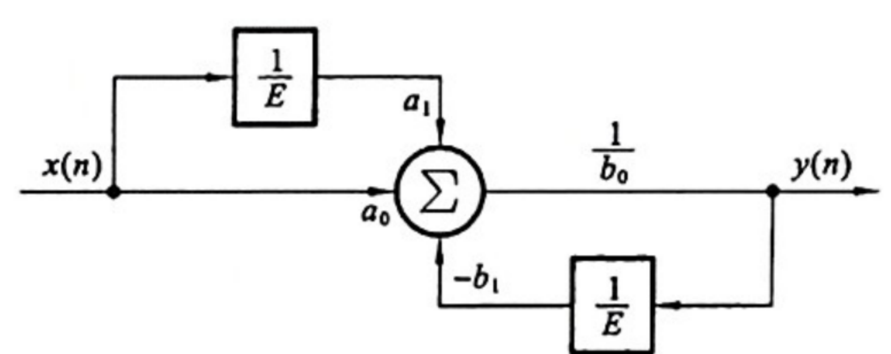
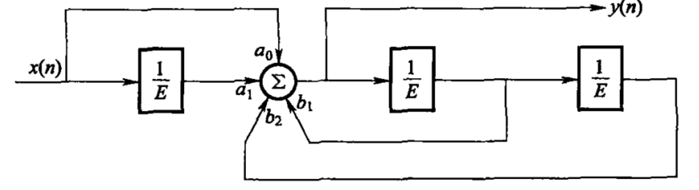

# 信号与系统 第5次作业题目（2023春）

## 题目

### 1

判断下列各序列是否为周期序列，如果是，请确定其周期。

（1） $x[n]=A\cos\left(\dfrac{3\pi}{7}n-\dfrac{\pi}{8}\right)$

（2） $x[n]=e^{j\left(\frac{n}{8}-\pi\right)}$

### 2

解差分方程 $y[n]+2y[n-1]=n-2$，给定初值 $y[0]=1$

### 3

解差分方程 $y[n]+2y[n-1]+y[n-2]=3^{n}$，给定初值 $y[-1]=0,\ y[0]=0$

### 4

某系统的输入输出关系可由二阶常系数线性差分方程描述。如果相应于输入为 $x[n]=u[n]$ 的响应为：

$$y[n]=\underbrace{\left[2^{n}+3\cdot 5^{n}\right]u[n]}_{\text{齐次解}}+\underbrace{10u[n]}_{\text{特解}}$$

1. 若系统起始为静止的，试决定此二阶差分方程。
2. 若激励为 $x[n]=2\left[u[n]-u[n-10]\right]$，求响应 $y[n]$。

### 5

一乒乓球从 $H$ 米高度自由下落至地面，每次弹跳起的最高值是前一次最高值的 2/3，设 $y[n]$ 为第 $n$ 次跳起的最高值，写出描述该过程的差分方程。当 $H=2\mathrm{m}$ 时，解该方程。

### 6

根据下列图确立系统的差分方程，并指出阶次。

（1）

（2）

