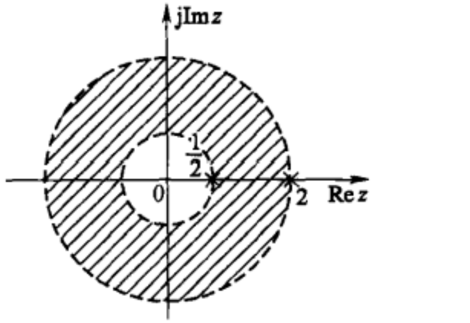

# 信号与系统 第6次作业答案（2023春）

## 题目与答案

### 1

#### 题目

求双边序列 $x(n)=\left(\dfrac{1}{2}\right)^{|n|}$ 的 $z$ 变换，并标明收敛域，绘制出零极点分布图。

#### 答案

**答案：** 根据定义，有

$$X(z)=\sum_{n=-\infty}^{\infty}\left(\frac{1}{2}\right)^{|n|}z^{-n}$$

$$=\sum_{n=-\infty}^{-1}\left(\frac{1}{2}\right)^{-n}z^{-n}+\sum_{n=0}^{\infty}\left(\frac{1}{2}\right)^{n}z^{-n}$$

$$=\sum_{m=1}^{\infty}\left(\frac{z}{2}\right)^{m}+\sum_{m=0}^{\infty}\left(\frac{1}{2z}\right)^{n}$$

$$=\frac{\dfrac{z}{2}}{1-\dfrac{z}{2}}+\frac{1}{1-\dfrac{1}{2z}}$$

$$=\frac{-3z}{(z-2)(2z-1)}\qquad\left(\frac{1}{2}<|z|<2\right)$$

$X(z)$ 的零极点如解图 8-2 所示。

### 2

#### 题目

求下列 $X(z)$ 的逆变换 $x(n)$

（1） $X(z)=\dfrac{1}{1+0.5z^{-1}}\quad(|z|>0.5)$

（2） $X(z)=\dfrac{1-0.5z^{-1}}{1-\dfrac{1}{4}z^{-2}}\quad(|z|>0.5)$

（3） $X(z)=\dfrac{z^{-1}}{\left(1-6z^{-1}\right)^{2}}\quad(|z|>6)$

#### 答案

**答案：**

（1）由 $a^{n}u(n)\leftrightarrow\dfrac{1}{1-az^{-1}}\ (|z|>|a|)$ 知

$$x(n)=(-0.5)^{n}u(n)$$

（2）由于

$$X(z)=\frac{1-\dfrac{1}{2}z^{-1}}{1-\dfrac{1}{4}z^{-2}}=\frac{1-\dfrac{1}{2}z^{-1}}{\left(1-\dfrac{1}{2}z^{-1}\right)\left(1+\dfrac{1}{2}z^{-1}\right)}$$

$$=\frac{1}{1+\dfrac{1}{2}z^{-1}}\qquad\left(|z|>\frac{1}{2}\right)$$

$$x(n)=\left(-\frac{1}{2}\right)^{n}u(n)$$

（3）注意到

$$X(z)=\frac{z^{-1}}{\left(1-6z^{-1}\right)^{2}}=\frac{z}{(z-6)^{2}}\qquad(|z|>6)$$

由变换对

$$\mathscr{Z}\left[6^{n}u(n)\right]=\frac{z}{z-6}\qquad(|z|>6)$$

然后利用 $z$ 域微分性质有

$$\mathscr{Z}\left[n6^{n}u(n)\right]=-z\frac{\mathrm{d}\left(\dfrac{z}{z-6}\right)}{\mathrm{d}z}=\frac{6z}{(z-6)^{2}}\qquad(|z|>6)$$

可知所求

$$x(n)=\frac{1}{6}n6^{n}u(n)=n6^{n-1}u(n)$$

### 3

#### 题目

已知因果序列的 $z$ 变换 $X(z)$，求序列的初值 $x(0)$ 与终值 $x(\infty)$

（1） $X(z)=\dfrac{1+z^{-1}+z^{-2}}{\left(1-z^{-1}\right)\left(1-2z^{-1}\right)}$

（2） $X(z)=\dfrac{1}{\left(1-0.5z^{-1}\right)\left(1+0.5z^{-1}\right)}$

#### 答案

**答案：**

（1）因 $X(z)$ 在 $p=2$ 有极点，所以终值不存在。而

$$x(0)=\lim_{z\to\infty}\frac{1+z^{-1}+z^{-2}}{\left(1-z^{-1}\right)\left(1-2z^{-1}\right)}=1$$

（2） $X(z)$ 极点 $p_{1,2}=\pm 0.5$，终值存在。

$$x(0)=\lim_{z\to\infty}\frac{1}{\left(1-0.5z^{-1}\right)\left(1+0.5z^{-1}\right)}=1$$

$$x(\infty)=\lim_{z\to 1}\frac{z-1}{\left(1-0.5z^{-1}\right)\left(1+0.5z^{-1}\right)}=0$$

### 4

#### 题目

对于下列差分方程所表示的离散系统：

$$y(n)+y(n-1)=x(n)$$

1. 求系统函数 $H(z)$ 以及单位样值响应 $h(n)$，并说明系统稳定性。
2. 若系统初始状态为 0，若 $x(n)=10u(n)$，求系统的响应。

#### 答案

**答案：**

（1）

$$Y(z)+z^{-1}Y(z)=X(z)$$

$$H(z)=\frac{Y(z)}{X(z)}=\frac{z}{z+1}$$

$$h(n)=(-1)^{n}u(n)$$

系统是临界稳定的。

（2）

$$X(z)=\frac{10z}{z-1}$$

$$Y(z)=H(z)\cdot X(z)=5\left(\frac{z}{z-1}+\frac{z}{z+1}\right)$$

$$y(n)=5\left(1+(-1)^{n}\right)u(n)$$

> $$Y(z)=\frac{X(z)}{1+3z^{-1}},\qquad H(z)=\frac{z}{z+3},\qquad h(n)=(-3)^{n}u(n)$$
>
> $$y(n)=\frac{1}{32}\left[-9\cdot(-3)^{n}+8n^{2}+20n+9\right]u(n)$$
