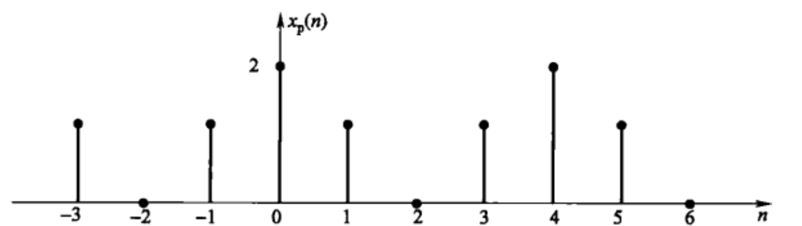
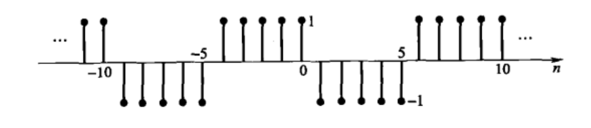

# 信号与系统 第7次作业答案（2023春）

## 题目与答案

### 1

#### 题目

如图所示，该序列为一周期为 $N=4$ 的周期序列 $x_{p}(n)$，求 $\mathrm{DFS}[x_{p}(n)]=X_{p}(k)$

#### 答案

**答案：** 根据 DFS 定义，有

$$X_{p}(k)=\sum_{n=0}^{N-1}x_{p}(n)e^{-j\frac{2\pi}{N}nk}=\sum_{n=0}^{3}x_{p}(n)e^{-j\frac{\pi}{2}nk}$$

$$=2+1\cdot e^{-j\frac{\pi}{2}k}+0+1\cdot e^{-j\frac{3\pi}{2}k}$$

$$=2+e^{-j\frac{\pi}{2}k}+e^{j\frac{\pi}{2}k}$$

$$=2\left[1+\cos\left(\frac{\pi}{2}k\right)\right]$$

### 2

#### 题目

周期序列 $x_{p}(n)$ 如图所示，判断下列命题是否正确，并简述理由。

1. $X_{p}(k)=X_{p}(k+10)$
2. $X_{p}(k)=X_{p}(-k)$
3. $X_{p}(0)=0$
4. $\forall k,\ X_{p}(k)e^{j\left(\frac{2\pi}{5}\right)k}\in\mathbb{R}$

#### 答案

**答案：**

解：（1）图示 $x_{p}(n)$ 序列的周期为 10，所以 $X_{p}(k)$ 的周期同样也为 10，故 $X_{p}(k)=X_{p}(k+10)$ 正确。

（2）假设 $X_{p}(k)=X_{p}(-k)$ 为真。根据题图 9-4， $x_{p}(n)$ 是实序列。按定义有

$$X_{p}^{*}(k)=\left[\sum_{n=0}^{N-1}x_{p}(n)e^{-j\frac{2\pi}{N}nk}\right]^{*}=\sum_{n=0}^{N-1}x_{p}^{*}(n)e^{j\frac{2\pi}{N}nk}$$

$$=\sum_{n=0}^{N-1}x_{p}(n)e^{-j\frac{2\pi}{N}n(-k)}=X_{p}(-k)$$

因而有 $X_{p}(k)=X_{p}^{*}(k)$，即 $X_{p}(k)$ 是实序列。下面考查

$$x_{p}^{*}(-n)=\left[\frac{1}{N}\sum_{k=0}^{N-1}X_{p}(k)e^{-j\frac{2\pi}{N}nk}\right]^{*}=\frac{1}{N}\sum_{k=0}^{N-1}X_{p}^{*}(k)e^{j\frac{2\pi}{N}nk}$$

$$=\frac{1}{N}\sum_{k=0}^{N-1}X_{p}(k)e^{j\frac{2\pi}{N}nk}=x_{p}(n)$$

即 $x_{p}(n)$ 是实偶序列。但由题图 9-4 显然 $x_{p}(n)$ 不满足偶对称性，所以 $X_{p}(k)\neq X_{p}(-k)$。

法二：令 $W=e^{-j\left(\frac{2\pi}{N}\right)}=e^{-j\frac{\pi}{5}}$，则

$$X_{p}(k)=\sum_{n=0}^{N-1}x_{p}(n)W^{kn}=1-W^{k}-W^{2k}-W^{3k}-W^{4k}-W^{5k}+W^{6k}+W^{7k}+W^{8k}+W^{9k}$$

由于 $W^{10k}=1$，上式

$$=-W^{k}-W^{2k}-W^{3k}-W^{4k}-W^{5k}+W^{6k}+W^{7k}+W^{8k}+W^{9k}+W^{10k}$$

$$=\left(W^{5k}-1\right)\left(W^{k}+W^{2k}+W^{3k}+W^{4k}+W^{5k}\right)$$

$$X_{p}(k)-X_{p}(-k)$$

$$=\left(W^{5k}-1\right)\left(W^{k}+W^{2k}+W^{3k}+W^{4k}+W^{5k}-W^{-k}-W^{-2k}-W^{-3k}-W^{-4k}-W^{-5k}\right)$$

$$=\left(W^{5k}-1\right)\left(W^{k}+W^{2k}+W^{3k}+W^{4k}+W^{5k}-W^{5k}-W^{6k}-W^{7k}-W^{8k}-W^{9k}\right)$$

$$=-\left(W^{5k}-1\right)^{2}\left(W^{k}+W^{2k}+W^{3k}+W^{4k}\right)=-\left(W^{5k}-1\right)^{2}\frac{W^{k}-W^{5k}}{1-W^{k}}\neq 0$$

命题错误。

（3）根据定义，有

$$X_{p}(0)=\sum_{n=0}^{N-1}x_{p}(n)e^{-j\frac{2\pi}{N}n\cdot 0}=\sum_{n=0}^{N-1}x_{p}(n)=0$$

（4）令 $W=e^{-j\left(\frac{2\pi}{N}\right)}=e^{-j\frac{\pi}{5}}$，则

$$X_{p}(k)e^{j\left(\frac{2\pi}{5}\right)k}=\sum_{n=0}^{N-1}x_{p}(n)W^{kn}e^{j\left(\frac{2\pi}{5}\right)k}=\sum_{n=0}^{N-1}x_{p}(n)W^{k(n-2)}$$

$$=W^{-2k}-W^{-1k}-W^{0k}-W^{1k}-W^{2k}-W^{3k}+W^{4k}+W^{5k}+W^{6k}+W^{7k}$$

由于 $W^{10k}=1$，上式

$$=W^{4k}+W^{5k}+W^{6k}+W^{7k}+W^{8k}-W^{-1k}-W^{0k}-W^{1k}-W^{2k}-W^{3k}$$

$$=\left(W^{5k}-1\right)\left(W^{-k}+1+W^{k}+W^{2k}+W^{3k}\right)$$

$k$ 为奇数时 $W^{5k}-1=-2$， $W^{-k}+1+W^{k}\in\mathbb{R}$，考虑 $W^{2k}+W^{3k}$ 即可

$$W^{2k}+W^{3k}\in\mathbb{R}\iff\sin\left(-\frac{2k\pi}{5}\right)+\sin\left(-\frac{3k\pi}{5}\right)=0\iff k\text{ 是 }5\text{ 的整数倍}$$

命题错误。
