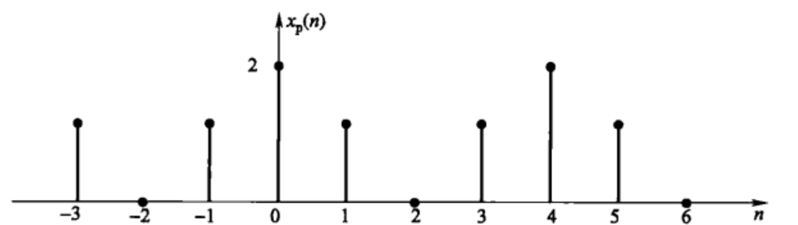
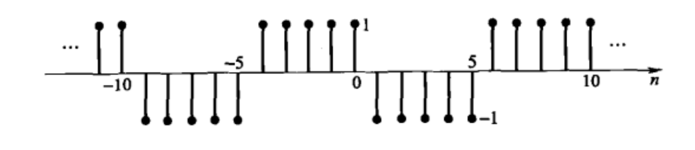

# 信号与系统 第7次作业题目（2023春）

## 题目

### 1

如图所示，该序列为一周期为 $N=4$ 的周期序列 $x_{p}(n)$，求 $\mathrm{DFS}[x_{p}(n)]=X_{p}(k)$

### 2

周期序列 $x_{p}(n)$ 如图所示，判断下列命题是否正确，并简述理由。

1. $X_{p}(k)=X_{p}(k+10)$
2. $X_{p}(k)=X_{p}(-k)$
3. $X_{p}(0)=0$
4. $\forall k,\ X_{p}(k)e^{j\left(\frac{2\pi}{5}\right)k}\in\mathbb{R}$

