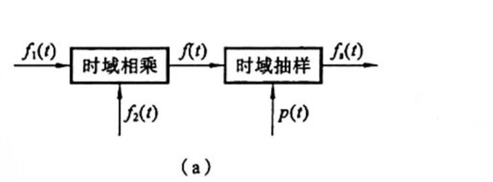
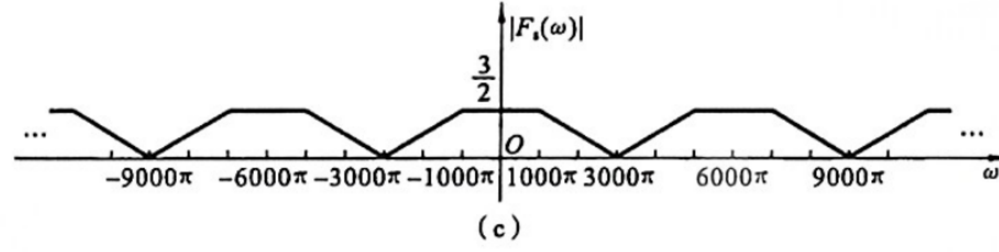

# 信号与系统 第8次作业答案（2023春）

## 题目与答案

### 1

#### 题目

信号 $x(t)$ 的 Nyquist 抽样频率为 $\omega_{1}$，则信号 $x(t)x(2t+1)\cos\omega_{2}t$ 的 Nyquist 抽样频率为 ______

#### 答案

**答案：** $x(t)$ 的 Nyquist 抽样频率为 $\omega_{1}$，所以 $x(t)$ 最高频率 $\dfrac{\omega_{1}}{2}$， $x(2t+1)$ 最高频率 $\omega_{1}$， $\cos\omega_{2}t$ 频率 $\omega_{2}$，则 $x(t)\cdot x(2t+1)\cdot\cos\omega_{2}t$ 对应最高频率：

$$\omega_{\mathrm{m}}=\frac{\omega_{1}}{2}+\omega_{1}+\omega_{2}=\omega_{2}+\frac{3}{2}\omega_{1}$$

其奈奎斯特采样频率：

$$\omega_{s}=2\omega_{\mathrm{m}}=2\omega_{2}+3\omega_{1}$$

### 2

#### 题目

若信号 $f(t)$ 的奈奎斯特采样频率为 $f_{s}$，则信号 $g(t)=f(t)f\left(\dfrac{t}{2}\right)$ 的奈奎斯特采样频率为 ______

#### 答案

**答案：** $f(t)$ 的奈奎斯特采样频率为 $f_{s}$，则 $f(t)$ 的最高频率为 $f_{\mathrm{m}}=0.5f_{s}$。又因为 $f\left(\dfrac{t}{2}\right)$ 的最高频率为 $\dfrac{1}{2}f_{\mathrm{m}}=0.25f_{s}$，则由卷积定理和傅里叶变换性质， $g(t)=f(t)f\left(\dfrac{t}{2}\right)$ 的频谱为：

$$G(\omega)=\frac{1}{2\pi}F(\omega)*2F(2\omega)$$

其最高频率为 $0.5f_{s}+0.25f_{s}=0.75f_{s}$，则其奈奎斯特采样频率为 $2\times 0.75f_{s}=1.5f_{s}$。

### 3

#### 题目

对连续时间信号 $x(t)=\cos(2\pi f_{a}t)$，按采样频率 $f_{s}=8f_{a}$ 采样得到的离散时间信号 $x[n]$ ______

#### 答案

**答案：**

$$x(n)=f(nT)=\cos(n\Omega_{0}T),\quad \omega_{0}=\Omega_{0}T=\frac{\Omega_{0}}{f_{s}}=\frac{2\pi f_{a}}{8f_{a}}=\frac{\pi}{4}$$

其中， $\omega_{0}$ 为离散域的频率， $\Omega_{0}$ 为连续域的频率， $x(n)=\cos(n\omega_{0})=\cos\left(\dfrac{\pi}{4}n\right)$。

### 4

#### 题目

确定下列信号的最低抽样率和奈奎斯特间隔

（1） $\mathrm{Sa}(100t)$

（2） $\mathrm{Sa}^{2}(100t)$

（3） $\mathrm{Sa}(100t)+\mathrm{Sa}(50t)$

（4） $\mathrm{Sa}(100t)+\mathrm{Sa}^{2}(60t)$

#### 答案

**答案：**

解：（1）由于

$$\mathscr{F}\{\mathrm{Sa}(100t)\}=\frac{\pi}{100}\left[u(\omega+100)-u(\omega-100)\right]$$

即信号的最大角频率 $\omega_{\mathrm{m}}=100\ \mathrm{rad/s}$，故

最低抽样率 $f_{\min}=\dfrac{100}{\pi}\ \mathrm{Hz}$

奈奎斯特间隔 $T_{\mathrm{N}}=\dfrac{\pi}{100}\ \mathrm{s}$

（2）由于

$$\mathscr{F}\left\{\mathrm{Sa}^{2}(100t)\right\}=\frac{\pi}{100}\left(1-\frac{|\omega|}{200}\right),\ |\omega|<200$$

即信号的最大角频率 $\omega_{\mathrm{m}}=200\ \mathrm{rad/s}$，故

最低抽样率 $f_{\min}=\dfrac{200}{\pi}\ \mathrm{Hz}$

奈奎斯特间隔 $T_{\mathrm{N}}=\dfrac{\pi}{200}\ \mathrm{s}$

（3）因为 $\mathrm{Sa}(100t)$ 的最大角频率为 $100\ \mathrm{rad/s}$， $\mathrm{Sa}(50t)$ 的最大角频率为 $50\ \mathrm{rad/s}$，故 $\mathrm{Sa}(100t)+\mathrm{Sa}(50t)$ 的 $\omega_{\mathrm{m}}=100\ \mathrm{rad/s}$，所以其

最低抽样率 $f_{\min}=\dfrac{100}{\pi}\ \mathrm{Hz}$

奈奎斯特间隔 $T_{\mathrm{N}}=\dfrac{\pi}{100}\ \mathrm{s}$

（4）因为 $\mathrm{Sa}(100t)$ 的最大角频率为 $100\ \mathrm{rad/s}$， $\mathrm{Sa}^{2}(60t)$ 的最大角频率为 $120\ \mathrm{rad/s}$，故 $\mathrm{Sa}(100t)+\mathrm{Sa}^{2}(60t)$ 的 $\omega_{\mathrm{m}}=120\ \mathrm{rad/s}$，所以其

最低抽样率 $f_{\min}=\dfrac{120}{\pi}\ \mathrm{Hz}$

奈奎斯特间隔 $T_{\mathrm{N}}=\dfrac{\pi}{120}\ \mathrm{s}$

### 5

#### 题目

如果对一最高频率为 $400\mathrm{Hz}$ 的带限信号 $f(t)$ 进行抽样，并使抽样信号通过一个理想低通滤波器后能够完全恢复出 $f(t)$，问：（1）抽样间隔 $T$ 应满足的条件是什么？（2）如果以 $T=1\mathrm{ms}$ 抽样，理想低通滤波器的截止频率 $f_{c}$ 应满足的条件是什么？

#### 答案

**答案：**

解：（1）由题意， $f(t)$ 的最高频率 $f_{\mathrm{m}}=400\mathrm{Hz}$，则那奎斯特抽样间隔为：

$$T_{s}=\frac{1}{2f_{\mathrm{m}}}=\frac{1}{2\times 400}=1.25\mathrm{ms}$$

所以，抽样间隔 $T$ 应满足： $T\le T_{s}=1.25\mathrm{ms}$

可见，此时抽样不会发生频谱混叠。

（2）已知抽样间隔 $T=1\mathrm{ms}$，则抽样频率 $f_{s}$ 为： $f_{s}=\dfrac{1}{T}=1\mathrm{kHz}$。

由抽样定理可知， $f_{c}$ 应满足 $f_{\mathrm{m}}<f_{c}<f_{s}-f_{\mathrm{m}}$，即：

$$400\mathrm{Hz}<f_{c}<(1000-400)\mathrm{Hz}=600\mathrm{Hz}$$

### 6

#### 题目

什么叫信号的「抽样」？根据抽样脉冲序列的不同，抽样分为哪两种形式？

#### 答案

**答案：** 信号的抽样就是利用抽样脉冲序列 $P(t)$ 从连续信号 $f(t)$ 取一系列的离值，这种离散信号通常称为抽样信号。根据抽样脉冲序列信号的不同可以分为矩形脉冲抽样，冲击抽样。

### 7

#### 题目

已知信号 $f(t)$ 的最高角频率为 $\omega_{\mathrm{m}}$，当对 $y_{1}(t)=f\left(\dfrac{t}{2}\right)+f\left(\dfrac{t}{4}\right)$ 取样时，求其频谱不混叠的最大取样间隔 $T_{1}$；当对 $y_{2}(t)=f\left(\dfrac{t}{2}\right)\cdot f\left(\dfrac{t}{4}\right)$ 取样时，求其频谱不混叠的最大取样间隔 $T_{2}$

#### 答案

**答案：**

解：设 $f(t)\leftrightarrow F(\omega)$，根据尺度变换性质，有 $f\left(\dfrac{t}{2}\right)\leftrightarrow 2F(2\omega)$， $f\left(\dfrac{t}{4}\right)\leftrightarrow 4F(4\omega)$，则：

$$y_{1}(t)=f\left(\frac{t}{2}\right)+f\left(\frac{t}{4}\right)\leftrightarrow F_{1}(\omega)=2F(2\omega)+4F(4\omega)$$

因此有： $\omega_{\max 1}=4\omega_{\mathrm{m}}\Rightarrow\omega_{\mathrm{s}1}=2\omega_{\max 1}\Rightarrow T_{1}=\dfrac{2\pi}{2\times 4\omega_{\mathrm{m}}}=\dfrac{\pi}{4\omega_{\mathrm{m}}}$

同理，根据尺度变换性质和卷积定理，可得：

$$y_{2}(t)=f\left(\frac{t}{2}\right)\cdot f\left(\frac{t}{4}\right)\leftrightarrow F_{2}(\omega)=\frac{1}{2\pi}\left[2F(2\omega)\right]*\left[4F(4\omega)\right]$$

因此有： $\omega_{\max 2}=6\omega_{\mathrm{m}}\Rightarrow\omega_{\mathrm{s}2}=2\omega_{\max 2}\Rightarrow T_{2}=\dfrac{2\pi}{2\times 6\omega_{\mathrm{m}}}=\dfrac{\pi}{6\omega_{\mathrm{m}}}$

> $$\omega_{\max 1}=\max\left(\frac{\omega_{\mathrm{m}}}{2},\ \frac{\omega_{\mathrm{m}}}{4}\right)=\frac{\omega_{\mathrm{m}}}{2},\qquad T_{1}=\frac{2\pi}{2\omega_{\max 1}}=\frac{2\pi}{\omega_{\mathrm{m}}}$$
>
> $$\omega_{\max 2}=\frac{\omega_{\mathrm{m}}}{2}+\frac{\omega_{\mathrm{m}}}{4}=\frac{3\omega_{\mathrm{m}}}{4},\qquad T_{2}=\frac{2\pi}{2\omega_{\max 2}}=\frac{4\pi}{3\omega_{\mathrm{m}}}$$

### 8

#### 题目

3-41 系统如题图 3-41(a) 所示， $f_{1}(t)=\mathrm{Sa}(1000\pi t)$， $f_{2}(t)=\mathrm{Sa}(2000\pi t)$， $p(t)=\displaystyle\sum_{n=-\infty}^{\infty}\delta(t-nT)$， $f(t)=f_{1}(t)f_{2}(t)$， $f_{s}(t)=f(t)p(t)$。

（1）为从 $f_{s}(t)$ 无失真恢复 $f(t)$，求最大抽样间隔 $T_{\max}$；

（2）当 $T=T_{\max}$ 时，画出 $f_{s}(t)$ 的幅度谱 $\left|F_{s}(\omega)\right|$。

#### 答案

**答案：**

解：（1）易知

$$\mathscr{F}\{\mathrm{Sa}(1000\pi t)\}=F_{1}(\omega)=10^{-3}\left[u(\omega+1000\pi)-u(\omega-1000\pi)\right]$$

$$\mathscr{F}\{\mathrm{Sa}(2000\pi t)\}=F_{2}(\omega)=0.5\times 10^{-3}\left[u(\omega+2000\pi)-u(\omega-2000\pi)\right]$$

由于 $f(t)=f_{1}(t)f_{2}(t)$

故

$$F(\omega)=\frac{1}{2\pi}F_{1}(\omega)*F_{2}(\omega)$$

$$=\frac{1}{4\pi}\times 10^{-6}\left\{(\omega+3000\pi)u(\omega+3000\pi)-(\omega-1000\pi)u(\omega-1000\pi)-(\omega+1000\pi)u(\omega+1000\pi)+(\omega-3000\pi)u(\omega-3000\pi)\right\}$$

$$=\frac{1}{4\pi}\times 10^{-6}\left\{(\omega+3000\pi)\left[u(\omega+3000\pi)-u(\omega+1000\pi)\right]+2000\pi\left[u(\omega+1000\pi)-u(\omega-1000\pi)\right]+(-\omega+3000\pi)\left[u(\omega-1000\pi)-u(\omega-3000\pi)\right]\right\}$$

$F(\omega)$ 的图形如题图 3-41(b) 所示。可见， $F(\omega)$ 的最大角频率

$$\omega_{\mathrm{m}}=3000\pi\ \mathrm{rad/s}$$

因而

$$T_{\max}=\frac{2\pi}{2\omega_{\mathrm{m}}}=\frac{1}{3000}\mathrm{s}$$

（2）对于冲激抽样，抽样信号的频谱

$$F_{s}(\omega)=\frac{1}{T_{s}}\sum_{n=-\infty}^{\infty}F(\omega-n\omega_{s})$$

当 $T_{s}=T_{\max}$ 时，此时

$$\omega_{s}=\frac{2\pi}{T_{\max}}=2\omega_{\mathrm{m}}=6000\pi\ \mathrm{rad/s}$$

此时的幅度谱 $\left|F_{s}(\omega)\right|$ 如题图 3-41(c) 所示，无混叠发生。

