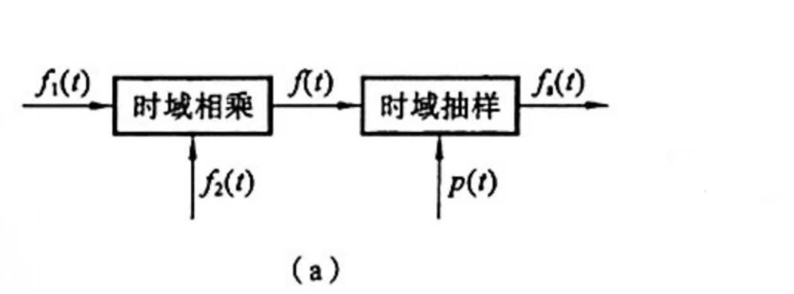

# 信号与系统 第8次作业题目（2023春）

## 题目

### 1

信号 $x(t)$ 的 Nyquist 抽样频率为 $\omega_{1}$，则信号 $x(t)x(2t+1)\cos\omega_{2}t$ 的 Nyquist 抽样频率为 ______

### 2

若信号 $f(t)$ 的奈奎斯特采样频率为 $f_{s}$，则信号 $g(t)=f(t)f\left(\dfrac{t}{2}\right)$ 的奈奎斯特采样频率为 ______

### 3

对连续时间信号 $x(t)=\cos(2\pi f_{a}t)$，按采样频率 $f_{s}=8f_{a}$ 采样得到的离散时间信号 $x[n]$ ______

### 4

确定下列信号的最低抽样率和奈奎斯特间隔

（1） $\mathrm{Sa}(100t)$

（2） $\mathrm{Sa}^{2}(100t)$

（3） $\mathrm{Sa}(100t)+\mathrm{Sa}(50t)$

（4） $\mathrm{Sa}(100t)+\mathrm{Sa}^{2}(60t)$

### 5

如果对一最高频率为 $400\mathrm{Hz}$ 的带限信号 $f(t)$ 进行抽样，并使抽样信号通过一个理想低通滤波器后能够完全恢复出 $f(t)$，问：（1）抽样间隔 $T$ 应满足的条件是什么？（2）如果以 $T=1\mathrm{ms}$ 抽样，理想低通滤波器的截止频率 $f_{c}$ 应满足的条件是什么？

### 6

什么叫信号的「抽样」？根据抽样脉冲序列的不同，抽样分为哪两种形式？

### 7

已知信号 $f(t)$ 的最高角频率为 $\omega_{\mathrm{m}}$，当对 $y_{1}(t)=f\left(\dfrac{t}{2}\right)+f\left(\dfrac{t}{4}\right)$ 取样时，求其频谱不混叠的最大取样间隔 $T_{1}$；当对 $y_{2}(t)=f\left(\dfrac{t}{2}\right)\cdot f\left(\dfrac{t}{4}\right)$ 取样时，求其频谱不混叠的最大取样间隔 $T_{2}$

### 8

3-41 系统如题图 3-41(a) 所示， $f_{1}(t)=\mathrm{Sa}(1000\pi t)$， $f_{2}(t)=\mathrm{Sa}(2000\pi t)$， $p(t)=\displaystyle\sum_{n=-\infty}^{\infty}\delta(t-nT)$， $f(t)=f_{1}(t)f_{2}(t)$， $f_{s}(t)=f(t)p(t)$。

（1）为从 $f_{s}(t)$ 无失真恢复 $f(t)$，求最大抽样间隔 $T_{\max}$；

（2）当 $T=T_{\max}$ 时，画出 $f_{s}(t)$ 的幅度谱 $\left|F_{s}(\omega)\right|$。
