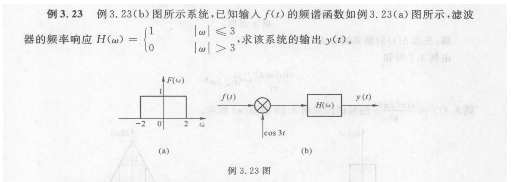
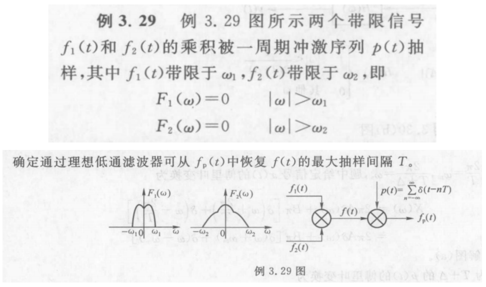

# 信号与系统 第9次作业题目（2023春）

## 题目

### 1

已知一个连续时间理想低通滤波器为 $h(t)=\dfrac{\sin 5\pi(t-4)}{\pi(t-4)}$；当 $x(t)=\sin\pi t$ 时，输出为 $y(t)=$ ______

### 2

已知一连续线性时不变系统，其单位冲激响应为

$$h(t)=\frac{1}{4}\left[\mathrm{Sa}\left(\pi t+\frac{\pi}{2}\right)+2\mathrm{Sa}\left(\pi t-\frac{\pi}{2}\right)+\mathrm{Sa}\left(\pi t-\frac{3\pi}{2}\right)\right]$$

其中函数 $\mathrm{Sa}(t)=\dfrac{\sin t}{t}$。试求：

（1）该系统的频率响应 $H(\mathrm{j}\omega)$，并画出它的频谱图；

（2）该系统是何种类型（低通、带通、高通、全通、线性相位等）滤波器？

（3）当系统的输入信号为

$$f(t)=\frac{\sin(\pi t/2)}{\pi t}\cos(2\pi t)+\sum_{n=0}^{\infty}2^{-n}\cos\frac{1}{4}n\left(\frac{\pi t}{2}+\frac{\pi}{4}\right)$$

时，求系统的输出 $y(t)$。

### 3

例 3.23：例 3.23(b) 图所示系统，已知输入 $f(t)$ 的频谱函数如例 3.23(a) 图所示，滤波器的频率响应

$$H(\omega)=\begin{cases}1 & |\omega|\le 3\\[4pt] 0 & |\omega|>3\end{cases}$$

求该系统的输出 $y(t)$。

### 4

例 3.29：例 3.29 图所示两个带限信号 $f_{1}(t)$ 和 $f_{2}(t)$ 的乘积被一周期冲激序列 $p(t)$ 抽样，其中 $f_{1}(t)$ 带限于 $\omega_{1}$， $f_{2}(t)$ 带限于 $\omega_{2}$，即

$$F_{1}(\omega)=0\qquad |\omega|>\omega_{1}$$

$$F_{2}(\omega)=0\qquad |\omega|>\omega_{2}$$

确定通过理想低通滤波器可从 $f_{\mathrm{p}}(t)$ 中恢复 $f(t)$ 的最大抽样间隔 $T$。

### 5

具有频率响应为

$$H(\mathrm{j}\omega)=\begin{cases}\neq 0 & |\omega|\le\omega_{\mathrm{m}}\\[4pt] =0 & \text{其他}\end{cases}$$

的低通滤波器，能否用硬件实现？试评理由。

### 6

试利用 Butterworth 滤波器，设计一个满足下列条件的模拟低通滤波器。

$$\begin{cases}0.8\ge\left|H(\mathrm{j}\omega)\right|\ge 1 & 0\ge\omega\ge 5\ \mathrm{rad/s}\\[6pt] \left|H(\mathrm{j}\omega)\right|\ge 0.1 & \omega\ge 10\ \mathrm{rad/s}\end{cases}$$

### 7

已知一模拟低通滤波器的技术指标为

$$f_{\mathrm{p}}=2.1\ \mathrm{kHz},\quad f_{\mathrm{s}}=8\ \mathrm{kHz},\quad A_{\mathrm{p}}=0.5\ \mathrm{dB},\quad A_{\mathrm{s}}=30\ \mathrm{dB}$$

试分别确定用 Butterworth 滤波器和 CB I 型滤波器实现该指标所需的阶数。

### 8

试用切比雪夫 I 型滤波器重做 Q6
