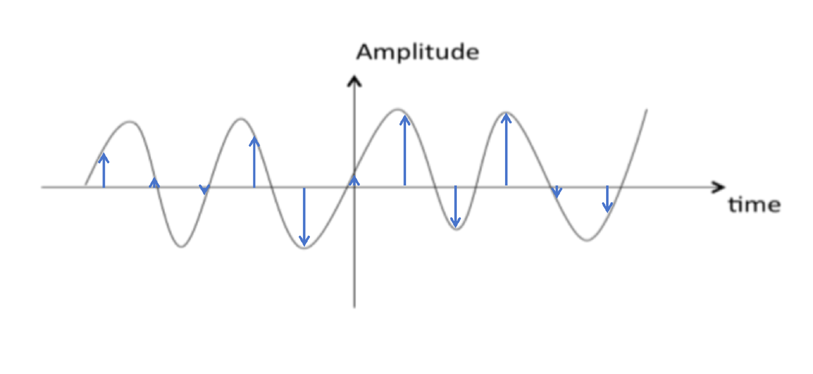
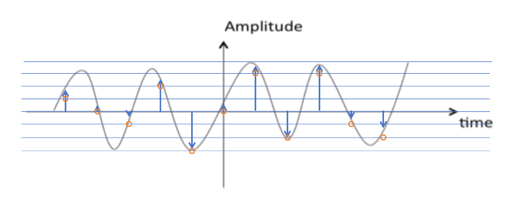
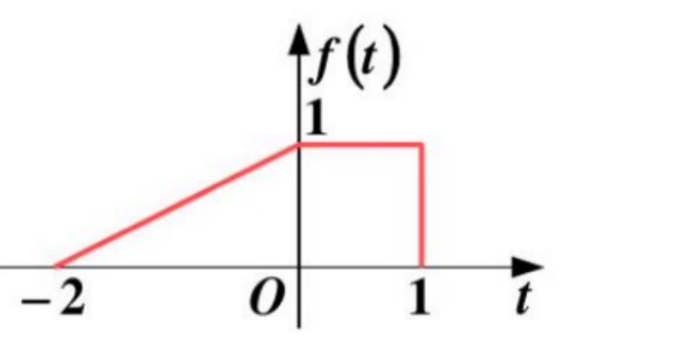

# 信号与系统 第1次作业答案（2024春）

## 题目与答案

### 1

#### 题目

请证明：

(1) $\displaystyle\int_{-\infty}^{\infty}f(t)\delta(at+b)\,\mathrm{d}t=\int_{-\infty}^{\infty}\frac{f(t)}{|a|}\delta\left(t+\frac{b}{a}\right)\mathrm{d}t,\quad a\neq 0$

(2) $\displaystyle\int_{-\infty}^{\infty}f(t)\delta'(t)\,\mathrm{d}t=-f'(0)$

#### 答案

**答案：**

(1) 左式：

$$\int_{-\infty}^{\infty}f(t)\delta(at+b)\,\mathrm{d}t=\int_{-\infty}^{\infty}\frac{1}{a}f\left(-\frac{b}{a}\right)\delta(at+b)\,\mathrm{d}(at+b)=f\left(-\frac{b}{a}\right)\int_{-\infty}^{\infty}\frac{1}{|a|}\delta(x)\,\mathrm{d}x=\frac{1}{|a|}f\left(-\frac{b}{a}\right)$$

右式：

$$\int_{-\infty}^{\infty}\frac{f(t)}{|a|}\delta\left(t+\frac{b}{a}\right)\mathrm{d}t=\int_{-\infty}^{\infty}\frac{f\left(-\frac{b}{a}\right)}{|a|}\delta\left(t+\frac{b}{a}\right)\mathrm{d}t=\frac{1}{|a|}f\left(-\frac{b}{a}\right)\int_{-\infty}^{\infty}\delta\left(t+\frac{b}{a}\right)\mathrm{d}\left(t+\frac{b}{a}\right)=\frac{1}{|a|}f\left(-\frac{b}{a}\right)$$

两边相等，得证。

(2)

$$\int_{-\infty}^{\infty}f(t)\delta'(t)\,\mathrm{d}t=\left.f(t)\delta(t)\right|_{-\infty}^{\infty}-\int_{-\infty}^{\infty}f'(t)\delta(t)\,\mathrm{d}t=-f'(0)$$

本题考察单位冲激信号的性质。目前为止，有且仅有第一个课件的 P35 页中右侧的两个公式表示了冲激信号，其性质也完全基于这两个公式推导而来。单位冲激信号具有尺缩性质和偶性质，课件并没有明确写出，此题便是推导过程。

### 2

#### 题目

判断下列信号是否为周期信号，若是，则给出周期：

(1) $\sin^{2}t$

(2) $e^{j2t}$

(3) $\cos(t)+\cos(\pi t)$

#### 答案

**答案：**

(1) $\sin^{2}t=\frac{1-\cos 2t}{2}$，周期为 $\pi$。

(2) 需要注意复数的定义，周期为 $\pi$。

(3) 两个无理周期相加，有很大概率是非周期信号。此处可以详细证明非周期性。

这里说「很大概率」非周期，是因为确实存在构造使得两个非周期信号之和为周期信号。

### 3

#### 题目

判断正误：

(1) $x[n]=\cos(n)$ 是数字信号

(2) 周期信号之和也是周期信号

(3) 非周期信号之和也是非周期信号

(4) 能量信号都是非周期信号（不考虑 0）

#### 答案

**答案：**

(1) 错误，幅值没有离散化。

(2) 错误，请见 2.3。

(3) 错误，找一个周期信号中间分一下，左右两侧信号都不是周期的，但是组合起来就是周期的了。

(4) 正确。

第四问证明如下：假设存在一个周期的非零能量信号，根据能量信号定义，下式应当有界：

$$\lim_{T\to\infty}\int_{-T}^{T}f^{2}(t)\,\mathrm{d}t$$

由于其为周期信号，我们可以将积分分成多个周期的累加。假设周期为 $T_{0}$，令 $T=nT_{0}$，则上式化为：

$$\lim_{T\to\infty}\int_{-T}^{T}f^{2}(t)\,\mathrm{d}t=\lim_{T\to\infty}\int_{-nT_{0}}^{nT_{0}}f^{2}(t)\,\mathrm{d}t=\lim_{n\to\infty}2n\int_{0}^{T_{0}}f^{2}(t)\,\mathrm{d}t$$

根据假设， $\displaystyle\int_{0}^{T_{0}}f^{2}(t)\,\mathrm{d}t>0$，所以极限无界，矛盾。

本次作业中注意到有许多同学对「离散化」这个概念不太清晰。此处的幅值离散化更接近「数字化」，要求所有取值隶属一个有限集（finite set），即信号所有的幅值构成的集合是有限的。为更好理解这个概念，引入离散信号的概念：离散信号（discrete signal）指时间离散、幅值连续的信号。现实中数字电路对模拟信号一般有以下处理：采样是对连续信号按照一定时间间隔采样，此时得到的信号是离散信号（但不一定是数字信号），对应时间离散化；量化是对上述采样出来的结果经过一定元件，得到对应的近似值的二进制编码，得到数字信号，对应幅值离散化。

对应到图像上，采样：

量化（假设采用向下取整）：

只经过采样的信号在时间有限的情况下依旧可以保持数字化，但随时间继续延续，假设保持任意波动，有充分可能取值集合慢慢变成无穷集。回到这道题里，在 $t$ 可以随便取的情况下，我们会发现由于其周期和间隔比是无理数，也就代表在无限时间后，其取值集合将持续增加元素，不满足有限集定义，也就是上面答案非常简单的一句「幅值未离散化」。

进一步辨析这三个概念的由来：

- **连续信号（Analog Signal）**：即模拟信号。现实中的信号大多连续，早期的信号处理装备也都是基于连续信号的。
- **离散信号（Discrete Signal）**：连续信号大多时候不能显式表达；为了描述其性质，经过一定采样后得到的离散点值可以更方便地描述信号，便于后续设计。
- **数字信号（Digital Signal）**：在计算机时代，幅值需要能够存储进计算机，但计算机只支持二进制编码，总共能表达的数字是有限的，这要求幅值也必须离散化到有限个值。

因此一般常见的离散化都是使用整数作为离散标记，便于直接转换为二进制编码；但只要取值总数是有限的，无论是有理数还是无理数都满足上述定义，只是编码形式不同。所以上面「采样」对应的图若只有有限个采样点，该采样后的信号也可称为数字信号。

### 4

#### 题目

$f(t)$ 波形如下，用两种不同的运算顺序求 $f(-3t+9)$，并绘制波形。

> 提示：先缩放再平移 或 先平移再缩放

#### 答案

**答案：**

略。

### 5

#### 题目

计算：

(1) $\displaystyle\int_{-\infty}^{\infty}f(t_{0}-t)\delta(t)\,\mathrm{d}t$

(2) $\displaystyle\int_{-\infty}^{\infty}(e^{t}-\cos(\pi t))\delta(t+1)\,\mathrm{d}t$

(3) $(\sin t)\delta(t)$

(4) $\displaystyle\int_{-\infty}^{\infty}u(t-1)\delta(t-3)\,\mathrm{d}t$

#### 答案

**答案：**

全部都是冲激函数性质应用。

(1) $f(t_{0})$

(2) $e^{-1}+1$

(3) $0,\ t\in(-\infty,\infty)$

(4) $1$

注意冲激函数是偶函数。

### 6

#### 题目

判断正误，并给出过程：

(1) 函数集 $\{1,x^{1},x^{2},\dots\}$ 是否为区间 $(0,2)$ 上的正交函数集

(2) $\cos t,\cos(2t),\dots,\cos(nt),\ n\in N^{*}$ 是否为区间 $(0,2\pi)$ 上的正交函数集

(3) $\cos t,\cos(2t),\dots,\cos(nt),\ n\in N^{*}$ 是否为区间 $\left(0,\frac{\pi}{2}\right)$ 上的正交函数集

#### 答案

**答案：**

(1) 不是。随便选俩，没一组正交的。

(2) 是正交函数集。

$$\int_{0}^{2\pi}\cos(mt)\cos(nt)\,\mathrm{d}t=\int_{0}^{2\pi}\frac{1}{2}(\cos((m+n)t)+\cos(m-n)t)\,\mathrm{d}t=0,\ m\neq n$$

$$\int_{0}^{2\pi}\cos^{2}(mt)\,\mathrm{d}t=\int_{0}^{2\pi}\frac{1+\cos 2mt}{2}\,\mathrm{d}t=\pi\neq 0$$

请注意正交函数集必须有任意函数的平方在区间上积分非 0。

(3) 不是。使用反证法：

$$\int_{0}^{\frac{\pi}{2}}\cos t\cos 2t\,\mathrm{d}t=\int_{0}^{\frac{\pi}{2}}\frac{\cos 3t+\cos t}{2}\,\mathrm{d}t=\int_{0}^{\frac{3\pi}{2}}\frac{\cos x}{6}\,\mathrm{d}x+\int_{0}^{\frac{\pi}{2}}\frac{\cos x}{2}\,\mathrm{d}x=-\frac{1}{6}+\frac{1}{2}=\frac{1}{3}\neq 0$$

对比 (2) 与 (3)，其结果的不同充分说明了区间在正交判断上的重要性。

### 7

#### 题目

(1) 对 $f(t)=e^{t}+t^{2}-t$ 做奇偶分解

(2) 对任意信号 $f(t)$ 做奇偶分解

(3) 对 $f(t)=\cos^{2}t$ 做直流交流分解

#### 答案

**答案：**

(1) 奇分量：

$$\frac{e^{t}-e^{-t}}{2}-t$$

偶分量：

$$\frac{e^{t}+e^{-t}}{2}+t^{2}$$

(2) 做出来 (1) 应该都知道这个技巧了，此处仅希望抽象出来再次加强记忆。

奇分量：

$$\frac{f(t)-f(-t)}{2}$$

偶分量：

$$\frac{f(t)+f(-t)}{2}$$

(3)

$$\cos^{2}t=\frac{1}{2}+\frac{\cos 2t}{2}$$

虽然可以直接拆开，但依旧建议使用公式计算直流分量。

### 8

#### 题目

用 $f(t)=at^{2}+bt+c$ 在区间 $(-1,1)$ 上近似表示信号 $e^{t}$（其中 $a,b,c$ 均为确定的参数， $a\neq 0$）。

（提示：考虑均方误差准则下的正交分解）

#### 答案

**答案：**

$$a=\frac{15}{4}\left(e-7e^{-1}\right)$$

$$b=3e^{-1}$$

$$c=\frac{1}{4}\left(-3e+33e^{-1}\right)$$

本题的描述存在多处问题，可能为各位同学带来了理解上的困难与歧义，在此谨代表课程助教组向各位致以歉意。本题的两处问题：题目括号内的表达应将「确定的」改为「不确定的」，若查看了题目括号内的表达，认为基函数是 $f(t)$ 本身，也算对；若理解为基函数为 $\{1,t,t^{2}\}$，此时并不是正交的，而是单纯的均方误差最小分解；请一定注意，非正交情况不得使用课件公式。本题希望各位亲手通过偏导计算分解系数，以更好理解后续的变换。

### 9

#### 题目

设矩形函数 $f(t)$ 有如下定义：

$$
f(t)=\begin{cases}
1, & 0<t<\pi\\
-1, & \pi<t<2\pi
\end{cases}
$$

试在 $n=1,2,3,4$ 的情况下使用正弦正交函数集，在 $(0,2\pi)$ 上做均方误差准则下的正交分解：

$$
f(t)\approx c_{1}\sin t+c_{2}\sin(2t)+\cdots+c_{n}\sin(nt)
$$

写出对应系数，并计算各情况下的均方误差 $\varepsilon^{2}$。

#### 答案

**答案：**

乍一看很困难，实际上套公式。要逐步习惯此类模式，在复杂的式子中直捣黄龙。

使用三角函数作分解便是傅立叶一系列变换的基础，这些系数可以很好地表达了函数的特征。很显然，如果画出来 $f(t)$ 的图像，也能一定程度上直观理解为什么只有奇数项系数有值了。

$$c_{1}=\frac{\displaystyle\int_{0}^{2\pi}f(t)\sin t\,\mathrm{d}t}{\displaystyle\int_{0}^{2\pi}\sin^{2}t\,\mathrm{d}t}=\frac{4}{\pi}$$

$$c_{2}=0$$

$$c_{3}=\frac{\displaystyle\int_{0}^{2\pi}f(t)\sin 3t\,\mathrm{d}t}{\displaystyle\int_{0}^{2\pi}\sin^{2}3t\,\mathrm{d}t}=\frac{4}{3\pi}$$

$$c_{4}=0$$

$$n=1,2:\ \varepsilon^{2}=1-\frac{8}{\pi^{2}}$$

$$n=3,4:\ \varepsilon^{2}=1-\frac{8}{\pi^{2}}-\frac{8}{(3\pi)^{2}}$$
