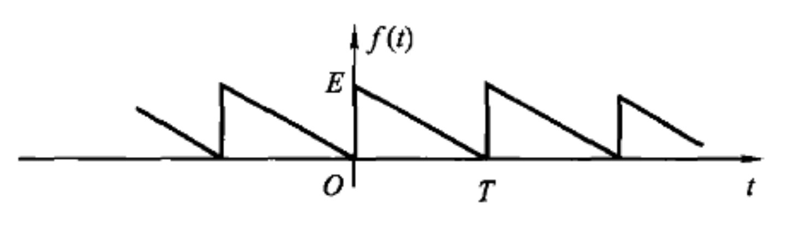
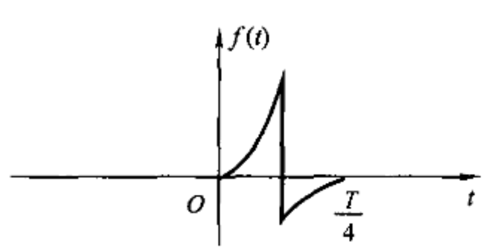
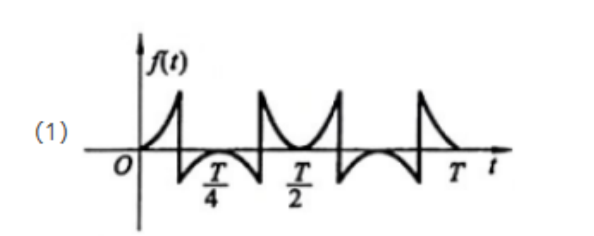
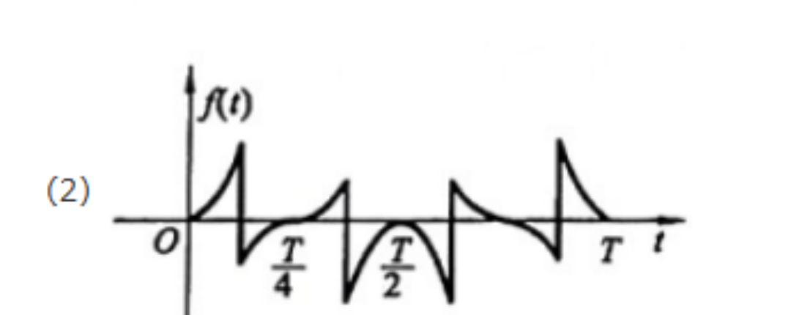
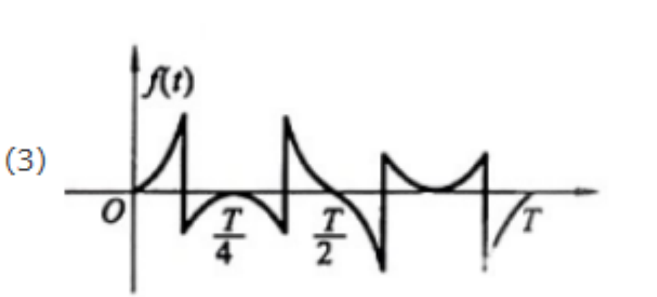
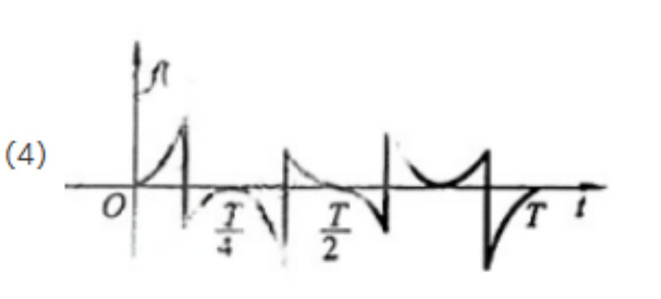

# 信号与系统 第2次作业答案（2024春）

## 题目与答案

### 1

#### 题目

求下图所示周期信号的指数形式傅里叶级数。

#### 答案

**答案：**

$$F_{0}=\frac{E}{2}$$

$$F_{n}=-\frac{jE}{2n\pi},\quad n=\pm 1,\pm 2,\dots$$

$$f(t)=\frac{E}{2}-\frac{jE}{2\pi}e^{j\omega_{1}t}+\frac{jE}{2\pi}e^{-j\omega_{1}t}-\frac{jE}{4\pi}e^{j2\omega_{1}t}+\frac{jE}{4\pi}e^{-j2\omega_{1}t}-\cdots$$

### 2

#### 题目

已知周期信号 $f(t)$ 的前四分之一周期波形如下图所示，根据要求补全一个周期的波形（大致即可）。

(1) $f(t)$ 是偶函数，只有偶次谐波。

(2) $f(t)$ 是偶函数，只有奇次谐波。

(3) $f(t)$ 是奇函数，只有奇次谐波。

(4) $f(t)$ 是奇函数，含有偶次和奇次谐波。

#### 答案

**答案：**

补全波形如下（题目只要求大致即可）。

(1) $f(t)$ 是偶函数，只有偶次谐波：

(2) $f(t)$ 是偶函数，只有奇次谐波：

(3) $f(t)$ 是奇函数，只有奇次谐波：

(4) $f(t)$ 是奇函数，含有偶次和奇次谐波：

### 3

#### 题目

求下列信号的傅里叶变换，并给出求解过程。其中第 (6) 问设 $f(t)$ 的傅里叶变换为 $\mathcal{F}(\omega)$。

(1) $\cos\omega_{0}t$

(2) $\sin\omega_{0}t$

(3) $e^{-2|t-1|}$

(4) $e^{-2(t-1)}u(t-1)$

(5) $\delta(t+1)+\delta(t-1)$

(6) $t\displaystyle\frac{d}{dt}f(t)$

(7) $\displaystyle\frac{d}{dt}\{u(-2-t)+u(t-2)\}$

#### 答案

**答案：**

(1)(2) 的答案使用欧拉公式可以很方便地得到：

(1) $\mathcal{F}[\cos\omega_{0}t]=\pi(\delta(\omega+\omega_{0})+\delta(\omega-\omega_{0}))$

(2) $\mathcal{F}[\sin\omega_{0}t]=j\pi(\delta(\omega+\omega_{0})-\delta(\omega-\omega_{0}))$

上面两个例子考察了傅里叶变换的线性性，和对于复指数运算的熟悉程度。

(3) 答案为 $\displaystyle\frac{4e^{-j\omega}}{4+\omega^{2}}$。

$$\mathcal{F}\left(e^{-\alpha|t|}\right)=\int_{-\infty}^{0}e^{-\alpha t}e^{-j\omega t}\,\mathrm{d}t+\int_{0}^{+\infty}e^{\alpha t}e^{-j\omega t}\,\mathrm{d}t$$

$$=\int_{-\infty}^{0}e^{-(\alpha+j\omega)t}\,\mathrm{d}t+\int_{0}^{+\infty}e^{(\alpha-j\omega)t}\,\mathrm{d}t$$

$$=\frac{-1}{\alpha+j\omega}\int_{-\infty}^{0}e^{-(\alpha+j\omega)t}\,\mathrm{d}[-\alpha+j\omega)t]+\frac{1}{\alpha-j\omega}\int_{0}^{+\infty}e^{(\alpha-j\omega)t}\,\mathrm{d}[(\alpha-j\omega)t]$$

$$=\frac{1}{\alpha+j\omega}+\frac{1}{\alpha-j\omega}=\frac{2\alpha}{\alpha^{2}+\omega^{2}}$$
然后再利用时移性质： $f(t)=e^{2|t|}\Leftrightarrow F(\omega)=\frac{4}{4+\omega^{2}}$，则

$$f(t-1)=e^{2|t-1|}\Leftrightarrow F(\omega)=\frac{4e^{-j\omega}}{4+\omega^{2}}$$

(4) 答案为 $\displaystyle\frac{e^{-j\omega}}{2+j\omega}$。

这题比较简单：求 $\mathcal{F}[e^{-2(t-1)}u(t-1)]$

$$f(t)=e^{-2t}u(t)\Leftrightarrow F(\omega)=\frac{1}{2+j\omega},$$

$$f(t-1)=e^{-2(t-1)}u(t-1)\Leftrightarrow F(\omega)=\frac{4e^{-j\omega}}{4+\omega^{2}}$$

大家可以比较一下补充的这题：求 $\mathcal{F}[e^{-2(t-1)}u(t)]$

$$f(t)=e^{-2t}u(t)\Leftrightarrow F(\omega)=\frac{1}{2+j\omega}$$

$$e^{2}f(t)=e^{-2(t-1)}u(t)\Leftrightarrow F(\omega)=\frac{e^{2}}{2+j\omega}$$

(5) 答案为 $2\cos\omega$。

时移法则；线性性。

(6) 答案为 $-\mathcal{F}(\omega)-\omega\displaystyle\frac{d\mathcal{F}(\omega)}{d\omega}$。

$$\mathcal{F}\left[\frac{d}{dt}f(t)\right]=j\omega\mathcal{F}(\omega)\quad\text{（时域微分）}$$

$$\mathcal{F}\left[-jt\frac{d}{dt}f(t)\right]=j\mathcal{F}(\omega)+j\omega\frac{d}{d\omega}\mathcal{F}(\omega)\quad\text{（频域微分）}$$

$$\mathcal{F}\left[t\frac{d}{dt}f(t)\right]=-\mathcal{F}(\omega)-\omega\frac{d}{d\omega}\mathcal{F}(\omega)$$

时域微分、频域微分的综合应用。

(7) 答案为 $-2j\sin 2\omega$。

$$\frac{d}{dt}\{u(-2-t)+u(t-2)\}=-\delta(-2-t)+\delta(t-2)$$

$$\mathcal{F}[-\delta(-2-t)+\delta(t-2)]=e^{-2j\omega}-e^{2j\omega}=-2j\sin 2\omega$$

### 4

#### 题目

利用时域和频域对称性，求下列信号的傅里叶逆变换。

(1) $\mathcal{F}(\omega)=2\pi\delta(\omega)+\pi\delta(\omega-4\pi)+\pi\delta(\omega+4\pi)$

(2)

$$
\mathcal{F}(\omega)=\begin{cases}
2, & 0\leqslant\omega\leqslant 2\\
-2, & -2\leqslant\omega<0\\
0, & |\omega|>2
\end{cases}
$$

(3) $\mathcal{F}(\omega)=u(\omega+\omega_{0})-u(\omega-\omega_{0})$

#### 答案

**答案：**

(1) 答案为 $1+\cos 4\pi t$。

$$\mathcal{F}[1]=2\pi\delta(\omega)$$

$$\mathcal{F}^{-1}[2\pi\delta(\omega)]=1$$

$$\mathcal{F}^{-1}[2\pi\delta(\omega)+\pi\delta(\omega-4\pi)+\pi\delta(\omega+4\pi)]=1+\frac{1}{2}e^{j4\pi t}+\frac{1}{2}e^{-j4\pi t}=1+\cos 4\pi t$$

(2) 答案为 $\displaystyle\frac{4j\sin^{2}t}{\pi t}$。

令

$$
f(t)=\begin{cases}
2, & 0\leqslant t\leqslant 2\\
-2, & -2\leqslant t<0\\
0, & |t|>2
\end{cases}
$$

可以看成两个矩形脉冲函数的和： $f_{1}(t)=2\ (0\leqslant t\leqslant 2)$， $f_{2}(t)=-2\ (-2\leqslant t<0)$。

$$\mathcal{F}[f_{1}(t)]=4Sa(\omega)e^{-j\omega}$$

$$\mathcal{F}[f_{2}(t)]=-4Sa(\omega)e^{j\omega}$$

$$\mathcal{F}[f(t)]=\mathcal{F}[f_{1}(t)+f_{2}(t)]=Sa(\omega)(4e^{-j\omega}-4e^{j\omega})=-\frac{8j\sin^{2}\omega}{\omega}$$

再由对称性：

$$\mathcal{F}^{-1}(F(\omega))=\frac{1}{2\pi}f(-t)=\frac{4j\sin^{2}t}{\pi t}$$
(3) 答案为 $\displaystyle\frac{\omega_{0}}{\pi}Sa(\omega_{0}t)$。

$$f(t)=u(t+\omega_{0})-u(t-\omega_{0})$$

$$\mathcal{F}[f(t)]=\left(\frac{1}{j\omega}+\pi\delta(\omega)\right)e^{j\omega_{0}\omega}-\left(\frac{1}{j\omega}+\pi\delta(\omega)\right)e^{-j\omega_{0}\omega}$$

$$=\left(\frac{1}{j\omega}+\pi\delta(\omega)\right)2j\sin(\omega_{0}\omega)=F(\omega)$$

$$\mathcal{F}^{-1}[F(\omega)]=\frac{1}{2\pi}f(-t)=\frac{1}{\pi t}\sin\omega_{0}t=\frac{\omega_{0}}{\pi}Sa(\omega_{0}t)$$

第一问需要首先将冲激信号进行时移，利用性质分别得到以 $t$ 为自变量的三个信号的傅里叶变换；然后利用线性性、时频域对称性得到傅里叶逆变换的结果。

第二问考察的有：反褶后的傅里叶变化、线性性。

第三问则是为了加深大家对于 $u(t)$ 这一信号的傅里叶变换的记忆。注意到第二问和第三问都使用到了 $u(t)$ 的傅里叶变换。
