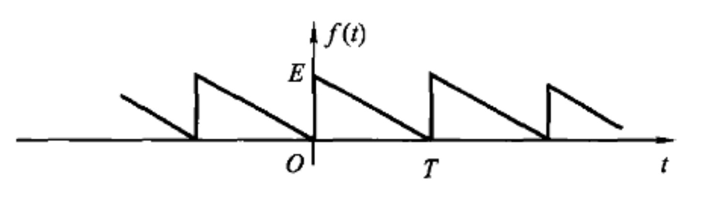
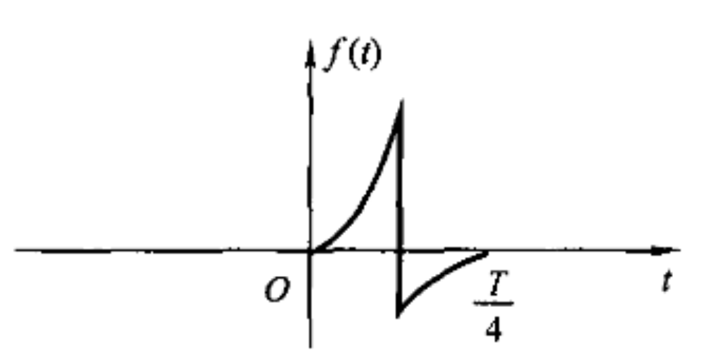

# 信号与系统 第2次作业题目（2024春）

## 题目

### 1

求下图所示周期信号的指数形式傅里叶级数。

### 2

已知周期信号 $f(t)$ 的前四分之一周期波形如下图所示，根据要求补全一个周期的波形（大致即可）。

(1) $f(t)$ 是偶函数，只有偶次谐波。

(2) $f(t)$ 是偶函数，只有奇次谐波。

(3) $f(t)$ 是奇函数，只有奇次谐波。

(4) $f(t)$ 是奇函数，含有偶次和奇次谐波。

### 3

求下列信号的傅里叶变换，并给出求解过程。其中第 (6) 问设 $f(t)$ 的傅里叶变换为 $\mathcal{F}(\omega)$。

(1) $\cos\omega_{0}t$

(2) $\sin\omega_{0}t$

(3) $e^{-2|t-1|}$

(4) $e^{-2(t-1)}u(t-1)$

(5) $\delta(t+1)+\delta(t-1)$

(6) $t\displaystyle\frac{d}{dt}f(t)$

(7) $\displaystyle\frac{d}{dt}\{u(-2-t)+u(t-2)\}$

### 4

利用时域和频域对称性，求下列信号的傅里叶逆变换。

(1) $\mathcal{F}(\omega)=2\pi\delta(\omega)+\pi\delta(\omega-4\pi)+\pi\delta(\omega+4\pi)$

(2)

$$
\mathcal{F}(\omega)=\begin{cases}
2, & 0\leqslant\omega\leqslant 2\\
-2, & -2\leqslant\omega<0\\
0, & |\omega|>2
\end{cases}
$$

(3) $\mathcal{F}(\omega)=u(\omega+\omega_{0})-u(\omega-\omega_{0})$
